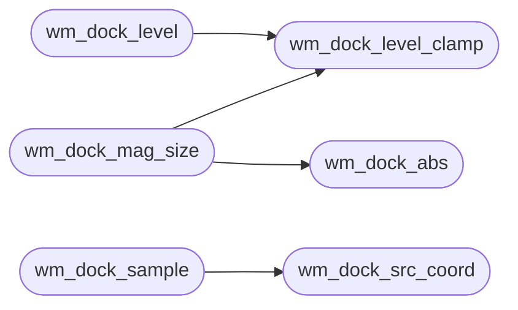

# `headers/wm_dock.h`

> Source: [headers/wm_dock.h:1](../../headers/wm_dock.h#L1) | language `h` | coverage 100.0% | [API index](../index.md)

Docstring: Dock magnification math for the MiniOS desktop.

## Contents

- **Structs:** [`wm_dock_config_t`](#wm_dock_config_t)
- **Functions:** [`wm_dock_abs`](#wm_dock_abs), [`wm_dock_level_clamp`](#wm_dock_level_clamp), [`wm_dock_level`](#wm_dock_level), [`wm_dock_mag_size`](#wm_dock_mag_size), [`wm_dock_src_coord`](#wm_dock_src_coord), [`wm_dock_sample`](#wm_dock_sample)
- **Macros:** [`WM_DOCK_LEVEL_ONE`](#wm_dock_level_one), [`WM_DOCK_REACH_MAX`](#wm_dock_reach_max), [`WM_DOCK_SIZE_MAX`](#wm_dock_size_max), [`WM_DOCK_FRAC_ONE`](#wm_dock_frac_one), [`WM_DOCK_ALPHA_OPAQUE`](#wm_dock_alpha_opaque)

## Call Graph

Solid arrows stay in this module, dashed arrows leave it.



## Structs

<a id="wm_dock_config_t"></a>

### `wm_dock_config_t`

`struct` | [headers/wm_dock.h:39](../../headers/wm_dock.h#L39)

```c
typedef struct
```

Docstring: Centralized magnification configuration, no magic numbers: resting size, size under the pointer, and the distance at which an icon is back to its resting size.

---

## Functions

<a id="wm_dock_abs"></a>

### `wm_dock_abs`

`function` `inline` `static` | [headers/wm_dock.h:46](../../headers/wm_dock.h#L46)

```c
static inline long wm_dock_abs(long v)
```

Docstring: Absolute value of an int without overflow on the minimum.

**Parameters**

| Name | Type | Default | Description |
|---|---|---|---|
| `v` | `long` |  |  |

**Returns:** `long`

*Called by:* [`wm_dock_mag_size`](#wm_dock_mag_size)

---

<a id="wm_dock_level_clamp"></a>

### `wm_dock_level_clamp`

`function` `inline` `static` | [headers/wm_dock.h:52](../../headers/wm_dock.h#L52)

```c
static inline int wm_dock_level_clamp(long level)
```

Docstring: Clamp a level to 0..WM_DOCK_LEVEL_ONE.

**Parameters**

| Name | Type | Default | Description |
|---|---|---|---|
| `level` | `long` |  |  |

**Returns:** `int`

*Called by:* [`wm_dock_level`](#wm_dock_level), [`wm_dock_mag_size`](#wm_dock_mag_size)

---

<a id="wm_dock_level"></a>

### `wm_dock_level`

`function` `inline` `static` | [headers/wm_dock.h:61](../../headers/wm_dock.h#L61)

```c
static inline int wm_dock_level(int from, int rising, unsigned long elapsed, unsigned long duration)
```

Docstring: Magnification level after elapsed ticks of a ramp that started at from: rising toward WM_DOCK_LEVEL_ONE or falling toward 0, linear over duration ticks for the full span.

A non-positive duration jumps to the target.

**Parameters**

| Name | Type | Default | Description |
|---|---|---|---|
| `from` | `int` |  |  |
| `rising` | `int` |  |  |
| `elapsed` | `unsigned long` |  |  |
| `duration` | `unsigned long` |  |  |

**Returns:** `int`

*Calls:* [`wm_dock_level_clamp`](#wm_dock_level_clamp)

---

<a id="wm_dock_mag_size"></a>

### `wm_dock_mag_size`

`function` `inline` `static` | [headers/wm_dock.h:78](../../headers/wm_dock.h#L78)

```c
static inline int wm_dock_mag_size(const wm_dock_config_t *cfg, long dist, int level)
```

Docstring: Size of an icon whose centre lies dist pixels from the pointer, at the given level.

The bell is (1 - t^2)^2 with t = dist / reach: peak under the pointer, base at the reach and beyond, smooth at both ends, symmetric in the sign of dist. The level scales the growth linearly. Returns base on a degenerate configuration, 0 on a null one.

**Parameters**

| Name | Type | Default | Description |
|---|---|---|---|
| `cfg` | `wm_dock_config_t *` |  |  |
| `dist` | `long` |  |  |
| `level` | `int` |  |  |

**Returns:** `int`

*Calls:* [`wm_dock_abs`](#wm_dock_abs), [`wm_dock_level_clamp`](#wm_dock_level_clamp)

---

<a id="wm_dock_src_coord"></a>

### `wm_dock_src_coord`

`function` `inline` `static` | [headers/wm_dock.h:104](../../headers/wm_dock.h#L104)

```c
static inline long wm_dock_src_coord(int o, int d, int s)
```

Docstring: Source coordinate, in 8.8 fixed point, that destination pixel o of a d-pixel span maps to in an s-texel span.

Pixel centres are aligned, so a 1:1 scale maps every pixel onto its own texel, and the result is clamped to the first and last texel centre.

**Parameters**

| Name | Type | Default | Description |
|---|---|---|---|
| `o` | `int` |  |  |
| `d` | `int` |  |  |
| `s` | `int` |  |  |

**Returns:** `long`

*Called by:* [`wm_dock_sample`](#wm_dock_sample)

---

<a id="wm_dock_sample"></a>

### `wm_dock_sample`

`function` `inline` `static` | [headers/wm_dock.h:120](../../headers/wm_dock.h#L120)

```c
static inline unsigned long wm_dock_sample(const unsigned char *rgba, int sw, int sh, int dw, int dh, int ox, int oy, int *alpha)
```

Docstring: Bilinear sample of destination pixel (ox,oy) of an sw by sh RGBA source scaled to dw by dh.

Colours are weighted by alpha, so a transparent texel never darkens the edge of an opaque one. Returns the packed 0x00RRGGBB colour and stores the coverage 0..255 in alpha; a degenerate call returns 0 with alpha 0.

**Parameters**

| Name | Type | Default | Description |
|---|---|---|---|
| `rgba` | `unsigned char *` |  |  |
| `sw` | `int` |  |  |
| `sh` | `int` |  |  |
| `dw` | `int` |  |  |
| `dh` | `int` |  |  |
| `ox` | `int` |  |  |
| `oy` | `int` |  |  |
| `alpha` | `int *` |  |  |

**Returns:** `unsigned long`

*Calls:* [`wm_dock_src_coord`](#wm_dock_src_coord)

---

## Macros

<a id="wm_dock_level_one"></a>

### `WM_DOCK_LEVEL_ONE`

`macro` | [headers/wm_dock.h:21](../../headers/wm_dock.h#L21)

```c
#define WM_DOCK_LEVEL_ONE
```

Docstring: Full magnification level; 0 is a flat dock.

---

<a id="wm_dock_reach_max"></a>

### `WM_DOCK_REACH_MAX`

`macro` | [headers/wm_dock.h:25](../../headers/wm_dock.h#L25)

```c
#define WM_DOCK_REACH_MAX
```

Docstring: Largest reach in pixels; keeps reach^4 times the size span inside 63 bits.

---

<a id="wm_dock_size_max"></a>

### `WM_DOCK_SIZE_MAX`

`macro` | [headers/wm_dock.h:28](../../headers/wm_dock.h#L28)

```c
#define WM_DOCK_SIZE_MAX
```

Docstring: Largest icon size in pixels the curve may produce.

---

<a id="wm_dock_frac_one"></a>

### `WM_DOCK_FRAC_ONE`

`macro` | [headers/wm_dock.h:31](../../headers/wm_dock.h#L31)

```c
#define WM_DOCK_FRAC_ONE
```

Docstring: One source texel in the sampler's 8.8 fixed point.

---

<a id="wm_dock_alpha_opaque"></a>

### `WM_DOCK_ALPHA_OPAQUE`

`macro` | [headers/wm_dock.h:34](../../headers/wm_dock.h#L34)

```c
#define WM_DOCK_ALPHA_OPAQUE
```

Docstring: Fully opaque alpha.

---
