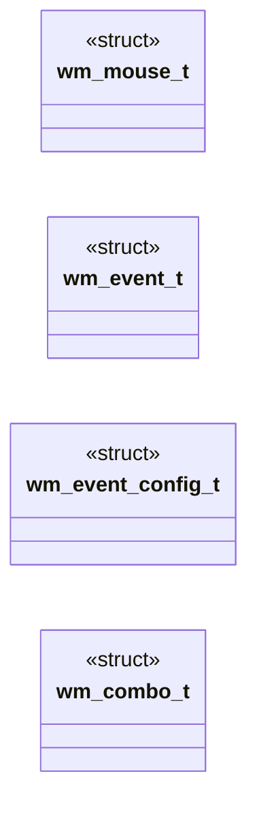
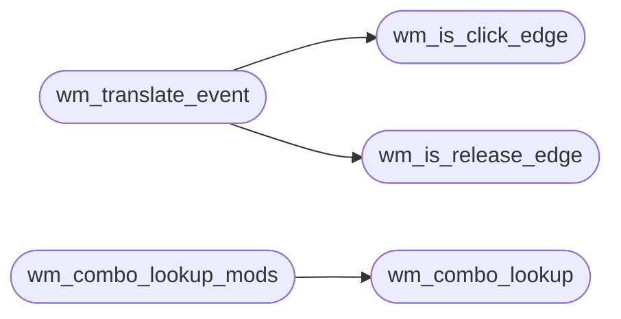

# `headers/wm_events.h`

> Source: [headers/wm_events.h:1](../../headers/wm_events.h#L1) | language `h` | coverage 41.0% | [API index](../index.md)

Docstring: Window event contract for the MiniOS desktop.

## Contents

- **Structs:** [`wm_mouse_t`](#wm_mouse_t), [`wm_event_t`](#wm_event_t), [`wm_event_config_t`](#wm_event_config_t), [`wm_combo_t`](#wm_combo_t)
- **Functions:** [`wm_is_click_edge`](#wm_is_click_edge), [`wm_is_release_edge`](#wm_is_release_edge), [`wm_translate_event`](#wm_translate_event), [`wm_event_suppresses_drag`](#wm_event_suppresses_drag), [`wm_combo_lookup`](#wm_combo_lookup), [`wm_combo_lookup_mods`](#wm_combo_lookup_mods)
- **Macros:** [`WM_EVENT_CONFIG_DEFAULT`](#wm_event_config_default), [`WM_SC_TAB`](#wm_sc_tab), [`WM_SC_ENTER`](#wm_sc_enter), [`WM_SC_MINUS`](#wm_sc_minus), [`WM_SC_EQUAL`](#wm_sc_equal), [`WM_SC_ZERO`](#wm_sc_zero), [`WM_SC_Q`](#wm_sc_q), [`WM_SC_LBRACKET`](#wm_sc_lbracket), [`WM_SC_RBRACKET`](#wm_sc_rbracket), [`WM_SC_M`](#wm_sc_m), [`WM_SC_X`](#wm_sc_x), [`WM_SC_UP`](#wm_sc_up), [`WM_SC_DOWN`](#wm_sc_down), [`WM_SC_LEFT`](#wm_sc_left), [`WM_SC_RIGHT`](#wm_sc_right), [`WM_SC_HOME`](#wm_sc_home), [`WM_SC_END`](#wm_sc_end), [`WM_SNAP_LEFT`](#wm_snap_left), [`WM_SNAP_RIGHT`](#wm_snap_right), [`WM_SNAP_TOP`](#wm_snap_top), [`WM_SNAP_BOTTOM`](#wm_snap_bottom), [`WM_SNAP_TOP_LEFT`](#wm_snap_top_left), [`WM_SNAP_TOP_RIGHT`](#wm_snap_top_right), [`WM_SNAP_BOTTOM_LEFT`](#wm_snap_bottom_left), [`WM_SNAP_BOTTOM_RIGHT`](#wm_snap_bottom_right), [`WM_PATH_COOKED`](#wm_path_cooked), [`WM_PATH_RAW`](#wm_path_raw), [`WM_COMBOS_N`](#wm_combos_n)

## Type Diagram



## Call Graph

Solid arrows stay in this module, dashed arrows leave it.



## Structs

<a id="wm_mouse_t"></a>

### `wm_mouse_t`

`struct` | [headers/wm_events.h:25](../../headers/wm_events.h#L25)

```c
typedef struct
```

Docstring: Raw mouse snapshot consumed by the translator.

---

<a id="wm_event_t"></a>

### `wm_event_t`

`struct` | [headers/wm_events.h:34](../../headers/wm_events.h#L34)

```c
typedef struct
```

Docstring: Translated window manager event.

---

<a id="wm_event_config_t"></a>

### `wm_event_config_t`

`struct` | [headers/wm_events.h:43](../../headers/wm_events.h#L43)

```c
typedef struct
```

Docstring: Centralized event translator configuration.

---

<a id="wm_combo_t"></a>

### `wm_combo_t`

`struct` | [headers/wm_events.h:158](../../headers/wm_events.h#L158)

```c
typedef struct
```

Docstring: One row of the shared Alt/Super combo table.

---

## Functions

<a id="wm_is_click_edge"></a>

### `wm_is_click_edge`

`function` `inline` `static` | [headers/wm_events.h:52](../../headers/wm_events.h#L52)

```c
static inline int wm_is_click_edge(const wm_event_config_t *cfg, int prev_buttons, int curr_buttons)
```

Docstring: True on the rising edge of the left button.

**Parameters**

| Name | Type | Default | Description |
|---|---|---|---|
| `cfg` | `wm_event_config_t *` |  |  |
| `prev_buttons` | `int` |  |  |
| `curr_buttons` | `int` |  |  |

**Returns:** `int`

*Called by:* [`wm_translate_event`](#wm_translate_event), [`vga_fb_mouse_tick`](kernel.vga_fb.c.md#vga_fb_mouse_tick)

---

<a id="wm_is_release_edge"></a>

### `wm_is_release_edge`

`function` `inline` `static` | [headers/wm_events.h:59](../../headers/wm_events.h#L59)

```c
static inline int wm_is_release_edge(const wm_event_config_t *cfg, int prev_buttons, int curr_buttons)
```

Docstring: True on the falling edge of the left button.

**Parameters**

| Name | Type | Default | Description |
|---|---|---|---|
| `cfg` | `wm_event_config_t *` |  |  |
| `prev_buttons` | `int` |  |  |
| `curr_buttons` | `int` |  |  |

**Returns:** `int`

*Called by:* [`wm_translate_event`](#wm_translate_event)

---

<a id="wm_translate_event"></a>

### `wm_translate_event`

`function` `inline` `static` | [headers/wm_events.h:66](../../headers/wm_events.h#L66)

```c
static inline wm_event_t wm_translate_event(const wm_event_config_t *cfg, const wm_mouse_t *prev, const wm_mouse_t *curr)
```

Docstring: Translate two consecutive mouse snapshots into one event.

**Parameters**

| Name | Type | Default | Description |
|---|---|---|---|
| `cfg` | `wm_event_config_t *` |  |  |
| `prev` | `wm_mouse_t *` |  |  |
| `curr` | `wm_mouse_t *` |  |  |

**Returns:** `wm_event_t`

*Calls:* [`wm_is_click_edge`](#wm_is_click_edge), [`wm_is_release_edge`](#wm_is_release_edge)

---

<a id="wm_event_suppresses_drag"></a>

### `wm_event_suppresses_drag`

`function` `inline` `static` | [headers/wm_events.h:104](../../headers/wm_events.h#L104)

```c
static inline int wm_event_suppresses_drag(const wm_event_t *evt)
```

Docstring: True when the event must suppress a title drag on this tick.

**Parameters**

| Name | Type | Default | Description |
|---|---|---|---|
| `evt` | `wm_event_t *` |  |  |

**Returns:** `int`

---

<a id="wm_combo_lookup"></a>

### `wm_combo_lookup`

`function` `inline` `static` | [headers/wm_events.h:201](../../headers/wm_events.h#L201)

```c
static inline int wm_combo_lookup(int alt, int altgr, int sup, int e0, int sc, int path, int *zone_out)
```

Docstring: Lookup one Alt/Super combo, fail closed on AltGr or mismatch.

**Parameters**

| Name | Type | Default | Description |
|---|---|---|---|
| `alt` | `int` |  |  |
| `altgr` | `int` |  |  |
| `sup` | `int` |  |  |
| `e0` | `int` |  |  |
| `sc` | `int` |  |  |
| `path` | `int` |  |  |
| `zone_out` | `int *` |  |  |

**Returns:** `int`

*Called by:* [`wm_combo_lookup_mods`](#wm_combo_lookup_mods)

---

<a id="wm_combo_lookup_mods"></a>

### `wm_combo_lookup_mods`

`function` `inline` `static` | [headers/wm_events.h:238](../../headers/wm_events.h#L238)

```c
static inline int wm_combo_lookup_mods(const modifier_state_t *st, int e0, int sc, int path, int *zone_out)
```

Docstring: Lookup through one modifier state, AltGr fail-closed.

**Parameters**

| Name | Type | Default | Description |
|---|---|---|---|
| `st` | `modifier_state_t *` |  |  |
| `e0` | `int` |  |  |
| `sc` | `int` |  |  |
| `path` | `int` |  |  |
| `zone_out` | `int *` |  |  |

**Returns:** `int`

*Calls:* [`wm_combo_lookup`](#wm_combo_lookup)

*Called by:* [`key`](drivers.kbd.c.md#key)

---

## Macros

<a id="wm_event_config_default"></a>

### `WM_EVENT_CONFIG_DEFAULT`

`macro` | [headers/wm_events.h:49](../../headers/wm_events.h#L49)

```c
#define WM_EVENT_CONFIG_DEFAULT
```

Docstring: Default event configuration matching the PS/2 mouse path.

---

<a id="wm_sc_tab"></a>

### `WM_SC_TAB`

`macro` | [headers/wm_events.h:110](../../headers/wm_events.h#L110)

```c
#define WM_SC_TAB
```

Docstring: Set-1 scancode ids for every key the WM consumes.

---

<a id="wm_sc_enter"></a>

### `WM_SC_ENTER`

`macro` | [headers/wm_events.h:111](../../headers/wm_events.h#L111)

```c
#define WM_SC_ENTER
```

---

<a id="wm_sc_minus"></a>

### `WM_SC_MINUS`

`macro` | [headers/wm_events.h:112](../../headers/wm_events.h#L112)

```c
#define WM_SC_MINUS
```

---

<a id="wm_sc_equal"></a>

### `WM_SC_EQUAL`

`macro` | [headers/wm_events.h:113](../../headers/wm_events.h#L113)

```c
#define WM_SC_EQUAL
```

---

<a id="wm_sc_zero"></a>

### `WM_SC_ZERO`

`macro` | [headers/wm_events.h:114](../../headers/wm_events.h#L114)

```c
#define WM_SC_ZERO
```

---

<a id="wm_sc_q"></a>

### `WM_SC_Q`

`macro` | [headers/wm_events.h:115](../../headers/wm_events.h#L115)

```c
#define WM_SC_Q
```

---

<a id="wm_sc_lbracket"></a>

### `WM_SC_LBRACKET`

`macro` | [headers/wm_events.h:116](../../headers/wm_events.h#L116)

```c
#define WM_SC_LBRACKET
```

---

<a id="wm_sc_rbracket"></a>

### `WM_SC_RBRACKET`

`macro` | [headers/wm_events.h:117](../../headers/wm_events.h#L117)

```c
#define WM_SC_RBRACKET
```

---

<a id="wm_sc_m"></a>

### `WM_SC_M`

`macro` | [headers/wm_events.h:118](../../headers/wm_events.h#L118)

```c
#define WM_SC_M
```

---

<a id="wm_sc_x"></a>

### `WM_SC_X`

`macro` | [headers/wm_events.h:119](../../headers/wm_events.h#L119)

```c
#define WM_SC_X
```

---

<a id="wm_sc_up"></a>

### `WM_SC_UP`

`macro` | [headers/wm_events.h:120](../../headers/wm_events.h#L120)

```c
#define WM_SC_UP
```

---

<a id="wm_sc_down"></a>

### `WM_SC_DOWN`

`macro` | [headers/wm_events.h:121](../../headers/wm_events.h#L121)

```c
#define WM_SC_DOWN
```

---

<a id="wm_sc_left"></a>

### `WM_SC_LEFT`

`macro` | [headers/wm_events.h:122](../../headers/wm_events.h#L122)

```c
#define WM_SC_LEFT
```

---

<a id="wm_sc_right"></a>

### `WM_SC_RIGHT`

`macro` | [headers/wm_events.h:123](../../headers/wm_events.h#L123)

```c
#define WM_SC_RIGHT
```

---

<a id="wm_sc_home"></a>

### `WM_SC_HOME`

`macro` | [headers/wm_events.h:124](../../headers/wm_events.h#L124)

```c
#define WM_SC_HOME
```

---

<a id="wm_sc_end"></a>

### `WM_SC_END`

`macro` | [headers/wm_events.h:125](../../headers/wm_events.h#L125)

```c
#define WM_SC_END
```

---

<a id="wm_snap_left"></a>

### `WM_SNAP_LEFT`

`macro` | [headers/wm_events.h:128](../../headers/wm_events.h#L128)

```c
#define WM_SNAP_LEFT
```

Docstring: Snap targets matching the TILING_* order left to bottom-right.

---

<a id="wm_snap_right"></a>

### `WM_SNAP_RIGHT`

`macro` | [headers/wm_events.h:129](../../headers/wm_events.h#L129)

```c
#define WM_SNAP_RIGHT
```

---

<a id="wm_snap_top"></a>

### `WM_SNAP_TOP`

`macro` | [headers/wm_events.h:130](../../headers/wm_events.h#L130)

```c
#define WM_SNAP_TOP
```

---

<a id="wm_snap_bottom"></a>

### `WM_SNAP_BOTTOM`

`macro` | [headers/wm_events.h:131](../../headers/wm_events.h#L131)

```c
#define WM_SNAP_BOTTOM
```

---

<a id="wm_snap_top_left"></a>

### `WM_SNAP_TOP_LEFT`

`macro` | [headers/wm_events.h:132](../../headers/wm_events.h#L132)

```c
#define WM_SNAP_TOP_LEFT
```

---

<a id="wm_snap_top_right"></a>

### `WM_SNAP_TOP_RIGHT`

`macro` | [headers/wm_events.h:133](../../headers/wm_events.h#L133)

```c
#define WM_SNAP_TOP_RIGHT
```

---

<a id="wm_snap_bottom_left"></a>

### `WM_SNAP_BOTTOM_LEFT`

`macro` | [headers/wm_events.h:134](../../headers/wm_events.h#L134)

```c
#define WM_SNAP_BOTTOM_LEFT
```

---

<a id="wm_snap_bottom_right"></a>

### `WM_SNAP_BOTTOM_RIGHT`

`macro` | [headers/wm_events.h:135](../../headers/wm_events.h#L135)

```c
#define WM_SNAP_BOTTOM_RIGHT
```

---

<a id="wm_path_cooked"></a>

### `WM_PATH_COOKED`

`macro` | [headers/wm_events.h:138](../../headers/wm_events.h#L138)

```c
#define WM_PATH_COOKED
```

Docstring: Input paths sharing one combo table.

---

<a id="wm_path_raw"></a>

### `WM_PATH_RAW`

`macro` | [headers/wm_events.h:139](../../headers/wm_events.h#L139)

```c
#define WM_PATH_RAW
```

---

<a id="wm_combos_n"></a>

### `WM_COMBOS_N`

`macro` | [headers/wm_events.h:198](../../headers/wm_events.h#L198)

```c
#define WM_COMBOS_N
```

Docstring: Row count of the shared combo table.

---
