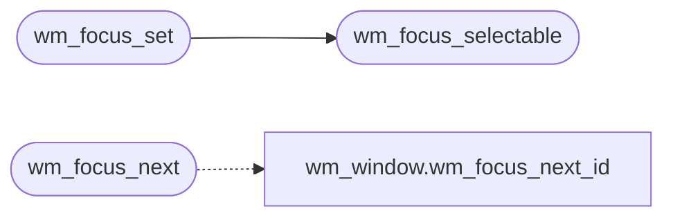

# `headers/wm_focus.h`

> Source: [headers/wm_focus.h:1](../../headers/wm_focus.h#L1) | language `h` | coverage 100.0% | [API index](../index.md)

Docstring: Focus manager contract for the MiniOS desktop.

## Contents

- **Structs:** [`wm_focus_state_t`](#wm_focus_state_t)
- **Functions:** [`wm_focus_selectable`](#wm_focus_selectable), [`wm_focus_next`](#wm_focus_next), [`wm_focus_set`](#wm_focus_set)

## Call Graph

Solid arrows stay in this module, dashed arrows leave it.



## Structs

<a id="wm_focus_state_t"></a>

### `wm_focus_state_t`

`struct` | [headers/wm_focus.h:15](../../headers/wm_focus.h#L15)

```c
typedef struct
```

Docstring: Focus state snapshot consumed by every transition.

---

## Functions

<a id="wm_focus_selectable"></a>

### `wm_focus_selectable`

`function` `inline` `static` | [headers/wm_focus.h:23](../../headers/wm_focus.h#L23)

```c
static inline int wm_focus_selectable(const wm_focus_state_t *st, int id)
```

Docstring: True when id is a selectable focus target in this state.

**Parameters**

| Name | Type | Default | Description |
|---|---|---|---|
| `st` | `wm_focus_state_t *` |  |  |
| `id` | `int` |  |  |

**Returns:** `int`

*Called by:* [`wm_focus_set`](#wm_focus_set), [`vga_fb_focus_next`](kernel.vga_fb.c.md#vga_fb_focus_next)

---

<a id="wm_focus_next"></a>

### `wm_focus_next`

`function` `inline` `static` | [headers/wm_focus.h:38](../../headers/wm_focus.h#L38)

```c
static inline int wm_focus_next(const wm_focus_state_t *st)
```

Docstring: Next focus id in rotation order, unchanged when < 2 targets.

**Parameters**

| Name | Type | Default | Description |
|---|---|---|---|
| `st` | `wm_focus_state_t *` |  |  |

**Returns:** `int`

*Calls:* [`wm_focus_next_id`](headers.wm_window.h.md#wm_focus_next_id)

*Called by:* [`vga_fb_focus_next`](kernel.vga_fb.c.md#vga_fb_focus_next)

---

<a id="wm_focus_set"></a>

### `wm_focus_set`

`function` `inline` `static` | [headers/wm_focus.h:55](../../headers/wm_focus.h#L55)

```c
static inline int wm_focus_set(const wm_focus_state_t *st, int id)
```

Docstring: Validated focus assignment, -1 when id is not selectable.

**Parameters**

| Name | Type | Default | Description |
|---|---|---|---|
| `st` | `wm_focus_state_t *` |  |  |
| `id` | `int` |  |  |

**Returns:** `int`

*Calls:* [`wm_focus_selectable`](#wm_focus_selectable)

*Called by:* [`vga_fb_focus_id`](kernel.vga_fb.c.md#vga_fb_focus_id)

---
