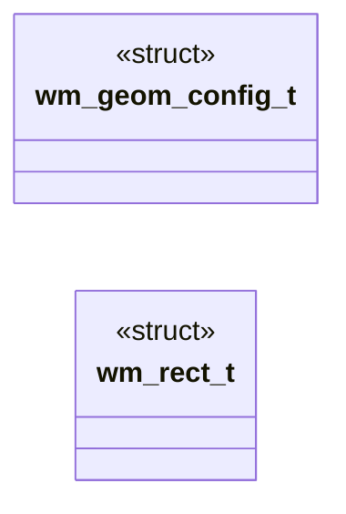
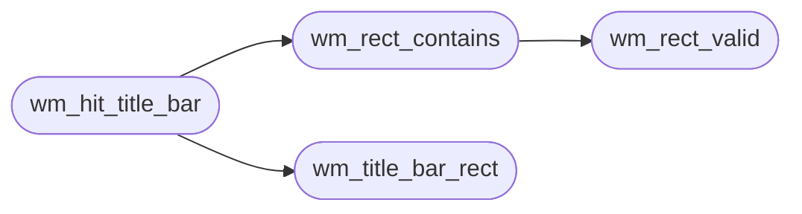

# `headers/wm_geom.h`

> Source: [headers/wm_geom.h:1](../../headers/wm_geom.h#L1) | language `h` | coverage 100.0% | [API index](../index.md)

Docstring: Window geometry contract for the MiniOS desktop.

## Contents

- **Structs:** [`wm_geom_config_t`](#wm_geom_config_t), [`wm_rect_t`](#wm_rect_t)
- **Functions:** [`wm_rect_valid`](#wm_rect_valid), [`wm_rect_contains`](#wm_rect_contains), [`wm_title_bar_rect`](#wm_title_bar_rect), [`wm_content_rect`](#wm_content_rect), [`wm_scrollbar_rect`](#wm_scrollbar_rect), [`wm_hit_title_bar`](#wm_hit_title_bar), [`wm_clamp_point`](#wm_clamp_point)
- **Macros:** [`WM_GEOM_CONFIG_DEFAULT`](#wm_geom_config_default)

## Type Diagram



## Call Graph

Solid arrows stay in this module, dashed arrows leave it.



## Structs

<a id="wm_geom_config_t"></a>

### `wm_geom_config_t`

`struct` | [headers/wm_geom.h:14](../../headers/wm_geom.h#L14)

```c
typedef struct
```

Docstring: Centralized geometry configuration for one WM layout engine.

---

<a id="wm_rect_t"></a>

### `wm_rect_t`

`struct` | [headers/wm_geom.h:25](../../headers/wm_geom.h#L25)

```c
typedef struct
```

Docstring: Axis-aligned rectangle in framebuffer pixels.

---

## Functions

<a id="wm_rect_valid"></a>

### `wm_rect_valid`

`function` `inline` `static` | [headers/wm_geom.h:33](../../headers/wm_geom.h#L33)

```c
static inline int wm_rect_valid(const wm_rect_t *r)
```

Docstring: True when the rectangle can contain any point.

**Parameters**

| Name | Type | Default | Description |
|---|---|---|---|
| `r` | `wm_rect_t *` |  |  |

**Returns:** `int`

*Called by:* [`wm_rect_contains`](#wm_rect_contains)

---

<a id="wm_rect_contains"></a>

### `wm_rect_contains`

`function` `inline` `static` | [headers/wm_geom.h:39](../../headers/wm_geom.h#L39)

```c
static inline int wm_rect_contains(const wm_rect_t *r, int px, int py)
```

Docstring: True when point px,py lies inside rectangle r.

**Parameters**

| Name | Type | Default | Description |
|---|---|---|---|
| `r` | `wm_rect_t *` |  |  |
| `px` | `int` |  |  |
| `py` | `int` |  |  |

**Returns:** `int`

*Calls:* [`wm_rect_valid`](#wm_rect_valid)

*Called by:* [`wm_hit_title_bar`](#wm_hit_title_bar), [`wm_window_contains`](headers.wm_window.h.md#wm_window_contains)

---

<a id="wm_title_bar_rect"></a>

### `wm_title_bar_rect`

`function` `inline` `static` | [headers/wm_geom.h:48](../../headers/wm_geom.h#L48)

```c
static inline wm_rect_t wm_title_bar_rect(const wm_geom_config_t *cfg, int px, int py, int w)
```

Docstring: Title bar strip for a window at px,py with total width w.

**Parameters**

| Name | Type | Default | Description |
|---|---|---|---|
| `cfg` | `wm_geom_config_t *` |  |  |
| `px` | `int` |  |  |
| `py` | `int` |  |  |
| `w` | `int` |  |  |

**Returns:** `wm_rect_t`

*Called by:* [`wm_hit_title_bar`](#wm_hit_title_bar)

---

<a id="wm_content_rect"></a>

### `wm_content_rect`

`function` `inline` `static` | [headers/wm_geom.h:59](../../headers/wm_geom.h#L59)

```c
static inline wm_rect_t wm_content_rect(const wm_geom_config_t *cfg, int px, int py, int w, int h)
```

Docstring: Text content area below the title bar.

**Parameters**

| Name | Type | Default | Description |
|---|---|---|---|
| `cfg` | `wm_geom_config_t *` |  |  |
| `px` | `int` |  |  |
| `py` | `int` |  |  |
| `w` | `int` |  |  |
| `h` | `int` |  |  |

**Returns:** `wm_rect_t`

---

<a id="wm_scrollbar_rect"></a>

### `wm_scrollbar_rect`

`function` `inline` `static` | [headers/wm_geom.h:71](../../headers/wm_geom.h#L71)

```c
static inline wm_rect_t wm_scrollbar_rect(const wm_geom_config_t *cfg, int px, int py, int content_w, int content_h)
```

Docstring: Scrollbar strip at the right edge of the content area.

**Parameters**

| Name | Type | Default | Description |
|---|---|---|---|
| `cfg` | `wm_geom_config_t *` |  |  |
| `px` | `int` |  |  |
| `py` | `int` |  |  |
| `content_w` | `int` |  |  |
| `content_h` | `int` |  |  |

**Returns:** `wm_rect_t`

---

<a id="wm_hit_title_bar"></a>

### `wm_hit_title_bar`

`function` `inline` `static` | [headers/wm_geom.h:84](../../headers/wm_geom.h#L84)

```c
static inline int wm_hit_title_bar(const wm_geom_config_t *cfg, int wx, int wy, int w, int px, int py)
```

Docstring: True when point px,py hits the title bar of a window at wx,wy with total width w.

**Parameters**

| Name | Type | Default | Description |
|---|---|---|---|
| `cfg` | `wm_geom_config_t *` |  |  |
| `wx` | `int` |  |  |
| `wy` | `int` |  |  |
| `w` | `int` |  |  |
| `px` | `int` |  |  |
| `py` | `int` |  |  |

**Returns:** `int`

*Calls:* [`wm_rect_contains`](#wm_rect_contains), [`wm_title_bar_rect`](#wm_title_bar_rect)

*Called by:* [`wm_window_title_hits`](headers.wm_window.h.md#wm_window_title_hits), [`pointer`](kernel.vga_fb.c.md#pointer)

---

<a id="wm_clamp_point"></a>

### `wm_clamp_point`

`function` `inline` `static` | [headers/wm_geom.h:91](../../headers/wm_geom.h#L91)

```c
static inline void wm_clamp_point(int *px, int *py, int fb_w, int fb_h)
```

Docstring: Clamp a point into the framebuffer bounds.

**Parameters**

| Name | Type | Default | Description |
|---|---|---|---|
| `px` | `int *` |  |  |
| `py` | `int *` |  |  |
| `fb_w` | `int` |  |  |
| `fb_h` | `int` |  |  |

*Called by:* [`vga_fb_mouse_tick`](kernel.vga_fb.c.md#vga_fb_mouse_tick)

---

## Macros

<a id="wm_geom_config_default"></a>

### `WM_GEOM_CONFIG_DEFAULT`

`macro` | [headers/wm_geom.h:22](../../headers/wm_geom.h#L22)

```c
#define WM_GEOM_CONFIG_DEFAULT
```

Docstring: Default geometry matching the kernel 8x8 font layout.

---
