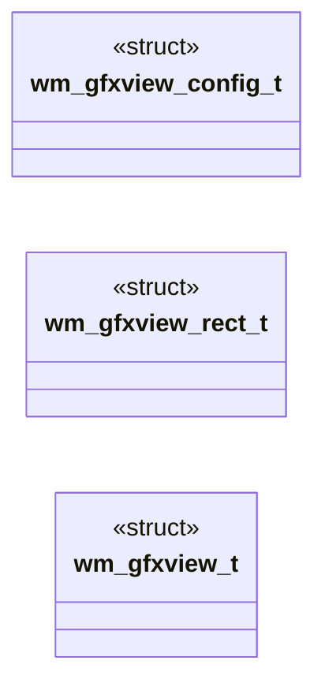
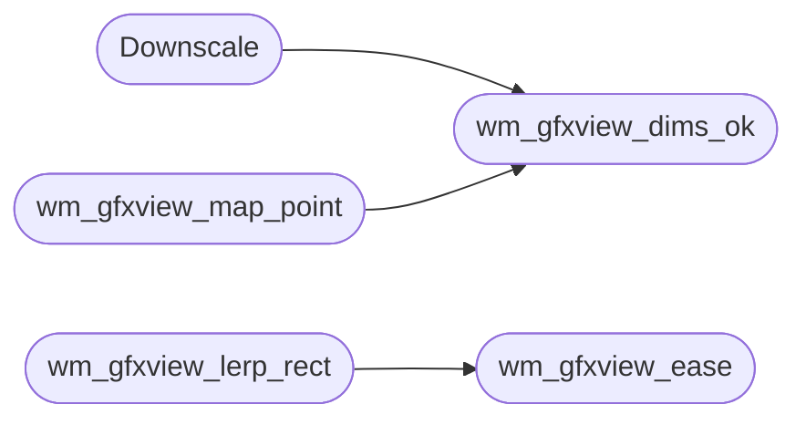

# `headers/wm_gfxview.h`

> Source: [headers/wm_gfxview.h:1](../../headers/wm_gfxview.h#L1) | language `h` | coverage 93.3% | [API index](../index.md)

Docstring: Graphics-window view contract for the MiniOS desktop.

## Contents

- **Structs:** [`wm_gfxview_config_t`](#wm_gfxview_config_t), [`wm_gfxview_rect_t`](#wm_gfxview_rect_t), [`wm_gfxview_t`](#wm_gfxview_t)
- **Functions:** [`wm_gfxview_mode_name`](#wm_gfxview_mode_name), [`wm_gfxview_dims_ok`](#wm_gfxview_dims_ok), [`Downscale`](#downscale), [`wm_gfxview_clamp`](#wm_gfxview_clamp), [`wm_gfxview_place_content`](#wm_gfxview_place_content), [`wm_gfxview_map_point`](#wm_gfxview_map_point), [`wm_gfxview_ease`](#wm_gfxview_ease), [`wm_gfxview_lerp_rect`](#wm_gfxview_lerp_rect), [`wm_gfxview_rect_same`](#wm_gfxview_rect_same)
- **Macros:** [`WM_GFXVIEW_CONFIG_DEFAULT`](#wm_gfxview_config_default), [`WM_GFXVIEW_DIM_MAX`](#wm_gfxview_dim_max)

## Type Diagram



## Call Graph

Solid arrows stay in this module, dashed arrows leave it.



## Structs

<a id="wm_gfxview_config_t"></a>

### `wm_gfxview_config_t`

`struct` | [headers/wm_gfxview.h:31](../../headers/wm_gfxview.h#L31)

```c
typedef struct
```

Docstring: Centralized view configuration, no magic numbers.

---

<a id="wm_gfxview_rect_t"></a>

### `wm_gfxview_rect_t`

`struct` | [headers/wm_gfxview.h:47](../../headers/wm_gfxview.h#L47)

```c
typedef struct
```

Docstring: One axis-aligned rectangle in framebuffer pixels.

---

<a id="wm_gfxview_t"></a>

### `wm_gfxview_t`

`struct` | [headers/wm_gfxview.h:56](../../headers/wm_gfxview.h#L56)

```c
typedef struct
```

Docstring: One computed view: frame (chrome plus content area), title strip height (0 in fullscreen) and the scaled content rect.

---

## Functions

<a id="wm_gfxview_mode_name"></a>

### `wm_gfxview_mode_name`

`function` `const` `inline` `static` | [headers/wm_gfxview.h:64](../../headers/wm_gfxview.h#L64)

```c
static inline const char *wm_gfxview_mode_name(int mode)
```

Docstring: Human name for one view mode, else zero.

**Parameters**

| Name | Type | Default | Description |
|---|---|---|---|
| `mode` | `int` |  |  |

**Returns:** `char *`

*Called by:* [`vga_fb_gfx_view_name`](kernel.vga_fb.c.md#vga_fb_gfx_view_name), [`vga_fb_list_windows`](kernel.vga_fb.c.md#vga_fb_list_windows)

---

<a id="wm_gfxview_dims_ok"></a>

### `wm_gfxview_dims_ok`

`function` `inline` `static` | [headers/wm_gfxview.h:79](../../headers/wm_gfxview.h#L79)

```c
static inline int wm_gfxview_dims_ok(int w, int h)
```

Docstring: True when every edge lies in the accepted range.

**Parameters**

| Name | Type | Default | Description |
|---|---|---|---|
| `w` | `int` |  |  |
| `h` | `int` |  |  |

**Returns:** `int`

*Called by:* [`Downscale`](#downscale), [`wm_gfxview_map_point`](#wm_gfxview_map_point)

---

<a id="downscale"></a>

### `Downscale`

`function` | [headers/wm_gfxview.h:88](../../headers/wm_gfxview.h#L88)

```c
* Downscale (fit below 1x) always takes the exact fit. Returns 1 on * success, 0 on degenerate i...
```

**Parameters**

| Name | Type | Default | Description |
|---|---|---|---|
| `x` | `fit below 1` |  |  |

**Returns:** `*`

*Calls:* [`wm_gfxview_dims_ok`](#wm_gfxview_dims_ok)

---

<a id="wm_gfxview_clamp"></a>

### `wm_gfxview_clamp`

`function` `inline` `static` | [headers/wm_gfxview.h:134](../../headers/wm_gfxview.h#L134)

```c
static inline void wm_gfxview_clamp(wm_gfxview_rect_t *r, int fb_w, int fb_h)
```

Docstring: Clamp a rect inside the framebuffer by moving, then by shrinking when it is larger than the screen.

**Parameters**

| Name | Type | Default | Description |
|---|---|---|---|
| `r` | `wm_gfxview_rect_t *` |  |  |
| `fb_w` | `int` |  |  |
| `fb_h` | `int` |  |  |

---

<a id="wm_gfxview_place_content"></a>

### `wm_gfxview_place_content`

`function` `inline` `static` | [headers/wm_gfxview.h:160](../../headers/wm_gfxview.h#L160)

```c
static inline int wm_gfxview_place_content(const wm_gfxview_config_t *cfg, int sw, int sh, const wm_gfxview_rect_t *area, wm_gfxview_rect_t *out)
```

Docstring: Center an aspect-fit content rect inside an area.

**Parameters**

| Name | Type | Default | Description |
|---|---|---|---|
| `cfg` | `wm_gfxview_config_t *` |  |  |
| `sw` | `int` |  |  |
| `sh` | `int` |  |  |
| `area` | `wm_gfxview_rect_t *` |  |  |
| `out` | `wm_gfxview_rect_t *` |  |  |

**Returns:** `int`

---

<a id="wm_gfxview_map_point"></a>

### `wm_gfxview_map_point`

`function` `inline` `static` | [headers/wm_gfxview.h:255](../../headers/wm_gfxview.h#L255)

```c
static inline int wm_gfxview_map_point(const wm_gfxview_t *v, int sw, int sh, int mx, int my, int *vx, int *vy)
```

Docstring: Map a framebuffer point into back-buffer space.

Inside the content rect the point scales exactly into [0, sw) x [0, sh); outside it clamps to the nearest edge so a drag that leaves the window keeps tracking. The result is reported as content origin plus local offset, which is the coordinate space apps already subtract their reported origin from. Returns 1 when the point was inside, 0 when it was clamped, -1 on degenerate input.

**Parameters**

| Name | Type | Default | Description |
|---|---|---|---|
| `v` | `wm_gfxview_t *` |  |  |
| `sw` | `int` |  |  |
| `sh` | `int` |  |  |
| `mx` | `int` |  |  |
| `my` | `int` |  |  |
| `vx` | `int *` |  |  |
| `vy` | `int *` |  |  |

**Returns:** `int`

*Calls:* [`wm_gfxview_dims_ok`](#wm_gfxview_dims_ok)

*Called by:* [`vga_fb_gfx_map_mouse`](kernel.vga_fb.c.md#vga_fb_gfx_map_mouse)

---

<a id="wm_gfxview_ease"></a>

### `wm_gfxview_ease`

`function` `inline` `static` | [headers/wm_gfxview.h:291](../../headers/wm_gfxview.h#L291)

```c
static inline long wm_gfxview_ease(int t, int n, long den)
```

Docstring: Ease-out cubic progress in [0, den] for step t of n.

1 - (1 - t/n)^3 in integer arithmetic: fast start, soft landing, monotonic, exactly 0 at t = 0 and exactly den at t = n.

**Parameters**

| Name | Type | Default | Description |
|---|---|---|---|
| `t` | `int` |  |  |
| `n` | `int` |  |  |
| `den` | `long` |  |  |

**Returns:** `long`

*Called by:* [`wm_gfxview_lerp_rect`](#wm_gfxview_lerp_rect)

---

<a id="wm_gfxview_lerp_rect"></a>

### `wm_gfxview_lerp_rect`

`function` `inline` `static` | [headers/wm_gfxview.h:313](../../headers/wm_gfxview.h#L313)

```c
static inline int wm_gfxview_lerp_rect(const wm_gfxview_rect_t *a, const wm_gfxview_rect_t *b, int t, int n, wm_gfxview_rect_t *out)
```

Docstring: Interpolate one rect between a and b at eased step t of n.

**Parameters**

| Name | Type | Default | Description |
|---|---|---|---|
| `a` | `wm_gfxview_rect_t *` |  |  |
| `b` | `wm_gfxview_rect_t *` |  |  |
| `t` | `int` |  |  |
| `n` | `int` |  |  |
| `out` | `wm_gfxview_rect_t *` |  |  |

**Returns:** `int`

*Calls:* [`wm_gfxview_ease`](#wm_gfxview_ease)

---

<a id="wm_gfxview_rect_same"></a>

### `wm_gfxview_rect_same`

`function` `inline` `static` | [headers/wm_gfxview.h:336](../../headers/wm_gfxview.h#L336)

```c
static inline int wm_gfxview_rect_same(const wm_gfxview_rect_t *a, const wm_gfxview_rect_t *b)
```

Docstring: True when two rects are identical.

**Parameters**

| Name | Type | Default | Description |
|---|---|---|---|
| `a` | `wm_gfxview_rect_t *` |  |  |
| `b` | `wm_gfxview_rect_t *` |  |  |

**Returns:** `int`

---

## Macros

<a id="wm_gfxview_config_default"></a>

### `WM_GFXVIEW_CONFIG_DEFAULT`

`macro` | [headers/wm_gfxview.h:41](../../headers/wm_gfxview.h#L41)

```c
#define WM_GFXVIEW_CONFIG_DEFAULT
```

Docstring: Default view: 8 px title, integer scale kept when it covers at least 7/8 of the fit, 10 animation frames at 16 ms.

---

<a id="wm_gfxview_dim_max"></a>

### `WM_GFXVIEW_DIM_MAX`

`macro` | [headers/wm_gfxview.h:44](../../headers/wm_gfxview.h#L44)

```c
#define WM_GFXVIEW_DIM_MAX
```

Docstring: Largest source or destination edge the math accepts.

---
