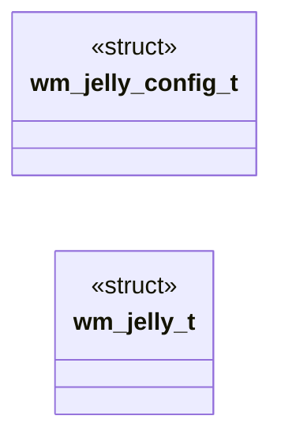
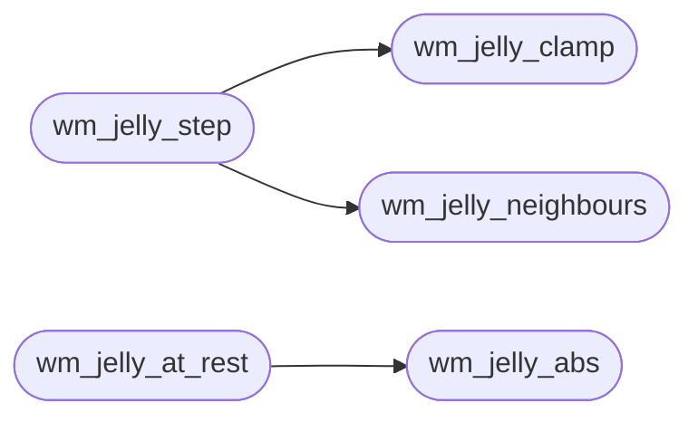

# `headers/wm_jelly.h`

> Source: [headers/wm_jelly.h:1](../../headers/wm_jelly.h#L1) | language `h` | coverage 100.0% | [API index](../index.md)

Docstring: Wobbly-window spring mesh contract for the MiniOS desktop.

## Contents

- **Structs:** [`wm_jelly_config_t`](#wm_jelly_config_t), [`wm_jelly_t`](#wm_jelly_t)
- **Functions:** [`wm_jelly_clamp`](#wm_jelly_clamp), [`wm_jelly_abs`](#wm_jelly_abs), [`wm_jelly_reset`](#wm_jelly_reset), [`wm_jelly_neighbours`](#wm_jelly_neighbours), [`wm_jelly_step`](#wm_jelly_step), [`wm_jelly_at_rest`](#wm_jelly_at_rest), [`wm_jelly_sample`](#wm_jelly_sample)
- **Macros:** [`WM_JELLY_GRID`](#wm_jelly_grid), [`WM_JELLY_FP`](#wm_jelly_fp), [`WM_JELLY_WEIGHT_ONE`](#wm_jelly_weight_one), [`WM_JELLY_CONFIG_DEFAULT`](#wm_jelly_config_default)

## Type Diagram



## Call Graph

Solid arrows stay in this module, dashed arrows leave it.



## Structs

<a id="wm_jelly_config_t"></a>

### `wm_jelly_config_t`

`struct` | [headers/wm_jelly.h:33](../../headers/wm_jelly.h#L33)

```c
typedef struct
```

Docstring: Centralized jelly tuning, no magic numbers.

Stiffness, coupling, damping and impulse are per-frame fractions of 256 (impulse is the share of a window move handed to the nodes as velocity, which is what keeps them swinging after the pointer stops); max_px clamps any displacement; rest_disp and rest_vel (fixed point) bound the settle verdict; max_frames caps a settle loop.

---

<a id="wm_jelly_t"></a>

### `wm_jelly_t`

`struct` | [headers/wm_jelly.h:51](../../headers/wm_jelly.h#L51)

```c
typedef struct
```

Docstring: Mesh state: displacement and velocity per node, row-major.

---

## Functions

<a id="wm_jelly_clamp"></a>

### `wm_jelly_clamp`

`function` `inline` `static` | [headers/wm_jelly.h:59](../../headers/wm_jelly.h#L59)

```c
static inline int wm_jelly_clamp(int v, int lim)
```

Docstring: Clamp v to plus or minus lim.

**Parameters**

| Name | Type | Default | Description |
|---|---|---|---|
| `v` | `int` |  |  |
| `lim` | `int` |  |  |

**Returns:** `int`

*Called by:* [`wm_jelly_step`](#wm_jelly_step)

---

<a id="wm_jelly_abs"></a>

### `wm_jelly_abs`

`function` `inline` `static` | [headers/wm_jelly.h:71](../../headers/wm_jelly.h#L71)

```c
static inline int wm_jelly_abs(int v)
```

Docstring: Absolute value.

**Parameters**

| Name | Type | Default | Description |
|---|---|---|---|
| `v` | `int` |  |  |

**Returns:** `int`

*Called by:* [`wm_jelly_at_rest`](#wm_jelly_at_rest)

---

<a id="wm_jelly_reset"></a>

### `wm_jelly_reset`

`function` `inline` `static` | [headers/wm_jelly.h:77](../../headers/wm_jelly.h#L77)

```c
static inline void wm_jelly_reset(wm_jelly_t *j)
```

Docstring: Zero the mesh: every node home, no velocity.

**Parameters**

| Name | Type | Default | Description |
|---|---|---|---|
| `j` | `wm_jelly_t *` |  |  |

---

<a id="wm_jelly_neighbours"></a>

### `wm_jelly_neighbours`

`function` `inline` `static` | [headers/wm_jelly.h:130](../../headers/wm_jelly.h#L130)

```c
static inline int wm_jelly_neighbours(const int *d, int r, int c)
```

Docstring: Average of the in-grid neighbours of node (r, c) in one axis.

**Parameters**

| Name | Type | Default | Description |
|---|---|---|---|
| `d` | `int *` |  |  |
| `r` | `int` |  |  |
| `c` | `int` |  |  |

**Returns:** `int`

*Called by:* [`wm_jelly_step`](#wm_jelly_step)

---

<a id="wm_jelly_step"></a>

### `wm_jelly_step`

`function` `inline` `static` | [headers/wm_jelly.h:155](../../headers/wm_jelly.h#L155)

```c
static inline void wm_jelly_step(const wm_jelly_config_t *cfg, wm_jelly_t *j)
```

Docstring: Advance the mesh one frame: spring toward home, coupling toward the neighbour average, velocity damping, semi-implicit Euler.

**Parameters**

| Name | Type | Default | Description |
|---|---|---|---|
| `cfg` | `wm_jelly_config_t *` |  |  |
| `j` | `wm_jelly_t *` |  |  |

*Calls:* [`wm_jelly_clamp`](#wm_jelly_clamp), [`wm_jelly_neighbours`](#wm_jelly_neighbours)

---

<a id="wm_jelly_at_rest"></a>

### `wm_jelly_at_rest`

`function` `inline` `static` | [headers/wm_jelly.h:186](../../headers/wm_jelly.h#L186)

```c
static inline int wm_jelly_at_rest(const wm_jelly_config_t *cfg, const wm_jelly_t *j)
```

Docstring: 1 when every node is within the rest thresholds in both displacement and velocity; null input reads as rest.

**Parameters**

| Name | Type | Default | Description |
|---|---|---|---|
| `cfg` | `wm_jelly_config_t *` |  |  |
| `j` | `wm_jelly_t *` |  |  |

**Returns:** `int`

*Calls:* [`wm_jelly_abs`](#wm_jelly_abs)

---

<a id="wm_jelly_sample"></a>

### `wm_jelly_sample`

`function` `inline` `static` | [headers/wm_jelly.h:203](../../headers/wm_jelly.h#L203)

```c
static inline void wm_jelly_sample(const wm_jelly_t *j, int x, int y, int w, int h, int *ox, int *oy)
```

Docstring: Displacement in whole pixels at window point (x, y) of a w x h window, bilinear over the grid.

Points outside clamp to the edge.

**Parameters**

| Name | Type | Default | Description |
|---|---|---|---|
| `j` | `wm_jelly_t *` |  |  |
| `x` | `int` |  |  |
| `y` | `int` |  |  |
| `w` | `int` |  |  |
| `h` | `int` |  |  |
| `ox` | `int *` |  |  |
| `oy` | `int *` |  |  |

---

## Macros

<a id="wm_jelly_grid"></a>

### `WM_JELLY_GRID`

`macro` | [headers/wm_jelly.h:19](../../headers/wm_jelly.h#L19)

```c
#define WM_JELLY_GRID
```

Docstring: Nodes per side of the mesh.

---

<a id="wm_jelly_fp"></a>

### `WM_JELLY_FP`

`macro` | [headers/wm_jelly.h:22](../../headers/wm_jelly.h#L22)

```c
#define WM_JELLY_FP
```

Docstring: Fractional bits of a node displacement or velocity.

---

<a id="wm_jelly_weight_one"></a>

### `WM_JELLY_WEIGHT_ONE`

`macro` | [headers/wm_jelly.h:25](../../headers/wm_jelly.h#L25)

```c
#define WM_JELLY_WEIGHT_ONE
```

Docstring: Weight scale: 256 means the node lags the full motion.

---

<a id="wm_jelly_config_default"></a>

### `WM_JELLY_CONFIG_DEFAULT`

`macro` | [headers/wm_jelly.h:48](../../headers/wm_jelly.h#L48)

```c
#define WM_JELLY_CONFIG_DEFAULT
```

Docstring: Default feel: period near 18 frames, damping ratio near 0.25, a move also launches the nodes at 43% of its speed, 64 px of reach, settled once under half a pixel and an eighth of a pixel per frame.

---
