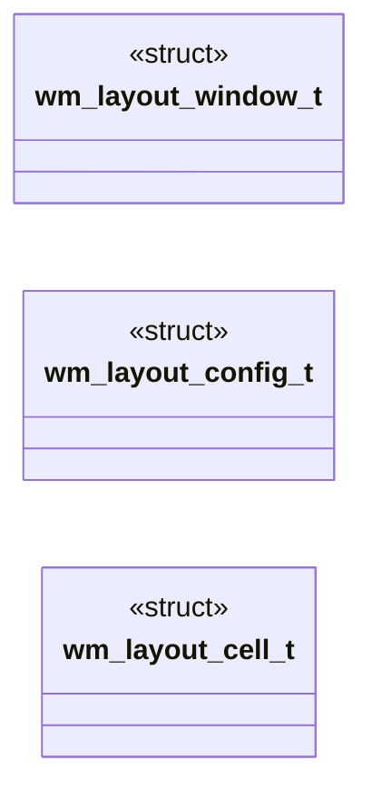
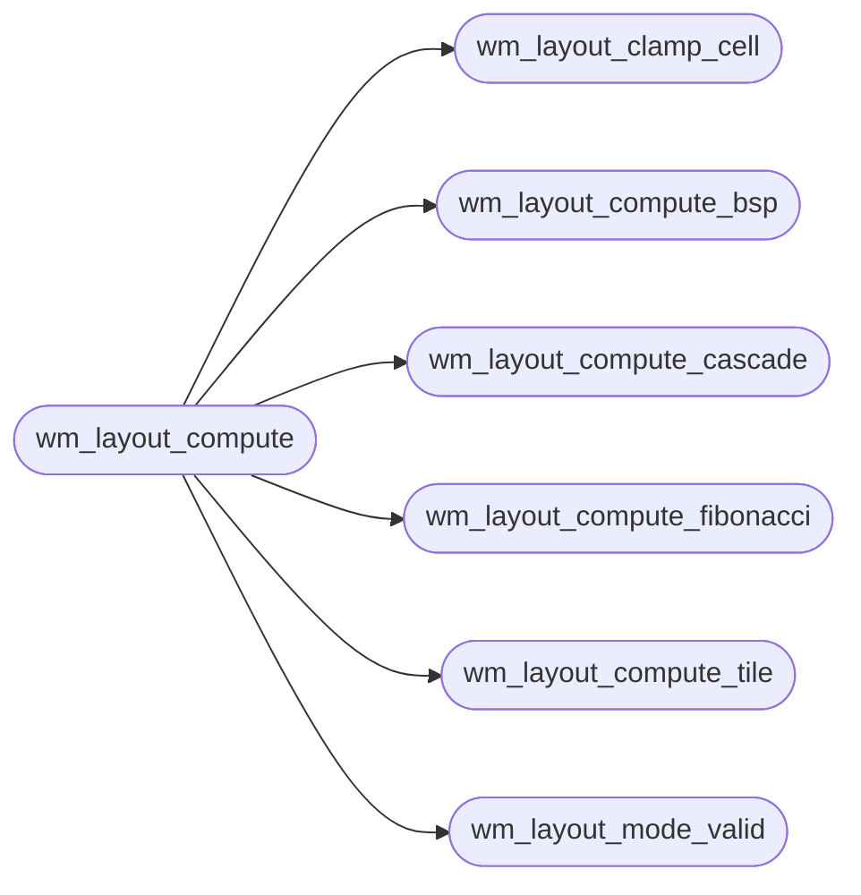

# `headers/wm_layout.h`

> Source: [headers/wm_layout.h:1](../../headers/wm_layout.h#L1) | language `h` | coverage 100.0% | [API index](../index.md)

Docstring: Unified layout contract for the MiniOS desktop.

## Contents

- **Structs:** [`wm_layout_window_t`](#wm_layout_window_t), [`wm_layout_config_t`](#wm_layout_config_t), [`wm_layout_cell_t`](#wm_layout_cell_t)
- **Functions:** [`wm_layout_mode_name`](#wm_layout_mode_name), [`wm_layout_mode_valid`](#wm_layout_mode_valid), [`wm_layout_clamp_cell`](#wm_layout_clamp_cell), [`wm_layout_fullscreen_cell`](#wm_layout_fullscreen_cell), [`wm_layout_compute_tile`](#wm_layout_compute_tile), [`wm_layout_compute_bsp`](#wm_layout_compute_bsp), [`wm_layout_compute_cascade`](#wm_layout_compute_cascade), [`wm_layout_compute_fibonacci`](#wm_layout_compute_fibonacci), [`wm_layout_compute`](#wm_layout_compute), [`wm_layout_same`](#wm_layout_same)
- **Macros:** [`WM_LAYOUT_MODE_COUNT`](#wm_layout_mode_count), [`WM_LAYOUT_CONFIG_DEFAULT`](#wm_layout_config_default)

## Type Diagram



## Call Graph

Solid arrows stay in this module, dashed arrows leave it.



## Structs

<a id="wm_layout_window_t"></a>

### `wm_layout_window_t`

`struct` | [headers/wm_layout.h:27](../../headers/wm_layout.h#L27)

```c
typedef struct
```

Docstring: One input window for layout computation.

---

<a id="wm_layout_config_t"></a>

### `wm_layout_config_t`

`struct` | [headers/wm_layout.h:36](../../headers/wm_layout.h#L36)

```c
typedef struct
```

Docstring: Centralized layout configuration for one engine.

---

<a id="wm_layout_cell_t"></a>

### `wm_layout_cell_t`

`struct` | [headers/wm_layout.h:48](../../headers/wm_layout.h#L48)

```c
typedef struct
```

Docstring: One computed cell in character units.

---

## Functions

<a id="wm_layout_mode_name"></a>

### `wm_layout_mode_name`

`function` `const` `inline` `static` | [headers/wm_layout.h:57](../../headers/wm_layout.h#L57)

```c
static inline const char *wm_layout_mode_name(int mode)
```

Docstring: Human name for one layout mode, else zero.

**Parameters**

| Name | Type | Default | Description |
|---|---|---|---|
| `mode` | `int` |  |  |

**Returns:** `char *`

*Called by:* [`vga_fb_layout_name`](kernel.vga_fb.c.md#vga_fb_layout_name)

---

<a id="wm_layout_mode_valid"></a>

### `wm_layout_mode_valid`

`function` `inline` `static` | [headers/wm_layout.h:76](../../headers/wm_layout.h#L76)

```c
static inline int wm_layout_mode_valid(int mode)
```

Docstring: True when mode is a selectable layout mode.

**Parameters**

| Name | Type | Default | Description |
|---|---|---|---|
| `mode` | `int` |  |  |

**Returns:** `int`

*Called by:* [`wm_layout_compute`](#wm_layout_compute), [`vga_fb_layout_set`](kernel.vga_fb.c.md#vga_fb_layout_set)

---

<a id="wm_layout_clamp_cell"></a>

### `wm_layout_clamp_cell`

`function` `inline` `static` | [headers/wm_layout.h:82](../../headers/wm_layout.h#L82)

```c
static inline int wm_layout_clamp_cell(wm_layout_cell_t *cell, int max_cols, int max_rows)
```

Docstring: Clamp cell extents into the grid, fail closed on nulls.

**Parameters**

| Name | Type | Default | Description |
|---|---|---|---|
| `cell` | `wm_layout_cell_t *` |  |  |
| `max_cols` | `int` |  |  |
| `max_rows` | `int` |  |  |

**Returns:** `int`

*Called by:* [`wm_layout_compute`](#wm_layout_compute)

---

<a id="wm_layout_fullscreen_cell"></a>

### `wm_layout_fullscreen_cell`

`function` `inline` `static` | [headers/wm_layout.h:118](../../headers/wm_layout.h#L118)

```c
static inline int wm_layout_fullscreen_cell(int max_cols, int max_rows, wm_layout_cell_t *out)
```

Docstring: Full grid cell for the focused window.

**Parameters**

| Name | Type | Default | Description |
|---|---|---|---|
| `max_cols` | `int` |  |  |
| `max_rows` | `int` |  |  |
| `out` | `wm_layout_cell_t *` |  |  |

**Returns:** `int`

---

<a id="wm_layout_compute_tile"></a>

### `wm_layout_compute_tile`

`function` `inline` `static` | [headers/wm_layout.h:135](../../headers/wm_layout.h#L135)

```c
static inline int wm_layout_compute_tile(const wm_layout_window_t *wins, int nwin, int max_cols, int max_rows, wm_layout_cell_t *out, int cap)
```

Docstring: Tile split across the long axis, legacy dual split exactly.

**Parameters**

| Name | Type | Default | Description |
|---|---|---|---|
| `wins` | `wm_layout_window_t *` |  |  |
| `nwin` | `int` |  |  |
| `max_cols` | `int` |  |  |
| `max_rows` | `int` |  |  |
| `out` | `wm_layout_cell_t *` |  |  |
| `cap` | `int` |  |  |

**Returns:** `int`

*Called by:* [`wm_layout_compute`](#wm_layout_compute)

---

<a id="wm_layout_compute_bsp"></a>

### `wm_layout_compute_bsp`

`function` `inline` `static` | [headers/wm_layout.h:182](../../headers/wm_layout.h#L182)

```c
static inline int wm_layout_compute_bsp(const wm_layout_window_t *wins, int nwin, int max_cols, int max_rows, wm_layout_cell_t *out, int cap)
```

Docstring: Recursive binary splits alternating axes, bspwm feel.

**Parameters**

| Name | Type | Default | Description |
|---|---|---|---|
| `wins` | `wm_layout_window_t *` |  |  |
| `nwin` | `int` |  |  |
| `max_cols` | `int` |  |  |
| `max_rows` | `int` |  |  |
| `out` | `wm_layout_cell_t *` |  |  |
| `cap` | `int` |  |  |

**Returns:** `int`

*Called by:* [`wm_layout_compute`](#wm_layout_compute)

---

<a id="wm_layout_compute_cascade"></a>

### `wm_layout_compute_cascade`

`function` `inline` `static` | [headers/wm_layout.h:250](../../headers/wm_layout.h#L250)

```c
static inline int wm_layout_compute_cascade(const wm_layout_config_t *cfg, const wm_layout_window_t *wins, int nwin, int max_cols, int max_rows, wm_layout_cell_t *out, int cap)
```

Docstring: Cascaded offsets so every title stays visible.

**Parameters**

| Name | Type | Default | Description |
|---|---|---|---|
| `cfg` | `wm_layout_config_t *` |  |  |
| `wins` | `wm_layout_window_t *` |  |  |
| `nwin` | `int` |  |  |
| `max_cols` | `int` |  |  |
| `max_rows` | `int` |  |  |
| `out` | `wm_layout_cell_t *` |  |  |
| `cap` | `int` |  |  |

**Returns:** `int`

*Called by:* [`wm_layout_compute`](#wm_layout_compute)

---

<a id="wm_layout_compute_fibonacci"></a>

### `wm_layout_compute_fibonacci`

`function` `inline` `static` | [headers/wm_layout.h:285](../../headers/wm_layout.h#L285)

```c
static inline int wm_layout_compute_fibonacci(const wm_layout_config_t *cfg, const wm_layout_window_t *wins, int nwin, int max_cols, int max_rows, wm_layout_cell_t *out, int cap)
```

Docstring: Fibonacci spiral carving integer ratio strips.

**Parameters**

| Name | Type | Default | Description |
|---|---|---|---|
| `cfg` | `wm_layout_config_t *` |  |  |
| `wins` | `wm_layout_window_t *` |  |  |
| `nwin` | `int` |  |  |
| `max_cols` | `int` |  |  |
| `max_rows` | `int` |  |  |
| `out` | `wm_layout_cell_t *` |  |  |
| `cap` | `int` |  |  |

**Returns:** `int`

*Called by:* [`wm_layout_compute`](#wm_layout_compute)

---

<a id="wm_layout_compute"></a>

### `wm_layout_compute`

`function` `inline` `static` | [headers/wm_layout.h:361](../../headers/wm_layout.h#L361)

```c
static inline int wm_layout_compute(const wm_layout_config_t *cfg, const wm_layout_window_t *wins, int nwin, int mode, int focus, int max_cols, int max_rows, wm_layout_cell_t *out, int cap)
```

Docstring: Compute one cell per present window in input order.

**Parameters**

| Name | Type | Default | Description |
|---|---|---|---|
| `cfg` | `wm_layout_config_t *` |  |  |
| `wins` | `wm_layout_window_t *` |  |  |
| `nwin` | `int` |  |  |
| `mode` | `int` |  |  |
| `focus` | `int` |  |  |
| `max_cols` | `int` |  |  |
| `max_rows` | `int` |  |  |
| `out` | `wm_layout_cell_t *` |  |  |
| `cap` | `int` |  |  |

**Returns:** `int`

*Calls:* [`wm_layout_clamp_cell`](#wm_layout_clamp_cell), [`wm_layout_compute_bsp`](#wm_layout_compute_bsp), [`wm_layout_compute_cascade`](#wm_layout_compute_cascade), [`wm_layout_compute_fibonacci`](#wm_layout_compute_fibonacci), [`wm_layout_compute_tile`](#wm_layout_compute_tile), [`wm_layout_mode_valid`](#wm_layout_mode_valid)

*Called by:* [`alone`](kernel.vga_fb.c.md#alone)

---

<a id="wm_layout_same"></a>

### `wm_layout_same`

`function` `inline` `static` | [headers/wm_layout.h:443](../../headers/wm_layout.h#L443)

```c
static inline int wm_layout_same(const wm_layout_cell_t *a, const wm_layout_cell_t *b, int n)
```

Docstring: True when two plans cover identical cells in order.

**Parameters**

| Name | Type | Default | Description |
|---|---|---|---|
| `a` | `wm_layout_cell_t *` |  |  |
| `b` | `wm_layout_cell_t *` |  |  |
| `n` | `int` |  |  |

**Returns:** `int`

*Called by:* [`alone`](kernel.vga_fb.c.md#alone)

---

## Macros

<a id="wm_layout_mode_count"></a>

### `WM_LAYOUT_MODE_COUNT`

`macro` | [headers/wm_layout.h:24](../../headers/wm_layout.h#L24)

```c
#define WM_LAYOUT_MODE_COUNT
```

Docstring: Total layout modes in the mode table.

---

<a id="wm_layout_config_default"></a>

### `WM_LAYOUT_CONFIG_DEFAULT`

`macro` | [headers/wm_layout.h:45](../../headers/wm_layout.h#L45)

```c
#define WM_LAYOUT_CONFIG_DEFAULT
```

Docstring: Default layout matching the legacy two terminal split.

---
