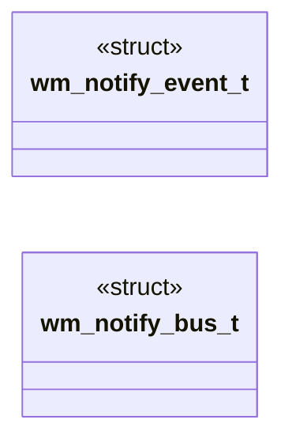

# `headers/wm_notify.h`

> Source: [headers/wm_notify.h:1](../../headers/wm_notify.h#L1) | language `h` | coverage 88.9% | [API index](../index.md)

Docstring: Focus event bus for the MiniOS desktop.

## Contents

- **Structs:** [`wm_notify_event_t`](#wm_notify_event_t), [`wm_notify_bus_t`](#wm_notify_bus_t)
- **Functions:** [`wm_notify_reset`](#wm_notify_reset), [`wm_notify_subscribe`](#wm_notify_subscribe), [`wm_notify_emit`](#wm_notify_emit), [`wm_notify_last`](#wm_notify_last), [`wm_notify_src_name`](#wm_notify_src_name)
- **Macros:** [`WM_NOTIFY_MAX_HANDLERS`](#wm_notify_max_handlers)

## Type Diagram



## Structs

<a id="wm_notify_event_t"></a>

### `wm_notify_event_t`

`struct` | [headers/wm_notify.h:30](../../headers/wm_notify.h#L30)

```c
typedef struct
```

Docstring: One focus move, old and new ids share the focus space.

---

<a id="wm_notify_bus_t"></a>

### `wm_notify_bus_t`

`struct` | [headers/wm_notify.h:43](../../headers/wm_notify.h#L43)

```c
typedef struct
```

---

## Functions

<a id="wm_notify_reset"></a>

### `wm_notify_reset`

`function` `inline` `static` | [headers/wm_notify.h:51](../../headers/wm_notify.h#L51)

```c
static inline void wm_notify_reset(wm_notify_bus_t *bus)
```

Docstring: Drop every subscriber and forget the last event.

**Parameters**

| Name | Type | Default | Description |
|---|---|---|---|
| `bus` | `wm_notify_bus_t *` |  |  |

---

<a id="wm_notify_subscribe"></a>

### `wm_notify_subscribe`

`function` `inline` `static` | [headers/wm_notify.h:66](../../headers/wm_notify.h#L66)

```c
static inline int wm_notify_subscribe(wm_notify_bus_t *bus, wm_notify_handler_t handler)
```

Docstring: Register one listener, -1 when full or null.

**Parameters**

| Name | Type | Default | Description |
|---|---|---|---|
| `bus` | `wm_notify_bus_t *` |  |  |
| `handler` | `wm_notify_handler_t` |  |  |

**Returns:** `int`

---

<a id="wm_notify_emit"></a>

### `wm_notify_emit`

`function` `inline` `static` | [headers/wm_notify.h:76](../../headers/wm_notify.h#L76)

```c
static inline void wm_notify_emit(wm_notify_bus_t *bus, const wm_notify_event_t *event)
```

Docstring: Deliver one event to every listener, then record it.

**Parameters**

| Name | Type | Default | Description |
|---|---|---|---|
| `bus` | `wm_notify_bus_t *` |  |  |
| `event` | `wm_notify_event_t *` |  |  |

---

<a id="wm_notify_last"></a>

### `wm_notify_last`

`function` `const` `inline` `static` | [headers/wm_notify.h:90](../../headers/wm_notify.h#L90)

```c
static inline const wm_notify_event_t *wm_notify_last( const wm_notify_bus_t *bus)
```

Docstring: Last emitted event, 0 when none was ever emitted.

**Parameters**

| Name | Type | Default | Description |
|---|---|---|---|
| `bus` | `wm_notify_bus_t *` |  |  |

**Returns:** `wm_notify_event_t *`

*Called by:* [`vga_fb_focus_event`](kernel.vga_fb.c.md#vga_fb_focus_event)

---

<a id="wm_notify_src_name"></a>

### `wm_notify_src_name`

`function` `const` `inline` `static` | [headers/wm_notify.h:98](../../headers/wm_notify.h#L98)

```c
static inline const char *wm_notify_src_name(int source)
```

Docstring: Short source name for serial-observable state.

**Parameters**

| Name | Type | Default | Description |
|---|---|---|---|
| `source` | `int` |  |  |

**Returns:** `char *`

---

## Macros

<a id="wm_notify_max_handlers"></a>

### `WM_NOTIFY_MAX_HANDLERS`

`macro` | [headers/wm_notify.h:41](../../headers/wm_notify.h#L41)

```c
#define WM_NOTIFY_MAX_HANDLERS
```

Docstring: Static subscriber table plus last emitted event.

---
