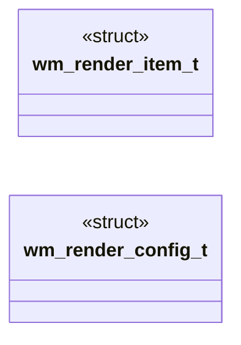

# `headers/wm_render.h`

> Source: [headers/wm_render.h:1](../../headers/wm_render.h#L1) | language `h` | coverage 100.0% | [API index](../index.md)

Docstring: Render pipeline contract for the MiniOS desktop.

## Contents

- **Structs:** [`wm_render_item_t`](#wm_render_item_t), [`wm_render_config_t`](#wm_render_config_t)
- **Functions:** [`wm_build_render_plan`](#wm_build_render_plan)
- **Macros:** [`WM_RENDER_CONFIG_DEFAULT`](#wm_render_config_default)

## Type Diagram



## Call Graph

Solid arrows stay in this module, dashed arrows leave it.


## Structs

<a id="wm_render_item_t"></a>

### `wm_render_item_t`

`struct` | [headers/wm_render.h:25](../../headers/wm_render.h#L25)

```c
typedef struct
```

Docstring: One composited item in back-to-front order.

---

<a id="wm_render_config_t"></a>

### `wm_render_config_t`

`struct` | [headers/wm_render.h:31](../../headers/wm_render.h#L31)

```c
typedef struct
```

Docstring: Centralized render pipeline configuration.

---

## Functions

<a id="wm_build_render_plan"></a>

### `wm_build_render_plan`

`function` `inline` `static` | [headers/wm_render.h:39](../../headers/wm_render.h#L39)

```c
static inline int wm_build_render_plan(const wm_render_config_t *cfg, const int *present, int nterms, int focus, int gfx_active, wm_render_item_t *items, int cap)
```

Docstring: Build the back-to-front composition plan for one frame.

**Parameters**

| Name | Type | Default | Description |
|---|---|---|---|
| `cfg` | `wm_render_config_t *` |  |  |
| `present` | `int *` |  |  |
| `nterms` | `int` |  |  |
| `focus` | `int` |  |  |
| `gfx_active` | `int` |  |  |
| `items` | `wm_render_item_t *` |  |  |
| `cap` | `int` |  |  |

**Returns:** `int`

*Calls:* [`wm_paint_order`](headers.wm_window.h.md#wm_paint_order)

*Called by:* [`vga_fb_draw_desktop`](kernel.vga_fb.c.md#vga_fb_draw_desktop)

---

## Macros

<a id="wm_render_config_default"></a>

### `WM_RENDER_CONFIG_DEFAULT`

`macro` | [headers/wm_render.h:36](../../headers/wm_render.h#L36)

```c
#define WM_RENDER_CONFIG_DEFAULT
```

Docstring: Default pipeline bound for two terminals plus chrome.

---
