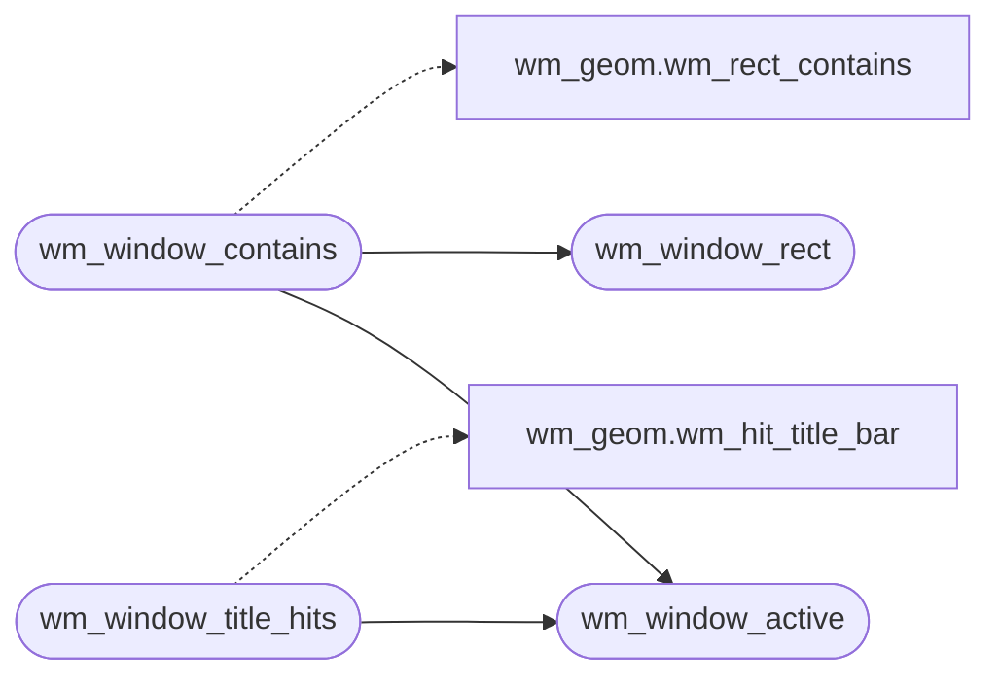

# `headers/wm_window.h`

> Source: [headers/wm_window.h:1](../../headers/wm_window.h#L1) | language `h` | coverage 100.0% | [API index](../index.md)

Docstring: Unified window contract for the MiniOS desktop.

## Contents

- **Structs:** [`wm_window_t`](#wm_window_t)
- **Functions:** [`wm_window_active`](#wm_window_active), [`wm_window_rect`](#wm_window_rect), [`wm_window_contains`](#wm_window_contains), [`wm_window_title_hits`](#wm_window_title_hits), [`wm_focus_next_id`](#wm_focus_next_id), [`wm_paint_order`](#wm_paint_order)
- **Macros:** [`WM_WINDOW_GFX_ID`](#wm_window_gfx_id), [`WM_WINDOW_MAX_TERMS`](#wm_window_max_terms)

## Call Graph

Solid arrows stay in this module, dashed arrows leave it.



## Structs

<a id="wm_window_t"></a>

### `wm_window_t`

`struct` | [headers/wm_window.h:29](../../headers/wm_window.h#L29)

```c
typedef struct
```

Docstring: Unified window descriptor in framebuffer pixels.

---

## Functions

<a id="wm_window_active"></a>

### `wm_window_active`

`function` `inline` `static` | [headers/wm_window.h:41](../../headers/wm_window.h#L41)

```c
static inline int wm_window_active(const wm_window_t *w)
```

Docstring: True when the window can receive input or pointer hits.

**Parameters**

| Name | Type | Default | Description |
|---|---|---|---|
| `w` | `wm_window_t *` |  |  |

**Returns:** `int`

*Called by:* [`wm_window_contains`](#wm_window_contains), [`wm_window_title_hits`](#wm_window_title_hits)

---

<a id="wm_window_rect"></a>

### `wm_window_rect`

`function` `inline` `static` | [headers/wm_window.h:47](../../headers/wm_window.h#L47)

```c
static inline wm_rect_t wm_window_rect(const wm_window_t *w)
```

Docstring: Rectangle covering the whole window including decorations.

**Parameters**

| Name | Type | Default | Description |
|---|---|---|---|
| `w` | `wm_window_t *` |  |  |

**Returns:** `wm_rect_t`

*Called by:* [`wm_window_contains`](#wm_window_contains)

---

<a id="wm_window_contains"></a>

### `wm_window_contains`

`function` `inline` `static` | [headers/wm_window.h:58](../../headers/wm_window.h#L58)

```c
static inline int wm_window_contains(const wm_window_t *w, int px, int py)
```

Docstring: True when point px,py hits the window body or decorations.

**Parameters**

| Name | Type | Default | Description |
|---|---|---|---|
| `w` | `wm_window_t *` |  |  |
| `px` | `int` |  |  |
| `py` | `int` |  |  |

**Returns:** `int`

*Calls:* [`wm_rect_contains`](headers.wm_geom.h.md#wm_rect_contains), [`wm_window_active`](#wm_window_active), [`wm_window_rect`](#wm_window_rect)

---

<a id="wm_window_title_hits"></a>

### `wm_window_title_hits`

`function` `inline` `static` | [headers/wm_window.h:68](../../headers/wm_window.h#L68)

```c
static inline int wm_window_title_hits(const wm_geom_config_t *cfg, const wm_window_t *w, int px, int py)
```

Docstring: True when point px,py hits the window title bar.

**Parameters**

| Name | Type | Default | Description |
|---|---|---|---|
| `cfg` | `wm_geom_config_t *` |  |  |
| `w` | `wm_window_t *` |  |  |
| `px` | `int` |  |  |
| `py` | `int` |  |  |

**Returns:** `int`

*Calls:* [`wm_hit_title_bar`](headers.wm_geom.h.md#wm_hit_title_bar), [`wm_window_active`](#wm_window_active)

---

<a id="wm_focus_next_id"></a>

### `wm_focus_next_id`

`function` `inline` `static` | [headers/wm_window.h:77](../../headers/wm_window.h#L77)

```c
static inline int wm_focus_next_id(const int *present, int nterms, int gfx_active, int focus)
```

Docstring: Next focus id across present terminals plus graphics when active.

**Parameters**

| Name | Type | Default | Description |
|---|---|---|---|
| `present` | `int *` |  |  |
| `nterms` | `int` |  |  |
| `gfx_active` | `int` |  |  |
| `focus` | `int` |  |  |

**Returns:** `int`

*Called by:* [`wm_focus_next`](headers.wm_focus.h.md#wm_focus_next)

---

<a id="wm_paint_order"></a>

### `wm_paint_order`

`function` `inline` `static` | [headers/wm_window.h:114](../../headers/wm_window.h#L114)

```c
static inline int wm_paint_order(const int *present, int nterms, int focus, int *order, int cap)
```

Docstring: Paint order for terminals with focused window last.

**Parameters**

| Name | Type | Default | Description |
|---|---|---|---|
| `present` | `int *` |  |  |
| `nterms` | `int` |  |  |
| `focus` | `int` |  |  |
| `order` | `int *` |  |  |
| `cap` | `int` |  |  |

**Returns:** `int`

*Called by:* [`wm_build_render_plan`](headers.wm_render.h.md#wm_build_render_plan)

---

## Macros

<a id="wm_window_gfx_id"></a>

### `WM_WINDOW_GFX_ID`

`macro` | [headers/wm_window.h:23](../../headers/wm_window.h#L23)

```c
#define WM_WINDOW_GFX_ID
```

Docstring: Focus id for the graphics window in the shared focus space.

---

<a id="wm_window_max_terms"></a>

### `WM_WINDOW_MAX_TERMS`

`macro` | [headers/wm_window.h:26](../../headers/wm_window.h#L26)

```c
#define WM_WINDOW_MAX_TERMS
```

Docstring: Maximum terminal windows sharing the focus space.

---
