# `kernel.c`

> Source: [kernel.c:1](../../kernel.c#L1) | language `c` | coverage 38.5% | [API index](../index.md)

kernel.c -- Mediator: boot orchestration and the syscall trampoline.

## Contents

- **Functions:** [`table`](#table), [`syscall_init`](#syscall_init), [`ksyscall`](#ksyscall), [`kstack`](#kstack), [`ms`](#ms), [`bootlog_mark`](#bootlog_mark), [`bootlog_report`](#bootlog_report), [`__attribute__`](#__attribute__), [`size`](#size), [`tables`](#tables)
- **Macros:** [`KSYM_MAX`](#ksym_max), [`BOOTLOG_MAX`](#bootlog_max)
- **Variables:** [`syscall_kstack`](#syscall_kstack), [`ramdisk_start`](#ramdisk_start), [`ramdisk_end`](#ramdisk_end)

## Call Graph

Solid arrows stay in this module, dashed arrows leave it.

```mermaid
flowchart LR
    n_kernel_c____attribute__(["__attribute__"])
    n_kernel_c__bootlog_mark(["bootlog_mark"])
    n_kernel_c__syscall_init(["syscall_init"])
    n_headers_arch_x86_msr_h__rdmsr["msr.rdmsr"]
    n_headers_arch_x86_msr_h__wrmsr["msr.wrmsr"]
    n_headers_abi_h__abi_check_manifest["abi.abi_check_manifest"]
    n_headers_block_h__block_init["block.block_init"]
    n_headers_drivers_usbblk_h__ubk_present["usbblk.ubk_present"]
    n_headers_drivers_virtio_blk_h__vblk_present["virtio_blk.vblk_present"]
    n_headers_ide_h__ide_present["ide.ide_present"]
    n_headers_kernel_h__outb["kernel.outb"]
    n_headers_minifs_h__minifs_init["minifs.minifs_init"]
    n_headers_minifs_h__minifs_mount["minifs.minifs_mount"]
    n_headers_pcache_h__pcache_init["pcache.pcache_init"]
    n_headers_sb16_h__sb16_init["sb16.sb16_init"]
    n_headers_sched_h__sched_init["sched.sched_init"]
    n_headers_smp_h__smp_init["smp.smp_init"]
    n_headers_vga_fb_h__vga_fb_boot_config["vga_fb.vga_fb_boot_config"]
    n_headers_vga_fb_h__vga_fb_init["vga_fb.vga_fb_init"]
    n_headers_vga_fb_h__vga_fb_term_ring_init["vga_fb.vga_fb_term_ring_init"]
    n_net_net_c__net_init["net.net_init"]
    n_progs_doomgeneric_p_local_h__d["p_local.d"]
    n_tools_update_sources_py__GitResult_ok["update_sources.GitResult.ok"]
    n_kernel_c__tables(["tables"])
    n_headers_drivers_usbhid_h__usbhid_init["usbhid.usbhid_init"]
    n_headers_drivers_usbhid_h__usbhid_keyboard_present["usbhid.usbhid_keyboard_present"]
    n_kernel_c____attribute__ --> n_kernel_c__bootlog_mark
    n_kernel_c____attribute__ --> n_kernel_c__syscall_init
    n_kernel_c__syscall_init -.-> n_headers_arch_x86_msr_h__rdmsr
    n_kernel_c__syscall_init -.-> n_headers_arch_x86_msr_h__wrmsr
    n_kernel_c____attribute__ -.-> n_headers_abi_h__abi_check_manifest
    n_kernel_c____attribute__ -.-> n_headers_block_h__block_init
    n_kernel_c____attribute__ -.-> n_headers_drivers_usbblk_h__ubk_present
    n_kernel_c____attribute__ -.-> n_headers_drivers_virtio_blk_h__vblk_present
    n_kernel_c____attribute__ -.-> n_headers_ide_h__ide_present
    n_kernel_c____attribute__ -.-> n_headers_kernel_h__outb
    n_kernel_c____attribute__ -.-> n_headers_minifs_h__minifs_init
    n_kernel_c____attribute__ -.-> n_headers_minifs_h__minifs_mount
    n_kernel_c____attribute__ -.-> n_headers_pcache_h__pcache_init
    n_kernel_c____attribute__ -.-> n_headers_sb16_h__sb16_init
    n_kernel_c____attribute__ -.-> n_headers_sched_h__sched_init
    n_kernel_c____attribute__ -.-> n_headers_smp_h__smp_init
    n_kernel_c____attribute__ -.-> n_headers_vga_fb_h__vga_fb_boot_config
    n_kernel_c____attribute__ -.-> n_headers_vga_fb_h__vga_fb_init
    n_kernel_c____attribute__ -.-> n_headers_vga_fb_h__vga_fb_term_ring_init
    n_kernel_c____attribute__ -.-> n_net_net_c__net_init
    n_kernel_c____attribute__ -.-> n_progs_doomgeneric_p_local_h__d
    n_kernel_c____attribute__ -.-> n_tools_update_sources_py__GitResult_ok
    n_kernel_c__tables -.-> n_headers_drivers_usbhid_h__usbhid_init
    n_kernel_c__tables -.-> n_headers_drivers_usbhid_h__usbhid_keyboard_present
```



## Functions

<a id="table"></a>

### `table`

`function` | [kernel.c:104](../../kernel.c#L104)

```c
* Symbol table (for resolving program references) * ================================================================ */ #define KSYM_MAX 256 /* ---- SYSCALL/SYSRET setup ------------------------------
```

**Parameters**

| Name | Type | Default | Description |
|---|---|---|---|
| `references` | `for resolving program` |  |  |

**Returns:** `* Symbol`

---

<a id="syscall_init"></a>

### `syscall_init`

`function` | [kernel.c:117](../../kernel.c#L117)

```c
void syscall_init(void)
```

========== Linux syscall interface ==========

> **Inherited:** Documentation from [`syscall_init`](#syscall_init) (headers/kernel.h:834).

*Calls:* [`rdmsr`](headers.arch.x86.msr.h.md#rdmsr), [`wrmsr`](headers.arch.x86.msr.h.md#wrmsr)

*Called by:* [`__attribute__`](#__attribute__)

---

<a id="ksyscall"></a>

### `ksyscall`

`function` `extern` | [kernel.c:130](../../kernel.c#L130)

```c
extern long ksyscall(long n, long a1, long a2, long a3, long a4, long a5, long a6);
```

**Parameters**

| Name | Type | Default | Description |
|---|---|---|---|
| `n` | `long` |  |  |
| `a1` | `long` |  |  |
| `a2` | `long` |  |  |
| `a3` | `long` |  |  |
| `a4` | `long` |  |  |
| `a5` | `long` |  |  |
| `a6` | `long` |  |  |

**Returns:** `long`

---

<a id="kstack"></a>

### `kstack`

`function` | [kernel.c:146](../../kernel.c#L146)

```c
* Reading gs:8 instead resolves every thread to the wrong kstack (0 on * the BSP, 1 on APs): harmless while a single process runs, fatal as * soon as two threads syscall concurrently. */ _Static_asser
```

**Parameters**

| Name | Type | Default | Description |
|---|---|---|---|
| `BSP` | `0 on * the` |  |  |
| `APs` | `1 on` |  |  |

**Returns:** `harmless while a single process runs, fatal as * soon as two threads syscall concurrently. */ _Static_asser`

---

<a id="ms"></a>

### `ms`

`function` | [kernel.c:185](../../kernel.c#L185)

```c
* 0 ms (TSC ticks since power-on divided down, still monotonic);
```

**Parameters**

| Name | Type | Default | Description |
|---|---|---|---|
| `down` | `TSC ticks since power-on divided` |  |  |
| `monotonic` | `still` |  |  |

**Returns:** `* 0`

---

<a id="bootlog_mark"></a>

### `bootlog_mark`

`function` | [kernel.c:192](../../kernel.c#L192)

```c
void bootlog_mark(const char *name)
```

========== Boot-phase log (kernel.c, `bootlog` builtin) ==========

**Parameters**

| Name | Type | Default | Description |
|---|---|---|---|
| `name` | `char *` |  |  |

> **Inherited:** Documentation from [`bootlog_mark`](#bootlog_mark) (headers/kernel.h:917).

*Called by:* [`__attribute__`](#__attribute__)

---

<a id="bootlog_report"></a>

### `bootlog_report`

`function` | [kernel.c:199](../../kernel.c#L199)

```c
void bootlog_report(void)
```

---

<a id="__attribute__"></a>

### `__attribute__`

`function` | [kernel.c:207](../../kernel.c#L207)

```c
__attribute__((section(".init.text"))) void kmain(void)
```

Exported IDTR for APs to load during SMP bring-up.

**Parameters**

| Name | Type | Default | Description |
|---|---|---|---|
| `text` | `(section(".init. "))` |  |  |

> **Inherited:** Documentation from [`__attribute__`](#__attribute__) (headers/sched.h:375).

*Calls:* [`abi_check_manifest`](headers.abi.h.md#abi_check_manifest), [`block_init`](headers.block.h.md#block_init), [`ubk_present`](headers.drivers.usbblk.h.md#ubk_present), [`vblk_present`](headers.drivers.virtio_blk.h.md#vblk_present), [`ide_present`](headers.ide.h.md#ide_present), [`outb`](headers.kernel.h.md#outb), [`minifs_init`](headers.minifs.h.md#minifs_init), [`minifs_mount`](headers.minifs.h.md#minifs_mount), [`pcache_init`](headers.pcache.h.md#pcache_init), [`sb16_init`](headers.sb16.h.md#sb16_init), [`sched_init`](headers.sched.h.md#sched_init), [`smp_init`](headers.smp.h.md#smp_init) and 8 more

---

<a id="size"></a>

### `size`

`function` | [kernel.c:257](../../kernel.c#L257)

```c
* image size (see kernel.ld);
```

**Parameters**

| Name | Type | Default | Description |
|---|---|---|---|
| `ld` | `see kernel.` |  |  |

**Returns:** `* image`

---

<a id="tables"></a>

### `tables`

`function` | [kernel.c:279](../../kernel.c#L279)

```c
* tables (already built above) for its uncached register window and the * heap for its rings...
```

**Parameters**

| Name | Type | Default | Description |
|---|---|---|---|
| `above` | `already built` |  |  |

**Returns:** `*`

*Calls:* [`usbhid_init`](headers.drivers.usbhid.h.md#usbhid_init), [`usbhid_keyboard_present`](headers.drivers.usbhid.h.md#usbhid_keyboard_present), [`usbhid_mouse_present`](headers.drivers.usbhid.h.md#usbhid_mouse_present), [`xhc_enumerate_all`](headers.drivers.xhci.h.md#xhc_enumerate_all), [`xhc_info`](headers.drivers.xhci.h.md#xhc_info), [`xhc_init`](headers.drivers.xhci.h.md#xhc_init)

---

## Macros

<a id="ksym_max"></a>

### `KSYM_MAX`

`macro` | [kernel.c:107](../../kernel.c#L107)

```c
#define KSYM_MAX
```

---

<a id="bootlog_max"></a>

### `BOOTLOG_MAX`

`macro` | [kernel.c:188](../../kernel.c#L188)

```c
#define BOOTLOG_MAX
```

`bootlog` -- timestamped boot-phase marks for the observability set. ktime_ms is PIT-calibrated only after sched_init, so early marks read 0 ms (TSC ticks since power-on divided down, still monotonic); later marks are wall milliseconds.

Fixed table, no heap, no locks: marks are appended before the shell runs (single CPU), reads are shell-time.

---

## Variables

<a id="syscall_kstack"></a>

### `syscall_kstack`

`variable` `extern` | [kernel.c:115](../../kernel.c#L115)

```c
extern unsigned long syscall_kstack;
```

---

<a id="ramdisk_start"></a>

### `ramdisk_start`

`variable` `extern` | [kernel.c:179](../../kernel.c#L179)

```c
extern char ramdisk_start[];
```

---

<a id="ramdisk_end"></a>

### `ramdisk_end`

`variable` `extern` | [kernel.c:180](../../kernel.c#L180)

```c
extern char ramdisk_end[];
```

---
