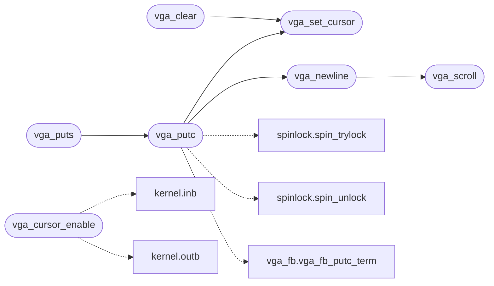

# `kernel/console.c`

> Source: [kernel/console.c:1](../../kernel/console.c#L1) | language `c` | coverage 25.0% | [API index](../index.md)

console.c -- Execution-context output: text console, capture, libc names.

## Contents

- **Functions:** [`vga_get_x`](#vga_get_x), [`vga_get_y`](#vga_get_y), [`vga_set_xy`](#vga_set_xy), [`vga_get_color`](#vga_get_color), [`vga_clear`](#vga_clear), [`vga_set_cursor`](#vga_set_cursor), [`vga_scroll`](#vga_scroll), [`vga_newline`](#vga_newline), [`vga_cursor_enable`](#vga_cursor_enable), [`redirect_active`](#redirect_active), [`redirect_suspend`](#redirect_suspend), [`redirect_resume`](#redirect_resume), [`redirect_begin`](#redirect_begin), [`redirect_commit`](#redirect_commit), [`redirect_pending`](#redirect_pending), [`redirect_take_into`](#redirect_take_into), [`redirect_discard`](#redirect_discard), [`vga_putc`](#vga_putc), [`vga_puts`](#vga_puts), [`register_libc_symbols`](#register_libc_symbols)
- **Macros:** [`XXH_STATIC_LINKING_ONLY`](#xxh_static_linking_only), [`REDIR_INITIAL_CAP`](#redir_initial_cap), [`REDIR_MAX_BYTES`](#redir_max_bytes)

## Call Graph

Solid arrows stay in this module, dashed arrows leave it.



## Functions

<a id="vga_get_x"></a>

### `vga_get_x`

`function` | [kernel/console.c:18](../../kernel/console.c#L18)

```c
int vga_get_x(void)
```

VGA state getters (kernel/console.c, for scrollback renderer)

**Returns:** `int`

> **Inherited:** Documentation from [`vga_get_x`](#vga_get_x) (headers/kernel.h:108).

---

<a id="vga_get_y"></a>

### `vga_get_y`

`function` | [kernel/console.c:19](../../kernel/console.c#L19)

```c
int vga_get_y(void)
```

**Returns:** `int`

---

<a id="vga_set_xy"></a>

### `vga_set_xy`

`function` | [kernel/console.c:20](../../kernel/console.c#L20)

```c
void vga_set_xy(int x, int y)
```

**Parameters**

| Name | Type | Default | Description |
|---|---|---|---|
| `x` | `int` |  |  |
| `y` | `int` |  |  |

---

<a id="vga_get_color"></a>

### `vga_get_color`

`function` | [kernel/console.c:21](../../kernel/console.c#L21)

```c
char vga_get_color(void)
```

**Returns:** `char`

---

<a id="vga_clear"></a>

### `vga_clear`

`function` | [kernel/console.c:25](../../kernel/console.c#L25)

```c
void vga_clear(void)
```

*Calls:* [`vga_set_cursor`](#vga_set_cursor)

---

<a id="vga_set_cursor"></a>

### `vga_set_cursor`

`function` | [kernel/console.c:36](../../kernel/console.c#L36)

```c
void vga_set_cursor(int x, int y)
```

**Parameters**

| Name | Type | Default | Description |
|---|---|---|---|
| `x` | `int` |  |  |
| `y` | `int` |  |  |

*Called by:* [`vga_clear`](#vga_clear), [`vga_putc`](#vga_putc)

---

<a id="vga_scroll"></a>

### `vga_scroll`

`function` | [kernel/console.c:56](../../kernel/console.c#L56)

```c
void vga_scroll(void)
```

*Called by:* [`vga_newline`](#vga_newline)

---

<a id="vga_newline"></a>

### `vga_newline`

`function` | [kernel/console.c:75](../../kernel/console.c#L75)

```c
void vga_newline(void)
```

*Calls:* [`vga_scroll`](#vga_scroll)

*Called by:* [`vga_putc`](#vga_putc)

---

<a id="vga_cursor_enable"></a>

### `vga_cursor_enable`

`function` | [kernel/console.c:81](../../kernel/console.c#L81)

```c
void vga_cursor_enable(int on)
```

**Parameters**

| Name | Type | Default | Description |
|---|---|---|---|
| `on` | `int` |  |  |

*Calls:* [`inb`](headers.kernel.h.md#inb), [`outb`](headers.kernel.h.md#outb)

---

<a id="redirect_active"></a>

### `redirect_active`

`function` | [kernel/console.c:120](../../kernel/console.c#L120)

```c
int redirect_active(void)
```

**Returns:** `int`

---

<a id="redirect_suspend"></a>

### `redirect_suspend`

`function` | [kernel/console.c:129](../../kernel/console.c#L129)

```c
int redirect_suspend(void)
```

**Returns:** `int`

---

<a id="redirect_resume"></a>

### `redirect_resume`

`function` | [kernel/console.c:135](../../kernel/console.c#L135)

```c
void redirect_resume(int was)
```

**Parameters**

| Name | Type | Default | Description |
|---|---|---|---|
| `was` | `int` |  |  |

---

<a id="redirect_begin"></a>

### `redirect_begin`

`function` | [kernel/console.c:139](../../kernel/console.c#L139)

```c
int redirect_begin(void)
```

**Returns:** `int`

---

<a id="redirect_commit"></a>

### `redirect_commit`

`function` | [kernel/console.c:147](../../kernel/console.c#L147)

```c
int redirect_commit(const char *path, int append_mode)
```

**Parameters**

| Name | Type | Default | Description |
|---|---|---|---|
| `path` | `char *` |  |  |
| `append_mode` | `int` |  |  |

**Returns:** `int`

---

<a id="redirect_pending"></a>

### `redirect_pending`

`function` | [kernel/console.c:185](../../kernel/console.c#L185)

```c
unsigned long redirect_pending(void)
```

Docstring: Bytes waiting in the capture, 0 when idle or overflowed.

Lets a caller size one arena block for the whole capture instead of taking a throwaway heap copy first.

**Returns:** `unsigned long`

---

<a id="redirect_take_into"></a>

### `redirect_take_into`

`function` | [kernel/console.c:196](../../kernel/console.c#L196)

```c
unsigned long redirect_take_into(char *dst, unsigned long cap, unsigned long *len_out)
```

Docstring: Drain the capture into the caller's arena memory instead of a fresh heap block.

Copies at most cap bytes, deactivates the capture and resets the ring exactly like redirect_take, but the caller owns dst so a pipeline stage assembles its output with one kmalloc instead of three. Reports the copied count in len_out; 0 with len 0 on empty capture or overflow.

**Parameters**

| Name | Type | Default | Description |
|---|---|---|---|
| `dst` | `char *` |  |  |
| `cap` | `unsigned long` |  |  |
| `len_out` | `unsigned long *` |  |  |

**Returns:** `unsigned long`

---

<a id="redirect_discard"></a>

### `redirect_discard`

`function` | [kernel/console.c:216](../../kernel/console.c#L216)

```c
void redirect_discard(void)
```

Docstring: Drop the capture without any allocation.

The ring keeps its backing block for the next Ctrl+R / Ctrl+L build, so repeated toolchain runs reuse one persistent bump buffer instead of churning the heap.

---

<a id="vga_putc"></a>

### `vga_putc`

`function` | [kernel/console.c:223](../../kernel/console.c#L223)

```c
void vga_putc(char c)
```

**Parameters**

| Name | Type | Default | Description |
|---|---|---|---|
| `c` | `char` |  |  |

*Calls:* [`spin_trylock`](headers.spinlock.h.md#spin_trylock), [`spin_unlock`](headers.spinlock.h.md#spin_unlock), [`vga_fb_putc_term`](headers.vga_fb.h.md#vga_fb_putc_term), [`vga_newline`](#vga_newline), [`vga_set_cursor`](#vga_set_cursor)

*Called by:* [`vga_puts`](#vga_puts)

---

<a id="vga_puts"></a>

### `vga_puts`

`function` | [kernel/console.c:267](../../kernel/console.c#L267)

```c
void vga_puts(const char *s)
```

**Parameters**

| Name | Type | Default | Description |
|---|---|---|---|
| `s` | `char *` |  |  |

*Calls:* [`vga_putc`](#vga_putc)

---

<a id="register_libc_symbols"></a>

### `register_libc_symbols`

`function` | [kernel/console.c:271](../../kernel/console.c#L271)

```c
void register_libc_symbols(void)
```

Libc name table for ET_REL programs (kernel/console.c).

Called once from kmain; the table itself lives in kernel/symtab.c.

> **Inherited:** Documentation from [`register_libc_symbols`](#register_libc_symbols) (headers/kernel.h:654).

---

## Macros

<a id="xxh_static_linking_only"></a>

### `XXH_STATIC_LINKING_ONLY`

`macro` | [kernel/console.c:4](../../kernel/console.c#L4)

```c
#define XXH_STATIC_LINKING_ONLY
```

---

<a id="redir_initial_cap"></a>

### `REDIR_INITIAL_CAP`

`macro` | [kernel/console.c:96](../../kernel/console.c#L96)

```c
#define REDIR_INITIAL_CAP
```

---

<a id="redir_max_bytes"></a>

### `REDIR_MAX_BYTES`

`macro` | [kernel/console.c:97](../../kernel/console.c#L97)

```c
#define REDIR_MAX_BYTES
```

---
