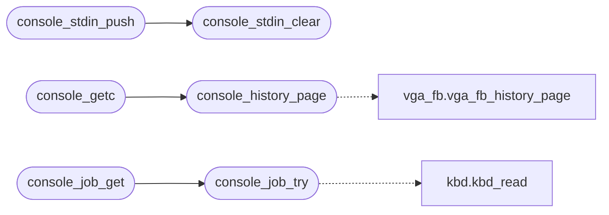

# `kernel/console_in.c`

> Source: [kernel/console_in.c:1](../../kernel/console_in.c#L1) | language `c` | coverage 68.4% | [API index](../index.md)

Docstring: Console input device (kernel/console_in.c).

## Contents

- **Functions:** [`console_stdin_push`](#console_stdin_push), [`console_stdin_clear`](#console_stdin_clear), [`console_stdin_active`](#console_stdin_active), [`console_ungetc`](#console_ungetc), [`ESC`](#esc), [`console_history_page`](#console_history_page), [`console_getc`](#console_getc), [`console_peek`](#console_peek), [`console_raw_try`](#console_raw_try), [`console_raw_get`](#console_raw_get), [`console_job_try`](#console_job_try), [`console_job_get`](#console_job_get)
- **Macros:** [`PB_LEN`](#pb_len), [`MAX_SEQ_POLL`](#max_seq_poll), [`SB_LEN`](#sb_len), [`SB_PGUP`](#sb_pgup), [`SB_PGDN`](#sb_pgdn), [`SB_EXIT`](#sb_exit)

## Call Graph

Solid arrows stay in this module, dashed arrows leave it.



## Functions

<a id="console_stdin_push"></a>

### `console_stdin_push`

`function` | [kernel/console_in.c:32](../../kernel/console_in.c#L32)

```c
int console_stdin_push(const char *data, unsigned long len)
```

Docstring: Install a pipeline stdin buffer (see header).

**Parameters**

| Name | Type | Default | Description |
|---|---|---|---|
| `data` | `char *` |  |  |
| `len` | `unsigned long` |  |  |

**Returns:** `int`

*Calls:* [`console_stdin_clear`](#console_stdin_clear)

---

<a id="console_stdin_clear"></a>

### `console_stdin_clear`

`function` | [kernel/console_in.c:46](../../kernel/console_in.c#L46)

```c
void console_stdin_clear(void)
```

Docstring: Release the pipeline stdin buffer, back to live console.

*Called by:* [`console_stdin_push`](#console_stdin_push)

---

<a id="console_stdin_active"></a>

### `console_stdin_active`

`function` | [kernel/console_in.c:56](../../kernel/console_in.c#L56)

```c
int console_stdin_active(void)
```

Docstring: True while a pipeline stdin buffer is installed (drained or not).

Lets sys_read tell piped EOF from a live block.

**Returns:** `int`

---

<a id="console_ungetc"></a>

### `console_ungetc`

`function` | [kernel/console_in.c:85](../../kernel/console_in.c#L85)

```c
void console_ungetc(unsigned char c)
```

Docstring: Push one byte back into the console FIFO; the next console_getc/console_peek serves it first.

Drops the byte when full.

**Parameters**

| Name | Type | Default | Description |
|---|---|---|---|
| `c` | `unsigned char` |  |  |

---

<a id="esc"></a>

### `ESC`

`function` | [kernel/console_in.c:157](../../kernel/console_in.c#L157)

```c
* The bound keeps a bare ESC (never completed into a sequence) from * hanging the reader. */ #de...
```

**Parameters**

| Name | Type | Default | Description |
|---|---|---|---|
| `sequence` | `never completed into a` |  |  |

**Returns:** `* The bound keeps a bare`

---

<a id="console_history_page"></a>

### `console_history_page`

`function` | [kernel/console_in.c:204](../../kernel/console_in.c#L204)

```c
void console_history_page(int dir)
```

Docstring: Page the console history by one screen (dir -1 up, +1 down).

The framebuffer terminal keeps its own logical ring, the text-mode console the legacy VGA scrollback ring; this picks the one that is up and is the single entry point for the page keys.

**Parameters**

| Name | Type | Default | Description |
|---|---|---|---|
| `dir` | `int` |  |  |

*Calls:* [`vga_fb_history_page`](headers.vga_fb.h.md#vga_fb_history_page)

*Called by:* [`console_getc`](#console_getc)

---

<a id="console_getc"></a>

### `console_getc`

`function` | [kernel/console_in.c:217](../../kernel/console_in.c#L217)

```c
int console_getc(void)
```

Docstring: Blocking read from either the PS/2 keyboard or COM1 serial line.

Recognises the PageUp/PageDown escape sequences and detours into the scrollback view; the view re-injects any terminating key into the pushback FIFO, so once it returns console_getc() simply serves the FIFO again.

**Returns:** `int`

*Calls:* [`console_history_page`](#console_history_page)

---

<a id="console_peek"></a>

### `console_peek`

`function` | [kernel/console_in.c:247](../../kernel/console_in.c#L247)

```c
int console_peek(void)
```

Docstring: Next buffered byte without consuming it, or -1 when nothing is available right now.

Used to tell an ESC prefix from a complete escape sequence, which always arrives in one burst. Global so SYS_SPAWN waits in spawn.c can poll for Ctrl+C exactly like the shell foreground wait does.

**Returns:** `int`

---

<a id="console_raw_try"></a>

### `console_raw_try`

`function` | [kernel/console_in.c:260](../../kernel/console_in.c#L260)

```c
int console_raw_try(void)
```

Docstring: Raw console multiplexer for the GETC_RAW syscall.

The same serial + PS/2 sources console_getc funnels, but without the line buffering, echo or scrollback detour: a ring-3 fullscreen program reads keystrokes byte by byte. Blocking spins with a pause (and the desktop tick, as the shell idle loop does); the try variant returns -1 when nothing is available so user space can implement its own timeout.

**Returns:** `int`

---

<a id="console_raw_get"></a>

### `console_raw_get`

`function` | [kernel/console_in.c:264](../../kernel/console_in.c#L264)

```c
int console_raw_get(void)
```

**Returns:** `int`

---

<a id="console_job_try"></a>

### `console_job_try`

`function` | [kernel/console_in.c:271](../../kernel/console_in.c#L271)

```c
int console_job_try(void)
```

Docstring: GETC_RAW source for ring-3 background jobs.

Serves the USB path too, so a ring-3 program that owns the keyboard on modern hardware is not handed a dead 8042.

**Returns:** `int`

*Calls:* [`kbd_read`](headers.drivers.kbd.h.md#kbd_read)

*Called by:* [`console_job_get`](#console_job_get)

---

<a id="console_job_get"></a>

### `console_job_get`

`function` | [kernel/console_in.c:281](../../kernel/console_in.c#L281)

```c
int console_job_get(void)
```

Docstring: Blocking PS/2-only GETC_RAW source for background jobs.

**Returns:** `int`

*Calls:* [`console_job_try`](#console_job_try)

---

## Macros

<a id="pb_len"></a>

### `PB_LEN`

`macro` | [kernel/console_in.c:18](../../kernel/console_in.c#L18)

```c
#define PB_LEN
```

---

<a id="max_seq_poll"></a>

### `MAX_SEQ_POLL`

`macro` | [kernel/console_in.c:159](../../kernel/console_in.c#L159)

```c
#define MAX_SEQ_POLL
```

Docstring: Poll for the next raw byte with a bounded spin, so a multi-byte escape sequence arriving over the serial line (byte by byte) is read as a unit.

Returns the byte, or -1 after MAX_SEQ_POLL polls. The bound keeps a bare ESC (never completed into a sequence) from hanging the reader.

---

<a id="sb_len"></a>

### `SB_LEN`

`macro` | [kernel/console_in.c:295](../../kernel/console_in.c#L295)

```c
#define SB_LEN
```

Docstring: Scrollback view.

Renders a 25-row window over (scrollback ring + live screen) into the VGA framebuffer and to the serial console, hides the cursor, and lets the user page up/down through history. PageDown at the bottom, or any other key, exits; the exit key is re-injected into the pushback FIFO so the readline that was waiting for input receives it as if scrollback never happened.

---

<a id="sb_pgup"></a>

### `SB_PGUP`

`macro` | [kernel/console_in.c:318](../../kernel/console_in.c#L318)

```c
#define SB_PGUP
```

---

<a id="sb_pgdn"></a>

### `SB_PGDN`

`macro` | [kernel/console_in.c:319](../../kernel/console_in.c#L319)

```c
#define SB_PGDN
```

---

<a id="sb_exit"></a>

### `SB_EXIT`

`macro` | [kernel/console_in.c:320](../../kernel/console_in.c#L320)

```c
#define SB_EXIT
```

---
