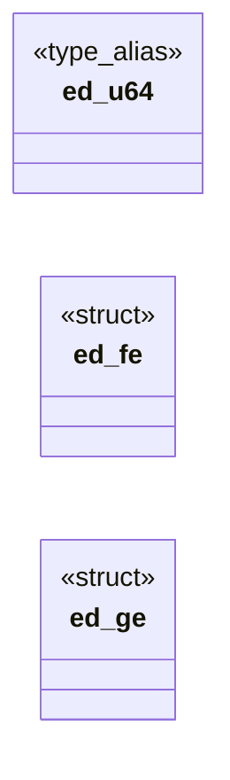
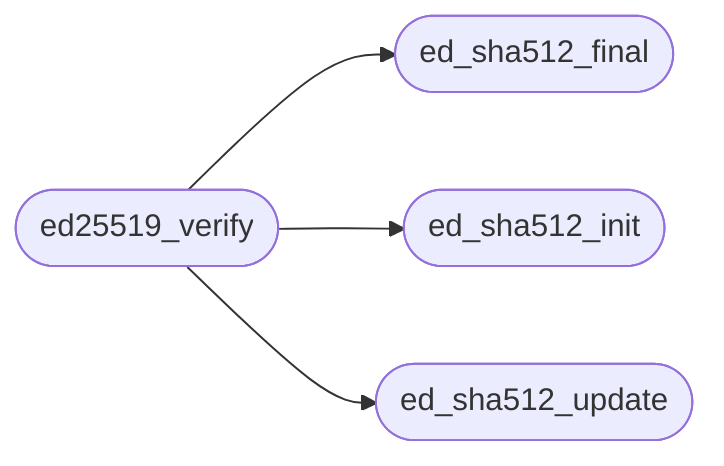

# `kernel/ed25519.c`

> Source: [kernel/ed25519.c:1](../../kernel/ed25519.c#L1) | language `c` | coverage 62.5% | [API index](../index.md)

## Contents

- **Structs:** [`ed_fe`](#ed_fe), [`ed_ge`](#ed_ge)
- **Type Aliases:** [`ed_u64`](#ed_u64)
- **Functions:** [`ed_sha512_init`](#ed_sha512_init), [`ed_sha512_update`](#ed_sha512_update), [`ed_sha512_final`](#ed_sha512_final), [`ed25519_verify`](#ed25519_verify)

## Type Diagram



## Call Graph

Solid arrows stay in this module, dashed arrows leave it.



## Structs

<a id="ed_fe"></a>

### `ed_fe`

`struct` | [kernel/ed25519.c:28](../../kernel/ed25519.c#L28)

```c
typedef struct
```

---

<a id="ed_ge"></a>

### `ed_ge`

`struct` | [kernel/ed25519.c:32](../../kernel/ed25519.c#L32)

```c
typedef struct
```

---

## Type Aliases

<a id="ed_u64"></a>

### `ed_u64`

`type_alias` | [kernel/ed25519.c:23](../../kernel/ed25519.c#L23)

```c
typedef unsigned long long ed_u64;
```

Docstring: kernel/ed25519.c -- Ed25519 signature verification.

Freestanding verify-only half of Ed25519 (RFC 8032): SHA-512 plus
twisted-Edwards verification over Curve25519. No signing, no key
generation; private scalars never exist in the kernel. The file
includes nothing and uses only unsigned char, unsigned long and
unsigned long long, so the same source builds for the kernel
(-ffreestanding) and for the host suite (tests/test_sign.c).

Field elements are four little-endian 64-bit limbs. Products use
__uint128_t schoolbook multiply with repeated 38-folds, and
scalars reduce mod L by binary long division, so no
transcription-risk prime multiple tables are needed. Point decoding
recovers x by exponentiation with a sqrt(-1) adjustment computed at
run time, so the only transcribed constants are the base point
encoding, L, q and the SHA-512 table, all generated by script and
pinned by tests/test_sign.c.

Every input to verification is public (signature, message, key),
so variable-time field arithmetic is acceptable here; the scalar
multiply still uses double-and-add-always out of hygiene.

---

## Functions

<a id="ed_sha512_init"></a>

### `ed_sha512_init`

`function` | [kernel/ed25519.c:147](../../kernel/ed25519.c#L147)

```c
void ed_sha512_init(ed_sha *c)
```

Docstring: Start a SHA-512 digest.

**Parameters**

| Name | Type | Default | Description |
|---|---|---|---|
| `c` | `ed_sha *` |  |  |

*Called by:* [`ed25519_verify`](#ed25519_verify)

---

<a id="ed_sha512_update"></a>

### `ed_sha512_update`

`function` | [kernel/ed25519.c:162](../../kernel/ed25519.c#L162)

```c
void ed_sha512_update(ed_sha *c, const unsigned char *data, unsigned long len)
```

Docstring: Feed bytes into a running SHA-512 digest.

**Parameters**

| Name | Type | Default | Description |
|---|---|---|---|
| `c` | `ed_sha *` |  |  |
| `data` | `unsigned char *` |  |  |
| `len` | `unsigned long` |  |  |

*Called by:* [`ed25519_verify`](#ed25519_verify)

---

<a id="ed_sha512_final"></a>

### `ed_sha512_final`

`function` | [kernel/ed25519.c:188](../../kernel/ed25519.c#L188)

```c
void ed_sha512_final(ed_sha *c, unsigned char out[64])
```

Docstring: Finish a SHA-512 digest into 64 bytes, big-endian length.

**Parameters**

| Name | Type | Default | Description |
|---|---|---|---|
| `c` | `ed_sha *` |  |  |
| `out` | `unsigned char [64]` |  |  |

*Called by:* [`ed25519_verify`](#ed25519_verify)

---

<a id="ed25519_verify"></a>

### `ed25519_verify`

`function` | [kernel/ed25519.c:810](../../kernel/ed25519.c#L810)

```c
int ed25519_verify(const unsigned char sig[64], const unsigned char *msg, unsigned long msglen, const unsigned char pub[32])
```

Docstring: Verify an Ed25519 signature, 1 valid else 0 fail-closed.

Rejects S at or above L and non-canonical R/A encodings before any
curve work, then checks [S]B minus [h]A against R by
cross-multiplied projective comparison, so no inversion touches
the hot path. Null inputs refuse.

**Parameters**

| Name | Type | Default | Description |
|---|---|---|---|
| `sig` | `unsigned char [64]` |  |  |
| `msg` | `unsigned char *` |  |  |
| `msglen` | `unsigned long` |  |  |
| `pub` | `unsigned char [32]` |  |  |

**Returns:** `int`

*Calls:* [`ed_sha512_final`](#ed_sha512_final), [`ed_sha512_init`](#ed_sha512_init), [`ed_sha512_update`](#ed_sha512_update)

---
