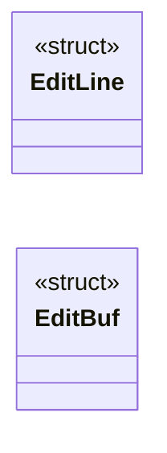

# `kernel/editor.c`

> Source: [kernel/editor.c:1](../../kernel/editor.c#L1) | language `c` | coverage 14.3% | [API index](../index.md)

================================================================

## Contents

- **Structs:** [`EditLine`](#editline), [`EditBuf`](#editbuf)
- **Functions:** [`shell_cmd_edit`](#shell_cmd_edit)
- **Macros:** [`EDIT_MAX_LINES`](#edit_max_lines), [`EDIT_LINE_MAX`](#edit_line_max), [`EDIT_FILE_MAX`](#edit_file_max)

## Type Diagram



## Structs

<a id="editline"></a>

### `EditLine`

`struct` | [kernel/editor.c:24](../../kernel/editor.c#L24)

```c
typedef struct
```

---

<a id="editbuf"></a>

### `EditBuf`

`struct` | [kernel/editor.c:29](../../kernel/editor.c#L29)

```c
typedef struct
```

---

## Functions

<a id="shell_cmd_edit"></a>

### `shell_cmd_edit`

`function` | [kernel/editor.c:329](../../kernel/editor.c#L329)

```c
void shell_cmd_edit(int argc, char **argv)
```

**Parameters**

| Name | Type | Default | Description |
|---|---|---|---|
| `argc` | `int` |  |  |
| `argv` | `char **` |  |  |

---

## Macros

<a id="edit_max_lines"></a>

### `EDIT_MAX_LINES`

`macro` | [kernel/editor.c:20](../../kernel/editor.c#L20)

```c
#define EDIT_MAX_LINES
```

---

<a id="edit_line_max"></a>

### `EDIT_LINE_MAX`

`macro` | [kernel/editor.c:21](../../kernel/editor.c#L21)

```c
#define EDIT_LINE_MAX
```

---

<a id="edit_file_max"></a>

### `EDIT_FILE_MAX`

`macro` | [kernel/editor.c:22](../../kernel/editor.c#L22)

```c
#define EDIT_FILE_MAX
```

---
