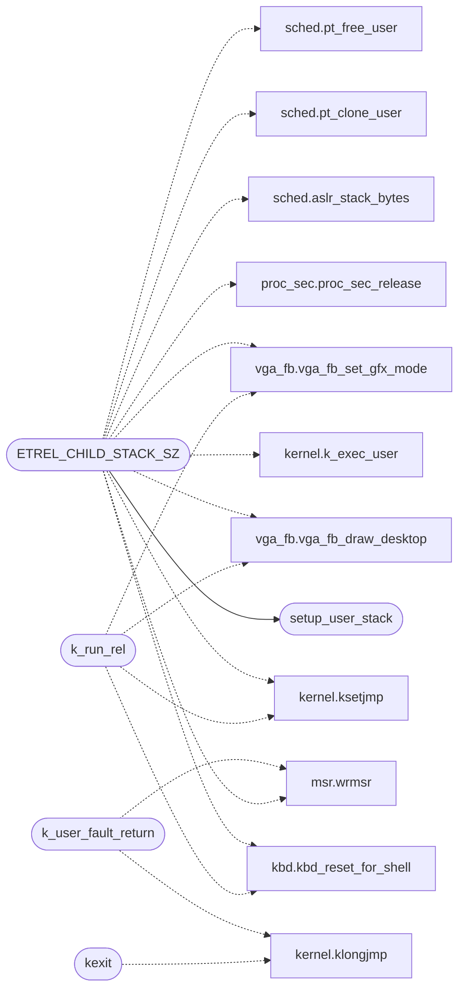

# `kernel/exec.c`

> Source: [kernel/exec.c:1](../../kernel/exec.c#L1) | language `c` | coverage 40.0% | [API index](../index.md)

exec.c - Process execution: setjmp/longjmp, k_exec_user, k_run_rel, kexit.

## Contents

- **Functions:** [`vga_mode_set`](#vga_mode_set), [`vga_mode_is_active`](#vga_mode_is_active), [`vga_gfx_ran_set`](#vga_gfx_ran_set), [`k_user_fault_return`](#k_user_fault_return), [`setup_user_stack`](#setup_user_stack), [`k_run_rel`](#k_run_rel), [`kexit`](#kexit)
- **Macros:** [`EXEC_KSTACK_SZ`](#exec_kstack_sz), [`ETREL_CHILD_STACK_SZ`](#etrel_child_stack_sz)
- **Variables:** [`syscall_kstack`](#syscall_kstack)

## Call Graph

Solid arrows stay in this module, dashed arrows leave it.



## Functions

<a id="vga_mode_set"></a>

### `vga_mode_set`

`function` | [kernel/exec.c:61](../../kernel/exec.c#L61)

```c
void vga_mode_set(int on)
```

**Parameters**

| Name | Type | Default | Description |
|---|---|---|---|
| `on` | `int` |  |  |

---

<a id="vga_mode_is_active"></a>

### `vga_mode_is_active`

`function` | [kernel/exec.c:62](../../kernel/exec.c#L62)

```c
int vga_mode_is_active(void)
```

**Returns:** `int`

---

<a id="vga_gfx_ran_set"></a>

### `vga_gfx_ran_set`

`function` | [kernel/exec.c:63](../../kernel/exec.c#L63)

```c
void vga_gfx_ran_set(int on)
```

**Parameters**

| Name | Type | Default | Description |
|---|---|---|---|
| `on` | `int` |  |  |

---

<a id="k_user_fault_return"></a>

### `k_user_fault_return`

`function` | [kernel/exec.c:66](../../kernel/exec.c#L66)

```c
void k_user_fault_return(void)
```

Called from the ISR exception handler when a ring-3 user program faults.

*Calls:* [`wrmsr`](headers.arch.x86.msr.h.md#wrmsr), [`klongjmp`](headers.kernel.h.md#klongjmp)

---

<a id="setup_user_stack"></a>

### `setup_user_stack`

`function` | [kernel/exec.c:83](../../kernel/exec.c#L83)

```c
unsigned long *setup_user_stack(char *sbase, unsigned long ssize, int argc, char **argv)
```

**Parameters**

| Name | Type | Default | Description |
|---|---|---|---|
| `sbase` | `char *` |  |  |
| `ssize` | `unsigned long` |  |  |
| `argc` | `int` |  |  |
| `argv` | `char **` |  |  |

**Returns:** `unsigned long *`

*Called by:* [`ETREL_CHILD_STACK_SZ`](#etrel_child_stack_sz)

---

<a id="k_run_rel"></a>

### `k_run_rel`

`function` | [kernel/exec.c:233](../../kernel/exec.c#L233)

```c
int k_run_rel(prog_entry_t entry, int argc, char **argv)
```

**Parameters**

| Name | Type | Default | Description |
|---|---|---|---|
| `entry` | `prog_entry_t` |  |  |
| `argc` | `int` |  |  |
| `argv` | `char **` |  |  |

**Returns:** `int`

*Calls:* [`kbd_reset_for_shell`](headers.drivers.kbd.h.md#kbd_reset_for_shell), [`ksetjmp`](headers.kernel.h.md#ksetjmp), [`vga_fb_draw_desktop`](headers.vga_fb.h.md#vga_fb_draw_desktop), [`vga_fb_set_gfx_mode`](headers.vga_fb.h.md#vga_fb_set_gfx_mode)

---

<a id="kexit"></a>

### `kexit`

`function` | [kernel/exec.c:284](../../kernel/exec.c#L284)

```c
void kexit(int code)
```

**Parameters**

| Name | Type | Default | Description |
|---|---|---|---|
| `code` | `int` |  |  |

*Calls:* [`klongjmp`](headers.kernel.h.md#klongjmp)

---

## Macros

<a id="exec_kstack_sz"></a>

### `EXEC_KSTACK_SZ`

`macro` | [kernel/exec.c:124](../../kernel/exec.c#L124)

```c
#define EXEC_KSTACK_SZ
```

Kernel stack the exec frame runs on.

It must hold both the ring-3 program's syscall frames and any ring-0 ET_REL child it spawns through SYS_SPAWN (the toolchain's minigcc/ld recurse deeply), so it is larger than the per-proc scheduler slot: a child that overflowed the old 32 KB wrote past its stack into adjacent kernel-heap page tables and made pt_free_user spin on the corrupted entries.

---

<a id="etrel_child_stack_sz"></a>

### `ETREL_CHILD_STACK_SZ`

`macro` | [kernel/exec.c:133](../../kernel/exec.c#L133)

```c
#define ETREL_CHILD_STACK_SZ
```

ET_REL child stack: the toolchain recurses deeper than any fixed small slot.

Measured need is a 66 KB single frame in minigcc's parse_function, so 64 KB (the old EXEC_KSTACK_SZ and every 16 KB proc slot) overflows it: silently into pool neighbours from an isolated window (the lost MiniFS mount), by luck nowhere fatal from the shell. 256 KB is transient per spawn and leaves headroom for nesting.

*Calls:* [`wrmsr`](headers.arch.x86.msr.h.md#wrmsr), [`kbd_reset_for_shell`](headers.drivers.kbd.h.md#kbd_reset_for_shell), [`k_exec_user`](headers.kernel.h.md#k_exec_user), [`ksetjmp`](headers.kernel.h.md#ksetjmp), [`proc_sec_release`](headers.proc_sec.h.md#proc_sec_release), [`aslr_stack_bytes`](headers.sched.h.md#aslr_stack_bytes), [`pt_clone_user`](headers.sched.h.md#pt_clone_user), [`pt_free_user`](headers.sched.h.md#pt_free_user), [`vga_fb_draw_desktop`](headers.vga_fb.h.md#vga_fb_draw_desktop), [`vga_fb_set_gfx_mode`](headers.vga_fb.h.md#vga_fb_set_gfx_mode), [`setup_user_stack`](#setup_user_stack)

---

## Variables

<a id="syscall_kstack"></a>

### `syscall_kstack`

`variable` `extern` | [kernel/exec.c:116](../../kernel/exec.c#L116)

```c
extern unsigned long syscall_kstack;
```

Enter a ring-3 program via iretq.

---
