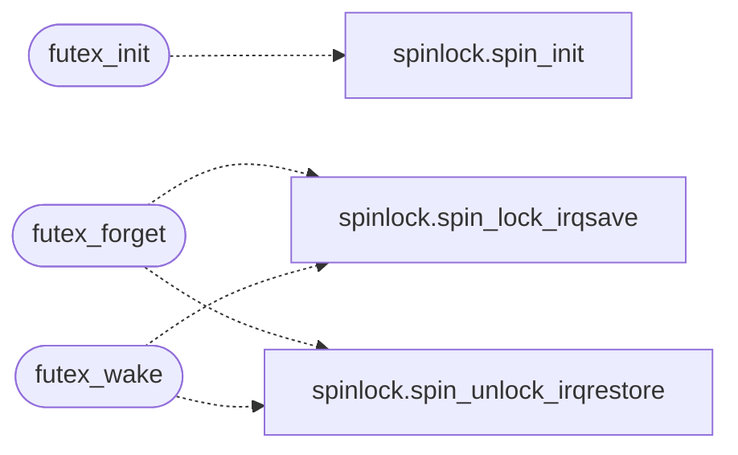

# `kernel/futex.c`

> Source: [kernel/futex.c:1](../../kernel/futex.c#L1) | language `c` | coverage 85.7% | [API index](../index.md)

Docstring: kernel/futex.c -- Kernel side of the futex contract.

## Contents

- **Structs:** [`futex_table_t`](#futex_table_t)
- **Functions:** [`futex_init`](#futex_init), [`futex_forget`](#futex_forget), [`futex_linux_cmd`](#futex_linux_cmd), [`futex_timeout_remaining_us`](#futex_timeout_remaining_us), [`futex_wake`](#futex_wake)
- **Variables:** [`t_cur_pid`](#t_cur_pid)

## Call Graph

Solid arrows stay in this module, dashed arrows leave it.



## Structs

<a id="futex_table_t"></a>

### `futex_table_t`

`struct` | [kernel/futex.c:16](../../kernel/futex.c#L16)

```c
typedef struct
```

---

## Functions

<a id="futex_init"></a>

### `futex_init`

`function` | [kernel/futex.c:36](../../kernel/futex.c#L36)

```c
void futex_init(void)
```

Docstring: Initialize every bucket queue and clear the awaited table.

*Calls:* [`spin_init`](headers.spinlock.h.md#spin_init)

---

<a id="futex_forget"></a>

### `futex_forget`

`function` | [kernel/futex.c:76](../../kernel/futex.c#L76)

```c
void futex_forget(int pid)
```

Docstring: Drop pid from the futex queues (see futex.h).

A thread that dies or is killed while waiting stays queued; once its slot is reused the stale node aliases the new thread, and the new thread queueing behind itself linked tail -> tail, a cycle futex_wake spun on forever. Called before every wait and when a slot is reaped.

**Parameters**

| Name | Type | Default | Description |
|---|---|---|---|
| `pid` | `int` |  |  |

*Calls:* [`spin_lock_irqsave`](headers.spinlock.h.md#spin_lock_irqsave), [`spin_unlock_irqrestore`](headers.spinlock.h.md#spin_unlock_irqrestore)

---

<a id="futex_linux_cmd"></a>

### `futex_linux_cmd`

`function` | [kernel/futex.c:128](../../kernel/futex.c#L128)

```c
int futex_linux_cmd(long op)
```

Docstring: Decode a Linux futex(2) op to WAIT/WAKE.

**Parameters**

| Name | Type | Default | Description |
|---|---|---|---|
| `op` | `long` |  |  |

**Returns:** `int`

---

<a id="futex_timeout_remaining_us"></a>

### `futex_timeout_remaining_us`

`function` | [kernel/futex.c:139](../../kernel/futex.c#L139)

```c
long futex_timeout_remaining_us(int cmd, long sec, long nsec, unsigned long now_us)
```

Docstring: Microseconds left before a futex timeout (see futex.h).

**Parameters**

| Name | Type | Default | Description |
|---|---|---|---|
| `cmd` | `int` |  |  |
| `sec` | `long` |  |  |
| `nsec` | `long` |  |  |
| `now_us` | `unsigned long` |  |  |

**Returns:** `long`

---

<a id="futex_wake"></a>

### `futex_wake`

`function` | [kernel/futex.c:158](../../kernel/futex.c#L158)

```c
long futex_wake(unsigned long uaddr, int n)
```

Docstring: Wake up to n sleepers waiting on uaddr.

Only entries whose recorded address equals uaddr change state; hash
collisions sleep through. Entries that no longer sleep (a waiter that
died or was killed in the queue) are unlinked on the way. The walk is
bounded by MAX_PROCS. Returns the number of threads woken, zero when
the bucket holds no waiter for this address. Never sleeps.

**Parameters**

| Name | Type | Default | Description |
|---|---|---|---|
| `uaddr` | `unsigned long` |  |  |
| `n` | `int` |  |  |

**Returns:** `long`

*Calls:* [`spin_lock_irqsave`](headers.spinlock.h.md#spin_lock_irqsave), [`spin_unlock_irqrestore`](headers.spinlock.h.md#spin_unlock_irqrestore)

---

## Variables

<a id="t_cur_pid"></a>

### `t_cur_pid`

`variable` `extern` | [kernel/futex.c:13](../../kernel/futex.c#L13)

```c
extern int t_cur_pid;
```

ifdef SYNC_HOST_CURRENT_PID

---
