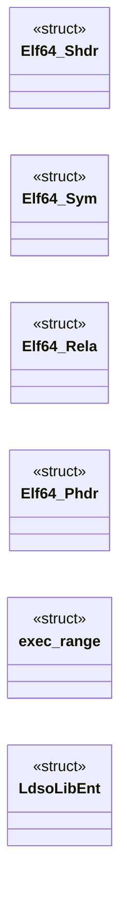
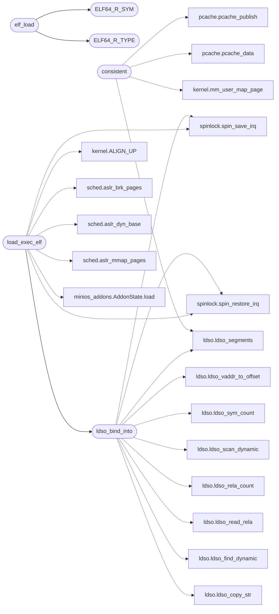

# `kernel/loader.c`

> Source: [kernel/loader.c:1](../../kernel/loader.c#L1) | language `c` | coverage 14.0% | [API index](../index.md)

================================================================

## Contents

- **Structs:** [`Elf64_Shdr`](#elf64_shdr), [`Elf64_Sym`](#elf64_sym), [`Elf64_Rela`](#elf64_rela), [`Elf64_Phdr`](#elf64_phdr), [`exec_range`](#exec_range), [`LdsoLibEnt`](#ldsolibent)
- **Functions:** [`elf_load`](#elf_load), [`inodes`](#inodes), [`ldso_pseudo_stat`](#ldso_pseudo_stat), [`ldso_pseudo_read`](#ldso_pseudo_read), [`consistent`](#consistent), [`images`](#images), [`ldso_bind_into`](#ldso_bind_into), [`load_exec_elf`](#load_exec_elf), [`process`](#process), [`base_out`](#base_out), [`elf_wants_process`](#elf_wants_process), [`load_exec_elf_into`](#load_exec_elf_into), [`time`](#time)
- **Macros:** [`ELF64_R_SYM`](#elf64_r_sym), [`ELF64_R_TYPE`](#elf64_r_type), [`SHN_UNDEF`](#shn_undef), [`ETREL_IMAGE_MAX`](#etrel_image_max), [`SHT_SYMTAB`](#sht_symtab), [`SHT_STRTAB`](#sht_strtab), [`SHT_RELA`](#sht_rela), [`SHT_PROGBITS`](#sht_progbits), [`SHT_NOBITS`](#sht_nobits), [`SHF_ALLOC`](#shf_alloc), [`SHF_EXECINSTR`](#shf_execinstr), [`EM_X86_64`](#em_x86_64), [`PT_LOAD`](#pt_load), [`PT_NOTE`](#pt_note), [`ELF_NOTE_HDR`](#elf_note_hdr), [`ELF_NOTE_ALIGN`](#elf_note_align), [`R_X86_64_64`](#r_x86_64_64), [`R_X86_64_PC32`](#r_x86_64_pc32), [`R_X86_64_PLT32`](#r_x86_64_plt32), [`R_X86_64_GLOB_DAT`](#r_x86_64_glob_dat), [`R_X86_64_JUMP_SLOT`](#r_x86_64_jump_slot), [`R_X86_64_RELATIVE`](#r_x86_64_relative), [`R_X86_64_32`](#r_x86_64_32), [`R_X86_64_32S`](#r_x86_64_32s), [`R_X86_64_IRELATIVE`](#r_x86_64_irelative), [`PF_X`](#pf_x), [`ELF_MAX_SEGMENTS`](#elf_max_segments), [`ELF_NAME_MAX`](#elf_name_max), [`SHT_NOTE`](#sht_note), [`SIGN_NOTE_NAME`](#sign_note_name)

## Type Diagram



## Call Graph

Solid arrows stay in this module, dashed arrows leave it.



## Structs

<a id="elf64_shdr"></a>

### `Elf64_Shdr`

`struct` | [kernel/loader.c:23](../../kernel/loader.c#L23)

```c
typedef struct
```

---

<a id="elf64_sym"></a>

### `Elf64_Sym`

`struct` | [kernel/loader.c:36](../../kernel/loader.c#L36)

```c
typedef struct
```

---

<a id="elf64_rela"></a>

### `Elf64_Rela`

`struct` | [kernel/loader.c:45](../../kernel/loader.c#L45)

```c
typedef struct
```

---

<a id="elf64_phdr"></a>

### `Elf64_Phdr`

`struct` | [kernel/loader.c:51](../../kernel/loader.c#L51)

```c
typedef struct
```

---

<a id="exec_range"></a>

### `exec_range`

`struct` | [kernel/loader.c:104](../../kernel/loader.c#L104)

```c
struct exec_range { unsigned long start, end; };
```

---

<a id="ldsolibent"></a>

### `LdsoLibEnt`

`struct` | [kernel/loader.c:388](../../kernel/loader.c#L388)

```c
typedef struct
```

---

## Functions

<a id="elf_load"></a>

### `elf_load`

`function` | [kernel/loader.c:136](../../kernel/loader.c#L136)

```c
void *elf_load(void *data, unsigned size, void **base_out)
```

**Parameters**

| Name | Type | Default | Description |
|---|---|---|---|
| `data` | `void *` |  |  |
| `size` | `unsigned` |  |  |
| `base_out` | `void **` |  |  |

**Returns:** `void *`

*Calls:* [`ELF64_R_SYM`](#elf64_r_sym), [`ELF64_R_TYPE`](#elf64_r_type)

---

<a id="inodes"></a>

### `inodes`

`function` | [kernel/loader.c:381](../../kernel/loader.c#L381)

```c
* Pseudo inodes (LDSO_INO_BASE + slot) keep registry pages apart from * MiniFS inodes in the shared cache. No unload in v1: slots and file * copies live for the machine's life, and the refcount names
```

**Parameters**

| Name | Type | Default | Description |
|---|---|---|---|
| `slot` | `LDSO_INO_BASE +` |  |  |

**Returns:** `* Pseudo`

---

<a id="ldso_pseudo_stat"></a>

### `ldso_pseudo_stat`

`function` | [kernel/loader.c:402](../../kernel/loader.c#L402)

```c
int ldso_pseudo_stat(int ino, unsigned long *size_out)
```

**Parameters**

| Name | Type | Default | Description |
|---|---|---|---|
| `ino` | `int` |  |  |
| `size_out` | `unsigned long *` |  |  |

**Returns:** `int`

---

<a id="ldso_pseudo_read"></a>

### `ldso_pseudo_read`

`function` | [kernel/loader.c:416](../../kernel/loader.c#L416)

```c
int ldso_pseudo_read(int ino, void *dst, unsigned long off, unsigned len)
```

**Parameters**

| Name | Type | Default | Description |
|---|---|---|---|
| `ino` | `int` |  |  |
| `dst` | `void *` |  |  |
| `off` | `unsigned long` |  |  |
| `len` | `unsigned` |  |  |

**Returns:** `int`

---

<a id="consistent"></a>

### `consistent`

`function` | [kernel/loader.c:579](../../kernel/loader.c#L579)

```c
* consistent (the next exec forgets them, a dying window frees them), * and only reports. */ sta...
```

**Parameters**

| Name | Type | Default | Description |
|---|---|---|---|
| `them` | `the next exec forgets` |  |  |
| `them` | `a dying window frees` |  |  |

**Returns:** `*`

*Calls:* [`mm_user_map_page`](headers.kernel.h.md#mm_user_map_page), [`ldso_segments`](headers.ldso.h.md#ldso_segments), [`pcache_data`](headers.pcache.h.md#pcache_data), [`pcache_publish`](headers.pcache.h.md#pcache_publish)

---

<a id="images"></a>

### `images`

`function` | [kernel/loader.c:790](../../kernel/loader.c#L790)

```c
* Static images (no dynamic section, or none needed) return 0 at * once, so the legacy paths never observe a difference. Live callers * pass cr3 0 and vma 0 (current tables, legacy view already bound)
```

**Parameters**

| Name | Type | Default | Description |
|---|---|---|---|
| `section` | `no dynamic` |  |  |
| `needed` | `or none` |  |  |

**Returns:** `* Static`

---

<a id="ldso_bind_into"></a>

### `ldso_bind_into`

`function` | [kernel/loader.c:794](../../kernel/loader.c#L794)

```c
int ldso_bind_into(void *data, unsigned size, unsigned long base, unsigned long cr3, vma_ctx_t *vma)
```

Bind one executable image with DT_NEEDED libraries: map every library into the target window, then resolve each GLOB_DAT row.

Static images (no dynamic section, or none needed) return 0 at once, so the legacy paths never observe a difference. Live callers pass cr3 0 and vma 0 (current tables, legacy view already bound); isolated callers pass the child's tables and context.

**Parameters**

| Name | Type | Default | Description |
|---|---|---|---|
| `data` | `void *` |  |  |
| `size` | `unsigned` |  |  |
| `base` | `unsigned long` |  |  |
| `cr3` | `unsigned long` |  |  |
| `vma` | `vma_ctx_t *` |  |  |

**Returns:** `int`

*Calls:* [`ldso_copy_str`](headers.ldso.h.md#ldso_copy_str), [`ldso_find_dynamic`](headers.ldso.h.md#ldso_find_dynamic), [`ldso_read_rela`](headers.ldso.h.md#ldso_read_rela), [`ldso_rela_count`](headers.ldso.h.md#ldso_rela_count), [`ldso_scan_dynamic`](headers.ldso.h.md#ldso_scan_dynamic), [`ldso_segments`](headers.ldso.h.md#ldso_segments), [`ldso_sym_count`](headers.ldso.h.md#ldso_sym_count), [`ldso_vaddr_to_offset`](headers.ldso.h.md#ldso_vaddr_to_offset), [`spin_restore_irq`](headers.spinlock.h.md#spin_restore_irq), [`spin_save_irq`](headers.spinlock.h.md#spin_save_irq)

*Called by:* [`load_exec_elf`](#load_exec_elf)

---

<a id="load_exec_elf"></a>

### `load_exec_elf`

`function` | [kernel/loader.c:1262](../../kernel/loader.c#L1262)

```c
void *load_exec_elf(void *data, unsigned size)
```

ET_REL relocatable .o

**Parameters**

| Name | Type | Default | Description |
|---|---|---|---|
| `data` | `void *` |  |  |
| `size` | `unsigned` |  |  |

**Returns:** `void *`

> **Inherited:** Documentation from [`load_exec_elf`](#load_exec_elf) (headers/kernel.h:767).

*Calls:* [`ALIGN_UP`](headers.kernel.h.md#align_up), [`aslr_brk_pages`](headers.sched.h.md#aslr_brk_pages), [`aslr_dyn_base`](headers.sched.h.md#aslr_dyn_base), [`aslr_mmap_pages`](headers.sched.h.md#aslr_mmap_pages), [`spin_restore_irq`](headers.spinlock.h.md#spin_restore_irq), [`spin_save_irq`](headers.spinlock.h.md#spin_save_irq), [`ldso_bind_into`](#ldso_bind_into), [`AddonState.load`](mcp.minios_addons.py.md#addonstate-load)

---

<a id="process"></a>

### `process`

`function` | [kernel/loader.c:1288](../../kernel/loader.c#L1288)

```c
* atomic section: a 100 Hz tick between two segments would switch * CR3 into another process (copies landing in its pages, NX marks * and brk carved from its view) and corrupt whoever loses. The * iso
```

**Parameters**

| Name | Type | Default | Description |
|---|---|---|---|
| `pages` | `copies landing in its` |  |  |
| `view` | `NX marks * and brk carved from its` |  |  |

**Returns:** `* atomic section: a 100 Hz tick between two segments would switch * CR3 into another`

---

<a id="base_out"></a>

### `base_out`

`function` | [kernel/loader.c:1395](../../kernel/loader.c#L1395)

```c
* the link base via base_out (0 when the caller runs static images * only: the dynamic binder needs the same base the segments used, * and ASLR never repeats it). Shared graphics slots are never * written. Returns the entry VA, or 0 with a diagnostic. Relocation * fixups stay with the caller: static images need none, and DT_NEEDED * images bind through ldso_bind_into once their VMA context exists. * No function symbol is ever resolved to a null address: * unresolvable imports stay zero and fault only if called. */ /* 1 when one PT_NOTE segment [off, off + len) of the image carries the * MiniOS process note with a nonzero descriptor. Every field is checked * against the segment before it is read. */
```

**Parameters**

| Name | Type | Default | Description |
|---|---|---|---|
| `used` | `0 when the caller runs static images * only: the dynamic binder needs the same base the segments` |  |  |
| `it` | `* and ASLR never repeats` |  |  |

**Returns:** `* the link base via`

---

<a id="elf_wants_process"></a>

### `elf_wants_process`

`function` | [kernel/loader.c:1432](../../kernel/loader.c#L1432)

```c
int elf_wants_process(const void *data, unsigned size)
```

Does an ET_EXEC/ET_DYN image ask to run as a process (minios_abi.h, process note)?

Header and program-header table are bounds checked like load_exec_elf_into; any malformed table answers 0 and leaves the load itself to report it.

**Parameters**

| Name | Type | Default | Description |
|---|---|---|---|
| `data` | `void *` |  |  |
| `size` | `unsigned` |  |  |

**Returns:** `int`

---

<a id="load_exec_elf_into"></a>

### `load_exec_elf_into`

`function` | [kernel/loader.c:1456](../../kernel/loader.c#L1456)

```c
void *load_exec_elf_into(void *data, unsigned size, unsigned long cr3, unsigned long *brk_out, unsigned long *base_out)
```

process note

**Parameters**

| Name | Type | Default | Description |
|---|---|---|---|
| `data` | `void *` |  |  |
| `size` | `unsigned` |  |  |
| `cr3` | `unsigned long` |  |  |
| `brk_out` | `unsigned long *` |  |  |
| `base_out` | `unsigned long *` |  |  |

**Returns:** `void *`

> **Inherited:** Documentation from [`load_exec_elf_into`](#load_exec_elf_into) (headers/kernel.h:769).

*Calls:* [`ALIGN_UP`](headers.kernel.h.md#align_up), [`aslr_brk_pages`](headers.sched.h.md#aslr_brk_pages), [`aslr_dyn_base`](headers.sched.h.md#aslr_dyn_base), [`spin_restore_irq`](headers.spinlock.h.md#spin_restore_irq), [`spin_save_irq`](headers.spinlock.h.md#spin_save_irq)

---

<a id="time"></a>

### `time`

`function` | [kernel/loader.c:1520](../../kernel/loader.c#L1520)

```c
* time (with the failing offset);
```

**Parameters**

| Name | Type | Default | Description |
|---|---|---|---|
| `offset` | `with the failing` |  |  |

**Returns:** `*`

*Calls:* [`spin_restore_irq`](headers.spinlock.h.md#spin_restore_irq), [`spin_save_irq`](headers.spinlock.h.md#spin_save_irq)

*Called by:* [`tls_now_days`](headers.tls_port.h.md#tls_now_days), [`tls_random`](progs.tls_u.tls_u_port.c.md#tls_random)

---

## Macros

<a id="elf64_r_sym"></a>

### `ELF64_R_SYM`

`macro` | [kernel/loader.c:62](../../kernel/loader.c#L62)

```c
#define ELF64_R_SYM(i)
```

*Called by:* [`elf_load`](#elf_load)

---

<a id="elf64_r_type"></a>

### `ELF64_R_TYPE`

`macro` | [kernel/loader.c:63](../../kernel/loader.c#L63)

```c
#define ELF64_R_TYPE(i)
```

*Called by:* [`elf_load`](#elf_load)

---

<a id="shn_undef"></a>

### `SHN_UNDEF`

`macro` | [kernel/loader.c:64](../../kernel/loader.c#L64)

```c
#define SHN_UNDEF
```

---

<a id="etrel_image_max"></a>

### `ETREL_IMAGE_MAX`

`macro` | [kernel/loader.c:71](../../kernel/loader.c#L71)

```c
#define ETREL_IMAGE_MAX
```

ET_REL image cap: a hostile .o must not drive an unbounded kmalloc.

Measured need (2026-09, host gcc -O2): ld.o carries a 12.6 MB .bss and loads at ~12.7 MB total; minigcc.o ~0.8 MB, cvm.o ~36 KB. 16 MB fails closed with a diagnostic instead of draining the 192 MB kernel heap. Do not tighten below ld.o without remeasuring.

---

<a id="sht_symtab"></a>

### `SHT_SYMTAB`

`macro` | [kernel/loader.c:73](../../kernel/loader.c#L73)

```c
#define SHT_SYMTAB
```

---

<a id="sht_strtab"></a>

### `SHT_STRTAB`

`macro` | [kernel/loader.c:74](../../kernel/loader.c#L74)

```c
#define SHT_STRTAB
```

---

<a id="sht_rela"></a>

### `SHT_RELA`

`macro` | [kernel/loader.c:75](../../kernel/loader.c#L75)

```c
#define SHT_RELA
```

---

<a id="sht_progbits"></a>

### `SHT_PROGBITS`

`macro` | [kernel/loader.c:76](../../kernel/loader.c#L76)

```c
#define SHT_PROGBITS
```

---

<a id="sht_nobits"></a>

### `SHT_NOBITS`

`macro` | [kernel/loader.c:77](../../kernel/loader.c#L77)

```c
#define SHT_NOBITS
```

---

<a id="shf_alloc"></a>

### `SHF_ALLOC`

`macro` | [kernel/loader.c:78](../../kernel/loader.c#L78)

```c
#define SHF_ALLOC
```

---

<a id="shf_execinstr"></a>

### `SHF_EXECINSTR`

`macro` | [kernel/loader.c:79](../../kernel/loader.c#L79)

```c
#define SHF_EXECINSTR
```

---

<a id="em_x86_64"></a>

### `EM_X86_64`

`macro` | [kernel/loader.c:81](../../kernel/loader.c#L81)

```c
#define EM_X86_64
```

---

<a id="pt_load"></a>

### `PT_LOAD`

`macro` | [kernel/loader.c:82](../../kernel/loader.c#L82)

```c
#define PT_LOAD
```

---

<a id="pt_note"></a>

### `PT_NOTE`

`macro` | [kernel/loader.c:83](../../kernel/loader.c#L83)

```c
#define PT_NOTE
```

---

<a id="elf_note_hdr"></a>

### `ELF_NOTE_HDR`

`macro` | [kernel/loader.c:87](../../kernel/loader.c#L87)

```c
#define ELF_NOTE_HDR
```

ELF note header (namesz, descsz, type); name and descriptor follow, each padded to ELF_NOTE_ALIGN bytes.

---

<a id="elf_note_align"></a>

### `ELF_NOTE_ALIGN`

`macro` | [kernel/loader.c:88](../../kernel/loader.c#L88)

```c
#define ELF_NOTE_ALIGN
```

---

<a id="r_x86_64_64"></a>

### `R_X86_64_64`

`macro` | [kernel/loader.c:90](../../kernel/loader.c#L90)

```c
#define R_X86_64_64
```

---

<a id="r_x86_64_pc32"></a>

### `R_X86_64_PC32`

`macro` | [kernel/loader.c:91](../../kernel/loader.c#L91)

```c
#define R_X86_64_PC32
```

---

<a id="r_x86_64_plt32"></a>

### `R_X86_64_PLT32`

`macro` | [kernel/loader.c:92](../../kernel/loader.c#L92)

```c
#define R_X86_64_PLT32
```

---

<a id="r_x86_64_glob_dat"></a>

### `R_X86_64_GLOB_DAT`

`macro` | [kernel/loader.c:93](../../kernel/loader.c#L93)

```c
#define R_X86_64_GLOB_DAT
```

---

<a id="r_x86_64_jump_slot"></a>

### `R_X86_64_JUMP_SLOT`

`macro` | [kernel/loader.c:94](../../kernel/loader.c#L94)

```c
#define R_X86_64_JUMP_SLOT
```

---

<a id="r_x86_64_relative"></a>

### `R_X86_64_RELATIVE`

`macro` | [kernel/loader.c:95](../../kernel/loader.c#L95)

```c
#define R_X86_64_RELATIVE
```

---

<a id="r_x86_64_32"></a>

### `R_X86_64_32`

`macro` | [kernel/loader.c:96](../../kernel/loader.c#L96)

```c
#define R_X86_64_32
```

---

<a id="r_x86_64_32s"></a>

### `R_X86_64_32S`

`macro` | [kernel/loader.c:97](../../kernel/loader.c#L97)

```c
#define R_X86_64_32S
```

---

<a id="r_x86_64_irelative"></a>

### `R_X86_64_IRELATIVE`

`macro` | [kernel/loader.c:98](../../kernel/loader.c#L98)

```c
#define R_X86_64_IRELATIVE
```

---

<a id="pf_x"></a>

### `PF_X`

`macro` | [kernel/loader.c:100](../../kernel/loader.c#L100)

```c
#define PF_X
```

---

<a id="elf_max_segments"></a>

### `ELF_MAX_SEGMENTS`

`macro` | [kernel/loader.c:101](../../kernel/loader.c#L101)

```c
#define ELF_MAX_SEGMENTS
```

---

<a id="elf_name_max"></a>

### `ELF_NAME_MAX`

`macro` | [kernel/loader.c:102](../../kernel/loader.c#L102)

```c
#define ELF_NAME_MAX
```

---

<a id="sht_note"></a>

### `SHT_NOTE`

`macro` | [kernel/loader.c:1067](../../kernel/loader.c#L1067)

```c
#define SHT_NOTE
```

---

<a id="sign_note_name"></a>

### `SIGN_NOTE_NAME`

`macro` | [kernel/loader.c:1069](../../kernel/loader.c#L1069)

```c
#define SIGN_NOTE_NAME
```

---
