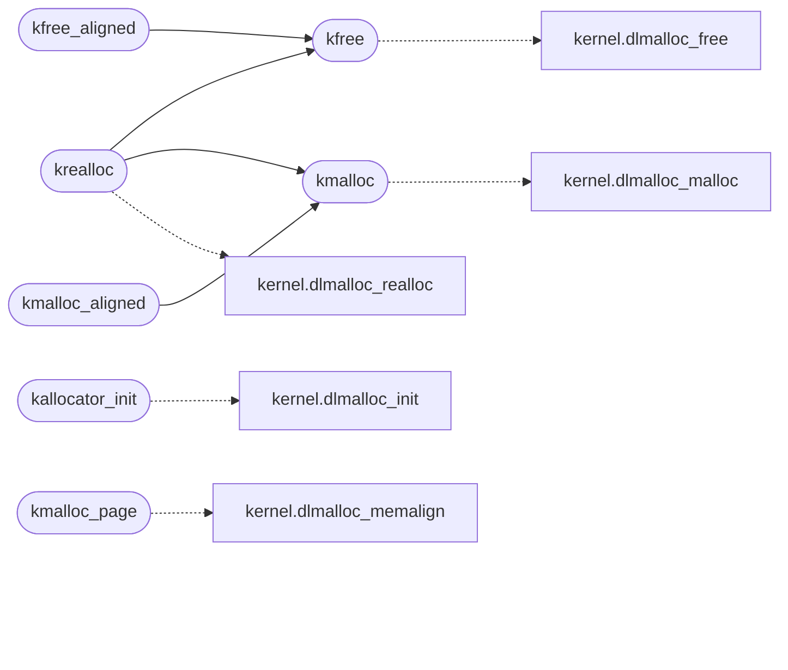

# `kernel/mm.c`

> Source: [kernel/mm.c:1](../../kernel/mm.c#L1) | language `c` | coverage 70.0% | [API index](../index.md)

================================================================

## Contents

- **Functions:** [`kallocator_init`](#kallocator_init), [`kmalloc`](#kmalloc), [`kmalloc_page`](#kmalloc_page), [`kfree`](#kfree), [`kcalloc`](#kcalloc), [`krealloc`](#krealloc), [`kmalloc_aligned`](#kmalloc_aligned), [`kfree_aligned`](#kfree_aligned)
- **Macros:** [`KMALLOC_REPORT_EVERY`](#kmalloc_report_every)

## Call Graph

Solid arrows stay in this module, dashed arrows leave it.



## Functions

<a id="kallocator_init"></a>

### `kallocator_init`

`function` | [kernel/mm.c:32](../../kernel/mm.c#L32)

```c
void kallocator_init(void)
```

Build the heap over [HEAP_BASE, HEAP_BASE + kheap_size): the layout maximum, never past the installed RAM (a smaller machine must not be handed memory that does not exist).

*Calls:* [`dlmalloc_init`](headers.kernel.h.md#dlmalloc_init)

---

<a id="kmalloc"></a>

### `kmalloc`

`function` | [kernel/mm.c:66](../../kernel/mm.c#L66)

```c
void *kmalloc(unsigned long size)
```

ifdef MINIOS_LK_KERNEL

**Parameters**

| Name | Type | Default | Description |
|---|---|---|---|
| `size` | `unsigned long` |  |  |

**Returns:** `void *`

> **Inherited:** Documentation from [`kmalloc`](#kmalloc) (headers/leakcheck.h:79).

*Calls:* [`dlmalloc_malloc`](headers.kernel.h.md#dlmalloc_malloc)

*Called by:* [`kmalloc_aligned`](#kmalloc_aligned), [`krealloc`](#krealloc)

---

<a id="kmalloc_page"></a>

### `kmalloc_page`

`function` | [kernel/mm.c:81](../../kernel/mm.c#L81)

```c
void *kmalloc_page(void)
```

One page-aligned heap page (the page-table and user-page allocator's backing). memalign keeps the cost at one page plus a chunk header, where over-allocating to align cost two pages per page and halved the user memory the heap could back.

Same fault injection and reporting as kmalloc.

**Returns:** `void *`

*Calls:* [`dlmalloc_memalign`](headers.kernel.h.md#dlmalloc_memalign)

---

<a id="kfree"></a>

### `kfree`

`function` | [kernel/mm.c:90](../../kernel/mm.c#L90)

```c
void kfree(void *ptr)
```

**Parameters**

| Name | Type | Default | Description |
|---|---|---|---|
| `ptr` | `void *` |  |  |

*Calls:* [`dlmalloc_free`](headers.kernel.h.md#dlmalloc_free)

*Called by:* [`kfree_aligned`](#kfree_aligned), [`krealloc`](#krealloc)

---

<a id="kcalloc"></a>

### `kcalloc`

`function` | [kernel/mm.c:111](../../kernel/mm.c#L111)

```c
void *kcalloc(unsigned long nmemb, unsigned long size)
```

**Parameters**

| Name | Type | Default | Description |
|---|---|---|---|
| `nmemb` | `unsigned long` |  |  |
| `size` | `unsigned long` |  |  |

**Returns:** `void *`

*Calls:* [`dlmalloc_calloc`](headers.kernel.h.md#dlmalloc_calloc)

---

<a id="krealloc"></a>

### `krealloc`

`function` | [kernel/mm.c:115](../../kernel/mm.c#L115)

```c
void *krealloc(void *ptr, unsigned long size)
```

**Parameters**

| Name | Type | Default | Description |
|---|---|---|---|
| `ptr` | `void *` |  |  |
| `size` | `unsigned long` |  |  |

**Returns:** `void *`

*Calls:* [`dlmalloc_realloc`](headers.kernel.h.md#dlmalloc_realloc), [`kfree`](#kfree), [`kmalloc`](#kmalloc)

---

<a id="kmalloc_aligned"></a>

### `kmalloc_aligned`

`function` | [kernel/mm.c:127](../../kernel/mm.c#L127)

```c
void *kmalloc_aligned(unsigned long size, unsigned long align)
```

Docstring: Aligned allocation with a recoverable raw pointer.

Reserves size bytes at the requested power-of-two alignment and stores
the original kmalloc pointer in the word below the aligned base, so
kfree_aligned releases exactly what the allocator returned. Fail-closed
on zero size, non-power-of-two alignment and size arithmetic overflow.

**Parameters**

| Name | Type | Default | Description |
|---|---|---|---|
| `size` | `unsigned long` |  |  |
| `align` | `unsigned long` |  |  |

**Returns:** `void *`

*Calls:* [`kmalloc`](#kmalloc)

---

<a id="kfree_aligned"></a>

### `kfree_aligned`

`function` | [kernel/mm.c:143](../../kernel/mm.c#L143)

```c
void kfree_aligned(void *ptr)
```

Docstring: Release a kmalloc_aligned block.

A null pointer is a no-op; a pointer outside the heap halts through kfree, never silently.

**Parameters**

| Name | Type | Default | Description |
|---|---|---|---|
| `ptr` | `void *` |  |  |

*Calls:* [`kfree`](#kfree)

---

## Macros

<a id="kmalloc_report_every"></a>

### `KMALLOC_REPORT_EVERY`

`macro` | [kernel/mm.c:50](../../kernel/mm.c#L50)

```c
#define KMALLOC_REPORT_EVERY
```

Heap exhaustion is reported on the serial line where it happens (the failure paths report rule): a caller turning NULL into -ENOMEM, a fork refusal or a killed process otherwise hides that the 192 MB heap ran out.

Serial only (safe from fault context); every KMALLOC_REPORT_EVERY failures after the first to keep a storm readable.

---
