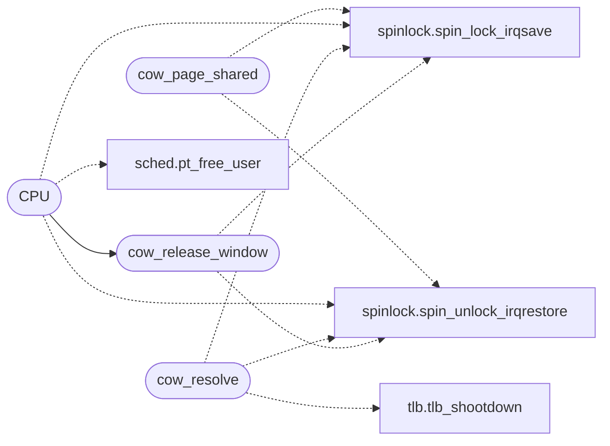

# `kernel/mm/cow.c`

> Source: [kernel/mm/cow.c:1](../../kernel/mm/cow.c#L1) | language `c` | coverage 36.8% | [API index](../index.md)

Docstring: kernel/mm/cow.c -- Copy-on-write fork support.

## Contents

- **Structs:** [`cow_entry_t`](#cow_entry_t)
- **Functions:** [`alternative`](#alternative), [`cow_page_shared`](#cow_page_shared), [`CPU`](#cpu), [`cow_resolve`](#cow_resolve), [`cow_release_window`](#cow_release_window), [`cow_shared`](#cow_shared)
- **Macros:** [`COW_BITS`](#cow_bits), [`COW_CAP`](#cow_cap), [`COW_MASK`](#cow_mask), [`COW_LOAD_MAX`](#cow_load_max), [`COW_TOMB_MAX`](#cow_tomb_max), [`COW_EMPTY`](#cow_empty), [`COW_TOMB`](#cow_tomb), [`COW_HASH_MUL`](#cow_hash_mul), [`PT_USER_RO`](#pt_user_ro), [`PT_USER_RW_ENTRY`](#pt_user_rw_entry), [`PT_PTE_RW`](#pt_pte_rw)

## Call Graph

Solid arrows stay in this module, dashed arrows leave it.



## Structs

<a id="cow_entry_t"></a>

### `cow_entry_t`

`struct` | [kernel/mm/cow.c:58](../../kernel/mm/cow.c#L58)

```c
typedef struct
```

---

## Functions

<a id="alternative"></a>

### `alternative`

`function` | [kernel/mm/cow.c:20](../../kernel/mm/cow.c#L20)

```c
* window is one instruction wide and the alternative (no CoW) is * documented, so the trade stands. */ #include "kernel.h" #include "bootdefs.h" #include "vga_fb.h" #include "sched.h" #include "tlb.h"
```

**Parameters**

| Name | Type | Default | Description |
|---|---|---|---|
| `CoW` | `no` |  |  |

**Returns:** `* window is one instruction wide and the`

---

<a id="cow_page_shared"></a>

### `cow_page_shared`

`function` | [kernel/mm/cow.c:132](../../kernel/mm/cow.c#L132)

```c
int cow_page_shared(unsigned long phys)
```

Docstring: True when phys is still shared copy-on-write. mprotect consults this before setting a writable bit: upgrading a shared page in place would let one window write another's bytes without ever faulting into cow_resolve.

Pure scan, no allocation, safe under the caller's mm_lock (cow_lock is a leaf here).

**Parameters**

| Name | Type | Default | Description |
|---|---|---|---|
| `phys` | `unsigned long` |  |  |

**Returns:** `int`

*Calls:* [`spin_lock_irqsave`](headers.spinlock.h.md#spin_lock_irqsave), [`spin_unlock_irqrestore`](headers.spinlock.h.md#spin_unlock_irqrestore)

---

<a id="cpu"></a>

### `CPU`

`function` | [kernel/mm/cow.c:287](../../kernel/mm/cow.c#L287)

```c
* address space down on every other CPU (tlb_shootdown in do_fork_ex). */ unsigned long cow_fork_...
```

**Parameters**

| Name | Type | Default | Description |
|---|---|---|---|
| `do_fork_ex` | `tlb_shootdown in` |  |  |

**Returns:** `* address space down on every other`

*Calls:* [`pt_free_user`](headers.sched.h.md#pt_free_user), [`spin_lock_irqsave`](headers.spinlock.h.md#spin_lock_irqsave), [`spin_unlock_irqrestore`](headers.spinlock.h.md#spin_unlock_irqrestore), [`cow_release_window`](#cow_release_window)

*Called by:* [`smp_init`](smp.c.md#smp_init)

---

<a id="cow_resolve"></a>

### `cow_resolve`

`function` | [kernel/mm/cow.c:356](../../kernel/mm/cow.c#L356)

```c
int cow_resolve(unsigned long cr3, unsigned long va)
```

Docstring: Resolve a write fault on a CoW page: last sharer gets a permission upgrade, otherwise the faulting window gets a private copy. invlpg keeps the local TLB honest and, once the PTE names the private copy, tlb_shootdown drops the shared frame from every sibling thread's TLB on other CPUs (they would keep reading the old bytes).

Returns 0 resolved (resume), -1 not a CoW page (existing fault handling runs).

**Parameters**

| Name | Type | Default | Description |
|---|---|---|---|
| `cr3` | `unsigned long` |  |  |
| `va` | `unsigned long` |  |  |

**Returns:** `int`

*Calls:* [`spin_lock_irqsave`](headers.spinlock.h.md#spin_lock_irqsave), [`spin_unlock_irqrestore`](headers.spinlock.h.md#spin_unlock_irqrestore), [`tlb_shootdown`](kernel.mm.tlb.c.md#tlb_shootdown)

---

<a id="cow_release_window"></a>

### `cow_release_window`

`function` | [kernel/mm/cow.c:421](../../kernel/mm/cow.c#L421)

```c
void cow_release_window(unsigned long cr3)
```

Docstring: Drop one window's CoW shares before its pages are freed: multi-shared pages are unmapped here (phys survives for the other window), last-shared pages are forgotten so pt_free_user frees them normally.

Runs at the head of pt_free_user.

**Parameters**

| Name | Type | Default | Description |
|---|---|---|---|
| `cr3` | `unsigned long` |  |  |

*Calls:* [`spin_lock_irqsave`](headers.spinlock.h.md#spin_lock_irqsave), [`spin_unlock_irqrestore`](headers.spinlock.h.md#spin_unlock_irqrestore)

*Called by:* [`CPU`](#cpu)

---

<a id="cow_shared"></a>

### `cow_shared`

`function` | [kernel/mm/cow.c:464](../../kernel/mm/cow.c#L464)

```c
int cow_shared(void)
```

Docstring: Live shared-page refs, for the [`mem`](tools.boot_wl.py.md#wlbootconfig-mem) pressure readout.

**Returns:** `int`

---

## Macros

<a id="cow_bits"></a>

### `COW_BITS`

`macro` | [kernel/mm/cow.c:34](../../kernel/mm/cow.c#L34)

```c
#define COW_BITS
```

Share table: open addressing over the frame number, sized for every user page the heap can back (HEAP_SIZE / 4 KB frames at most 3/4 full).

The old 512-entry table made fork of any real process copy everything past the first 512 pages eagerly: forking a 100 MB browser duplicated it before the child could exec, and the kernel heap ran dry.

---

<a id="cow_cap"></a>

### `COW_CAP`

`macro` | [kernel/mm/cow.c:35](../../kernel/mm/cow.c#L35)

```c
#define COW_CAP
```

---

<a id="cow_mask"></a>

### `COW_MASK`

`macro` | [kernel/mm/cow.c:36](../../kernel/mm/cow.c#L36)

```c
#define COW_MASK
```

---

<a id="cow_load_max"></a>

### `COW_LOAD_MAX`

`macro` | [kernel/mm/cow.c:37](../../kernel/mm/cow.c#L37)

```c
#define COW_LOAD_MAX
```

---

<a id="cow_tomb_max"></a>

### `COW_TOMB_MAX`

`macro` | [kernel/mm/cow.c:38](../../kernel/mm/cow.c#L38)

```c
#define COW_TOMB_MAX
```

---

<a id="cow_empty"></a>

### `COW_EMPTY`

`macro` | [kernel/mm/cow.c:39](../../kernel/mm/cow.c#L39)

```c
#define COW_EMPTY
```

---

<a id="cow_tomb"></a>

### `COW_TOMB`

`macro` | [kernel/mm/cow.c:40](../../kernel/mm/cow.c#L40)

```c
#define COW_TOMB
```

---

<a id="cow_hash_mul"></a>

### `COW_HASH_MUL`

`macro` | [kernel/mm/cow.c:41](../../kernel/mm/cow.c#L41)

```c
#define COW_HASH_MUL
```

---

<a id="pt_user_ro"></a>

### `PT_USER_RO`

`macro` | [kernel/mm/cow.c:46](../../kernel/mm/cow.c#L46)

```c
#define PT_USER_RO
```

RO share entries preserve the parent's NX bit (flags): forcing NX would fault instruction fetch in the child on executable pages, and the resolver only upgrades writes, so a forced-NX fetch fault would loop forever.

---

<a id="pt_user_rw_entry"></a>

### `PT_USER_RW_ENTRY`

`macro` | [kernel/mm/cow.c:47](../../kernel/mm/cow.c#L47)

```c
#define PT_USER_RW_ENTRY
```

---

<a id="pt_pte_rw"></a>

### `PT_PTE_RW`

`macro` | [kernel/mm/cow.c:48](../../kernel/mm/cow.c#L48)

```c
#define PT_PTE_RW
```

---
