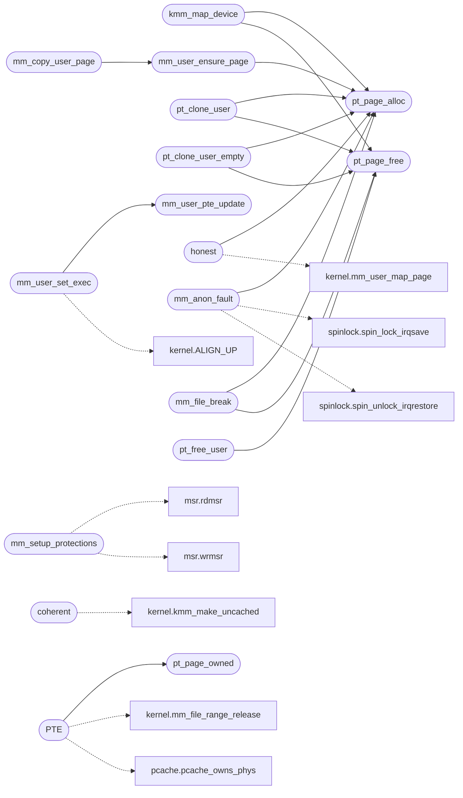

# `kernel/mm/paging.c`

> Source: [kernel/mm/paging.c:1](../../kernel/mm/paging.c#L1) | language `c` | coverage 57.7% | [API index](../index.md)

paging.c - Page table management for the user window and per-process KPTI.

## Contents

- **Functions:** [`mm_setup_protections`](#mm_setup_protections), [`coherent`](#coherent), [`kmm_map_device`](#kmm_map_device), [`mm_user_pte_update`](#mm_user_pte_update), [`mm_user_set_exec`](#mm_user_set_exec), [`pt_page_owned`](#pt_page_owned), [`pt_page_alloc`](#pt_page_alloc), [`pt_page_free`](#pt_page_free), [`pt_clone_user`](#pt_clone_user), [`pt_clone_user_empty`](#pt_clone_user_empty), [`mm_user_ensure_page`](#mm_user_ensure_page), [`honest`](#honest), [`mm_demand_pte`](#mm_demand_pte), [`mm_anon_fault`](#mm_anon_fault), [`mm_file_page_phys`](#mm_file_page_phys), [`tables`](#tables), [`explicitly`](#explicitly), [`PTE`](#pte), [`mm_file_break`](#mm_file_break), [`mm_copy_user_page`](#mm_copy_user_page), [`pt_free_user`](#pt_free_user)
- **Macros:** [`KMM_DEVICE_MAX`](#kmm_device_max), [`KMM_MAX_IDENTITY`](#kmm_max_identity), [`KMM_DEVICE_FLAGS`](#kmm_device_flags), [`PT_OWNED_BYTES`](#pt_owned_bytes)
- **Variables:** [`_kernel_end`](#_kernel_end), [`mm_lock`](#mm_lock)

## Call Graph

Solid arrows stay in this module, dashed arrows leave it.



## Functions

<a id="mm_setup_protections"></a>

### `mm_setup_protections`

`function` | [kernel/mm/paging.c:41](../../kernel/mm/paging.c#L41)

```c
void mm_setup_protections(void)
```

========== Page table helpers (kernel/mm/paging.c) ==========

> **Inherited:** Documentation from [`mm_setup_protections`](#mm_setup_protections) (headers/kernel.h:696).

*Calls:* [`rdmsr`](headers.arch.x86.msr.h.md#rdmsr), [`wrmsr`](headers.arch.x86.msr.h.md#wrmsr)

---

<a id="coherent"></a>

### `coherent`

`function` | [kernel/mm/paging.c:259](../../kernel/mm/paging.c#L259)

```c
* coherent (and an emulator that does not snoop the guest's caches) reads * stale zeros out of a write-back line, which looks like a device that never * answers. * * Refusals mirror kmm_map_device. Returns 1 on success, 0 on refusal, in * which case nothing is changed. */ int kmm_make_uncached(unsigned long phys, unsigned long len)
```

**Parameters**

| Name | Type | Default | Description |
|---|---|---|---|
| `caches` | `and an emulator that does not snoop the guest's` |  |  |

**Returns:** `*`

*Calls:* [`kmm_make_uncached`](headers.kernel.h.md#kmm_make_uncached)

---

<a id="kmm_map_device"></a>

### `kmm_map_device`

`function` | [kernel/mm/paging.c:296](../../kernel/mm/paging.c#L296)

```c
unsigned long kmm_map_device(unsigned long phys, unsigned long len)
```

**Parameters**

| Name | Type | Default | Description |
|---|---|---|---|
| `phys` | `unsigned long` |  |  |
| `len` | `unsigned long` |  |  |

**Returns:** `unsigned long`

*Calls:* [`pt_page_alloc`](#pt_page_alloc), [`pt_page_free`](#pt_page_free)

*Called by:* [`nvme_init`](drivers.nvme.c.md#nvme_init), [`xhc_init`](drivers.xhci.c.md#xhc_init)

---

<a id="mm_user_pte_update"></a>

### `mm_user_pte_update`

`function` | [kernel/mm/paging.c:336](../../kernel/mm/paging.c#L336)

```c
void mm_user_pte_update(unsigned long vaddr, int exec, unsigned long cr3)
```

**Parameters**

| Name | Type | Default | Description |
|---|---|---|---|
| `vaddr` | `unsigned long` |  |  |
| `exec` | `int` |  |  |
| `cr3` | `unsigned long` |  |  |

*Called by:* [`mm_user_set_exec`](#mm_user_set_exec)

---

<a id="mm_user_set_exec"></a>

### `mm_user_set_exec`

`function` | [kernel/mm/paging.c:356](../../kernel/mm/paging.c#L356)

```c
void mm_user_set_exec(unsigned long start, unsigned long end, unsigned long cr3)
```

**Parameters**

| Name | Type | Default | Description |
|---|---|---|---|
| `start` | `unsigned long` |  |  |
| `end` | `unsigned long` |  |  |
| `cr3` | `unsigned long` |  |  |

*Calls:* [`ALIGN_UP`](headers.kernel.h.md#align_up), [`mm_user_pte_update`](#mm_user_pte_update)

---

<a id="pt_page_owned"></a>

### `pt_page_owned`

`function` | [kernel/mm/paging.c:385](../../kernel/mm/paging.c#L385)

```c
int pt_page_owned(unsigned long phys)
```

1 when phys is a page pt_page_alloc handed out and nobody freed.

**Parameters**

| Name | Type | Default | Description |
|---|---|---|---|
| `phys` | `unsigned long` |  |  |

**Returns:** `int`

*Called by:* [`PTE`](#pte)

---

<a id="pt_page_alloc"></a>

### `pt_page_alloc`

`function` | [kernel/mm/paging.c:392](../../kernel/mm/paging.c#L392)

```c
void *pt_page_alloc(void)
```

**Returns:** `void *`

*Called by:* [`honest`](#honest), [`kmm_map_device`](#kmm_map_device), [`mm_anon_fault`](#mm_anon_fault), [`mm_file_break`](#mm_file_break), [`mm_user_ensure_page`](#mm_user_ensure_page), [`pt_clone_user`](#pt_clone_user), [`pt_clone_user_empty`](#pt_clone_user_empty)

---

<a id="pt_page_free"></a>

### `pt_page_free`

`function` | [kernel/mm/paging.c:411](../../kernel/mm/paging.c#L411)

```c
void pt_page_free(void *ptr)
```

**Parameters**

| Name | Type | Default | Description |
|---|---|---|---|
| `ptr` | `void *` |  |  |

*Called by:* [`kmm_map_device`](#kmm_map_device), [`mm_file_break`](#mm_file_break), [`pt_clone_user`](#pt_clone_user), [`pt_clone_user_empty`](#pt_clone_user_empty), [`pt_free_user`](#pt_free_user)

---

<a id="pt_clone_user"></a>

### `pt_clone_user`

`function` | [kernel/mm/paging.c:420](../../kernel/mm/paging.c#L420)

```c
uint64_t pt_clone_user(uint64_t parent_cr3)
```

---- Per-process page tables ----

**Parameters**

| Name | Type | Default | Description |
|---|---|---|---|
| `parent_cr3` | `uint64_t` |  |  |

**Returns:** `uint64_t`

> **Inherited:** Documentation from [`pt_clone_user`](#pt_clone_user) (headers/sched.h:456).

*Calls:* [`pt_page_alloc`](#pt_page_alloc), [`pt_page_free`](#pt_page_free)

---

<a id="pt_clone_user_empty"></a>

### `pt_clone_user_empty`

`function` | [kernel/mm/paging.c:568](../../kernel/mm/paging.c#L568)

```c
unsigned long pt_clone_user_empty(void)
```

Fresh user window: kernel mappings copied, every user PT zeroed, graphics slots re-shared from the boot tables.

Returns PML4 phys (usable as CR3), or 0 on OOM. No user data page is mapped.

**Returns:** `unsigned long`

*Calls:* [`pt_page_alloc`](#pt_page_alloc), [`pt_page_free`](#pt_page_free)

---

<a id="mm_user_ensure_page"></a>

### `mm_user_ensure_page`

`function` | [kernel/mm/paging.c:625](../../kernel/mm/paging.c#L625)

```c
int mm_user_ensure_page(unsigned long cr3, unsigned long va)
```

Ensure one 4 KB user page at va inside cr3 exists (heap-owned).

Returns 0 on success, -1 on OOM or when va leaves the user window.

**Parameters**

| Name | Type | Default | Description |
|---|---|---|---|
| `cr3` | `unsigned long` |  |  |
| `va` | `unsigned long` |  |  |

**Returns:** `int`

*Calls:* [`pt_page_alloc`](#pt_page_alloc)

*Called by:* [`mm_copy_user_page`](#mm_copy_user_page)

---

<a id="honest"></a>

### `honest`

`function` | [kernel/mm/paging.c:655](../../kernel/mm/paging.c#L655)

```c
* and invlpg keeps the local TLB honest (cross-CPU shootdown rides * the documented T5 follow-up, same as the CoW path). The file * fault populate and the file CoW-break own this: no anonymous * caller should bypass ensure_page through it. Returns 0 mapped, * -1 refused. */ int mm_user_map_page(unsigned long cr3, unsigned long va, unsigned long phys, int write, int exec)
```

**Parameters**

| Name | Type | Default | Description |
|---|---|---|---|
| `up` | `cross-CPU shootdown rides * the documented T5 follow-` |  |  |
| `path` | `same as the CoW` |  |  |

**Returns:** `* and invlpg keeps the TLB`

*Calls:* [`mm_user_map_page`](headers.kernel.h.md#mm_user_map_page), [`pt_page_alloc`](#pt_page_alloc)

---

<a id="mm_demand_pte"></a>

### `mm_demand_pte`

`function` | [kernel/mm/paging.c:704](../../kernel/mm/paging.c#L704)

```c
unsigned long mm_demand_pte(unsigned long prot)
```

Encode a Linux prot as a demand-paging reservation PTE.

**Parameters**

| Name | Type | Default | Description |
|---|---|---|---|
| `prot` | `unsigned long` |  |  |

**Returns:** `unsigned long`

---

<a id="mm_anon_fault"></a>

### `mm_anon_fault`

`function` | [kernel/mm/paging.c:779](../../kernel/mm/paging.c#L779)

```c
int mm_anon_fault(unsigned long cr3, unsigned long va, int write)
```

Resolve a fault on a reservation: map a zeroed page with the reserved protection.

Returns 0 when mapped or when another CPU mapped it first (the faulting access retries through the fresh PTE), -1 when va is no reservation, the reservation is PROT_NONE, the access is a write to a read-only one, or the heap is exhausted (the caller kills like any unresolved fault).

**Parameters**

| Name | Type | Default | Description |
|---|---|---|---|
| `cr3` | `unsigned long` |  |  |
| `va` | `unsigned long` |  |  |
| `write` | `int` |  |  |

**Returns:** `int`

*Calls:* [`spin_lock_irqsave`](headers.spinlock.h.md#spin_lock_irqsave), [`spin_unlock_irqrestore`](headers.spinlock.h.md#spin_unlock_irqrestore), [`pt_page_alloc`](#pt_page_alloc)

---

<a id="mm_file_page_phys"></a>

### `mm_file_page_phys`

`function` | [kernel/mm/paging.c:861](../../kernel/mm/paging.c#L861)

```c
unsigned long mm_file_page_phys(unsigned long cr3, unsigned long va)
```

Docstring: Read the mapped phys for va in cr3, 0 when the PTE is absent or non-present.

Fork and teardown prove sharing through the tables before taking or dropping cache refs.

**Parameters**

| Name | Type | Default | Description |
|---|---|---|---|
| `cr3` | `unsigned long` |  |  |
| `va` | `unsigned long` |  |  |

**Returns:** `unsigned long`

---

<a id="tables"></a>

### `tables`

`function` | [kernel/mm/paging.c:1010](../../kernel/mm/paging.c#L1010)

```c
* tables (munmap/mremap in caller context, under their mm_lock);
```

**Parameters**

| Name | Type | Default | Description |
|---|---|---|---|
| `context` | `munmap/mremap in caller` |  |  |
| `mm_lock` | `under their` |  |  |

**Returns:** `*`

---

<a id="explicitly"></a>

### `explicitly`

`function` | [kernel/mm/paging.c:1011](../../kernel/mm/paging.c#L1011)

```c
* teardown passes the dying window explicitly (zombie-exclusive, no * lock needed). unmap == 0 drops refs only (teardown, whose tables * die next);
```

**Parameters**

| Name | Type | Default | Description |
|---|---|---|---|
| `exclusive` | `zombie-` |  |  |
| `needed` | `no * lock` |  |  |

**Returns:** `* teardown passes the dying window`

---

<a id="pte"></a>

### `PTE`

`function` | [kernel/mm/paging.c:1015](../../kernel/mm/paging.c#L1015)

```c
* PTE (a cache page stays cached, but no stale writer may reach it). * Never allocates. */ void ...
```

**Parameters**

| Name | Type | Default | Description |
|---|---|---|---|
| `cached` | `a cache page stays` |  |  |
| `it` | `but no stale writer may reach` |  |  |

**Returns:** `*`

*Calls:* [`mm_file_range_release`](headers.kernel.h.md#mm_file_range_release), [`pcache_owns_phys`](headers.pcache.h.md#pcache_owns_phys), [`spin_lock_irqsave`](headers.spinlock.h.md#spin_lock_irqsave), [`spin_unlock_irqrestore`](headers.spinlock.h.md#spin_unlock_irqrestore), [`pt_page_owned`](#pt_page_owned)

---

<a id="mm_file_break"></a>

### `mm_file_break`

`function` | [kernel/mm/paging.c:1070](../../kernel/mm/paging.c#L1070)

```c
int mm_file_break(unsigned long cr3, unsigned long va)
```

Docstring: Break a write fault on a cache-shared file page into a private copy (fail-closed).

Fires after cow_resolve refuses (a file page is never in the cow table outside fork, and fork-shared ones resolve there first). The PTE must be present, read-only and pointing at the cached page the VMA node names; anything else (recycled slot, truncated file, mprotect-RO anon) returns -1 for the kill path. The mapping keeps its cache ref until munmap or teardown, so the accounting stays balanced. Returns 0 resumed.

**Parameters**

| Name | Type | Default | Description |
|---|---|---|---|
| `cr3` | `unsigned long` |  |  |
| `va` | `unsigned long` |  |  |

**Returns:** `int`

*Calls:* [`mm_user_map_page`](headers.kernel.h.md#mm_user_map_page), [`pcache_data`](headers.pcache.h.md#pcache_data), [`pcache_lookup`](headers.pcache.h.md#pcache_lookup), [`spin_lock_irqsave`](headers.spinlock.h.md#spin_lock_irqsave), [`spin_unlock_irqrestore`](headers.spinlock.h.md#spin_unlock_irqrestore), [`pt_page_alloc`](#pt_page_alloc), [`pt_page_free`](#pt_page_free)

---

<a id="mm_copy_user_page"></a>

### `mm_copy_user_page`

`function` | [kernel/mm/paging.c:1149](../../kernel/mm/paging.c#L1149)

```c
int mm_copy_user_page(unsigned long dst_cr3, unsigned long src_cr3, unsigned long va)
```

Copy one present user page from src_cr3 to the same VA in dst_cr3, allocating the destination page.

Used by fork-style clones. The executable bit rides along: ensure_page maps NX, so an exec source left as-is would fault the clone's fetch with #PF/NX (seen as err=15 on the child's entry rip).

**Parameters**

| Name | Type | Default | Description |
|---|---|---|---|
| `dst_cr3` | `unsigned long` |  |  |
| `src_cr3` | `unsigned long` |  |  |
| `va` | `unsigned long` |  |  |

**Returns:** `int`

*Calls:* [`spin_restore_irq`](headers.spinlock.h.md#spin_restore_irq), [`spin_save_irq`](headers.spinlock.h.md#spin_save_irq), [`mm_user_ensure_page`](#mm_user_ensure_page)

---

<a id="pt_free_user"></a>

### `pt_free_user`

`function` | [kernel/mm/paging.c:1227](../../kernel/mm/paging.c#L1227)

```c
void pt_free_user(uint64_t cr3)
```

**Parameters**

| Name | Type | Default | Description |
|---|---|---|---|
| `cr3` | `uint64_t` |  |  |

*Calls:* [`pt_page_free`](#pt_page_free)

---

## Macros

<a id="kmm_device_max"></a>

### `KMM_DEVICE_MAX`

`macro` | [kernel/mm/paging.c:200](../../kernel/mm/paging.c#L200)

```c
#define KMM_DEVICE_MAX
```

Docstring: Bytes one call will map: one 4 KB page table covers a 2 MB window, and no controller needs more.

---

<a id="kmm_max_identity"></a>

### `KMM_MAX_IDENTITY`

`macro` | [kernel/mm/paging.c:204](../../kernel/mm/paging.c#L204)

```c
#define KMM_MAX_IDENTITY
```

Docstring: Top of the boot identity window that can be refined in place: the 512 2 MB leaves of the identity page directory.

---

<a id="kmm_device_flags"></a>

### `KMM_DEVICE_FLAGS`

`macro` | [kernel/mm/paging.c:211](../../kernel/mm/paging.c#L211)

```c
#define KMM_DEVICE_FLAGS
```

Docstring: 4 KB device leaf: present, read-write, cache-disable, write-through, supervisor.

Matches what Linux's ioremap produces. The supervisor bits matter: this window is reachable from the kernel PML4 and gets copied into per-process tables by the KPTI clone, so without them a ring-3 program could reach a device register.

---

<a id="pt_owned_bytes"></a>

### `PT_OWNED_BYTES`

`macro` | [kernel/mm/paging.c:371](../../kernel/mm/paging.c#L371)

```c
#define PT_OWNED_BYTES
```

Ownership record of the page allocator: one bit per heap page, set while pt_page_alloc owns it.

Teardown and unmap free a mapped frame only when its bit is set, so a heap buffer mapped into a window some other way (page-by-page kmalloc_aligned mappings) is never freed as a page. Heap-owned, created on the first allocation.

---

## Variables

<a id="_kernel_end"></a>

### `_kernel_end`

`variable` `extern` | [kernel/mm/paging.c:49](../../kernel/mm/paging.c#L49)

```c
extern char _kernel_end[];
```

---

<a id="mm_lock"></a>

### `mm_lock`

`variable` `extern` | [kernel/mm/paging.c:696](../../kernel/mm/paging.c#L696)

```c
extern spinlock_t mm_lock;
```

---
