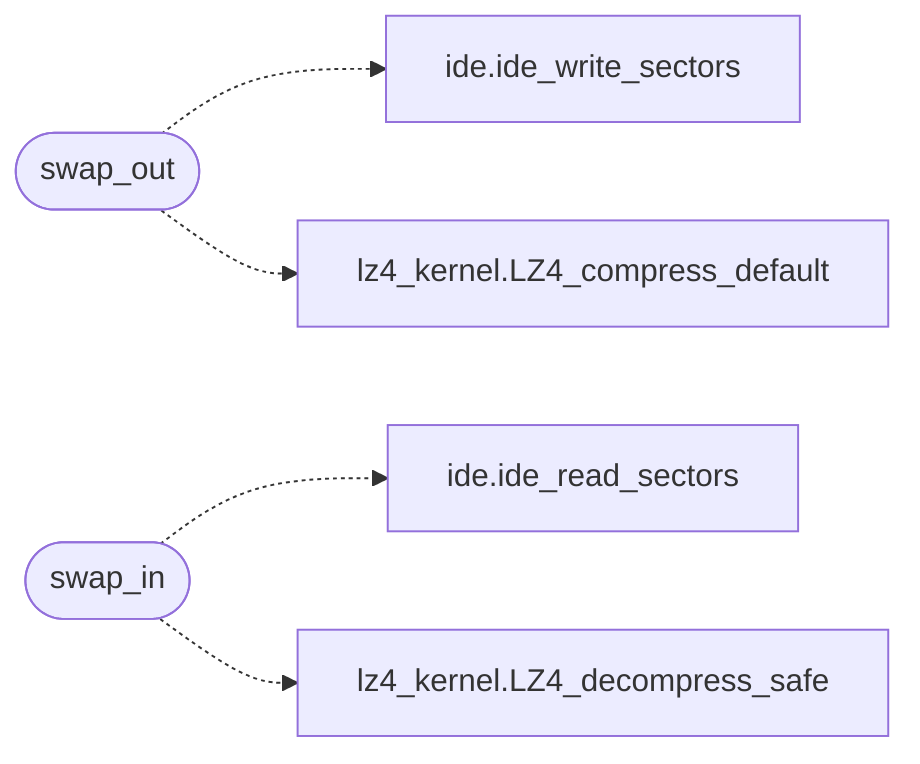

# `kernel/mm/swap.c`

> Source: [kernel/mm/swap.c:1](../../kernel/mm/swap.c#L1) | language `c` | coverage 20.0% | [API index](../index.md)

swap.c - Swap-out/swap-in for the user window (LZ4-compressed disk swap).

## Contents

- **Functions:** [`unwired`](#unwired), [`swap_out`](#swap_out), [`swap_in`](#swap_in)
- **Macros:** [`SWAP_CHUNK_RAW`](#swap_chunk_raw), [`SWAP_CHUNK_CMP`](#swap_chunk_cmp), [`SWAP_CHUNK_SECTORS`](#swap_chunk_sectors), [`SWAP_HDR_SECTORS`](#swap_hdr_sectors), [`SWAP_MAX_SECTORS`](#swap_max_sectors), [`SWAP_MAGIC`](#swap_magic)

## Call Graph

Solid arrows stay in this module, dashed arrows leave it.



## Functions

<a id="unwired"></a>

### `unwired`

`function` | [kernel/mm/swap.c:7](../../kernel/mm/swap.c#L7)

```c
* * Currently unwired (the isolated-window spawn path superseded the * swap-out design);
```

**Parameters**

| Name | Type | Default | Description |
|---|---|---|---|
| `design` | `the isolated-window spawn path superseded the * swap-out` |  |  |

**Returns:** `* * Currently`

---

<a id="swap_out"></a>

### `swap_out`

`function` | [kernel/mm/swap.c:47](../../kernel/mm/swap.c#L47)

```c
int swap_out(unsigned long window_sz)
```

========== Swap (kernel/mm/swap.c) ==========

**Parameters**

| Name | Type | Default | Description |
|---|---|---|---|
| `window_sz` | `unsigned long` |  |  |

**Returns:** `int`

> **Inherited:** Documentation from [`swap_out`](#swap_out) (headers/kernel.h:719).

*Calls:* [`ide_write_sectors`](headers.ide.h.md#ide_write_sectors), [`LZ4_compress_default`](headers.lz4_kernel.h.md#lz4_compress_default)

---

<a id="swap_in"></a>

### `swap_in`

`function` | [kernel/mm/swap.c:97](../../kernel/mm/swap.c#L97)

```c
int swap_in(void)
```

**Returns:** `int`

*Calls:* [`ide_read_sectors`](headers.ide.h.md#ide_read_sectors), [`LZ4_decompress_safe`](headers.lz4_kernel.h.md#lz4_decompress_safe)

---

## Macros

<a id="swap_chunk_raw"></a>

### `SWAP_CHUNK_RAW`

`macro` | [kernel/mm/swap.c:17](../../kernel/mm/swap.c#L17)

```c
#define SWAP_CHUNK_RAW
```

---

<a id="swap_chunk_cmp"></a>

### `SWAP_CHUNK_CMP`

`macro` | [kernel/mm/swap.c:18](../../kernel/mm/swap.c#L18)

```c
#define SWAP_CHUNK_CMP
```

---

<a id="swap_chunk_sectors"></a>

### `SWAP_CHUNK_SECTORS`

`macro` | [kernel/mm/swap.c:19](../../kernel/mm/swap.c#L19)

```c
#define SWAP_CHUNK_SECTORS
```

---

<a id="swap_hdr_sectors"></a>

### `SWAP_HDR_SECTORS`

`macro` | [kernel/mm/swap.c:20](../../kernel/mm/swap.c#L20)

```c
#define SWAP_HDR_SECTORS
```

---

<a id="swap_max_sectors"></a>

### `SWAP_MAX_SECTORS`

`macro` | [kernel/mm/swap.c:21](../../kernel/mm/swap.c#L21)

```c
#define SWAP_MAX_SECTORS
```

---

<a id="swap_magic"></a>

### `SWAP_MAGIC`

`macro` | [kernel/mm/swap.c:22](../../kernel/mm/swap.c#L22)

```c
#define SWAP_MAGIC
```

---
