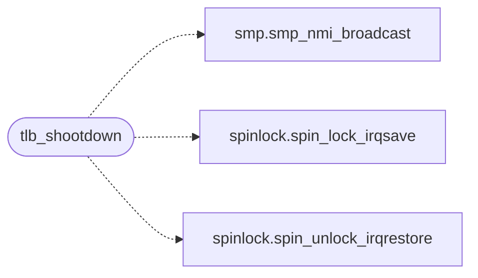

# `kernel/mm/tlb.c`

> Source: [kernel/mm/tlb.c:1](../../kernel/mm/tlb.c#L1) | language `c` | coverage 60.0% | [API index](../index.md)

tlb.c - cross-CPU TLB shootdown (docs/spec/smp-sched.md, "TLB shootdown").

## Contents

- **Functions:** [`tlb_shootdown`](#tlb_shootdown), [`tlb_shootdown_count`](#tlb_shootdown_count), [`tlb_shootdown_timeouts`](#tlb_shootdown_timeouts)
- **Macros:** [`TLB_SHOOT_SPIN_MAX`](#tlb_shoot_spin_max)

## Call Graph

Solid arrows stay in this module, dashed arrows leave it.



## Functions

<a id="tlb_shootdown"></a>

### `tlb_shootdown`

`function` | [kernel/mm/tlb.c:49](../../kernel/mm/tlb.c#L49)

```c
void tlb_shootdown(unsigned long cr3)
```

**Parameters**

| Name | Type | Default | Description |
|---|---|---|---|
| `cr3` | `unsigned long` |  |  |

*Calls:* [`smp_nmi_broadcast`](headers.smp.h.md#smp_nmi_broadcast), [`spin_lock_irqsave`](headers.spinlock.h.md#spin_lock_irqsave), [`spin_unlock_irqrestore`](headers.spinlock.h.md#spin_unlock_irqrestore)

*Called by:* [`cow_resolve`](kernel.mm.cow.c.md#cow_resolve), [`do_fork_ex`](kernel.sched.c.md#do_fork_ex)

---

<a id="tlb_shootdown_count"></a>

### `tlb_shootdown_count`

`function` | [kernel/mm/tlb.c:71](../../kernel/mm/tlb.c#L71)

```c
unsigned long tlb_shootdown_count(void)
```

Shootdowns broadcast and acknowledgement waits that ran out of budget (reported by the smp builtin).

**Returns:** `unsigned long`

> **Inherited:** Documentation from [`tlb_shootdown_count`](#tlb_shootdown_count) (headers/tlb.h:22).

---

<a id="tlb_shootdown_timeouts"></a>

### `tlb_shootdown_timeouts`

`function` | [kernel/mm/tlb.c:75](../../kernel/mm/tlb.c#L75)

```c
unsigned long tlb_shootdown_timeouts(void)
```

**Returns:** `unsigned long`

---

## Macros

<a id="tlb_shoot_spin_max"></a>

### `TLB_SHOOT_SPIN_MAX`

`macro` | [kernel/mm/tlb.c:24](../../kernel/mm/tlb.c#L24)

```c
#define TLB_SHOOT_SPIN_MAX
```

pause iterations the issuer waits for every acknowledgement before it reports a lost one (an NMI is never masked, so this is a hardware or emulator fault, not a scheduling delay).

---
