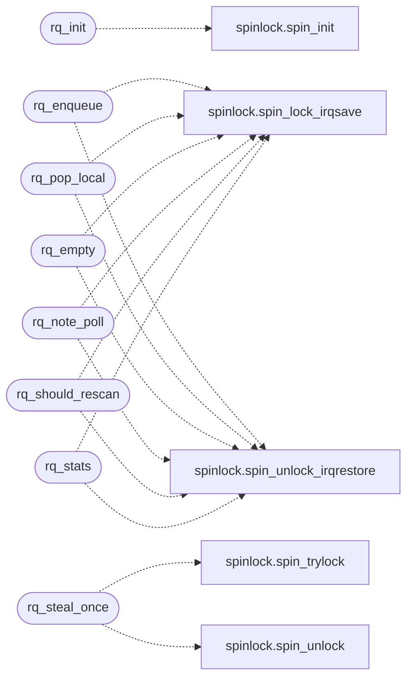

# `kernel/percpu_rq.c`

> Source: [kernel/percpu_rq.c:1](../../kernel/percpu_rq.c#L1) | language `c` | coverage 100.0% | [API index](../index.md)

Docstring: kernel/percpu_rq.c -- Per-CPU runqueue hints and stealing.

## Contents

- **Functions:** [`rq_init`](#rq_init), [`rq_enqueue`](#rq_enqueue), [`rq_pop_local`](#rq_pop_local), [`rq_steal_once`](#rq_steal_once), [`rq_empty`](#rq_empty), [`rq_note_poll`](#rq_note_poll), [`rq_should_rescan`](#rq_should_rescan), [`rq_stats`](#rq_stats)

## Call Graph

Solid arrows stay in this module, dashed arrows leave it.



## Functions

<a id="rq_init"></a>

### `rq_init`

`function` | [kernel/percpu_rq.c:19](../../kernel/percpu_rq.c#L19)

```c
void rq_init(void)
```

Docstring: Clear every ring and counter.

Called once from sched_init.

*Calls:* [`spin_init`](headers.spinlock.h.md#spin_init)

---

<a id="rq_enqueue"></a>

### `rq_enqueue`

`function` | [kernel/percpu_rq.c:41](../../kernel/percpu_rq.c#L41)

```c
void rq_enqueue(int cpu, int pid)
```

Docstring: Record pid as READY work for cpu.

Lossy by contract: a full ring drops the hint and counts the drop. The
global scan remains the fallback, so a drop costs one rescan period of
latency at most, never correctness. Pids outside the table are refused.

**Parameters**

| Name | Type | Default | Description |
|---|---|---|---|
| `cpu` | `int` |  |  |
| `pid` | `int` |  |  |

*Calls:* [`spin_lock_irqsave`](headers.spinlock.h.md#spin_lock_irqsave), [`spin_unlock_irqrestore`](headers.spinlock.h.md#spin_unlock_irqrestore)

---

<a id="rq_pop_local"></a>

### `rq_pop_local`

`function` | [kernel/percpu_rq.c:61](../../kernel/percpu_rq.c#L61)

```c
int rq_pop_local(int cpu)
```

Docstring: Pop one hint from the local ring, WQ_NONE_HINT when empty.

**Parameters**

| Name | Type | Default | Description |
|---|---|---|---|
| `cpu` | `int` |  |  |

**Returns:** `int`

*Calls:* [`spin_lock_irqsave`](headers.spinlock.h.md#spin_lock_irqsave), [`spin_unlock_irqrestore`](headers.spinlock.h.md#spin_unlock_irqrestore)

---

<a id="rq_steal_once"></a>

### `rq_steal_once`

`function` | [kernel/percpu_rq.c:89](../../kernel/percpu_rq.c#L89)

```c
int rq_steal_once(int self_cpu, int *from_cpu)
```

Docstring: Non-blocking steal of one hint from another CPU's ring.

Tries every remote ring once with spin_trylock and returns the first
hint found, reporting the donor through from_cpu. Rings that are busy
are skipped, never waited on. Returns WQ_NONE_HINT when nothing could
be stolen without blocking. The thief's steal counter is owner-written
but updated under the donor's lock, so it uses an atomic add (the same
pattern as smp_dispatches) instead of relying on the donor's lock.

**Parameters**

| Name | Type | Default | Description |
|---|---|---|---|
| `self_cpu` | `int` |  |  |
| `from_cpu` | `int *` |  |  |

**Returns:** `int`

*Calls:* [`spin_trylock`](headers.spinlock.h.md#spin_trylock), [`spin_unlock`](headers.spinlock.h.md#spin_unlock)

---

<a id="rq_empty"></a>

### `rq_empty`

`function` | [kernel/percpu_rq.c:115](../../kernel/percpu_rq.c#L115)

```c
int rq_empty(int cpu)
```

Docstring: True when cpu holds no hint.

Lock-protected peek.

**Parameters**

| Name | Type | Default | Description |
|---|---|---|---|
| `cpu` | `int` |  |  |

**Returns:** `int`

*Calls:* [`spin_lock_irqsave`](headers.spinlock.h.md#spin_lock_irqsave), [`spin_unlock_irqrestore`](headers.spinlock.h.md#spin_unlock_irqrestore)

---

<a id="rq_note_poll"></a>

### `rq_note_poll`

`function` | [kernel/percpu_rq.c:127](../../kernel/percpu_rq.c#L127)

```c
void rq_note_poll(int cpu)
```

Docstring: Count an unsuccessful claim poll for the rescan schedule.

**Parameters**

| Name | Type | Default | Description |
|---|---|---|---|
| `cpu` | `int` |  |  |

*Calls:* [`spin_lock_irqsave`](headers.spinlock.h.md#spin_lock_irqsave), [`spin_unlock_irqrestore`](headers.spinlock.h.md#spin_unlock_irqrestore)

---

<a id="rq_should_rescan"></a>

### `rq_should_rescan`

`function` | [kernel/percpu_rq.c:137](../../kernel/percpu_rq.c#L137)

```c
int rq_should_rescan(int cpu)
```

Docstring: True every RQ_RESCAN_PERIOD polls, bounding hint staleness.

**Parameters**

| Name | Type | Default | Description |
|---|---|---|---|
| `cpu` | `int` |  |  |

**Returns:** `int`

*Calls:* [`spin_lock_irqsave`](headers.spinlock.h.md#spin_lock_irqsave), [`spin_unlock_irqrestore`](headers.spinlock.h.md#spin_unlock_irqrestore)

---

<a id="rq_stats"></a>

### `rq_stats`

`function` | [kernel/percpu_rq.c:152](../../kernel/percpu_rq.c#L152)

```c
void rq_stats(int cpu, unsigned long *hits, unsigned long *steals, unsigned long *drops)
```

Docstring: Snapshot hits, steals and drops for diagnostics.

**Parameters**

| Name | Type | Default | Description |
|---|---|---|---|
| `cpu` | `int` |  |  |
| `hits` | `unsigned long *` |  |  |
| `steals` | `unsigned long *` |  |  |
| `drops` | `unsigned long *` |  |  |

*Calls:* [`spin_lock_irqsave`](headers.spinlock.h.md#spin_lock_irqsave), [`spin_unlock_irqrestore`](headers.spinlock.h.md#spin_unlock_irqrestore)

---
