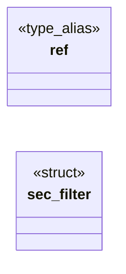
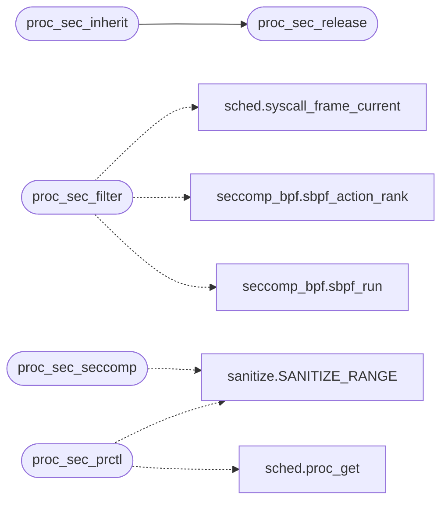

# `kernel/proc_sec.c`

> Source: [kernel/proc_sec.c:1](../../kernel/proc_sec.c#L1) | language `c` | coverage 17.9% | [API index](../index.md)

Docstring: proc_sec.c -- per-process security state: the Linux seccomp

## Contents

- **Structs:** [`sec_filter`](#sec_filter)
- **Type Aliases:** [`ref`](#ref)
- **Functions:** [`proc_sec_inherit`](#proc_sec_inherit), [`proc_sec_release`](#proc_sec_release), [`proc_sec_exec`](#proc_sec_exec), [`proc_sec_set_exe`](#proc_sec_set_exe), [`proc_sec_exe`](#proc_sec_exe), [`proc_sec_filter`](#proc_sec_filter), [`proc_sec_prctl`](#proc_sec_prctl), [`proc_sec_seccomp`](#proc_sec_seccomp)
- **Macros:** [`LINUX_PR_GET_DUMPABLE`](#linux_pr_get_dumpable), [`LINUX_PR_SET_DUMPABLE`](#linux_pr_set_dumpable), [`LINUX_PR_SET_NAME`](#linux_pr_set_name), [`LINUX_PR_GET_NAME`](#linux_pr_get_name), [`LINUX_PR_GET_SECCOMP`](#linux_pr_get_seccomp), [`LINUX_PR_SET_SECCOMP`](#linux_pr_set_seccomp), [`LINUX_PR_SET_NO_NEW_PRIVS`](#linux_pr_set_no_new_privs), [`LINUX_PR_GET_NO_NEW_PRIVS`](#linux_pr_get_no_new_privs), [`LINUX_SECCOMP_MODE_DISABLED`](#linux_seccomp_mode_disabled), [`LINUX_SECCOMP_MODE_STRICT`](#linux_seccomp_mode_strict), [`LINUX_SECCOMP_MODE_FILTER`](#linux_seccomp_mode_filter), [`LINUX_SECCOMP_SET_MODE_STRICT`](#linux_seccomp_set_mode_strict), [`LINUX_SECCOMP_SET_MODE_FILTER`](#linux_seccomp_set_mode_filter), [`LINUX_SECCOMP_GET_ACTION_AVAIL`](#linux_seccomp_get_action_avail), [`LINUX_NR_READ`](#linux_nr_read), [`LINUX_NR_WRITE`](#linux_nr_write), [`LINUX_NR_RT_SIGRETURN`](#linux_nr_rt_sigreturn), [`LINUX_NR_EXIT`](#linux_nr_exit), [`LINUX_ERRNO_MAX`](#linux_errno_max), [`LINUX_TASK_COMM_LEN`](#linux_task_comm_len), [`SOCK_FPROG_SIZE`](#sock_fprog_size), [`SOCK_FPROG_FILTER_OFF`](#sock_fprog_filter_off), [`ERR_ENOMEM`](#err_enomem), [`ERR_EACCES`](#err_eacces), [`ERR_EINVAL`](#err_einval), [`ERR_ENOSYS`](#err_enosys), [`ERR_EOPNOTSUPP`](#err_eopnotsupp), [`SEC_STRICT_LEN`](#sec_strict_len)

## Type Diagram



## Call Graph

Solid arrows stay in this module, dashed arrows leave it.



## Structs

<a id="sec_filter"></a>

### `sec_filter`

`struct` | [kernel/proc_sec.c:48](../../kernel/proc_sec.c#L48)

```c
typedef struct sec_filter
```

---

## Type Aliases

<a id="ref"></a>

### `ref`

`type_alias` | [kernel/proc_sec.c:47](../../kernel/proc_sec.c#L47)

```c
typedef struct sec_filter { int ref;
```

define ERR_ENOMEM  (-12) define ERR_EACCES  (-13) define ERR_EINVAL  (-22) define ERR_ENOSYS  (-38) define ERR_EOPNOTSUPP (-95)

---

## Functions

<a id="proc_sec_inherit"></a>

### `proc_sec_inherit`

`function` | [kernel/proc_sec.c:87](../../kernel/proc_sec.c#L87)

```c
void proc_sec_inherit(int child, int parent)
```

Lifecycle (callers hold sched_lock where noted in sched.c).

**Parameters**

| Name | Type | Default | Description |
|---|---|---|---|
| `child` | `int` |  |  |
| `parent` | `int` |  |  |

> **Inherited:** Documentation from [`proc_sec_inherit`](#proc_sec_inherit) (headers/proc_sec.h:23).

*Calls:* [`proc_sec_release`](#proc_sec_release)

---

<a id="proc_sec_release"></a>

### `proc_sec_release`

`function` | [kernel/proc_sec.c:101](../../kernel/proc_sec.c#L101)

```c
void proc_sec_release(int pid)
```

**Parameters**

| Name | Type | Default | Description |
|---|---|---|---|
| `pid` | `int` |  |  |

*Called by:* [`proc_sec_inherit`](#proc_sec_inherit)

---

<a id="proc_sec_exec"></a>

### `proc_sec_exec`

`function` | [kernel/proc_sec.c:115](../../kernel/proc_sec.c#L115)

```c
void proc_sec_exec(int pid)
```

execve keeps the filters and no_new_privs (Linux) and makes the fresh image dumpable again.

**Parameters**

| Name | Type | Default | Description |
|---|---|---|---|
| `pid` | `int` |  |  |

---

<a id="proc_sec_set_exe"></a>

### `proc_sec_set_exe`

`function` | [kernel/proc_sec.c:119](../../kernel/proc_sec.c#L119)

```c
void proc_sec_set_exe(int pid, const char *resolved)
```

**Parameters**

| Name | Type | Default | Description |
|---|---|---|---|
| `pid` | `int` |  |  |
| `resolved` | `char *` |  |  |

---

<a id="proc_sec_exe"></a>

### `proc_sec_exe`

`function` `const` | [kernel/proc_sec.c:125](../../kernel/proc_sec.c#L125)

```c
const char *proc_sec_exe(int pid)
```

Resolved image path of pid ("" when unknown).

**Parameters**

| Name | Type | Default | Description |
|---|---|---|---|
| `pid` | `int` |  |  |

**Returns:** `char *`

> **Inherited:** Documentation from [`proc_sec_exe`](#proc_sec_exe) (headers/proc_sec.h:28).

---

<a id="proc_sec_filter"></a>

### `proc_sec_filter`

`function` | [kernel/proc_sec.c:136](../../kernel/proc_sec.c#L136)

```c
int proc_sec_filter(long n, long a1, long a2, long a3, long a4, long a5, long a6, long *ret)
```

Run the caller's filters for syscall n.

Returns 1 and stores the value the syscall must answer in *ret when a filter decided it (ERRNO, TRACE, USER_NOTIF); kills the caller for KILL and TRAP; returns 0 to let the syscall run.

**Parameters**

| Name | Type | Default | Description |
|---|---|---|---|
| `n` | `long` |  |  |
| `a1` | `long` |  |  |
| `a2` | `long` |  |  |
| `a3` | `long` |  |  |
| `a4` | `long` |  |  |
| `a5` | `long` |  |  |
| `a6` | `long` |  |  |
| `ret` | `long *` |  |  |

**Returns:** `int`

> **Inherited:** Documentation from [`proc_sec_filter`](#proc_sec_filter) (headers/proc_sec.h:34).

*Calls:* [`syscall_frame_current`](headers.sched.h.md#syscall_frame_current), [`sbpf_action_rank`](headers.seccomp_bpf.h.md#sbpf_action_rank), [`sbpf_run`](headers.seccomp_bpf.h.md#sbpf_run)

---

<a id="proc_sec_prctl"></a>

### `proc_sec_prctl`

`function` | [kernel/proc_sec.c:235](../../kernel/proc_sec.c#L235)

```c
long proc_sec_prctl(long option, long a2, long a3, long a4, long a5)
```

**Parameters**

| Name | Type | Default | Description |
|---|---|---|---|
| `option` | `long` |  |  |
| `a2` | `long` |  |  |
| `a3` | `long` |  |  |
| `a4` | `long` |  |  |
| `a5` | `long` |  |  |

**Returns:** `long`

*Calls:* [`SANITIZE_RANGE`](headers.sanitize.h.md#sanitize_range), [`proc_get`](headers.sched.h.md#proc_get)

---

<a id="proc_sec_seccomp"></a>

### `proc_sec_seccomp`

`function` | [kernel/proc_sec.c:290](../../kernel/proc_sec.c#L290)

```c
long proc_sec_seccomp(long op, long flags, long uargs)
```

**Parameters**

| Name | Type | Default | Description |
|---|---|---|---|
| `op` | `long` |  |  |
| `flags` | `long` |  |  |
| `uargs` | `long` |  |  |

**Returns:** `long`

*Calls:* [`SANITIZE_RANGE`](headers.sanitize.h.md#sanitize_range)

---

## Macros

<a id="linux_pr_get_dumpable"></a>

### `LINUX_PR_GET_DUMPABLE`

`macro` | [kernel/proc_sec.c:18](../../kernel/proc_sec.c#L18)

```c
#define LINUX_PR_GET_DUMPABLE
```

---

<a id="linux_pr_set_dumpable"></a>

### `LINUX_PR_SET_DUMPABLE`

`macro` | [kernel/proc_sec.c:19](../../kernel/proc_sec.c#L19)

```c
#define LINUX_PR_SET_DUMPABLE
```

---

<a id="linux_pr_set_name"></a>

### `LINUX_PR_SET_NAME`

`macro` | [kernel/proc_sec.c:20](../../kernel/proc_sec.c#L20)

```c
#define LINUX_PR_SET_NAME
```

---

<a id="linux_pr_get_name"></a>

### `LINUX_PR_GET_NAME`

`macro` | [kernel/proc_sec.c:21](../../kernel/proc_sec.c#L21)

```c
#define LINUX_PR_GET_NAME
```

---

<a id="linux_pr_get_seccomp"></a>

### `LINUX_PR_GET_SECCOMP`

`macro` | [kernel/proc_sec.c:22](../../kernel/proc_sec.c#L22)

```c
#define LINUX_PR_GET_SECCOMP
```

---

<a id="linux_pr_set_seccomp"></a>

### `LINUX_PR_SET_SECCOMP`

`macro` | [kernel/proc_sec.c:23](../../kernel/proc_sec.c#L23)

```c
#define LINUX_PR_SET_SECCOMP
```

---

<a id="linux_pr_set_no_new_privs"></a>

### `LINUX_PR_SET_NO_NEW_PRIVS`

`macro` | [kernel/proc_sec.c:24](../../kernel/proc_sec.c#L24)

```c
#define LINUX_PR_SET_NO_NEW_PRIVS
```

---

<a id="linux_pr_get_no_new_privs"></a>

### `LINUX_PR_GET_NO_NEW_PRIVS`

`macro` | [kernel/proc_sec.c:25](../../kernel/proc_sec.c#L25)

```c
#define LINUX_PR_GET_NO_NEW_PRIVS
```

---

<a id="linux_seccomp_mode_disabled"></a>

### `LINUX_SECCOMP_MODE_DISABLED`

`macro` | [kernel/proc_sec.c:26](../../kernel/proc_sec.c#L26)

```c
#define LINUX_SECCOMP_MODE_DISABLED
```

---

<a id="linux_seccomp_mode_strict"></a>

### `LINUX_SECCOMP_MODE_STRICT`

`macro` | [kernel/proc_sec.c:27](../../kernel/proc_sec.c#L27)

```c
#define LINUX_SECCOMP_MODE_STRICT
```

---

<a id="linux_seccomp_mode_filter"></a>

### `LINUX_SECCOMP_MODE_FILTER`

`macro` | [kernel/proc_sec.c:28](../../kernel/proc_sec.c#L28)

```c
#define LINUX_SECCOMP_MODE_FILTER
```

---

<a id="linux_seccomp_set_mode_strict"></a>

### `LINUX_SECCOMP_SET_MODE_STRICT`

`macro` | [kernel/proc_sec.c:29](../../kernel/proc_sec.c#L29)

```c
#define LINUX_SECCOMP_SET_MODE_STRICT
```

---

<a id="linux_seccomp_set_mode_filter"></a>

### `LINUX_SECCOMP_SET_MODE_FILTER`

`macro` | [kernel/proc_sec.c:30](../../kernel/proc_sec.c#L30)

```c
#define LINUX_SECCOMP_SET_MODE_FILTER
```

---

<a id="linux_seccomp_get_action_avail"></a>

### `LINUX_SECCOMP_GET_ACTION_AVAIL`

`macro` | [kernel/proc_sec.c:31](../../kernel/proc_sec.c#L31)

```c
#define LINUX_SECCOMP_GET_ACTION_AVAIL
```

---

<a id="linux_nr_read"></a>

### `LINUX_NR_READ`

`macro` | [kernel/proc_sec.c:32](../../kernel/proc_sec.c#L32)

```c
#define LINUX_NR_READ
```

---

<a id="linux_nr_write"></a>

### `LINUX_NR_WRITE`

`macro` | [kernel/proc_sec.c:33](../../kernel/proc_sec.c#L33)

```c
#define LINUX_NR_WRITE
```

---

<a id="linux_nr_rt_sigreturn"></a>

### `LINUX_NR_RT_SIGRETURN`

`macro` | [kernel/proc_sec.c:34](../../kernel/proc_sec.c#L34)

```c
#define LINUX_NR_RT_SIGRETURN
```

---

<a id="linux_nr_exit"></a>

### `LINUX_NR_EXIT`

`macro` | [kernel/proc_sec.c:35](../../kernel/proc_sec.c#L35)

```c
#define LINUX_NR_EXIT
```

---

<a id="linux_errno_max"></a>

### `LINUX_ERRNO_MAX`

`macro` | [kernel/proc_sec.c:36](../../kernel/proc_sec.c#L36)

```c
#define LINUX_ERRNO_MAX
```

---

<a id="linux_task_comm_len"></a>

### `LINUX_TASK_COMM_LEN`

`macro` | [kernel/proc_sec.c:37](../../kernel/proc_sec.c#L37)

```c
#define LINUX_TASK_COMM_LEN
```

---

<a id="sock_fprog_size"></a>

### `SOCK_FPROG_SIZE`

`macro` | [kernel/proc_sec.c:39](../../kernel/proc_sec.c#L39)

```c
#define SOCK_FPROG_SIZE
```

struct sock_fprog: u16 len, 6 bytes padding, struct sock_filter *.

---

<a id="sock_fprog_filter_off"></a>

### `SOCK_FPROG_FILTER_OFF`

`macro` | [kernel/proc_sec.c:40](../../kernel/proc_sec.c#L40)

```c
#define SOCK_FPROG_FILTER_OFF
```

---

<a id="err_enomem"></a>

### `ERR_ENOMEM`

`macro` | [kernel/proc_sec.c:42](../../kernel/proc_sec.c#L42)

```c
#define ERR_ENOMEM
```

---

<a id="err_eacces"></a>

### `ERR_EACCES`

`macro` | [kernel/proc_sec.c:43](../../kernel/proc_sec.c#L43)

```c
#define ERR_EACCES
```

---

<a id="err_einval"></a>

### `ERR_EINVAL`

`macro` | [kernel/proc_sec.c:44](../../kernel/proc_sec.c#L44)

```c
#define ERR_EINVAL
```

---

<a id="err_enosys"></a>

### `ERR_ENOSYS`

`macro` | [kernel/proc_sec.c:45](../../kernel/proc_sec.c#L45)

```c
#define ERR_ENOSYS
```

---

<a id="err_eopnotsupp"></a>

### `ERR_EOPNOTSUPP`

`macro` | [kernel/proc_sec.c:46](../../kernel/proc_sec.c#L46)

```c
#define ERR_EOPNOTSUPP
```

---

<a id="sec_strict_len"></a>

### `SEC_STRICT_LEN`

`macro` | [kernel/proc_sec.c:72](../../kernel/proc_sec.c#L72)

```c
#define SEC_STRICT_LEN
```

---
