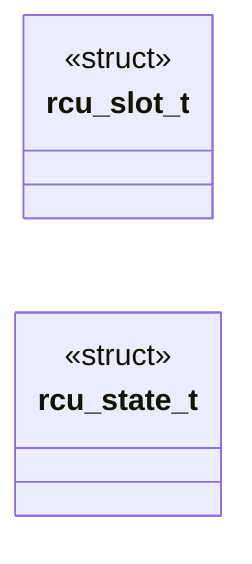
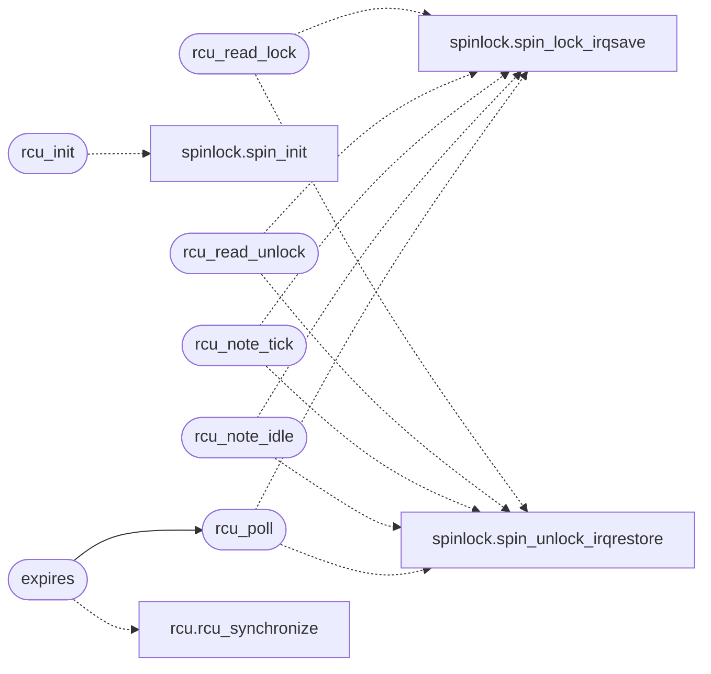

# `kernel/rcu.c`

> Source: [kernel/rcu.c:1](../../kernel/rcu.c#L1) | language `c` | coverage 75.0% | [API index](../index.md)

Docstring: kernel/rcu.c -- Epoch grace periods over scheduler ticks.

## Contents

- **Structs:** [`rcu_slot_t`](#rcu_slot_t), [`rcu_state_t`](#rcu_state_t)
- **Functions:** [`rcu_init`](#rcu_init), [`rcu_read_lock`](#rcu_read_lock), [`rcu_read_unlock`](#rcu_read_unlock), [`rcu_deref`](#rcu_deref), [`rcu_publish`](#rcu_publish), [`rcu_note_tick`](#rcu_note_tick), [`rcu_note_idle`](#rcu_note_idle), [`rcu_poll`](#rcu_poll), [`expires`](#expires)

## Type Diagram



## Call Graph

Solid arrows stay in this module, dashed arrows leave it.



## Structs

<a id="rcu_slot_t"></a>

### `rcu_slot_t`

`struct` | [kernel/rcu.c:22](../../kernel/rcu.c#L22)

```c
typedef struct
```

---

<a id="rcu_state_t"></a>

### `rcu_state_t`

`struct` | [kernel/rcu.c:28](../../kernel/rcu.c#L28)

```c
typedef struct
```

---

## Functions

<a id="rcu_init"></a>

### `rcu_init`

`function` | [kernel/rcu.c:45](../../kernel/rcu.c#L45)

```c
void rcu_init(void)
```

Docstring: Reset epoch, quiescent marks, depths and callbacks.

*Calls:* [`spin_init`](headers.spinlock.h.md#spin_init)

---

<a id="rcu_read_lock"></a>

### `rcu_read_lock`

`function` | [kernel/rcu.c:63](../../kernel/rcu.c#L63)

```c
void rcu_read_lock(void)
```

Docstring: Enter a read section on the current CPU.

Nests.

*Calls:* [`spin_lock_irqsave`](headers.spinlock.h.md#spin_lock_irqsave), [`spin_unlock_irqrestore`](headers.spinlock.h.md#spin_unlock_irqrestore)

---

<a id="rcu_read_unlock"></a>

### `rcu_read_unlock`

`function` | [kernel/rcu.c:75](../../kernel/rcu.c#L75)

```c
void rcu_read_unlock(void)
```

Docstring: Leave a read section.

Underflow is clamped, never wraps.

*Calls:* [`spin_lock_irqsave`](headers.spinlock.h.md#spin_lock_irqsave), [`spin_unlock_irqrestore`](headers.spinlock.h.md#spin_unlock_irqrestore)

---

<a id="rcu_deref"></a>

### `rcu_deref`

`function` | [kernel/rcu.c:88](../../kernel/rcu.c#L88)

```c
void *rcu_deref(void *volatile *pp)
```

Docstring: Load a published pointer inside a read section.

**Parameters**

| Name | Type | Default | Description |
|---|---|---|---|
| `pp` | `void *volatile *` |  |  |

**Returns:** `void *`

---

<a id="rcu_publish"></a>

### `rcu_publish`

`function` | [kernel/rcu.c:94](../../kernel/rcu.c#L94)

```c
void rcu_publish(void *volatile *pp, void *v)
```

Docstring: Publish a new pointer value with release ordering.

**Parameters**

| Name | Type | Default | Description |
|---|---|---|---|
| `pp` | `void *volatile *` |  |  |
| `v` | `void *` |  |  |

---

<a id="rcu_note_tick"></a>

### `rcu_note_tick`

`function` | [kernel/rcu.c:126](../../kernel/rcu.c#L126)

```c
void rcu_note_tick(int cpu)
```

Docstring: Record a quiescent state for cpu at the current epoch.

**Parameters**

| Name | Type | Default | Description |
|---|---|---|---|
| `cpu` | `int` |  |  |

*Calls:* [`spin_lock_irqsave`](headers.spinlock.h.md#spin_lock_irqsave), [`spin_unlock_irqrestore`](headers.spinlock.h.md#spin_unlock_irqrestore)

---

<a id="rcu_note_idle"></a>

### `rcu_note_idle`

`function` | [kernel/rcu.c:137](../../kernel/rcu.c#L137)

```c
void rcu_note_idle(int cpu)
```

Docstring: Idle CPUs are always quiescent.

**Parameters**

| Name | Type | Default | Description |
|---|---|---|---|
| `cpu` | `int` |  |  |

*Calls:* [`spin_lock_irqsave`](headers.spinlock.h.md#spin_lock_irqsave), [`spin_unlock_irqrestore`](headers.spinlock.h.md#spin_unlock_irqrestore)

---

<a id="rcu_poll"></a>

### `rcu_poll`

`function` | [kernel/rcu.c:152](../../kernel/rcu.c#L152)

```c
void rcu_poll(void)
```

Docstring: Advance the epoch and run due callbacks.

A grace period closes when every online CPU reported quiescence at the
current epoch. Callbacks stamped with an older epoch then run inline
and the epoch advances. Runs from the timer tick; never blocks.

*Calls:* [`spin_lock_irqsave`](headers.spinlock.h.md#spin_lock_irqsave), [`spin_unlock_irqrestore`](headers.spinlock.h.md#spin_unlock_irqrestore)

*Called by:* [`expires`](#expires)

---

<a id="expires"></a>

### `expires`

`function` | [kernel/rcu.c:193](../../kernel/rcu.c#L193)

```c
* expires (ticks stalled, never a hang). No completion assert is * possible here by design: a re...
```

**Parameters**

| Name | Type | Default | Description |
|---|---|---|---|
| `stalled` | `ticks` |  |  |
| `hang` | `never a` |  |  |

**Returns:** `*`

*Calls:* [`rcu_synchronize`](headers.rcu.h.md#rcu_synchronize), [`rcu_poll`](#rcu_poll)

---
