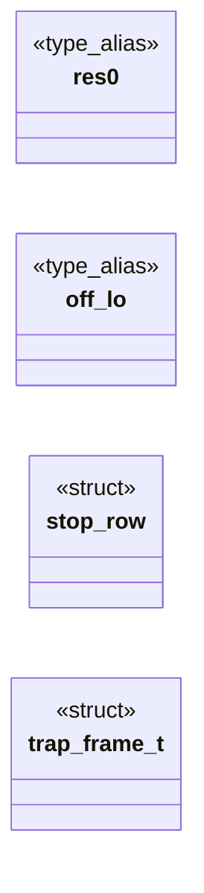
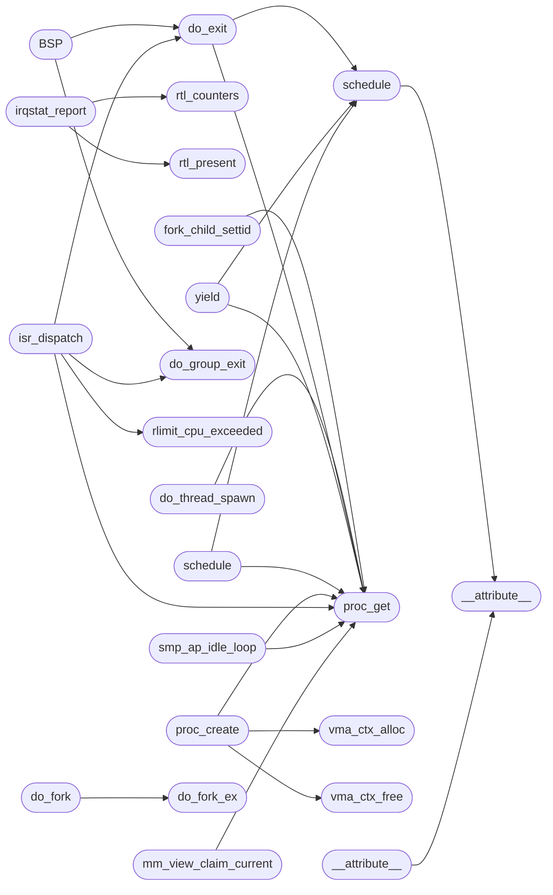

# `kernel/sched.c`

> Source: [kernel/sched.c:1](../../kernel/sched.c#L1) | language `c` | coverage 38.9% | [API index](../index.md)

## Contents

- **Structs:** [`stop_row`](#stop_row), [`trap_frame_t`](#trap_frame_t)
- **Type Aliases:** [`res0`](#res0), [`off_lo`](#off_lo)
- **Functions:** [`user_trampoline`](#user_trampoline), [`fork_trampoline`](#fork_trampoline), [`exec_enter`](#exec_enter), [`PROC_KSTACK_OFF`](#proc_kstack_off), [`descriptor`](#descriptor), [`__attribute__`](#__attribute__), [`here`](#here), [`__attribute__`](#__attribute__), [`live`](#live), [`MXCSR`](#mxcsr), [`vma_ctx_alloc`](#vma_ctx_alloc), [`vma_ctx_free`](#vma_ctx_free), [`copy`](#copy), [`sched_lock`](#sched_lock), [`mm_view_claim_current`](#mm_view_claim_current), [`kstack_report`](#kstack_report), [`schedtop_report`](#schedtop_report), [`slot`](#slot), [`sys_ticks`](#sys_ticks), [`irqstat_report`](#irqstat_report), [`rtl_counters`](#rtl_counters), [`rtl_present`](#rtl_present), [`stub`](#stub), [`gdb_dump_report`](#gdb_dump_report), [`sched_idle_on_kernel_cr3`](#sched_idle_on_kernel_cr3), [`IRQ4`](#irq4), [`tss_init_ap`](#tss_init_ap), [`context`](#context), [`point`](#point), [`FSBASE`](#fsbase), [`sched_set_nice`](#sched_set_nice), [`seccomp_deny_one`](#seccomp_deny_one), [`seccomp_allow_one`](#seccomp_allow_one), [`seccomp_denied`](#seccomp_denied), [`smp_ap_idle_loop`](#smp_ap_idle_loop), [`rlimit_cpu_exceeded`](#rlimit_cpu_exceeded), [`isr_dispatch`](#isr_dispatch), [`syscall`](#syscall), [`BSP`](#bsp), [`proc_get`](#proc_get), [`proc_create`](#proc_create), [`proc_spawn_elf`](#proc_spawn_elf), [`schedule`](#schedule), [`schedule`](#schedule), [`PROC_SWITCHING`](#proc_switching), [`yield`](#yield), [`returns`](#returns), [`do_exit`](#do_exit), [`do_thread_spawn`](#do_thread_spawn), [`registers`](#registers), [`itself`](#itself), [`fork_child_settid`](#fork_child_settid), [`do_fork`](#do_fork), [`do_fork_ex`](#do_fork_ex), [`shares`](#shares), [`MSR`](#msr), [`do_group_exit`](#do_group_exit), [`aslr_stack_bytes`](#aslr_stack_bytes), [`aslr_brk_pages`](#aslr_brk_pages), [`aslr_mmap_pages`](#aslr_mmap_pages), [`aslr_dyn_base`](#aslr_dyn_base), [`cli`](#cli), [`adopt`](#adopt), [`do_execve`](#do_execve), [`do_waitpid`](#do_waitpid), [`do_waitpid_linux`](#do_waitpid_linux), [`shell_reap_nb`](#shell_reap_nb), [`shell_reap_one`](#shell_reap_one), [`shell_nchildren`](#shell_nchildren), [`do_kill`](#do_kill), [`do_kill_code`](#do_kill_code), [`timer_tick`](#timer_tick), [`sched_init`](#sched_init), [`it`](#it), [`park`](#park), [`zeroed`](#zeroed)
- **Macros:** [`MY_SYS_KSTK_TOP`](#my_sys_kstk_top), [`MY_USER_STACK_TOP`](#my_user_stack_top), [`MY_USER_LOAD_BASE`](#my_user_load_base), [`NMI_IST_STACK_SZ`](#nmi_ist_stack_sz), [`NMI_VECTOR`](#nmi_vector), [`NMI_IST_SLOT`](#nmi_ist_slot), [`KSTACK_SZ`](#kstack_sz), [`KSTACK_PAINT`](#kstack_paint), [`KSTACK_CANARY`](#kstack_canary)
- **Variables:** [`sc_top_save`](#sc_top_save), [`isr_stub_table`](#isr_stub_table), [`net_rx_dropped`](#net_rx_dropped), [`mm_lock`](#mm_lock)

## Type Diagram



## Call Graph

Solid arrows stay in this module, dashed arrows leave it.



## Structs

<a id="stop_row"></a>

### `stop_row`

`struct` | [kernel/sched.c:564](../../kernel/sched.c#L564)

```c
struct stop_row { int pid; int tgid; int is_thr; int ppid; int state; int nice;
```

---

<a id="trap_frame_t"></a>

### `trap_frame_t`

`struct` | [kernel/sched.c:729](../../kernel/sched.c#L729)

```c
typedef struct
```

---- Trap frame (must match isr_stubs.S) ----

---

## Type Aliases

<a id="res0"></a>

### `res0`

`type_alias` | [kernel/sched.c:109](../../kernel/sched.c#L109)

```c
typedef struct __attribute__((packed)) { uint32_t res0;
```

---- TSS (one per CPU) ----

Every CPU that runs ring-3 code needs a private TSS: a timer tick that
preempts ring 3 switches to TSS.rsp0, so two CPUs sharing one TSS would
run their ISRs on the same stack.  The runtime GDT grows from 7 entries
(5 from stage 2 + 1 TSS descriptor of 2 slots) to 5 + 2*MAX_CPUS
entries; CPU 0 keeps selector 0x28 exactly as before.  The GDT lives at
0x8000 with 4 KB reserved up to stage 2 at 0x9000, so 21 entries
(168 bytes) fit with room to spare.

---

<a id="off_lo"></a>

### `off_lo`

`type_alias` | [kernel/sched.c:143](../../kernel/sched.c#L143)

```c
typedef struct __attribute__((packed)) { uint16_t off_lo;
```

---- IDT ----

---

## Functions

<a id="user_trampoline"></a>

### `user_trampoline`

`function` `extern` | [kernel/sched.c:66](../../kernel/sched.c#L66)

```c
extern void user_trampoline(void);
```

---

<a id="fork_trampoline"></a>

### `fork_trampoline`

`function` `extern` | [kernel/sched.c:67](../../kernel/sched.c#L67)

```c
extern void fork_trampoline(void);
```

---

<a id="exec_enter"></a>

### `exec_enter`

`function` `extern` | [kernel/sched.c:72](../../kernel/sched.c#L72)

```c
extern void exec_enter(unsigned long frame);
```

**Parameters**

| Name | Type | Default | Description |
|---|---|---|---|
| `frame` | `unsigned long` |  |  |

*Called by:* [`do_execve`](#do_execve)

---

<a id="proc_kstack_off"></a>

### `PROC_KSTACK_OFF`

`function` | [kernel/sched.c:82](../../kernel/sched.c#L82)

```c
* PROC_KSTACK_OFF (it cannot use C here). The asm derives both * immediates from headers/syscall_asm.h, so this assert is the single * check: if it fires, the struct changed and the macros in sched.h
```

**Parameters**

| Name | Type | Default | Description |
|---|---|---|---|
| `here` | `it cannot use C` |  |  |

**Returns:** `*`

---

<a id="descriptor"></a>

### `descriptor`

`function` | [kernel/sched.c:97](../../kernel/sched.c#L97)

```c
* descriptor (two slots) per CPU past the 5 stage-2 entries. */ _Static_assert((5 + 2 * MAX_CPUS) * 8 == GDT64_SMP_BYTES, "GDT SMP size");
```

**Parameters**

| Name | Type | Default | Description |
|---|---|---|---|
| `slots` | `two` |  |  |

**Returns:** `*`

---

<a id="__attribute__"></a>

### `__attribute__`

`function` | [kernel/sched.c:109](../../kernel/sched.c#L109)

```c
typedef struct __attribute__((packed))
```

---- TSS (one per CPU) ----

Every CPU that runs ring-3 code needs a private TSS: a timer tick that
preempts ring 3 switches to TSS.rsp0, so two CPUs sharing one TSS would
run their ISRs on the same stack.  The runtime GDT grows from 7 entries
(5 from stage 2 + 1 TSS descriptor of 2 slots) to 5 + 2*MAX_CPUS
entries; CPU 0 keeps selector 0x28 exactly as before.  The GDT lives at
0x8000 with 4 KB reserved up to stage 2 at 0x9000, so 21 entries
(168 bytes) fit with room to spare.

**Parameters**

| Name | Type | Default | Description |
|---|---|---|---|
| `packed` |  |  |  |

**Returns:** `typedef`

*Called by:* [`__attribute__`](#__attribute__), [`schedule`](#schedule)

---

<a id="here"></a>

### `here`

`function` | [kernel/sched.c:128](../../kernel/sched.c#L128)

```c
* smp_ap_idle_loop here (idle_proc ctx.rsp points at the top). */ static char ap_idle_stack[MAX_CPUS][4096] __attribute__((aligned(16)));
```

**Parameters**

| Name | Type | Default | Description |
|---|---|---|---|
| `top` | `idle_proc ctx.rsp points at the` |  |  |

**Returns:** `* smp_ap_idle_loop`

---

<a id="__attribute__"></a>

### `__attribute__`

`function` | [kernel/sched.c:143](../../kernel/sched.c#L143)

```c
typedef struct __attribute__((packed))
```

---- IDT ----

**Parameters**

| Name | Type | Default | Description |
|---|---|---|---|
| `packed` |  |  |  |

**Returns:** `typedef`

*Calls:* [`__attribute__`](#__attribute__)

---

<a id="live"></a>

### `live`

`function` | [kernel/sched.c:286](../../kernel/sched.c#L286)

```c
* still be live (two procs on one kernel stack). Anything that is not * exactly a slot end is ignored, never freed. */ static int free_kstack(uint64_t top)
```

**Parameters**

| Name | Type | Default | Description |
|---|---|---|---|
| `stack` | `two procs on one kernel` |  |  |

**Returns:** `* still be`

---

<a id="mxcsr"></a>

### `MXCSR`

`function` | [kernel/sched.c:306](../../kernel/sched.c#L306)

```c
* A fresh image is explicit zeros plus the default MXCSR (0x1F80, all * exceptions masked): fxsa...
```

**Parameters**

| Name | Type | Default | Description |
|---|---|---|---|
| `x1F80` |  |  |  |
| `masked` | `all * exceptions` |  |  |

**Returns:** `fxsa...`

---

<a id="vma_ctx_alloc"></a>

### `vma_ctx_alloc`

`function` | [kernel/sched.c:342](../../kernel/sched.c#L342)

```c
vma_ctx_t *vma_ctx_alloc(void)
```

Per-process VMA contexts (vma.h contract; defined here so vma.c stays host-testable).

A private pool is VMA_MAX nodes from the kernel heap.

**Returns:** `vma_ctx_t *`

*Called by:* [`do_execve`](#do_execve), [`proc_create`](#proc_create)

---

<a id="vma_ctx_free"></a>

### `vma_ctx_free`

`function` | [kernel/sched.c:352](../../kernel/sched.c#L352)

```c
void vma_ctx_free(vma_ctx_t *c)
```

**Parameters**

| Name | Type | Default | Description |
|---|---|---|---|
| `c` | `vma_ctx_t *` |  |  |

*Called by:* [`do_execve`](#do_execve), [`do_fork_ex`](#do_fork_ex), [`proc_create`](#proc_create)

---

<a id="copy"></a>

### `copy`

`function` | [kernel/sched.c:362](../../kernel/sched.c#L362)

```c
* copy (fail closed, fork refuses) instead of forging pointers. */ /* Name the link a fork could ...
```

**Parameters**

| Name | Type | Default | Description |
|---|---|---|---|
| `closed` | `fail` |  |  |
| `refuses` | `fork` |  |  |

**Returns:** `*`

*Calls:* [`d`](progs.doomgeneric.p_local.h.md#d)

---

<a id="sched_lock"></a>

### `sched_lock`

`function` | [kernel/sched.c:452](../../kernel/sched.c#L452)

```c
* hold sched_lock (+mm_lock at the swap sites);
```

**Parameters**

| Name | Type | Default | Description |
|---|---|---|---|
| `sites` | `+mm_lock at the swap` |  |  |

**Returns:** `* hold`

---

<a id="mm_view_claim_current"></a>

### `mm_view_claim_current`

`function` | [kernel/sched.c:513](../../kernel/sched.c#L513)

```c
void mm_view_claim_current(void)
```

The running process installed a fresh view itself (execve, spawn restore): it is the holder from now on.

*Calls:* [`proc_get`](#proc_get)

*Called by:* [`do_execve`](#do_execve)

---

<a id="kstack_report"></a>

### `kstack_report`

`function` | [kernel/sched.c:520](../../kernel/sched.c#L520)

```c
void kstack_report(void)
```

Serial-observable stack health: per-proc high-water marks plus the legacy 32 KB syscall stack, ending in `kstack: ok` or `kstack: OVERFLOW`.

The shell [`kstack`](kernel.c.md#kstack) builtin calls this.

*Calls:* [`d`](progs.doomgeneric.p_local.h.md#d)

---

<a id="schedtop_report"></a>

### `schedtop_report`

`function` | [kernel/sched.c:563](../../kernel/sched.c#L563)

```c
void schedtop_report(void)
```

`schedtop` -- one screenful of scheduler state: uptime from the 100 Hz tick, per-CPU current pid, then one row per live proc (thread group, thread/process flag, state, nice, virtual runtime, consumed ticks).

Threads are CLONE_VM procs sharing an address space: the T/P column names them, and tgid is the lowest pid sharing the same VMA view (the group leader), so `thdemo`'s ten threads read as one group with ten per-thread tick counters. Snapshot under sched_lock, print after release so console I/O never runs with the scheduler held.

*Calls:* [`spin_lock`](headers.spinlock.h.md#spin_lock), [`spin_unlock`](headers.spinlock.h.md#spin_unlock)

---

<a id="slot"></a>

### `slot`

`function` | [kernel/sched.c:567](../../kernel/sched.c#L567)

```c
* must not eat a quarter of a 16 KB slot (see the stack discipline * contract in CLAUDE.md). Fail-closed on OOM. */ struct stop_row *snap = (struct stop_row *)kmalloc(sizeof(struct stop_row) * MAX_PRO
```

**Parameters**

| Name | Type | Default | Description |
|---|---|---|---|
| `md` | `see the stack discipline * contract in CLAUDE.` |  |  |

**Returns:** `* must not eat a quarter of a 16 KB`

---

<a id="sys_ticks"></a>

### `sys_ticks`

`function` | [kernel/sched.c:627](../../kernel/sched.c#L627)

```c
* sys_ticks (PIT 100 Hz on the BSP, broadcast as IPIs to APs);
```

**Parameters**

| Name | Type | Default | Description |
|---|---|---|---|
| `BSP` | `PIT 100 Hz on the` |  |  |
| `APs` | `broadcast as IPIs to` |  |  |

**Returns:** `*`

---

<a id="irqstat_report"></a>

### `irqstat_report`

`function` | [kernel/sched.c:631](../../kernel/sched.c#L631)

```c
void irqstat_report(void)
```

`irqstat` -- interrupt arrivals per source.

Timer ticks come from sys_ticks (PIT 100 Hz on the BSP, broadcast as IPIs to APs); kbd/mouse/ sb16 are counted at the top of their isr_dispatch arms. NIC and audio queue health ride along from rtl/sb16 counters so one screen answers "is the hardware talking and is the guest keeping up".

*Calls:* [`sb16_counters`](headers.sb16.h.md#sb16_counters), [`rtl_counters`](#rtl_counters), [`rtl_present`](#rtl_present)

---

<a id="rtl_counters"></a>

### `rtl_counters`

`function` `extern` | [kernel/sched.c:634](../../kernel/sched.c#L634)

```c
extern void rtl_counters(unsigned int *tx_frames, unsigned int *rx_frames);
```

Frame-level TX/RX counters (bytes are protocol counters in net.c).

**Parameters**

| Name | Type | Default | Description |
|---|---|---|---|
| `tx_frames` | `unsigned int *` |  |  |
| `rx_frames` | `unsigned int *` |  |  |

> **Inherited:** Documentation from [`rtl_counters`](#rtl_counters) (headers/net/rtl8139.h:38).

*Called by:* [`irqstat_report`](#irqstat_report)

---

<a id="rtl_present"></a>

### `rtl_present`

`function` `extern` | [kernel/sched.c:636](../../kernel/sched.c#L636)

```c
extern int rtl_present(void);
```

Nonzero when the rtl8139 was found and initialized.

**Returns:** `int`

> **Inherited:** Documentation from [`rtl_present`](#rtl_present) (headers/net/rtl8139.h:18).

*Called by:* [`irqstat_report`](#irqstat_report)

---

<a id="stub"></a>

### `stub`

`function` | [kernel/sched.c:650](../../kernel/sched.c#L650)

```c
* gdb stub (`make gdb`, then `target remote :1234` from the host). These * helpers are the seria...
```

**Parameters**

| Name | Type | Default | Description |
|---|---|---|---|
| `gdb` | `` `make ` `` |  |  |
| `host` | `` then `target remote :1234` from the `` |  |  |

**Returns:** `* gdb`

*Calls:* [`gdb_regs_report`](headers.sched.h.md#gdb_regs_report), [`d`](progs.doomgeneric.p_local.h.md#d)

---

<a id="gdb_dump_report"></a>

### `gdb_dump_report`

`function` | [kernel/sched.c:697](../../kernel/sched.c#L697)

```c
void gdb_dump_report(unsigned long addr, unsigned long len)
```

**Parameters**

| Name | Type | Default | Description |
|---|---|---|---|
| `addr` | `unsigned long` |  |  |
| `len` | `unsigned long` |  |  |

---

<a id="sched_idle_on_kernel_cr3"></a>

### `sched_idle_on_kernel_cr3`

`function` | [kernel/sched.c:723](../../kernel/sched.c#L723)

```c
int sched_idle_on_kernel_cr3(int cpu)
```

1 when cpu's idle context runs on the kernel tables (the `smp` builtin reports it as idle_cr3=kernel|stale).

**Parameters**

| Name | Type | Default | Description |
|---|---|---|---|
| `cpu` | `int` |  |  |

**Returns:** `int`

---

<a id="irq4"></a>

### `IRQ4`

`function` | [kernel/sched.c:796](../../kernel/sched.c#L796)

```c
* IRQ4 (COM1, UART IER stays 0 so it never fires) + * IRQ5 (Sound Blaster 16 DMA done). In the mask register a bit set * means masked, so 0xC8 masks only IRQ3, IRQ6 and IRQ7. Masking IRQ5 * here starv
```

**Parameters**

| Name | Type | Default | Description |
|---|---|---|---|
| `fires` | `UART IER stays 0 so it never` |  |  |

**Returns:** `*`

---

<a id="tss_init_ap"></a>

### `tss_init_ap`

`function` | [kernel/sched.c:870](../../kernel/sched.c#L870)

```c
void tss_init_ap(int cpu)
```

Load this AP's task register.

The BSP wrote every descriptor in tss_init before the APs were woken, so the AP only points its TR at its own slot; its ring-3 preempts then land on its private rsp0 stack instead of the BSP's.

**Parameters**

| Name | Type | Default | Description |
|---|---|---|---|
| `cpu` | `int` |  |  |

*Calls:* [`TSS_SEL`](headers.sched.h.md#tss_sel)

---

<a id="context"></a>

### `context`

`function` | [kernel/sched.c:888](../../kernel/sched.c#L888)

```c
* context (anything entered via k_exec_user) is inside a syscall * (entry swapped 0 in), and a c...
```

**Parameters**

| Name | Type | Default | Description |
|---|---|---|---|
| `k_exec_user` | `anything entered via` |  |  |

**Returns:** `*`

*Calls:* [`wrmsr`](headers.arch.x86.msr.h.md#wrmsr)

---

<a id="point"></a>

### `point`

`function` | [kernel/sched.c:901](../../kernel/sched.c#L901)

```c
* return address as the resume point ("continue the ISR"), which * required the stranded ISR fra...
```

**Parameters**

| Name | Type | Default | Description |
|---|---|---|---|
| `ISR` | `"continue the "` |  |  |

**Returns:** `* return address as the resume`

*Calls:* [`rdmsr`](headers.arch.x86.msr.h.md#rdmsr)

---

<a id="fsbase"></a>

### `FSBASE`

`function` | [kernel/sched.c:913](../../kernel/sched.c#L913)

```c
* for FSBASE (per-proc TLS): a thread preempted after arch_prctl * would otherwise resume with whatever base the next thread left * behind. GSBASE is deliberately untouched (live kernel per-CPU). */ i
```

**Parameters**

| Name | Type | Default | Description |
|---|---|---|---|
| `TLS` | `per-proc` |  |  |

**Returns:** `a thread preempted after arch_prctl * would otherwise resume with whatever base the next thread left * behind. GSBASE is deliberately untouched (live kernel per-CPU). */ i`

---

<a id="sched_set_nice"></a>

### `sched_set_nice`

`function` | [kernel/sched.c:948](../../kernel/sched.c#L948)

```c
int sched_set_nice(int pid, int nice)
```

Set scheduling niceness for pid (-20..19, clamped).

Returns 0 or -1.

**Parameters**

| Name | Type | Default | Description |
|---|---|---|---|
| `pid` | `int` |  |  |
| `nice` | `int` |  |  |

**Returns:** `int`

---

<a id="seccomp_deny_one"></a>

### `seccomp_deny_one`

`function` | [kernel/sched.c:957](../../kernel/sched.c#L957)

```c
int seccomp_deny_one(int pid, int n)
```

Seccomp-basic helpers: deny/allow one MiniOS syscall for pid.

**Parameters**

| Name | Type | Default | Description |
|---|---|---|---|
| `pid` | `int` |  |  |
| `n` | `int` |  |  |

**Returns:** `int`

*Calls:* [`SECCOMP_BIT`](headers.sched.h.md#seccomp_bit)

---

<a id="seccomp_allow_one"></a>

### `seccomp_allow_one`

`function` | [kernel/sched.c:964](../../kernel/sched.c#L964)

```c
int seccomp_allow_one(int pid, int n)
```

**Parameters**

| Name | Type | Default | Description |
|---|---|---|---|
| `pid` | `int` |  |  |
| `n` | `int` |  |  |

**Returns:** `int`

*Calls:* [`SECCOMP_BIT`](headers.sched.h.md#seccomp_bit)

---

<a id="seccomp_denied"></a>

### `seccomp_denied`

`function` | [kernel/sched.c:971](../../kernel/sched.c#L971)

```c
int seccomp_denied(int pid, int n)
```

**Parameters**

| Name | Type | Default | Description |
|---|---|---|---|
| `pid` | `int` |  |  |
| `n` | `int` |  |  |

**Returns:** `int`

*Calls:* [`SECCOMP_BIT`](headers.sched.h.md#seccomp_bit)

---

<a id="smp_ap_idle_loop"></a>

### `smp_ap_idle_loop`

`function` | [kernel/sched.c:1042](../../kernel/sched.c#L1042)

```c
void smp_ap_idle_loop(void)
```

AP idle loop: hlt until a CLONE_VM thread is ready, run it, repeat.

Entered once from smp_ap_entry on the AP stub stack; the first switch_to out of here saves these registers into ap_idle_proc[cpu], so every return to idle resumes this loop.

Interrupts stay OFF from the claim through the switch: a LAPIC tick
landing in between would park this half-switched state over the
incoming thread's ctx.  Threads enter with their own rflags (IF=1);
a resume back to idle restores IF=0, so sti runs after every
switch_to return.  The hlt itself needs IF=1 to wake.

*Calls:* [`switch_to`](headers.sched.h.md#switch_to), [`proc_get`](#proc_get)

---

<a id="rlimit_cpu_exceeded"></a>

### `rlimit_cpu_exceeded`

`function` | [kernel/sched.c:1182](../../kernel/sched.c#L1182)

```c
int rlimit_cpu_exceeded(int pid)
```

**Parameters**

| Name | Type | Default | Description |
|---|---|---|---|
| `pid` | `int` |  |  |

**Returns:** `int`

*Called by:* [`isr_dispatch`](#isr_dispatch)

---

<a id="isr_dispatch"></a>

### `isr_dispatch`

`function` | [kernel/sched.c:1203](../../kernel/sched.c#L1203)

```c
void isr_dispatch(int vector, trap_frame_t *frame)
```

**Parameters**

| Name | Type | Default | Description |
|---|---|---|---|
| `vector` | `int` |  |  |
| `frame` | `trap_frame_t *` |  |  |

*Calls:* [`hal_inb`](headers.arch.x86.hal_io.h.md#hal_inb), [`hal_lapic_eoi`](headers.arch.x86.hal_io.h.md#hal_lapic_eoi), [`hal_outb`](headers.arch.x86.hal_io.h.md#hal_outb), [`rdmsr`](headers.arch.x86.msr.h.md#rdmsr), [`mm_file_fault`](headers.kernel.h.md#mm_file_fault), [`pcm2_active`](headers.pcm2.h.md#pcm2_active), [`pcm2_irq`](headers.pcm2.h.md#pcm2_irq), [`rcu_note_tick`](headers.rcu.h.md#rcu_note_tick), [`rcu_poll`](headers.rcu.h.md#rcu_poll), [`sb16_irq`](headers.sb16.h.md#sb16_irq), [`rlimit_cpu_tick`](headers.sched.h.md#rlimit_cpu_tick), [`switch_to_notrap`](headers.sched.h.md#switch_to_notrap) and 13 more

---

<a id="syscall"></a>

### `syscall`

`function` | [kernel/sched.c:1320](../../kernel/sched.c#L1320)

```c
* outgoing syscall (see sched_rearm_kgs). Without * this the next entry swapgs puts garbage under GS * and the pid math faults. */ sched_rearm_kgs();
```

**Parameters**

| Name | Type | Default | Description |
|---|---|---|---|
| `sched_rearm_kgs` | `see` |  |  |

**Returns:** `* outgoing`

---

<a id="bsp"></a>

### `BSP`

`function` | [kernel/sched.c:1780](../../kernel/sched.c#L1780)

```c
* CPU believe it is the BSP (wrong per-CPU identity, two CPUs * running the shell context) — the thread dies through the * scheduler instead and its parent reaps it with waitpid. */ if ((frame->cs & 3) == 3 && frame->rip >= 0x400000 && frame->rip < 0x0C000000)
```

**Parameters**

| Name | Type | Default | Description |
|---|---|---|---|
| `identity` | `wrong per-CPU` |  |  |
| `context` | `two CPUs * running the shell` |  |  |

**Returns:** `* CPU believe it is the`

*Calls:* [`do_exit`](#do_exit), [`do_group_exit`](#do_group_exit)

---

<a id="proc_get"></a>

### `proc_get`

`function` | [kernel/sched.c:1821](../../kernel/sched.c#L1821)

```c
proc_t *proc_get(int pid)
```

**Parameters**

| Name | Type | Default | Description |
|---|---|---|---|
| `pid` | `int` |  |  |

**Returns:** `proc_t *`

*Called by:* [`do_execve`](#do_execve), [`do_exit`](#do_exit), [`do_fork_ex`](#do_fork_ex), [`do_group_exit`](#do_group_exit), [`do_kill_code`](#do_kill_code), [`do_thread_spawn`](#do_thread_spawn), [`do_waitpid`](#do_waitpid), [`do_waitpid_linux`](#do_waitpid_linux), [`fork_child_settid`](#fork_child_settid), [`isr_dispatch`](#isr_dispatch), [`mm_view_claim_current`](#mm_view_claim_current), [`proc_create`](#proc_create) and 5 more

---

<a id="proc_create"></a>

### `proc_create`

`function` | [kernel/sched.c:1827](../../kernel/sched.c#L1827)

```c
int proc_create(const char *name, int parent_pid)
```

**Parameters**

| Name | Type | Default | Description |
|---|---|---|---|
| `name` | `char *` |  |  |
| `parent_pid` | `int` |  |  |

**Returns:** `int`

*Calls:* [`kfd_view_copy`](headers.sched.h.md#kfd_view_copy), [`pt_clone_user`](headers.sched.h.md#pt_clone_user), [`spin_lock`](headers.spinlock.h.md#spin_lock), [`spin_unlock`](headers.spinlock.h.md#spin_unlock), [`proc_get`](#proc_get), [`vma_ctx_alloc`](#vma_ctx_alloc), [`vma_ctx_free`](#vma_ctx_free)

---

<a id="proc_spawn_elf"></a>

### `proc_spawn_elf`

`function` | [kernel/sched.c:2105](../../kernel/sched.c#L2105)

```c
int proc_spawn_elf(const char *name, void *data, unsigned size, int argc, char **argv)
```

Atomic spawn wrapper: the whole construction (page tables, image copy, stack, publish) runs with the timer held off, so a running process's syscalls can never interleave the newcomer's heap and table writes.

See the inner note for why the newcomer paid. Flags saved/restored (not bare cli/sti) so a caller that entered with IF=0 keeps it; scheduler-structure protection inside is spin_lock_irqsave on sched_lock/mm_lock, the CR3 windows save theirs locally.

**Parameters**

| Name | Type | Default | Description |
|---|---|---|---|
| `name` | `char *` |  |  |
| `data` | `void *` |  |  |
| `size` | `unsigned` |  |  |
| `argc` | `int` |  |  |
| `argv` | `char **` |  |  |

**Returns:** `int`

*Calls:* [`spin_restore_irq`](headers.spinlock.h.md#spin_restore_irq), [`spin_save_irq`](headers.spinlock.h.md#spin_save_irq)

---

<a id="schedule"></a>

### `schedule`

`function` | [kernel/sched.c:2147](../../kernel/sched.c#L2147)

```c
* that keeps schedule()'s own rbp runs the caller's frame accesses * (locals, leave/ret) on the ...
```

**Returns:** `* that keeps`

*Calls:* [`sched_park_capture`](arch.x86.ctx_sw.S.md#sched_park_capture), [`__attribute__`](#__attribute__)

*Called by:* [`do_exit`](#do_exit), [`do_waitpid`](#do_waitpid), [`do_waitpid_linux`](#do_waitpid_linux), [`schedule`](#schedule), [`yield`](#yield)

---

<a id="schedule"></a>

### `schedule`

`function` | [kernel/sched.c:2154](../../kernel/sched.c#L2154)

```c
void schedule(void)
```

*Calls:* [`switch_save_only`](headers.sched.h.md#switch_save_only), [`switch_to_notrap`](headers.sched.h.md#switch_to_notrap), [`spin_lock`](headers.spinlock.h.md#spin_lock), [`spin_lock_irqsave`](headers.spinlock.h.md#spin_lock_irqsave), [`spin_unlock`](headers.spinlock.h.md#spin_unlock), [`spin_unlock_irqrestore`](headers.spinlock.h.md#spin_unlock_irqrestore), [`spin_unlock_keep_irq`](headers.spinlock.h.md#spin_unlock_keep_irq), [`proc_get`](#proc_get), [`schedule`](#schedule)

---

<a id="proc_switching"></a>

### `PROC_SWITCHING`

`function` | [kernel/sched.c:2180](../../kernel/sched.c#L2180)

```c
* while the thread is still PROC_SWITCHING (never claimable), * then set the resume point and publish. A BLOCKED/ZOMBIE * thread keeps its state (no one claims it until a wake). */ switch_save_only(cu
```

Transient: the owner CPU is between "decided to switch away" and "context fully saved".

Never claimable: a steal here would resume a stale context.  schedule() turns it into READY only after the save.

**Parameters**

| Name | Type | Default | Description |
|---|---|---|---|
| `claimable` | `never` |  |  |

**Returns:** `* while the thread is still`

> **Inherited:** Documentation from [`PROC_SWITCHING`](#proc_switching) (headers/sched.h:22).

---

<a id="yield"></a>

### `yield`

`function` | [kernel/sched.c:2235](../../kernel/sched.c#L2235)

```c
void yield(void)
```

*Calls:* [`proc_get`](#proc_get), [`schedule`](#schedule)

---

<a id="returns"></a>

### `returns`

`function` | [kernel/sched.c:2243](../../kernel/sched.c#L2243)

```c
* that returns (and the resumed thread returns with IF=1). */ __asm__ volatile("cli");
```

**Parameters**

| Name | Type | Default | Description |
|---|---|---|---|
| `IF` | `and the resumed thread returns with` | `1` |  |

**Returns:** `* that`

---

<a id="do_exit"></a>

### `do_exit`

`function` | [kernel/sched.c:2250](../../kernel/sched.c#L2250)

```c
void do_exit(int code)
```

**Parameters**

| Name | Type | Default | Description |
|---|---|---|---|
| `code` | `int` |  |  |

*Calls:* [`futex_wake`](headers.futex.h.md#futex_wake), [`user_page_present`](headers.kernel.h.md#user_page_present), [`kfd_view_release`](headers.sched.h.md#kfd_view_release), [`spin_lock`](headers.spinlock.h.md#spin_lock), [`spin_unlock`](headers.spinlock.h.md#spin_unlock), [`proc_get`](#proc_get), [`schedule`](#schedule)

*Called by:* [`BSP`](#bsp), [`do_kill_code`](#do_kill_code), [`isr_dispatch`](#isr_dispatch)

---

<a id="do_thread_spawn"></a>

### `do_thread_spawn`

`function` | [kernel/sched.c:2314](../../kernel/sched.c#L2314)

```c
long do_thread_spawn(unsigned long fn, unsigned long stack, unsigned long arg)
```

do_thread_spawn(fn, stack, arg) - create a 1:1 kernel thread that shares the caller's address space (CLONE_VM).

Unlike do_clone, whose child frame is ambiguous, this one starts cleanly at fn(arg) on the given stack:

child RIP = fn, child RSP = stack, child RDI = arg (SysV first arg),
  entered through the same user_trampoline + iretq path as proc_create.

The caller (pthread-like user code) owns the stack: it must be allocated
before the call (8 KB each per the roadmap) with its TOP passed here,
and must stay alive until the thread is joined.  fn and stack must lie
in the user window (checked by the syscall wrapper).  The thread shares
CR3, the fd view and (by the schedule() CLONE_VM rule) the live
brk/mmap view with its parent; the parent joins it with do_waitpid,
which reaps the exit code without freeing the shared page tables.
Returns the child PID, or -1 when no slot or stack is usable.

**Parameters**

| Name | Type | Default | Description |
|---|---|---|---|
| `fn` | `unsigned long` |  |  |
| `stack` | `unsigned long` |  |  |
| `arg` | `unsigned long` |  |  |

**Returns:** `long`

*Calls:* [`rq_enqueue`](headers.percpu_rq.h.md#rq_enqueue), [`proc_sec_inherit`](headers.proc_sec.h.md#proc_sec_inherit), [`spin_lock`](headers.spinlock.h.md#spin_lock), [`spin_unlock`](headers.spinlock.h.md#spin_unlock), [`proc_get`](#proc_get)

---

<a id="registers"></a>

### `registers`

`function` | [kernel/sched.c:2345](../../kernel/sched.c#L2345)

```c
* registers (float args would need XMM inheritance, which the * arg-passing contract does not carry: fn takes one integer arg). */ child->fpu_save = fpu_alloc_clean();
```

**Parameters**

| Name | Type | Default | Description |
|---|---|---|---|
| `inheritance` | `float args would need XMM` |  |  |
| `arg` | `which the * arg-passing contract does not carry: fn takes one integer` |  |  |

**Returns:** `*`

---

<a id="itself"></a>

### `itself`

`function` | [kernel/sched.c:2514](../../kernel/sched.c#L2514)

```c
* the shell itself (use mrun first), and a CLONE_VM thread forking * would duplicate shared stat...
```

**Parameters**

| Name | Type | Default | Description |
|---|---|---|---|
| `first` | `use mrun` |  |  |

**Returns:** `* the shell`

*Calls:* [`syscall_frame_current`](headers.sched.h.md#syscall_frame_current)

---

<a id="fork_child_settid"></a>

### `fork_child_settid`

`function` | [kernel/sched.c:2555](../../kernel/sched.c#L2555)

```c
void fork_child_settid(void)
```

First code a fork or clone child runs (fork_trampoline, its own window live): store its tid at the CLONE_CHILD_SETTID address.

A copy-on-write page privatizes through the #PF path, never touching the parent's.

*Calls:* [`user_page_present`](headers.kernel.h.md#user_page_present), [`proc_get`](#proc_get)

---

<a id="do_fork"></a>

### `do_fork`

`function` | [kernel/sched.c:2564](../../kernel/sched.c#L2564)

```c
long do_fork(void)
```

**Returns:** `long`

*Calls:* [`do_fork_ex`](#do_fork_ex)

---

<a id="do_fork_ex"></a>

### `do_fork_ex`

`function` | [kernel/sched.c:2577](../../kernel/sched.c#L2577)

```c
long do_fork_ex(uint64_t set_tid, uint64_t clear_tid)
```

**Parameters**

| Name | Type | Default | Description |
|---|---|---|---|
| `set_tid` | `uint64_t` |  |  |
| `clear_tid` | `uint64_t` |  |  |

**Returns:** `long`

*Calls:* [`rdmsr`](headers.arch.x86.msr.h.md#rdmsr), [`proc_sec_inherit`](headers.proc_sec.h.md#proc_sec_inherit), [`kfd_view_copy`](headers.sched.h.md#kfd_view_copy), [`pt_free_user`](headers.sched.h.md#pt_free_user), [`syscall_frame_current`](headers.sched.h.md#syscall_frame_current), [`spin_lock_irqsave`](headers.spinlock.h.md#spin_lock_irqsave), [`spin_restore_irq`](headers.spinlock.h.md#spin_restore_irq), [`spin_save_irq`](headers.spinlock.h.md#spin_save_irq), [`spin_unlock_irqrestore`](headers.spinlock.h.md#spin_unlock_irqrestore), [`tlb_shootdown`](kernel.mm.tlb.c.md#tlb_shootdown), [`proc_get`](#proc_get), [`vma_ctx_free`](#vma_ctx_free)

*Called by:* [`do_fork`](#do_fork)

---

<a id="shares"></a>

### `shares`

`function` | [kernel/sched.c:2595](../../kernel/sched.c#L2595)

```c
* thread on another CPU kept its writable translation and wrote straight * into frames the child now shares (the forked FreeDom renderer read the * parent's later pointers as garbage), so its TLB is s
```

**Parameters**

| Name | Type | Default | Description |
|---|---|---|---|
| `garbage` | `the forked FreeDom renderer read the * parent's later pointers as` |  |  |

**Returns:** `* thread on another CPU kept its writable translation and wrote straight * into frames the child now`

---

<a id="msr"></a>

### `MSR`

`function` | [kernel/sched.c:2633](../../kernel/sched.c#L2633)

```c
* in the MSR (the PCB field refreshes on switch-out) and its FPU * regs live in the CPU (the PCB image refreshes on switch-out). * The child resumes user code directly, never through glibc init, * so
```

**Parameters**

| Name | Type | Default | Description |
|---|---|---|---|
| `out` | `the PCB field refreshes on switch-` |  |  |

**Returns:** `* in the`

---

<a id="do_group_exit"></a>

### `do_group_exit`

`function` | [kernel/sched.c:2859](../../kernel/sched.c#L2859)

```c
void do_group_exit(int code)
```

Linux exit_group(2) and fatal-signal semantics, minus the caller's own exit (the caller follows with do_exit or do_proc_exit): every other thread of the group dies, and when the caller is a worker thread the leader dies too with code, so its parent's wait reports the group's fate instead of waiting on a leader that would never end.

A foreground leader (pid 0) is the shell context and cannot be zombified; its workers die and the leader keeps running, as before.

**Parameters**

| Name | Type | Default | Description |
|---|---|---|---|
| `code` | `int` |  |  |

*Calls:* [`spin_lock_irqsave`](headers.spinlock.h.md#spin_lock_irqsave), [`spin_unlock_irqrestore`](headers.spinlock.h.md#spin_unlock_irqrestore), [`proc_get`](#proc_get)

*Called by:* [`BSP`](#bsp), [`do_kill_code`](#do_kill_code), [`isr_dispatch`](#isr_dispatch)

---

<a id="aslr_stack_bytes"></a>

### `aslr_stack_bytes`

`function` | [kernel/sched.c:2896](../../kernel/sched.c#L2896)

```c
unsigned long aslr_stack_bytes(void)
```

ASLR jitter, fresh per exec (TSC + ticks + per-exec counter, never zero for stack/brk so consecutive execs differ observably): stack top slides 1..4096 bytes, brk start 1..256 pages past the image, mmap cursor up to 255 pages down, ET_DYN base up to 47 2 MB slots up.

**Returns:** `unsigned long`

> **Inherited:** Documentation from [`aslr_stack_bytes`](#aslr_stack_bytes) (headers/sched.h:431).

*Called by:* [`do_execve`](#do_execve)

---

<a id="aslr_brk_pages"></a>

### `aslr_brk_pages`

`function` | [kernel/sched.c:2897](../../kernel/sched.c#L2897)

```c
unsigned long aslr_brk_pages(void)
```

**Returns:** `unsigned long`

---

<a id="aslr_mmap_pages"></a>

### `aslr_mmap_pages`

`function` | [kernel/sched.c:2898](../../kernel/sched.c#L2898)

```c
unsigned long aslr_mmap_pages(void)
```

**Returns:** `unsigned long`

*Called by:* [`do_execve`](#do_execve)

---

<a id="aslr_dyn_base"></a>

### `aslr_dyn_base`

`function` | [kernel/sched.c:2899](../../kernel/sched.c#L2899)

```c
unsigned long aslr_dyn_base(void)
```

**Returns:** `unsigned long`

---

<a id="cli"></a>

### `cli`

`function` | [kernel/sched.c:2908](../../kernel/sched.c#L2908)

```c
* cli (disk PIO must never run with the timer held off);
```

**Parameters**

| Name | Type | Default | Description |
|---|---|---|---|
| `off` | `disk PIO must never run with the timer held` |  |  |

**Returns:** `*`

---

<a id="adopt"></a>

### `adopt`

`function` | [kernel/sched.c:2922](../../kernel/sched.c#L2922)

```c
* adopt (armed by Linux O_CLOEXEC on open);
```

**Parameters**

| Name | Type | Default | Description |
|---|---|---|---|
| `open` | `armed by Linux O_CLOEXEC on` |  |  |

**Returns:** `*`

---

<a id="do_execve"></a>

### `do_execve`

`function` | [kernel/sched.c:2926](../../kernel/sched.c#L2926)

```c
long do_execve(char *kpath, int kargc, char **kargv)
```

do_execve() - replace the caller's ET_EXEC/ET_DYN image in place.

The caller keeps its pid, parent, children, fd table and limits; the
window, VMA context, brk/mmap view, user stack, FPU image, FSBASE and
name are rebuilt around the new program. File content loads before
cli (disk PIO must never run with the timer held off); everything
from the fresh-window build through the iretq runs atomic like
proc_spawn_elf_inner, then the new program is entered directly on a
fresh kstack through user_trampoline. Success never returns.

Scope, fail-closed: the caller must be an isolated non-CLONE_VM
ring-3 proc (pid 0 has no own window; a thread calling execve
would keep CLONE_VM on a private window, which the view switch
does not serve, so it refuses with -ENOSYS). Sibling threads die
with the old image like Linux: at adopt, every CLONE_VM sharer of
the old window becomes a zombie for its parent. ET_REL refuses
with -ENOEXEC (ring-0 extensions load only through SPAWN's trust
gate). OOM at any pre-adopt step releases what was claimed and
returns -12 with the caller byte-identical. CLOEXEC fds close at
adopt (armed by Linux O_CLOEXEC on open); the rest survive like
fork. envp is not carried: setup_user_stack
builds argc/argv only, so every execve starts with an empty
environment.

**Parameters**

| Name | Type | Default | Description |
|---|---|---|---|
| `kpath` | `char *` |  |  |
| `kargc` | `int` |  |  |
| `kargv` | `char **` |  |  |

**Returns:** `long`

*Calls:* [`wrmsr`](headers.arch.x86.msr.h.md#wrmsr), [`proc_sec_exec`](headers.proc_sec.h.md#proc_sec_exec), [`proc_sec_set_exe`](headers.proc_sec.h.md#proc_sec_set_exe), [`kfd_view_cloexec`](headers.sched.h.md#kfd_view_cloexec), [`pt_free_user`](headers.sched.h.md#pt_free_user), [`spawn_load_image`](headers.spawn.h.md#spawn_load_image), [`spin_lock_irqsave`](headers.spinlock.h.md#spin_lock_irqsave), [`spin_restore_irq`](headers.spinlock.h.md#spin_restore_irq), [`spin_save_irq`](headers.spinlock.h.md#spin_save_irq), [`spin_unlock_irqrestore`](headers.spinlock.h.md#spin_unlock_irqrestore), [`aslr_mmap_pages`](#aslr_mmap_pages), [`aslr_stack_bytes`](#aslr_stack_bytes) and 5 more

---

<a id="do_waitpid"></a>

### `do_waitpid`

`function` | [kernel/sched.c:3224](../../kernel/sched.c#L3224)

```c
int do_waitpid(int pid)
```

**Parameters**

| Name | Type | Default | Description |
|---|---|---|---|
| `pid` | `int` |  |  |

**Returns:** `int`

*Calls:* [`spin_lock`](headers.spinlock.h.md#spin_lock), [`spin_unlock`](headers.spinlock.h.md#spin_unlock), [`proc_get`](#proc_get), [`schedule`](#schedule)

---

<a id="do_waitpid_linux"></a>

### `do_waitpid_linux`

`function` | [kernel/sched.c:3255](../../kernel/sched.c#L3255)

```c
int do_waitpid_linux(int pid, int nohang, int *found)
```

Linux wait4 core (docs/spec/smp-sched.md): reap one matching child and report its pid through *found and its raw exit code as the result; WAITPID_NOCHILD when there is nothing to wait for, WAITPID_NONE when nohang and nothing has exited yet.

**Parameters**

| Name | Type | Default | Description |
|---|---|---|---|
| `pid` | `int` |  |  |
| `nohang` | `int` |  |  |
| `found` | `int *` |  |  |

**Returns:** `int`

*Calls:* [`spin_lock`](headers.spinlock.h.md#spin_lock), [`spin_unlock`](headers.spinlock.h.md#spin_unlock), [`proc_get`](#proc_get), [`schedule`](#schedule)

---

<a id="shell_reap_nb"></a>

### `shell_reap_nb`

`function` | [kernel/sched.c:3272](../../kernel/sched.c#L3272)

```c
int shell_reap_nb(int *pid_out, int *code_out)
```

Reap one zombie child for `jobs`/auto-reap messages: returns 1 with pid+code, or 0 when none is ready.

Never blocks.

**Parameters**

| Name | Type | Default | Description |
|---|---|---|---|
| `pid_out` | `int *` |  |  |
| `code_out` | `int *` |  |  |

**Returns:** `int`

*Calls:* [`spin_lock`](headers.spinlock.h.md#spin_lock), [`spin_unlock`](headers.spinlock.h.md#spin_unlock), [`proc_get`](#proc_get)

---

<a id="shell_reap_one"></a>

### `shell_reap_one`

`function` | [kernel/sched.c:3286](../../kernel/sched.c#L3286)

```c
int shell_reap_one(int pid, int *code_out)
```

Reap one specific zombie child (foreground wait).

Returns 1 with the code, or 0 when that pid is not a reaped zombie right now.

**Parameters**

| Name | Type | Default | Description |
|---|---|---|---|
| `pid` | `int` |  |  |
| `code_out` | `int *` |  |  |

**Returns:** `int`

*Calls:* [`spin_lock`](headers.spinlock.h.md#spin_lock), [`spin_unlock`](headers.spinlock.h.md#spin_unlock), [`proc_get`](#proc_get)

---

<a id="shell_nchildren"></a>

### `shell_nchildren`

`function` | [kernel/sched.c:3298](../../kernel/sched.c#L3298)

```c
int shell_nchildren(void)
```

Live non-free children of the caller (shell job table size).

**Returns:** `int`

*Calls:* [`spin_lock`](headers.spinlock.h.md#spin_lock), [`spin_unlock`](headers.spinlock.h.md#spin_unlock)

---

<a id="do_kill"></a>

### `do_kill`

`function` | [kernel/sched.c:3324](../../kernel/sched.c#L3324)

```c
int do_kill(int pid)
```

True kill: the TARGET becomes a zombie for its parent to reap (its stack/tables free in do_waitpid, never here).

Killing self keeps the old do_exit path. A zombie on an AP is abandoned by the AP preempt path, so a kill never leaves a corpse running.

**Parameters**

| Name | Type | Default | Description |
|---|---|---|---|
| `pid` | `int` |  |  |

**Returns:** `int`

*Calls:* [`do_kill_code`](#do_kill_code)

---

<a id="do_kill_code"></a>

### `do_kill_code`

`function` | [kernel/sched.c:3330](../../kernel/sched.c#L3330)

```c
int do_kill_code(int pid, int code)
```

End pid with exit code (negative: killed by signal -code, as wait4 reports it).

Killing the caller is a group exit.

**Parameters**

| Name | Type | Default | Description |
|---|---|---|---|
| `pid` | `int` |  |  |
| `code` | `int` |  |  |

**Returns:** `int`

*Calls:* [`spin_lock`](headers.spinlock.h.md#spin_lock), [`spin_unlock`](headers.spinlock.h.md#spin_unlock), [`do_exit`](#do_exit), [`do_group_exit`](#do_group_exit), [`proc_get`](#proc_get)

*Called by:* [`do_kill`](#do_kill)

---

<a id="timer_tick"></a>

### `timer_tick`

`function` | [kernel/sched.c:3357](../../kernel/sched.c#L3357)

```c
void timer_tick(void)
```

---

<a id="sched_init"></a>

### `sched_init`

`function` | [kernel/sched.c:3362](../../kernel/sched.c#L3362)

```c
void sched_init(void)
```

---- Functions ----

> **Inherited:** Documentation from [`sched_init`](#sched_init) (headers/sched.h:379).

*Calls:* [`wrmsr`](headers.arch.x86.msr.h.md#wrmsr), [`mouse_hw_init`](headers.drivers.mouse.h.md#mouse_hw_init), [`futex_init`](headers.futex.h.md#futex_init), [`rq_init`](headers.percpu_rq.h.md#rq_init), [`rcu_init`](headers.rcu.h.md#rcu_init), [`tick_register_audio`](headers.tick.h.md#tick_register_audio), [`tick_register_desktop`](headers.tick.h.md#tick_register_desktop), [`tick_register_usb`](headers.tick.h.md#tick_register_usb), [`tick_reset`](headers.tick.h.md#tick_reset)

---

<a id="it"></a>

### `it`

`function` | [kernel/sched.c:3370](../../kernel/sched.c#L3370)

```c
* it (SPAWN/exec point proc 0 here transiently);
```

**Parameters**

| Name | Type | Default | Description |
|---|---|---|---|
| `transiently` | `SPAWN/exec point proc 0 here` |  |  |

**Returns:** `*`

---

<a id="park"></a>

### `park`

`function` | [kernel/sched.c:3422](../../kernel/sched.c#L3422)

```c
* an image its live FPU registers would be dropped by the preempt * park (the save path skips a null area). */ procs[0].fpu_save = fpu_alloc_clean();
```

**Parameters**

| Name | Type | Default | Description |
|---|---|---|---|
| `area` | `the save path skips a null` |  |  |

**Returns:** `* an image its live FPU registers would be dropped by the preempt *`

---

<a id="zeroed"></a>

### `zeroed`

`function` | [kernel/sched.c:3433](../../kernel/sched.c#L3433)

```c
* still zeroed (kmemset happens inside idt_init) faults through a * null gate. Handlers for 32/33/44 are safe pre-mouse-init. */ idt_init();
```

**Parameters**

| Name | Type | Default | Description |
|---|---|---|---|
| `idt_init` | `kmemset happens inside` |  |  |

**Returns:** `* still`

---

## Macros

<a id="my_sys_kstk_top"></a>

### `MY_SYS_KSTK_TOP`

`macro` | [kernel/sched.c:53](../../kernel/sched.c#L53)

```c
#define MY_SYS_KSTK_TOP
```

The user-window and syscall-stack constants come from kernel.h, which derives them from progs/minios_abi.h (the single source of truth for the kernel-ABI memory layout).

Do not copy a bare address here: the historical MY_USER_STACK_TOP (0x07400000) went stale when the window grew and would have stacked a scheduled process in the middle of the heap.

---

<a id="my_user_stack_top"></a>

### `MY_USER_STACK_TOP`

`macro` | [kernel/sched.c:54](../../kernel/sched.c#L54)

```c
#define MY_USER_STACK_TOP
```

---

<a id="my_user_load_base"></a>

### `MY_USER_LOAD_BASE`

`macro` | [kernel/sched.c:55](../../kernel/sched.c#L55)

```c
#define MY_USER_LOAD_BASE
```

---

<a id="nmi_ist_stack_sz"></a>

### `NMI_IST_STACK_SZ`

`macro` | [kernel/sched.c:123](../../kernel/sched.c#L123)

```c
#define NMI_IST_STACK_SZ
```

Private NMI stacks (TSS.ist1), one per CPU: the TLB shootdown NMI may land in the syscall entry window, still on the user stack.

---

<a id="nmi_vector"></a>

### `NMI_VECTOR`

`macro` | [kernel/sched.c:124](../../kernel/sched.c#L124)

```c
#define NMI_VECTOR
```

---

<a id="nmi_ist_slot"></a>

### `NMI_IST_SLOT`

`macro` | [kernel/sched.c:125](../../kernel/sched.c#L125)

```c
#define NMI_IST_SLOT
```

---

<a id="kstack_sz"></a>

### `KSTACK_SZ`

`macro` | [kernel/sched.c:155](../../kernel/sched.c#L155)

```c
#define KSTACK_SZ
```

---- Kernel stack pool ----

---

<a id="kstack_paint"></a>

### `KSTACK_PAINT`

`macro` | [kernel/sched.c:168](../../kernel/sched.c#L168)

```c
#define KSTACK_PAINT
```

---- Kernel-stack canary + high-water diagnostic ----
A slot is painted with KSTACK_PAINT at claim time with a KSTACK_CANARY
word at its very bottom. kstack_report() scans for the deepest
clobbered word: the high-water mark shows how close a stack came to
overflowing, and a dead canary proves an overflow already happened
(a stack that overruns writes into its neighbour's slot, the classic
"address touched by someone else" corruption). Paint cost is at
allocation rate only, never in the ISR path; the report is fail-closed
(a dead canary prints OVERFLOW, never a forged number).

---

<a id="kstack_canary"></a>

### `KSTACK_CANARY`

`macro` | [kernel/sched.c:169](../../kernel/sched.c#L169)

```c
#define KSTACK_CANARY
```

---

## Variables

<a id="sc_top_save"></a>

### `sc_top_save`

`variable` `extern` | [kernel/sched.c:69](../../kernel/sched.c#L69)

```c
extern unsigned long sc_top_save[];
```

Per-pid kernel-stack tops the syscall entry saves (syscall_entry.S).

---

<a id="isr_stub_table"></a>

### `isr_stub_table`

`variable` `extern` | [kernel/sched.c:152](../../kernel/sched.c#L152)

```c
extern void *isr_stub_table[];
```

---

<a id="net_rx_dropped"></a>

### `net_rx_dropped`

`variable` `extern` | [kernel/sched.c:635](../../kernel/sched.c#L635)

```c
extern unsigned int net_rx_dropped;
```

---

<a id="mm_lock"></a>

### `mm_lock`

`variable` `extern` | [kernel/sched.c:882](../../kernel/sched.c#L882)

```c
extern spinlock_t mm_lock;
```

Guards the shared g_brk/g_brk_limit/user_mmap_cur view and the VMA trees against concurrent brk/mmap/munmap syscalls from threads on different CPUs.

Defined in kernel/syscalls.c; always taken INSIDE sched_lock (lock order: sched_lock -> mm_lock), never alone in the scheduler paths.

---
