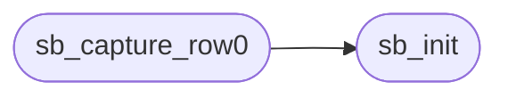

# `kernel/scrollback.c`

> Source: [kernel/scrollback.c:1](../../kernel/scrollback.c#L1) | language `c` | coverage 22.2% | [API index](../index.md)

scrollback.c - Console scrollback ring buffer.

## Contents

- **Functions:** [`vga_scroll`](#vga_scroll), [`sb_init`](#sb_init), [`sb_capture_row0`](#sb_capture_row0), [`sb_reset`](#sb_reset), [`sb_get_count`](#sb_get_count), [`sb_get_head`](#sb_get_head), [`sb_get_char`](#sb_get_char)
- **Macros:** [`SCROLLBACK_ROWS`](#scrollback_rows)

## Call Graph

Solid arrows stay in this module, dashed arrows leave it.



## Functions

<a id="vga_scroll"></a>

### `vga_scroll`

`function` | [kernel/scrollback.c:4](../../kernel/scrollback.c#L4)

```c
* Captured lazily from vga_scroll();
```

**Returns:** `* Captured lazily from`

---

<a id="sb_init"></a>

### `sb_init`

`function` | [kernel/scrollback.c:17](../../kernel/scrollback.c#L17)

```c
void sb_init(void)
```

========== Scrollback ring (kernel/scrollback.c) ==========

> **Inherited:** Documentation from [`sb_init`](#sb_init) (headers/kernel.h:120).

*Called by:* [`sb_capture_row0`](#sb_capture_row0)

---

<a id="sb_capture_row0"></a>

### `sb_capture_row0`

`function` | [kernel/scrollback.c:23](../../kernel/scrollback.c#L23)

```c
void sb_capture_row0(void)
```

*Calls:* [`sb_init`](#sb_init)

---

<a id="sb_reset"></a>

### `sb_reset`

`function` | [kernel/scrollback.c:34](../../kernel/scrollback.c#L34)

```c
void sb_reset(void)
```

---

<a id="sb_get_count"></a>

### `sb_get_count`

`function` | [kernel/scrollback.c:38](../../kernel/scrollback.c#L38)

```c
int sb_get_count(void)
```

**Returns:** `int`

---

<a id="sb_get_head"></a>

### `sb_get_head`

`function` | [kernel/scrollback.c:39](../../kernel/scrollback.c#L39)

```c
int sb_get_head(void)
```

**Returns:** `int`

---

<a id="sb_get_char"></a>

### `sb_get_char`

`function` | [kernel/scrollback.c:41](../../kernel/scrollback.c#L41)

```c
char sb_get_char(int row, int col)
```

**Parameters**

| Name | Type | Default | Description |
|---|---|---|---|
| `row` | `int` |  |  |
| `col` | `int` |  |  |

**Returns:** `char`

---

## Macros

<a id="scrollback_rows"></a>

### `SCROLLBACK_ROWS`

`macro` | [kernel/scrollback.c:12](../../kernel/scrollback.c#L12)

```c
#define SCROLLBACK_ROWS
```

---
