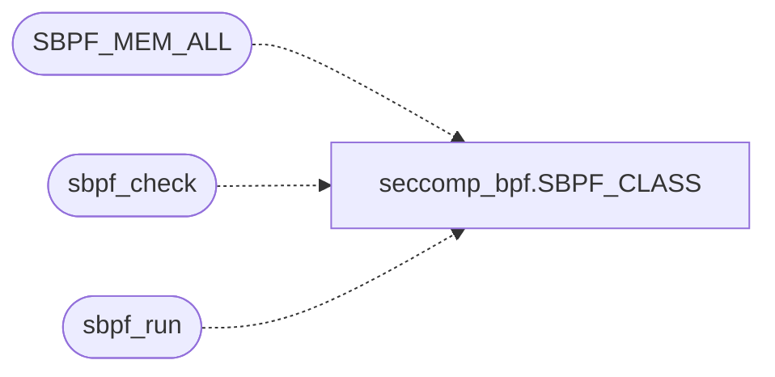

# `kernel/seccomp_bpf.c`

> Source: [kernel/seccomp_bpf.c:1](../../kernel/seccomp_bpf.c#L1) | language `c` | coverage 36.4% | [API index](../index.md)

Docstring: seccomp_bpf.c -- classic BPF checker and interpreter for Linux

## Contents

- **Functions:** [`sbpf_check`](#sbpf_check), [`sbpf_run`](#sbpf_run), [`sbpf_action_rank`](#sbpf_action_rank)
- **Macros:** [`SBPF_OP_MASK`](#sbpf_op_mask), [`SBPF_SRC_MASK`](#sbpf_src_mask), [`SBPF_SIZE_MASK`](#sbpf_size_mask), [`SBPF_MODE_MASK`](#sbpf_mode_mask), [`SBPF_RVAL_MASK`](#sbpf_rval_mask), [`SBPF_MISC_MASK`](#sbpf_misc_mask), [`SBPF_MEM_ALL`](#sbpf_mem_all)

## Call Graph

Solid arrows stay in this module, dashed arrows leave it.



## Functions

<a id="sbpf_check"></a>

### `sbpf_check`

`function` | [kernel/seccomp_bpf.c:69](../../kernel/seccomp_bpf.c#L69)

```c
int sbpf_check(const sbpf_insn *prog, unsigned len, unsigned short *scratch)
```

Validate a program before it ever runs: 1..SBPF_MAX_INSNS instructions, only the opcodes Linux accepts for seccomp, word loads inside seccomp_data at aligned offsets, scratch indices below SBPF_MEMWORDS, no constant zero divisor or modulus, constant shifts below 32, every jump landing inside the program, no scratch word read before every path wrote it, and a RET last. scratch must hold len entries (the per-pc initialized-scratch masks).

0 when valid, SBPF_ERR_INVALID otherwise.

**Parameters**

| Name | Type | Default | Description |
|---|---|---|---|
| `prog` | `sbpf_insn *` |  |  |
| `len` | `unsigned` |  |  |
| `scratch` | `unsigned short *` |  |  |

**Returns:** `int`

> **Inherited:** Documentation from [`sbpf_check`](#sbpf_check) (headers/seccomp_bpf.h:95).

*Calls:* [`SBPF_CLASS`](headers.seccomp_bpf.h.md#sbpf_class)

---

<a id="sbpf_run"></a>

### `sbpf_run`

`function` | [kernel/seccomp_bpf.c:120](../../kernel/seccomp_bpf.c#L120)

```c
unsigned int sbpf_run(const sbpf_insn *prog, unsigned len, const sbpf_data *d)
```

Run a program sbpf_check accepted over one syscall's data; returns the 32-bit action.

A runtime division or modulus by a zero X returns SBPF_RET_KILL_PROCESS.

**Parameters**

| Name | Type | Default | Description |
|---|---|---|---|
| `prog` | `sbpf_insn *` |  |  |
| `len` | `unsigned` |  |  |
| `d` | `sbpf_data *` |  |  |

**Returns:** `unsigned int`

> **Inherited:** Documentation from [`sbpf_run`](#sbpf_run) (headers/seccomp_bpf.h:100).

*Calls:* [`SBPF_CLASS`](headers.seccomp_bpf.h.md#sbpf_class)

---

<a id="sbpf_action_rank"></a>

### `sbpf_action_rank`

`function` | [kernel/seccomp_bpf.c:194](../../kernel/seccomp_bpf.c#L194)

```c
int sbpf_action_rank(unsigned int action)
```

Restrictiveness rank of an action (0 = most restrictive): the order stacked filters are combined in.

Unknown actions rank as KILL_PROCESS.

**Parameters**

| Name | Type | Default | Description |
|---|---|---|---|
| `action` | `unsigned int` |  |  |

**Returns:** `int`

> **Inherited:** Documentation from [`sbpf_action_rank`](#sbpf_action_rank) (headers/seccomp_bpf.h:104).

---

## Macros

<a id="sbpf_op_mask"></a>

### `SBPF_OP_MASK`

`macro` | [kernel/seccomp_bpf.c:8](../../kernel/seccomp_bpf.c#L8)

```c
#define SBPF_OP_MASK
```

---

<a id="sbpf_src_mask"></a>

### `SBPF_SRC_MASK`

`macro` | [kernel/seccomp_bpf.c:9](../../kernel/seccomp_bpf.c#L9)

```c
#define SBPF_SRC_MASK
```

---

<a id="sbpf_size_mask"></a>

### `SBPF_SIZE_MASK`

`macro` | [kernel/seccomp_bpf.c:10](../../kernel/seccomp_bpf.c#L10)

```c
#define SBPF_SIZE_MASK
```

---

<a id="sbpf_mode_mask"></a>

### `SBPF_MODE_MASK`

`macro` | [kernel/seccomp_bpf.c:11](../../kernel/seccomp_bpf.c#L11)

```c
#define SBPF_MODE_MASK
```

---

<a id="sbpf_rval_mask"></a>

### `SBPF_RVAL_MASK`

`macro` | [kernel/seccomp_bpf.c:12](../../kernel/seccomp_bpf.c#L12)

```c
#define SBPF_RVAL_MASK
```

---

<a id="sbpf_misc_mask"></a>

### `SBPF_MISC_MASK`

`macro` | [kernel/seccomp_bpf.c:13](../../kernel/seccomp_bpf.c#L13)

```c
#define SBPF_MISC_MASK
```

---

<a id="sbpf_mem_all"></a>

### `SBPF_MEM_ALL`

`macro` | [kernel/seccomp_bpf.c:14](../../kernel/seccomp_bpf.c#L14)

```c
#define SBPF_MEM_ALL
```

*Calls:* [`SBPF_CLASS`](headers.seccomp_bpf.h.md#sbpf_class)

---
