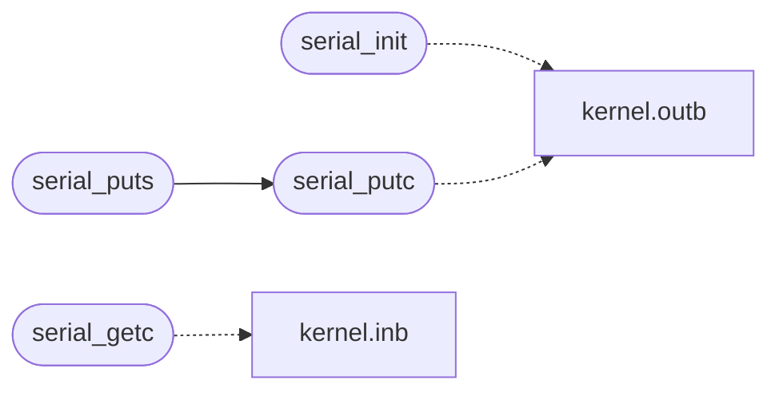

# `kernel/serial.c`

> Source: [kernel/serial.c:1](../../kernel/serial.c#L1) | language `c` | coverage 37.5% | [API index](../index.md)

serial.c -- COM1 16550 UART driver.

## Contents

- **Functions:** [`serial_init`](#serial_init), [`serial_putc`](#serial_putc), [`serial_e_count`](#serial_e_count), [`serial_puts`](#serial_puts), [`serial_available`](#serial_available), [`serial_getc`](#serial_getc)
- **Macros:** [`COM1`](#com1)

## Call Graph

Solid arrows stay in this module, dashed arrows leave it.



## Functions

<a id="serial_init"></a>

### `serial_init`

`function` | [kernel/serial.c:20](../../kernel/serial.c#L20)

```c
void serial_init(void)
```

========== Serial console (COM1) ==========

> **Inherited:** Documentation from [`serial_init`](#serial_init) (headers/kernel.h:128).

*Calls:* [`outb`](headers.kernel.h.md#outb)

---

<a id="serial_putc"></a>

### `serial_putc`

`function` | [kernel/serial.c:33](../../kernel/serial.c#L33)

```c
void serial_putc(char c)
```

**Parameters**

| Name | Type | Default | Description |
|---|---|---|---|
| `c` | `char` |  |  |

*Calls:* [`outb`](headers.kernel.h.md#outb)

*Called by:* [`serial_puts`](#serial_puts)

---

<a id="serial_e_count"></a>

### `serial_e_count`

`function` | [kernel/serial.c:38](../../kernel/serial.c#L38)

```c
unsigned long serial_e_count(void)
```

**Returns:** `unsigned long`

---

<a id="serial_puts"></a>

### `serial_puts`

`function` | [kernel/serial.c:40](../../kernel/serial.c#L40)

```c
void serial_puts(const char *s)
```

**Parameters**

| Name | Type | Default | Description |
|---|---|---|---|
| `s` | `char *` |  |  |

*Calls:* [`serial_putc`](#serial_putc)

---

<a id="serial_available"></a>

### `serial_available`

`function` | [kernel/serial.c:42](../../kernel/serial.c#L42)

```c
int serial_available(void)
```

first 'E' writer's RA/CPU

**Returns:** `int`

> **Inherited:** Documentation from [`serial_available`](#serial_available) (headers/kernel.h:134).

---

<a id="serial_getc"></a>

### `serial_getc`

`function` | [kernel/serial.c:44](../../kernel/serial.c#L44)

```c
int serial_getc(void)
```

**Returns:** `int`

*Calls:* [`inb`](headers.kernel.h.md#inb)

---

## Macros

<a id="com1"></a>

### `COM1`

`macro` | [kernel/serial.c:18](../../kernel/serial.c#L18)

```c
#define COM1
```

---
