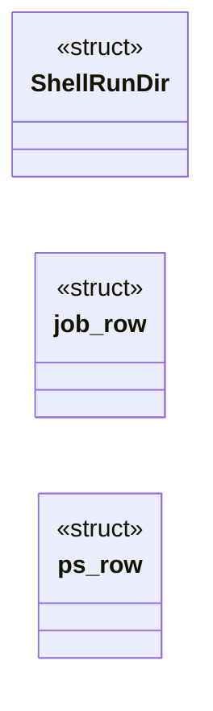
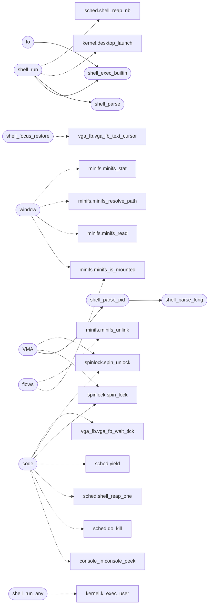

# `kernel/shell.c`

> Source: [kernel/shell.c:1](../../kernel/shell.c#L1) | language `c` | coverage 25.6% | [API index](../index.md)

## Contents

- **Structs:** [`ShellRunDir`](#shellrundir), [`job_row`](#job_row), [`ps_row`](#ps_row)
- **Functions:** [`shell_queue_launch`](#shell_queue_launch), [`shell_readline_active`](#shell_readline_active), [`shell_focus_park`](#shell_focus_park), [`shell_focus_restore`](#shell_focus_restore), [`shell_readline_buf`](#shell_readline_buf), [`line`](#line), [`root`](#root), [`shell_parse`](#shell_parse), [`shell_run`](#shell_run), [`window`](#window), [`code`](#code), [`this`](#this), [`flows`](#flows), [`shell_run_any`](#shell_run_any), [`context`](#context), [`tree`](#tree), [`VMA`](#vma), [`to`](#to), [`shell_parse_long`](#shell_parse_long), [`shell_parse_pid`](#shell_parse_pid), [`shell_exec_builtin`](#shell_exec_builtin), [`terminal`](#terminal), [`driver`](#driver), [`frame`](#frame), [`stdout`](#stdout)
- **Macros:** [`XXH_STATIC_LINKING_ONLY`](#xxh_static_linking_only), [`SHELL_CVM_INTERP`](#shell_cvm_interp), [`SHELL_RUN_DIRS`](#shell_run_dirs), [`SHELL_HIST_MAX`](#shell_hist_max), [`SHELL_BUILTIN_COUNT`](#shell_builtin_count), [`QEMU_PM_PORT`](#qemu_pm_port), [`HTTPD_REQ_CAP`](#httpd_req_cap), [`HTTPD_IO_CHUNK`](#httpd_io_chunk), [`SHELL_LS_CAP`](#shell_ls_cap), [`PIPE_HOP_MAX`](#pipe_hop_max)

## Type Diagram



## Call Graph

Solid arrows stay in this module, dashed arrows leave it.



## Structs

<a id="shellrundir"></a>

### `ShellRunDir`

`struct` | [kernel/shell.c:61](../../kernel/shell.c#L61)

```c
typedef struct
```

Runnable-file lookup: a bare name is mapped to a toolchain directory by its suffix, so `ld.o` finds objects/ld.o, `fib.elf` finds bin/fib.elf and `w1.cvm` finds cvm/w1.cvm.

A bare name with no recognised suffix (cp, freedom, ...) resolves through bin/, the command path. Every candidate is checked for existence before it is run, so a name can never be truncated into a path it does not own.

---

<a id="job_row"></a>

### `job_row`

`struct` | [kernel/shell.c:2068](../../kernel/shell.c#L2068)

```c
struct job_row { int pid; int state; char name[32]; };
```

---

<a id="ps_row"></a>

### `ps_row`

`struct` | [kernel/shell.c:3704](../../kernel/shell.c#L3704)

```c
struct ps_row { int pid; int ppid; int state; int code; char name[32]; };
```

---

## Functions

<a id="shell_queue_launch"></a>

### `shell_queue_launch`

`function` | [kernel/shell.c:87](../../kernel/shell.c#L87)

```c
void shell_queue_launch(const char *cmd)
```

Queue a desktop-icon command to run after the current user program exits.

Overwrites any earlier pending launch; safe to call from the ISR (it only copies into a kernel buffer).

**Parameters**

| Name | Type | Default | Description |
|---|---|---|---|
| `cmd` | `char *` |  |  |

---

<a id="shell_readline_active"></a>

### `shell_readline_active`

`function` | [kernel/shell.c:115](../../kernel/shell.c#L115)

```c
int shell_readline_active(void)
```

Shell side of window focus: park/restore the half-typed input line so it travels with its window.

Implemented in shell.c, called from vga_fb.c.

**Returns:** `int`

> **Inherited:** Documentation from [`shell_readline_active`](#shell_readline_active) (headers/kernel.h:701).

---

<a id="shell_focus_park"></a>

### `shell_focus_park`

`function` | [kernel/shell.c:116](../../kernel/shell.c#L116)

```c
void shell_focus_park(void)
```

---

<a id="shell_focus_restore"></a>

### `shell_focus_restore`

`function` | [kernel/shell.c:121](../../kernel/shell.c#L121)

```c
void shell_focus_restore(void)
```

*Calls:* [`vga_fb_text_cursor`](headers.vga_fb.h.md#vga_fb_text_cursor)

---

<a id="shell_readline_buf"></a>

### `shell_readline_buf`

`function` | [kernel/shell.c:184](../../kernel/shell.c#L184)

```c
void shell_readline_buf(char *buf, int size)
```

Read one line into buf (at most size-1 chars).

Echoes input and honours backspace. Shared by the shell prompt and the editor.

**Parameters**

| Name | Type | Default | Description |
|---|---|---|---|
| `buf` | `char *` |  |  |
| `size` | `int` |  |  |

---

<a id="line"></a>

### `line`

`function` | [kernel/shell.c:446](../../kernel/shell.c#L446)

```c
* to the live line (handled by the caller resetting shell_hist_idx). */ static void shell_hist_na...
```

**Parameters**

| Name | Type | Default | Description |
|---|---|---|---|
| `shell_hist_idx` | `handled by the caller resetting` |  |  |

**Returns:** `* to the live`

---

<a id="root"></a>

### `root`

`function` | [kernel/shell.c:654](../../kernel/shell.c#L654)

```c
* MiniFS root (where the big ELFs live under bare names), * and only the highest-priority non-empty tier is kept. An * explicit path or an argument word keeps every match, so * navigating to data file
```

**Parameters**

| Name | Type | Default | Description |
|---|---|---|---|
| `names` | `where the big ELFs live under bare` |  |  |

**Returns:** `* MiniFS`

---

<a id="shell_parse"></a>

### `shell_parse`

`function` | [kernel/shell.c:815](../../kernel/shell.c#L815)

```c
int shell_parse(char *line, char **argv, int max_args)
```

Tokenize [`line`](#line) into up to `max_args` argv entries; returns argc.

**Parameters**

| Name | Type | Default | Description |
|---|---|---|---|
| `line` | `char *` |  |  |
| `argv` | `char **` |  |  |
| `max_args` | `int` |  |  |

**Returns:** `int`

> **Inherited:** Documentation from [`shell_parse`](#shell_parse) (headers/shell.h:21).

*Called by:* [`shell_run`](#shell_run)

---

<a id="shell_run"></a>

### `shell_run`

`function` | [kernel/shell.c:883](../../kernel/shell.c#L883)

```c
void shell_run(void)
```

*Calls:* [`desktop_launch`](headers.kernel.h.md#desktop_launch), [`shell_reap_nb`](headers.sched.h.md#shell_reap_nb), [`shell_exec_builtin`](#shell_exec_builtin), [`shell_parse`](#shell_parse)

---

<a id="window"></a>

### `window`

`function` | [kernel/shell.c:1328](../../kernel/shell.c#L1328)

```c
* window (proc_spawn_elf) and waits for all of them. The 100 Hz timer * preempts the BSP across the READY set, so small programs overlap in * time instead of running one after another. ET_REL is refus
```

**Returns:** `*`

*Calls:* [`minifs_is_mounted`](headers.minifs.h.md#minifs_is_mounted), [`minifs_read`](headers.minifs.h.md#minifs_read), [`minifs_resolve_path`](headers.minifs.h.md#minifs_resolve_path), [`minifs_stat`](headers.minifs.h.md#minifs_stat)

---

<a id="code"></a>

### `code`

`function` | [kernel/shell.c:1401](../../kernel/shell.c#L1401)

```c
* the last exit code (130 when interrupted). */ static int shell_wait_fg(int *pids, int n, int ki...
```

**Parameters**

| Name | Type | Default | Description |
|---|---|---|---|
| `interrupted` | `130 when` |  |  |

**Returns:** `* the last exit`

*Calls:* [`console_peek`](headers.kernel.console_in.h.md#console_peek), [`do_kill`](headers.sched.h.md#do_kill), [`shell_reap_one`](headers.sched.h.md#shell_reap_one), [`yield`](headers.sched.h.md#yield), [`spin_lock`](headers.spinlock.h.md#spin_lock), [`spin_unlock`](headers.spinlock.h.md#spin_unlock), [`vga_fb_wait_tick`](headers.vga_fb.h.md#vga_fb_wait_tick)

---

<a id="this"></a>

### `this`

`function` | [kernel/shell.c:1533](../../kernel/shell.c#L1533)

```c
* boot into the tiled Wayland desktop: every NK app started after * this (paint, vedit, file, nuklear, doomedit, piano) runs as a * Wayland client (pixels to its pid-unique mailbox, input from its * .
```

**Returns:** `* boot into the tiled Wayland desktop: every NK app started after *`

---

<a id="flows"></a>

### `flows`

`function` | [kernel/shell.c:1579](../../kernel/shell.c#L1579)

```c
* and external flows (make wl) set it themselves. */ static void desktop_unflag(const char *name)
```

**Parameters**

| Name | Type | Default | Description |
|---|---|---|---|
| `wl` | `make` |  |  |

**Returns:** `* and external`

*Calls:* [`minifs_is_mounted`](headers.minifs.h.md#minifs_is_mounted), [`minifs_unlink`](headers.minifs.h.md#minifs_unlink)

---

<a id="shell_run_any"></a>

### `shell_run_any`

`function` | [kernel/shell.c:1667](../../kernel/shell.c#L1667)

```c
int shell_run_any(const char *name, int argc, char **argv)
```

Unified dispatcher used by `run` and by bare commands: a registered program wins, then the runnable-file resolver. argv[0] is the command/program name as typed.

Returns the exit code, or -1 when the name cannot be run.

**Parameters**

| Name | Type | Default | Description |
|---|---|---|---|
| `name` | `char *` |  |  |
| `argc` | `int` |  |  |
| `argv` | `char **` |  |  |

**Returns:** `int`

*Calls:* [`k_exec_user`](headers.kernel.h.md#k_exec_user)

---

<a id="context"></a>

### `context`

`function` | [kernel/shell.c:1694](../../kernel/shell.c#L1694)

```c
* ISR context (which corrupts the running program's state) or * nesting a second foreground run inside the wait. */ shell_queue_launch(cmd);
```

**Parameters**

| Name | Type | Default | Description |
|---|---|---|---|
| `state` | `which corrupts the running program's` |  |  |

**Returns:** `* ISR`

---

<a id="tree"></a>

### `tree`

`function` | [kernel/shell.c:2054](../../kernel/shell.c#L2054)

```c
* tree (mmap-heavy jobs stay best-effort), legacy blocking `run` ignores * Ctrl+C (it never poll...
```

**Parameters**

| Name | Type | Default | Description |
|---|---|---|---|
| `effort` | `mmap-heavy jobs stay best-` |  |  |

**Returns:** `*`

---

<a id="vma"></a>

### `VMA`

`function` | [kernel/shell.c:2197](../../kernel/shell.c#L2197)

```c
* plus the live VMA (mmap) tree. The walk is bounded (64-deep explicit * stack, 128 regions prin...
```

**Returns:** `* plus the live`

*Calls:* [`spin_lock`](headers.spinlock.h.md#spin_lock), [`spin_unlock`](headers.spinlock.h.md#spin_unlock), [`shell_parse_pid`](#shell_parse_pid), [`d`](progs.doomgeneric.p_local.h.md#d)

---

<a id="to"></a>

### `to`

`function` | [kernel/shell.c:2270](../../kernel/shell.c#L2270)

```c
* actually trap to (brk/mmap/munmap/mprotect) and says so up front. */ static void shell_cmd_trac...
```

**Parameters**

| Name | Type | Default | Description |
|---|---|---|---|
| `mprotect` | `brk/mmap/munmap/` |  |  |

**Returns:** `* actually trap`

*Calls:* [`shell_exec_builtin`](#shell_exec_builtin)

---

<a id="shell_parse_long"></a>

### `shell_parse_long`

`function` | [kernel/shell.c:2355](../../kernel/shell.c#L2355)

```c
int shell_parse_long(const char *s, long *out)
```

Strict signed decimal twin of shell_parse_u64: optional sign, at least one digit, whole string consumed, overflow fail-closed.

The bound comes from the compiler's __LONG_MAX__ (freestanding-safe, no libc header needed); a negative sign allows one extra unit of magnitude for LONG_MIN. Shared through shell.h so the editor's line numbers use the same choke point instead of a second copy.

**Parameters**

| Name | Type | Default | Description |
|---|---|---|---|
| `s` | `char *` |  |  |
| `out` | `long *` |  |  |

**Returns:** `int`

*Called by:* [`shell_parse_pid`](#shell_parse_pid)

---

<a id="shell_parse_pid"></a>

### `shell_parse_pid`

`function` | [kernel/shell.c:2376](../../kernel/shell.c#L2376)

```c
int shell_parse_pid(const char *s, int min_pid, int *out)
```

Bounded pid parse shared by wait/kill/vmmap: one range check instead of three open-coded copies. min_pid is 1 for job commands (pid 0 is the shell view, never a job) and 0 for inspectors like vmmap.

**Parameters**

| Name | Type | Default | Description |
|---|---|---|---|
| `s` | `char *` |  |  |
| `min_pid` | `int` |  |  |
| `out` | `int *` |  |  |

**Returns:** `int`

*Calls:* [`shell_parse_long`](#shell_parse_long)

*Called by:* [`VMA`](#vma)

---

<a id="shell_exec_builtin"></a>

### `shell_exec_builtin`

`function` | [kernel/shell.c:2894](../../kernel/shell.c#L2894)

```c
void shell_exec_builtin(int argc, char **argv)
```

**Parameters**

| Name | Type | Default | Description |
|---|---|---|---|
| `argc` | `int` |  |  |
| `argv` | `char **` |  |  |

*Calls:* [`nvme_init`](headers.drivers.nvme.h.md#nvme_init), [`nvme_note`](headers.drivers.nvme.h.md#nvme_note), [`nvme_present`](headers.drivers.nvme.h.md#nvme_present), [`nvme_read_sectors`](headers.drivers.nvme.h.md#nvme_read_sectors), [`nvme_sectors`](headers.drivers.nvme.h.md#nvme_sectors), [`nvme_version`](headers.drivers.nvme.h.md#nvme_version), [`vblk_init`](headers.drivers.virtio_blk.h.md#vblk_init), [`vblk_read_sectors`](headers.drivers.virtio_blk.h.md#vblk_read_sectors), [`vblk_sectors`](headers.drivers.virtio_blk.h.md#vblk_sectors), [`shell_cmd_edit`](headers.editor.h.md#shell_cmd_edit), [`clip_get`](headers.kernel.h.md#clip_get), [`fs_rename`](headers.kernel.h.md#fs_rename) and 15 more

*Called by:* [`shell_run`](#shell_run), [`to`](#to)

---

<a id="terminal"></a>

### `terminal`

`function` | [kernel/shell.c:2969](../../kernel/shell.c#L2969)

```c
* sequence clears serial consoles and is swallowed without * garbage by the framebuffer terminal (vedit pattern). */ if (vga_fb_active) term_clear();
```

**Parameters**

| Name | Type | Default | Description |
|---|---|---|---|
| `pattern` | `vedit` |  |  |

**Returns:** `* sequence clears serial consoles and is swallowed without * garbage by the framebuffer`

---

<a id="driver"></a>

### `driver`

`function` | [kernel/shell.c:3312](../../kernel/shell.c#L3312)

```c
* stream through the fat: VFS driver ("img:fatpath" per open, * registered at boot beside mem:), 4 KB heap chunks so a hostile * size can never drive an oversized alloc. Bad magic, missing files * and overlong names are diagnostics. */ else if (kstrcmp(argv[0], "fat") == 0)
```

**Parameters**

| Name | Type | Default | Description |
|---|---|---|---|
| `open` | `"img:fatpath" per` |  |  |
| `mem` | `* registered at boot beside :` |  |  |

**Returns:** `* stream through the fat: VFS`

---

<a id="frame"></a>

### `frame`

`function` | [kernel/shell.c:3706](../../kernel/shell.c#L3706)

```c
* not live in this frame (stack discipline, CLAUDE.md). */ struct ps_row *snap = (struct ps_row *)kmalloc(sizeof(struct ps_row) * MAX_PROCS);
```

**Parameters**

| Name | Type | Default | Description |
|---|---|---|---|
| `discipline` | `stack` |  |  |
| `md` | `CLAUDE.` |  |  |

**Returns:** `* not live in this`

---

<a id="stdout"></a>

### `stdout`

`function` | [kernel/shell.c:4074](../../kernel/shell.c#L4074)

```c
* the pipe exactly like stdout (`2>` is an alias of `>`). * Per-stage `exit code:` lines report to the console, never into the * pipe (shell_report suspends the capture), so `run x | cat` shows the *
```

**Parameters**

| Name | Type | Default | Description |
|---|---|---|---|
| `of` | `` `2>` is an alias `>` `` |  |  |

**Returns:** `* the pipe exactly like`

---

## Macros

<a id="xxh_static_linking_only"></a>

### `XXH_STATIC_LINKING_ONLY`

`macro` | [kernel/shell.c:25](../../kernel/shell.c#L25)

```c
#define XXH_STATIC_LINKING_ONLY
```

---

<a id="shell_cvm_interp"></a>

### `SHELL_CVM_INTERP`

`macro` | [kernel/shell.c:53](../../kernel/shell.c#L53)

```c
#define SHELL_CVM_INTERP
```

The CVM interpreter ships on the ramdisk as objects/cvm.o and is loaded on demand the first time a .cvm module is run.

---

<a id="shell_run_dirs"></a>

### `SHELL_RUN_DIRS`

`macro` | [kernel/shell.c:72](../../kernel/shell.c#L72)

```c
#define SHELL_RUN_DIRS
```

---

<a id="shell_hist_max"></a>

### `SHELL_HIST_MAX`

`macro` | [kernel/shell.c:98](../../kernel/shell.c#L98)

```c
#define SHELL_HIST_MAX
```

---

<a id="shell_builtin_count"></a>

### `SHELL_BUILTIN_COUNT`

`macro` | [kernel/shell.c:232](../../kernel/shell.c#L232)

```c
#define SHELL_BUILTIN_COUNT
```

---

<a id="qemu_pm_port"></a>

### `QEMU_PM_PORT`

`macro` | [kernel/shell.c:1022](../../kernel/shell.c#L1022)

```c
#define QEMU_PM_PORT
```

---

<a id="httpd_req_cap"></a>

### `HTTPD_REQ_CAP`

`macro` | [kernel/shell.c:2552](../../kernel/shell.c#L2552)

```c
#define HTTPD_REQ_CAP
```

---

<a id="httpd_io_chunk"></a>

### `HTTPD_IO_CHUNK`

`macro` | [kernel/shell.c:2553](../../kernel/shell.c#L2553)

```c
#define HTTPD_IO_CHUNK
```

*Calls:* [`httpd_ctype`](headers.httpd.h.md#httpd_ctype), [`httpd_header`](headers.httpd.h.md#httpd_header), [`net_recv_timeout`](headers.net.h.md#net_recv_timeout), [`net_send`](headers.net.h.md#net_send)

---

<a id="shell_ls_cap"></a>

### `SHELL_LS_CAP`

`macro` | [kernel/shell.c:2810](../../kernel/shell.c#L2810)

```c
#define SHELL_LS_CAP
```

List one directory from a cross-filesystem VFS driver (fat:, ext4:) to the console: same "drv:/img:path" addressing as the cat twin, served by the readdir verb so the builtin never names the backing driver.

Shared by the fat and ext4 builtins.

*Calls:* [`vfs_readdir`](headers.kernel.h.md#vfs_readdir)

---

<a id="pipe_hop_max"></a>

### `PIPE_HOP_MAX`

`macro` | [kernel/shell.c:4084](../../kernel/shell.c#L4084)

```c
#define PIPE_HOP_MAX
```

---
