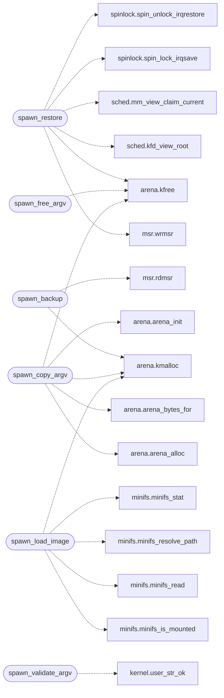

# `kernel/spawn.c`

> Source: [kernel/spawn.c:1](../../kernel/spawn.c#L1) | language `c` | coverage 87.5% | [API index](../index.md)

## Contents

- **Functions:** [`spawn_backup`](#spawn_backup), [`spawn_restore`](#spawn_restore), [`spawn_free_argv`](#spawn_free_argv), [`spawn_copy_argv`](#spawn_copy_argv), [`spawn_validate_argv`](#spawn_validate_argv), [`spawn_load_image`](#spawn_load_image), [`spawn_execute`](#spawn_execute)

## Call Graph

Solid arrows stay in this module, dashed arrows leave it.



## Functions

<a id="spawn_backup"></a>

### `spawn_backup`

`function` | [kernel/spawn.c:11](../../kernel/spawn.c#L11)

```c
int spawn_backup(spawn_ctx_t *ctx)
```

Docstring: Save the caller shared-window view into ctx.

**Parameters**

| Name | Type | Default | Description |
|---|---|---|---|
| `ctx` | `spawn_ctx_t *` |  |  |

**Returns:** `int`

*Calls:* [`rdmsr`](headers.arch.x86.msr.h.md#rdmsr), [`kmalloc`](headers.arena.h.md#kmalloc)

---

<a id="spawn_restore"></a>

### `spawn_restore`

`function` | [kernel/spawn.c:38](../../kernel/spawn.c#L38)

```c
void spawn_restore(spawn_ctx_t *ctx)
```

Docstring: Restore a view previously saved by spawn_backup.

**Parameters**

| Name | Type | Default | Description |
|---|---|---|---|
| `ctx` | `spawn_ctx_t *` |  |  |

*Calls:* [`wrmsr`](headers.arch.x86.msr.h.md#wrmsr), [`kfree`](headers.arena.h.md#kfree), [`kfd_view_root`](headers.sched.h.md#kfd_view_root), [`mm_view_claim_current`](headers.sched.h.md#mm_view_claim_current), [`spin_lock_irqsave`](headers.spinlock.h.md#spin_lock_irqsave), [`spin_unlock_irqrestore`](headers.spinlock.h.md#spin_unlock_irqrestore)

---

<a id="spawn_free_argv"></a>

### `spawn_free_argv`

`function` | [kernel/spawn.c:87](../../kernel/spawn.c#L87)

```c
void spawn_free_argv(char **kargv, int argc)
```

Docstring: Release a copy produced by spawn_copy_argv.

The copy is one arena block holding the pointer vector plus every word, so one kfree releases the whole scope; argc only sizes the legacy contract.

**Parameters**

| Name | Type | Default | Description |
|---|---|---|---|
| `kargv` | `char **` |  |  |
| `argc` | `int` |  |  |

*Calls:* [`kfree`](headers.arena.h.md#kfree)

---

<a id="spawn_copy_argv"></a>

### `spawn_copy_argv`

`function` | [kernel/spawn.c:99](../../kernel/spawn.c#L99)

```c
char **spawn_copy_argv(int argc, const char **uargv)
```

Docstring: Copy user argv into kernel memory, zero terminated.

One kmalloc serves the pointer vector plus every word through a bump arena, so a Ctrl+R / Ctrl+L spawn costs a single heap block and frees it with a single kfree instead of argc+1 round trips that fragment the heap and leak one word per missed free. Fail-closed with 0.

**Parameters**

| Name | Type | Default | Description |
|---|---|---|---|
| `argc` | `int` |  |  |
| `uargv` | `char **` |  |  |

**Returns:** `char **`

*Calls:* [`arena_alloc`](headers.arena.h.md#arena_alloc), [`arena_bytes_for`](headers.arena.h.md#arena_bytes_for), [`arena_init`](headers.arena.h.md#arena_init), [`kfree`](headers.arena.h.md#kfree), [`kmalloc`](headers.arena.h.md#kmalloc)

---

<a id="spawn_validate_argv"></a>

### `spawn_validate_argv`

`function` | [kernel/spawn.c:143](../../kernel/spawn.c#L143)

```c
int spawn_validate_argv(int argc, const char **uargv)
```

Docstring: Validate user argv words against the user window.

**Parameters**

| Name | Type | Default | Description |
|---|---|---|---|
| `argc` | `int` |  |  |
| `uargv` | `char **` |  |  |

**Returns:** `int`

*Calls:* [`user_str_ok`](headers.kernel.h.md#user_str_ok)

---

<a id="spawn_load_image"></a>

### `spawn_load_image`

`function` | [kernel/spawn.c:161](../../kernel/spawn.c#L161)

```c
unsigned char *spawn_load_image(const char *resolved, unsigned *size_out)
```

Docstring: Snapshot a resolved path into a kernel buffer.

**Parameters**

| Name | Type | Default | Description |
|---|---|---|---|
| `resolved` | `char *` |  |  |
| `size_out` | `unsigned *` |  |  |

**Returns:** `unsigned char *`

*Calls:* [`kmalloc`](headers.arena.h.md#kmalloc), [`minifs_is_mounted`](headers.minifs.h.md#minifs_is_mounted), [`minifs_read`](headers.minifs.h.md#minifs_read), [`minifs_resolve_path`](headers.minifs.h.md#minifs_resolve_path), [`minifs_stat`](headers.minifs.h.md#minifs_stat)

---

<a id="spawn_execute"></a>

### `spawn_execute`

`function` | [kernel/spawn.c:268](../../kernel/spawn.c#L268)

```c
int spawn_execute(const char *resolved, const char *redirect, unsigned char *data, unsigned data_size, int argc, char **kargv, const char **uargv_fallback)
```

Docstring: Run a loaded image by ELF type, return child status.

**Parameters**

| Name | Type | Default | Description |
|---|---|---|---|
| `resolved` | `char *` |  |  |
| `redirect` | `char *` |  |  |
| `data` | `unsigned char *` |  |  |
| `data_size` | `unsigned` |  |  |
| `argc` | `int` |  |  |
| `kargv` | `char **` |  |  |
| `uargv_fallback` | `char **` |  |  |

**Returns:** `int`

---
