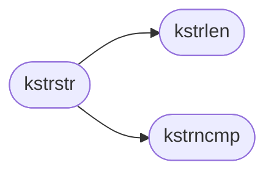

# `kernel/string.c`

> Source: [kernel/string.c:1](../../kernel/string.c#L1) | language `c` | coverage 14.3% | [API index](../index.md)

string.c -- Kernel string and memory functions.

## Contents

- **Functions:** [`kstrlen`](#kstrlen), [`kstrcpy`](#kstrcpy), [`kstrncpy`](#kstrncpy), [`kstrncat`](#kstrncat), [`kstrcmp`](#kstrcmp), [`kstrncmp`](#kstrncmp), [`kstrchr`](#kstrchr), [`kstrstr`](#kstrstr), [`kmemcpy`](#kmemcpy), [`kmemset`](#kmemset), [`kmemcmp`](#kmemcmp), [`kmemmove`](#kmemmove), [`katol`](#katol)

## Call Graph

Solid arrows stay in this module, dashed arrows leave it.



## Functions

<a id="kstrlen"></a>

### `kstrlen`

`function` | [kernel/string.c:17](../../kernel/string.c#L17)

```c
unsigned long kstrlen(const char *s)
```

========== String functions ==========

**Parameters**

| Name | Type | Default | Description |
|---|---|---|---|
| `s` | `char *` |  |  |

**Returns:** `unsigned long`

> **Inherited:** Documentation from [`kstrlen`](#kstrlen) (headers/kernel.h:529).

*Called by:* [`kstrstr`](#kstrstr)

---

<a id="kstrcpy"></a>

### `kstrcpy`

`function` | [kernel/string.c:23](../../kernel/string.c#L23)

```c
char *kstrcpy(char *dst, const char *src)
```

**Parameters**

| Name | Type | Default | Description |
|---|---|---|---|
| `dst` | `char *` |  |  |
| `src` | `char *` |  |  |

**Returns:** `char *`

---

<a id="kstrncpy"></a>

### `kstrncpy`

`function` | [kernel/string.c:29](../../kernel/string.c#L29)

```c
char *kstrncpy(char *dst, const char *src, unsigned long n)
```

**Parameters**

| Name | Type | Default | Description |
|---|---|---|---|
| `dst` | `char *` |  |  |
| `src` | `char *` |  |  |
| `n` | `unsigned long` |  |  |

**Returns:** `char *`

---

<a id="kstrncat"></a>

### `kstrncat`

`function` | [kernel/string.c:35](../../kernel/string.c#L35)

```c
char *kstrncat(char *dst, const char *src, unsigned long n)
```

**Parameters**

| Name | Type | Default | Description |
|---|---|---|---|
| `dst` | `char *` |  |  |
| `src` | `char *` |  |  |
| `n` | `unsigned long` |  |  |

**Returns:** `char *`

---

<a id="kstrcmp"></a>

### `kstrcmp`

`function` | [kernel/string.c:43](../../kernel/string.c#L43)

```c
int kstrcmp(const char *a, const char *b)
```

**Parameters**

| Name | Type | Default | Description |
|---|---|---|---|
| `a` | `char *` |  |  |
| `b` | `char *` |  |  |

**Returns:** `int`

---

<a id="kstrncmp"></a>

### `kstrncmp`

`function` | [kernel/string.c:48](../../kernel/string.c#L48)

```c
int kstrncmp(const char *a, const char *b, unsigned long n)
```

**Parameters**

| Name | Type | Default | Description |
|---|---|---|---|
| `a` | `char *` |  |  |
| `b` | `char *` |  |  |
| `n` | `unsigned long` |  |  |

**Returns:** `int`

*Called by:* [`kstrstr`](#kstrstr)

---

<a id="kstrchr"></a>

### `kstrchr`

`function` | [kernel/string.c:53](../../kernel/string.c#L53)

```c
char *kstrchr(const char *s, int c)
```

**Parameters**

| Name | Type | Default | Description |
|---|---|---|---|
| `s` | `char *` |  |  |
| `c` | `int` |  |  |

**Returns:** `char *`

---

<a id="kstrstr"></a>

### `kstrstr`

`function` | [kernel/string.c:58](../../kernel/string.c#L58)

```c
char *kstrstr(const char *hay, const char *ndl)
```

**Parameters**

| Name | Type | Default | Description |
|---|---|---|---|
| `hay` | `char *` |  |  |
| `ndl` | `char *` |  |  |

**Returns:** `char *`

*Calls:* [`kstrlen`](#kstrlen), [`kstrncmp`](#kstrncmp)

---

<a id="kmemcpy"></a>

### `kmemcpy`

`function` | [kernel/string.c:68](../../kernel/string.c#L68)

```c
void *kmemcpy(void *dst, const void *src, unsigned long n)
```

**Parameters**

| Name | Type | Default | Description |
|---|---|---|---|
| `dst` | `void *` |  |  |
| `src` | `void *` |  |  |
| `n` | `unsigned long` |  |  |

**Returns:** `void *`

---

<a id="kmemset"></a>

### `kmemset`

`function` | [kernel/string.c:75](../../kernel/string.c#L75)

```c
void *kmemset(void *dst, int c, unsigned long n)
```

**Parameters**

| Name | Type | Default | Description |
|---|---|---|---|
| `dst` | `void *` |  |  |
| `c` | `int` |  |  |
| `n` | `unsigned long` |  |  |

**Returns:** `void *`

---

<a id="kmemcmp"></a>

### `kmemcmp`

`function` | [kernel/string.c:81](../../kernel/string.c#L81)

```c
int kmemcmp(const void *a, const void *b, unsigned long n)
```

**Parameters**

| Name | Type | Default | Description |
|---|---|---|---|
| `a` | `void *` |  |  |
| `b` | `void *` |  |  |
| `n` | `unsigned long` |  |  |

**Returns:** `int`

---

<a id="kmemmove"></a>

### `kmemmove`

`function` | [kernel/string.c:87](../../kernel/string.c#L87)

```c
void *kmemmove(void *dst, const void *src, unsigned long n)
```

**Parameters**

| Name | Type | Default | Description |
|---|---|---|---|
| `dst` | `void *` |  |  |
| `src` | `void *` |  |  |
| `n` | `unsigned long` |  |  |

**Returns:** `void *`

---

<a id="katol"></a>

### `katol`

`function` | [kernel/string.c:95](../../kernel/string.c#L95)

```c
long katol(const char *s)
```

**Parameters**

| Name | Type | Default | Description |
|---|---|---|---|
| `s` | `char *` |  |  |

**Returns:** `long`

---
