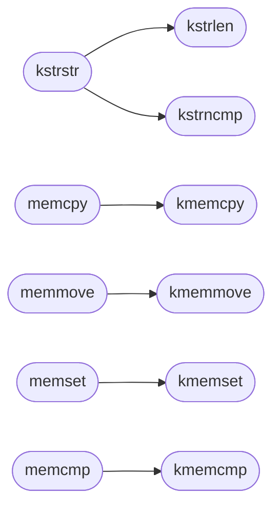

# `kernel/string.c`

> Source: [kernel/string.c:1](../../kernel/string.c#L1) | language `c` | coverage 21.1% | [API index](../index.md)

string.c -- Kernel string and memory functions.

## Contents

- **Functions:** [`kstrlen`](#kstrlen), [`kstrcpy`](#kstrcpy), [`kstrncpy`](#kstrncpy), [`kstrncat`](#kstrncat), [`kstrcmp`](#kstrcmp), [`kstrncmp`](#kstrncmp), [`kstrchr`](#kstrchr), [`kstrstr`](#kstrstr), [`kmemcpy`](#kmemcpy), [`kmemset`](#kmemset), [`kmemcmp`](#kmemcmp), [`kmemmove`](#kmemmove), [`memcpy`](#memcpy), [`memmove`](#memmove), [`memset`](#memset), [`memcmp`](#memcmp), [`katol`](#katol)
- **Macros:** [`NO_LOOP_IDIOM`](#no_loop_idiom)

## Call Graph

Solid arrows stay in this module, dashed arrows leave it.



## Functions

<a id="kstrlen"></a>

### `kstrlen`

`function` | [kernel/string.c:17](../../kernel/string.c#L17)

```c
unsigned long kstrlen(const char *s)
```

========== String functions ==========

**Parameters**

| Name | Type | Default | Description |
|---|---|---|---|
| `s` | `char *` |  |  |

**Returns:** `unsigned long`

> **Inherited:** Documentation from [`kstrlen`](#kstrlen) (headers/kernel.h:545).

*Called by:* [`kstrstr`](#kstrstr)

---

<a id="kstrcpy"></a>

### `kstrcpy`

`function` | [kernel/string.c:23](../../kernel/string.c#L23)

```c
char *kstrcpy(char *dst, const char *src)
```

**Parameters**

| Name | Type | Default | Description |
|---|---|---|---|
| `dst` | `char *` |  |  |
| `src` | `char *` |  |  |

**Returns:** `char *`

---

<a id="kstrncpy"></a>

### `kstrncpy`

`function` | [kernel/string.c:29](../../kernel/string.c#L29)

```c
char *kstrncpy(char *dst, const char *src, unsigned long n)
```

**Parameters**

| Name | Type | Default | Description |
|---|---|---|---|
| `dst` | `char *` |  |  |
| `src` | `char *` |  |  |
| `n` | `unsigned long` |  |  |

**Returns:** `char *`

---

<a id="kstrncat"></a>

### `kstrncat`

`function` | [kernel/string.c:35](../../kernel/string.c#L35)

```c
char *kstrncat(char *dst, const char *src, unsigned long n)
```

**Parameters**

| Name | Type | Default | Description |
|---|---|---|---|
| `dst` | `char *` |  |  |
| `src` | `char *` |  |  |
| `n` | `unsigned long` |  |  |

**Returns:** `char *`

---

<a id="kstrcmp"></a>

### `kstrcmp`

`function` | [kernel/string.c:43](../../kernel/string.c#L43)

```c
int kstrcmp(const char *a, const char *b)
```

**Parameters**

| Name | Type | Default | Description |
|---|---|---|---|
| `a` | `char *` |  |  |
| `b` | `char *` |  |  |

**Returns:** `int`

---

<a id="kstrncmp"></a>

### `kstrncmp`

`function` | [kernel/string.c:48](../../kernel/string.c#L48)

```c
int kstrncmp(const char *a, const char *b, unsigned long n)
```

**Parameters**

| Name | Type | Default | Description |
|---|---|---|---|
| `a` | `char *` |  |  |
| `b` | `char *` |  |  |
| `n` | `unsigned long` |  |  |

**Returns:** `int`

*Called by:* [`kstrstr`](#kstrstr)

---

<a id="kstrchr"></a>

### `kstrchr`

`function` | [kernel/string.c:53](../../kernel/string.c#L53)

```c
char *kstrchr(const char *s, int c)
```

**Parameters**

| Name | Type | Default | Description |
|---|---|---|---|
| `s` | `char *` |  |  |
| `c` | `int` |  |  |

**Returns:** `char *`

---

<a id="kstrstr"></a>

### `kstrstr`

`function` | [kernel/string.c:58](../../kernel/string.c#L58)

```c
char *kstrstr(const char *hay, const char *ndl)
```

**Parameters**

| Name | Type | Default | Description |
|---|---|---|---|
| `hay` | `char *` |  |  |
| `ndl` | `char *` |  |  |

**Returns:** `char *`

*Calls:* [`kstrlen`](#kstrlen), [`kstrncmp`](#kstrncmp)

---

<a id="kmemcpy"></a>

### `kmemcpy`

`function` | [kernel/string.c:73](../../kernel/string.c#L73)

```c
NO_LOOP_IDIOM void *kmemcpy(void *dst, const void *src, unsigned long n)
```

Docstring: Byte copy.

Immune to loop-idiom recognition, which would turn the loop back into a call to memcpy and recurse through the wrappers below.

**Parameters**

| Name | Type | Default | Description |
|---|---|---|---|
| `dst` | `void *` |  |  |
| `src` | `void *` |  |  |
| `n` | `unsigned long` |  |  |

**Returns:** `NO_LOOP_IDIOM void *`

*Called by:* [`memcpy`](#memcpy)

---

<a id="kmemset"></a>

### `kmemset`

`function` | [kernel/string.c:80](../../kernel/string.c#L80)

```c
NO_LOOP_IDIOM void *kmemset(void *dst, int c, unsigned long n)
```

**Parameters**

| Name | Type | Default | Description |
|---|---|---|---|
| `dst` | `void *` |  |  |
| `c` | `int` |  |  |
| `n` | `unsigned long` |  |  |

**Returns:** `NO_LOOP_IDIOM void *`

*Called by:* [`memset`](#memset)

---

<a id="kmemcmp"></a>

### `kmemcmp`

`function` | [kernel/string.c:86](../../kernel/string.c#L86)

```c
int kmemcmp(const void *a, const void *b, unsigned long n)
```

**Parameters**

| Name | Type | Default | Description |
|---|---|---|---|
| `a` | `void *` |  |  |
| `b` | `void *` |  |  |
| `n` | `unsigned long` |  |  |

**Returns:** `int`

*Called by:* [`memcmp`](#memcmp)

---

<a id="kmemmove"></a>

### `kmemmove`

`function` | [kernel/string.c:92](../../kernel/string.c#L92)

```c
NO_LOOP_IDIOM void *kmemmove(void *dst, const void *src, unsigned long n)
```

**Parameters**

| Name | Type | Default | Description |
|---|---|---|---|
| `dst` | `void *` |  |  |
| `src` | `void *` |  |  |
| `n` | `unsigned long` |  |  |

**Returns:** `NO_LOOP_IDIOM void *`

*Called by:* [`memmove`](#memmove)

---

<a id="memcpy"></a>

### `memcpy`

`function` | [kernel/string.c:104](../../kernel/string.c#L104)

```c
void *memcpy(void *dst, const void *src, unsigned long n)
```

Docstring: ISO C entry points the compiler itself emits calls to for struct copies and large initializers, even under -ffreestanding.

Thin wrappers over the kernel primitives so the link never depends on the optimizer inlining them.

**Parameters**

| Name | Type | Default | Description |
|---|---|---|---|
| `dst` | `void *` |  |  |
| `src` | `void *` |  |  |
| `n` | `unsigned long` |  |  |

**Returns:** `void *`

*Calls:* [`kmemcpy`](#kmemcpy)

*Called by:* [`TryRunTics`](progs.doomgeneric.d_loop.c.md#tryruntics), [`DG_DrawFrame`](progs.doomgeneric.doomgeneric_soso.c.md#dg_drawframe), [`DG_DrawFrame`](progs.doomgeneric.doomgeneric_sosox.c.md#dg_drawframe), [`wipe_initColorXForm`](progs.doomgeneric.f_wipe.c.md#wipe_initcolorxform), [`wipe_initMelt`](progs.doomgeneric.f_wipe.c.md#wipe_initmelt), [`wipe_shittyColMajorXform`](progs.doomgeneric.f_wipe.c.md#wipe_shittycolmajorxform), [`G_DoCompleted`](progs.doomgeneric.g_game.c.md#g_docompleted), [`G_PlayerReborn`](progs.doomgeneric.g_game.c.md#g_playerreborn), [`G_Ticker`](progs.doomgeneric.g_game.c.md#g_ticker), [`I_Endoom`](progs.doomgeneric.i_endoom.c.md#i_endoom), [`cht_GetParam`](progs.doomgeneric.m_cheat.c.md#cht_getparam), [`mem_fread`](progs.doomgeneric.memio.c.md#mem_fread) and 11 more

---

<a id="memmove"></a>

### `memmove`

`function` | [kernel/string.c:108](../../kernel/string.c#L108)

```c
void *memmove(void *dst, const void *src, unsigned long n)
```

**Parameters**

| Name | Type | Default | Description |
|---|---|---|---|
| `dst` | `void *` |  |  |
| `src` | `void *` |  |  |
| `n` | `unsigned long` |  |  |

**Returns:** `void *`

*Calls:* [`kmemmove`](#kmemmove)

---

<a id="memset"></a>

### `memset`

`function` | [kernel/string.c:112](../../kernel/string.c#L112)

```c
void *memset(void *dst, int c, unsigned long n)
```

**Parameters**

| Name | Type | Default | Description |
|---|---|---|---|
| `dst` | `void *` |  |  |
| `c` | `int` |  |  |
| `n` | `unsigned long` |  |  |

**Returns:** `void *`

*Calls:* [`kmemset`](#kmemset)

*Called by:* [`DG_Init`](progs.doomgeneric.doomgeneric_xlib.c.md#dg_init), [`G_BuildTiccmd`](progs.doomgeneric.g_game.c.md#g_buildticcmd), [`G_DoLoadLevel`](progs.doomgeneric.g_game.c.md#g_doloadlevel), [`G_PlayerFinishLevel`](progs.doomgeneric.g_game.c.md#g_playerfinishlevel), [`G_PlayerReborn`](progs.doomgeneric.g_game.c.md#g_playerreborn), [`I_Error`](progs.doomgeneric.i_system.c.md#i_error), [`MAXARGVS`](progs.doomgeneric.m_argv.c.md#maxargvs), [`M_ExtractFileBase`](progs.doomgeneric.m_misc.c.md#m_extractfilebase), [`SHA1_Final`](progs.doomgeneric.sha1.c.md#sha1_final), [`WritePCXfile`](progs.doomgeneric.v_video.c.md#writepcxfile), [`W_GenerateHashTable`](progs.doomgeneric.w_wad.c.md#w_generatehashtable), [`pf_window_close`](progs.freedomui.platform_minios.c.md#pf_window_close) and 12 more

---

<a id="memcmp"></a>

### `memcmp`

`function` | [kernel/string.c:116](../../kernel/string.c#L116)

```c
int memcmp(const void *a, const void *b, unsigned long n)
```

**Parameters**

| Name | Type | Default | Description |
|---|---|---|---|
| `a` | `void *` |  |  |
| `b` | `void *` |  |  |
| `n` | `unsigned long` |  |  |

**Returns:** `int`

*Calls:* [`kmemcmp`](#kmemcmp)

*Called by:* [`frames`](progs.pokemon.platform_minios.c.md#frames), [`gb_platform_present_framebuffer`](progs.pokemon.platform_minios.c.md#gb_platform_present_framebuffer)

---

<a id="katol"></a>

### `katol`

`function` | [kernel/string.c:120](../../kernel/string.c#L120)

```c
long katol(const char *s)
```

**Parameters**

| Name | Type | Default | Description |
|---|---|---|---|
| `s` | `char *` |  |  |

**Returns:** `long`

---

## Macros

<a id="no_loop_idiom"></a>

### `NO_LOOP_IDIOM`

`macro` | [kernel/string.c:68](../../kernel/string.c#L68)

```c
#define NO_LOOP_IDIOM
```

---
