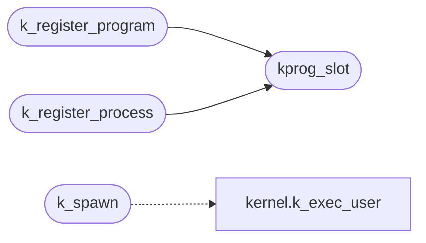

# `kernel/symtab.c`

> Source: [kernel/symtab.c:1](../../kernel/symtab.c#L1) | language `c` | coverage 12.5% | [API index](../index.md)

================================================================

## Contents

- **Functions:** [`k_register_symbol`](#k_register_symbol), [`ksym_resolve`](#ksym_resolve), [`kprog_slot`](#kprog_slot), [`kprog_lookup`](#kprog_lookup), [`k_register_program`](#k_register_program), [`k_register_process`](#k_register_process), [`k_spawn`](#k_spawn)

## Call Graph

Solid arrows stay in this module, dashed arrows leave it.



## Functions

<a id="k_register_symbol"></a>

### `k_register_symbol`

`function` | [kernel/symtab.c:10](../../kernel/symtab.c#L10)

```c
void k_register_symbol(const char *name, void *addr)
```

**Parameters**

| Name | Type | Default | Description |
|---|---|---|---|
| `name` | `char *` |  |  |
| `addr` | `void *` |  |  |

---

<a id="ksym_resolve"></a>

### `ksym_resolve`

`function` | [kernel/symtab.c:18](../../kernel/symtab.c#L18)

```c
void *ksym_resolve(const char *name)
```

**Parameters**

| Name | Type | Default | Description |
|---|---|---|---|
| `name` | `char *` |  |  |

**Returns:** `void *`

---

<a id="kprog_slot"></a>

### `kprog_slot`

`function` | [kernel/symtab.c:34](../../kernel/symtab.c#L34)

```c
KProg *kprog_slot(const char *name)
```

**Parameters**

| Name | Type | Default | Description |
|---|---|---|---|
| `name` | `char *` |  |  |

**Returns:** `KProg *`

*Called by:* [`k_register_process`](#k_register_process), [`k_register_program`](#k_register_program)

---

<a id="kprog_lookup"></a>

### `kprog_lookup`

`function` | [kernel/symtab.c:42](../../kernel/symtab.c#L42)

```c
KProg *kprog_lookup(const char *name)
```

**Parameters**

| Name | Type | Default | Description |
|---|---|---|---|
| `name` | `char *` |  |  |

**Returns:** `KProg *`

---

<a id="k_register_program"></a>

### `k_register_program`

`function` | [kernel/symtab.c:49](../../kernel/symtab.c#L49)

```c
void k_register_program(const char *name, prog_entry_t entry)
```

**Parameters**

| Name | Type | Default | Description |
|---|---|---|---|
| `name` | `char *` |  |  |
| `entry` | `prog_entry_t` |  |  |

*Calls:* [`kprog_slot`](#kprog_slot)

---

<a id="k_register_process"></a>

### `k_register_process`

`function` | [kernel/symtab.c:57](../../kernel/symtab.c#L57)

```c
void k_register_process(const char *name, void *proc_entry)
```

**Parameters**

| Name | Type | Default | Description |
|---|---|---|---|
| `name` | `char *` |  |  |
| `proc_entry` | `void *` |  |  |

*Calls:* [`kprog_slot`](#kprog_slot)

---

<a id="k_spawn"></a>

### `k_spawn`

`function` | [kernel/symtab.c:65](../../kernel/symtab.c#L65)

```c
int k_spawn(const char *name, int argc, char **argv)
```

**Parameters**

| Name | Type | Default | Description |
|---|---|---|---|
| `name` | `char *` |  |  |
| `argc` | `int` |  |  |
| `argv` | `char **` |  |  |

**Returns:** `int`

*Calls:* [`k_exec_user`](headers.kernel.h.md#k_exec_user)

---
