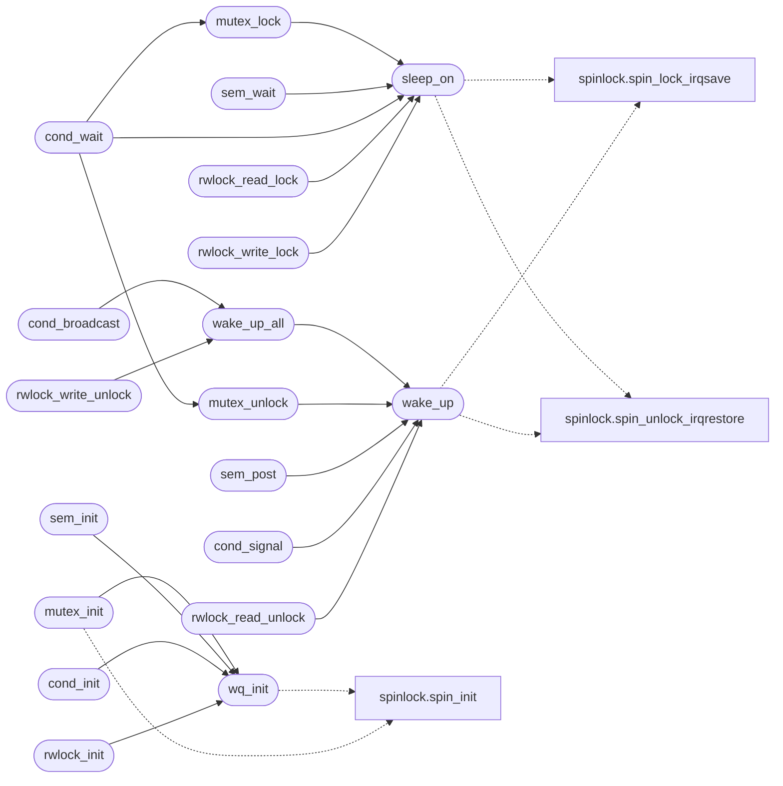

# `kernel/sync.c`

> Source: [kernel/sync.c:1](../../kernel/sync.c#L1) | language `c` | coverage 4.3% | [API index](../index.md)

sync.c -- Blocking synchronization primitives (roadmap Phase 3.1).

## Contents

- **Functions:** [`wq_init`](#wq_init), [`sleep_on`](#sleep_on), [`wake_up`](#wake_up), [`wake_up_all`](#wake_up_all), [`mutex_init`](#mutex_init), [`pi_set_base`](#pi_set_base), [`pi_get_eff`](#pi_get_eff), [`mutex_lock`](#mutex_lock), [`mutex_trylock`](#mutex_trylock), [`mutex_unlock`](#mutex_unlock), [`sem_init`](#sem_init), [`sem_wait`](#sem_wait), [`sem_post`](#sem_post), [`cond_init`](#cond_init), [`cond_wait`](#cond_wait), [`cond_signal`](#cond_signal), [`cond_broadcast`](#cond_broadcast), [`rwlock_init`](#rwlock_init), [`rwlock_read_lock`](#rwlock_read_lock), [`rwlock_read_unlock`](#rwlock_read_unlock), [`rwlock_write_lock`](#rwlock_write_lock), [`rwlock_write_unlock`](#rwlock_write_unlock)
- **Variables:** [`t_cur_pid`](#t_cur_pid)

## Call Graph

Solid arrows stay in this module, dashed arrows leave it.



## Functions

<a id="wq_init"></a>

### `wq_init`

`function` | [kernel/sync.c:27](../../kernel/sync.c#L27)

```c
void wq_init(wait_queue_t *q)
```

**Parameters**

| Name | Type | Default | Description |
|---|---|---|---|
| `q` | `wait_queue_t *` |  |  |

*Calls:* [`spin_init`](headers.spinlock.h.md#spin_init)

*Called by:* [`cond_init`](#cond_init), [`mutex_init`](#mutex_init), [`rwlock_init`](#rwlock_init), [`sem_init`](#sem_init)

---

<a id="sleep_on"></a>

### `sleep_on`

`function` | [kernel/sync.c:33](../../kernel/sync.c#L33)

```c
void sleep_on(wait_queue_t *q)
```

**Parameters**

| Name | Type | Default | Description |
|---|---|---|---|
| `q` | `wait_queue_t *` |  |  |

*Calls:* [`spin_lock_irqsave`](headers.spinlock.h.md#spin_lock_irqsave), [`spin_unlock_irqrestore`](headers.spinlock.h.md#spin_unlock_irqrestore)

*Called by:* [`cond_wait`](#cond_wait), [`mutex_lock`](#mutex_lock), [`rwlock_read_lock`](#rwlock_read_lock), [`rwlock_write_lock`](#rwlock_write_lock), [`sem_wait`](#sem_wait)

---

<a id="wake_up"></a>

### `wake_up`

`function` | [kernel/sync.c:54](../../kernel/sync.c#L54)

```c
int wake_up(wait_queue_t *q)
```

**Parameters**

| Name | Type | Default | Description |
|---|---|---|---|
| `q` | `wait_queue_t *` |  |  |

**Returns:** `int`

*Calls:* [`spin_lock_irqsave`](headers.spinlock.h.md#spin_lock_irqsave), [`spin_unlock_irqrestore`](headers.spinlock.h.md#spin_unlock_irqrestore)

*Called by:* [`cond_signal`](#cond_signal), [`mutex_unlock`](#mutex_unlock), [`rwlock_read_unlock`](#rwlock_read_unlock), [`sem_post`](#sem_post), [`wake_up_all`](#wake_up_all)

---

<a id="wake_up_all"></a>

### `wake_up_all`

`function` | [kernel/sync.c:70](../../kernel/sync.c#L70)

```c
int wake_up_all(wait_queue_t *q)
```

**Parameters**

| Name | Type | Default | Description |
|---|---|---|---|
| `q` | `wait_queue_t *` |  |  |

**Returns:** `int`

*Calls:* [`wake_up`](#wake_up)

*Called by:* [`cond_broadcast`](#cond_broadcast), [`rwlock_write_unlock`](#rwlock_write_unlock)

---

<a id="mutex_init"></a>

### `mutex_init`

`function` | [kernel/sync.c:76](../../kernel/sync.c#L76)

```c
void mutex_init(mutex_t *m)
```

**Parameters**

| Name | Type | Default | Description |
|---|---|---|---|
| `m` | `mutex_t *` |  |  |

*Calls:* [`spin_init`](headers.spinlock.h.md#spin_init), [`wq_init`](#wq_init)

---

<a id="pi_set_base"></a>

### `pi_set_base`

`function` | [kernel/sync.c:99](../../kernel/sync.c#L99)

```c
void pi_set_base(int pid, int prio)
```

**Parameters**

| Name | Type | Default | Description |
|---|---|---|---|
| `pid` | `int` |  |  |
| `prio` | `int` |  |  |

---

<a id="pi_get_eff"></a>

### `pi_get_eff`

`function` | [kernel/sync.c:108](../../kernel/sync.c#L108)

```c
int pi_get_eff(int pid)
```

**Parameters**

| Name | Type | Default | Description |
|---|---|---|---|
| `pid` | `int` |  |  |

**Returns:** `int`

---

<a id="mutex_lock"></a>

### `mutex_lock`

`function` | [kernel/sync.c:150](../../kernel/sync.c#L150)

```c
void mutex_lock(mutex_t *m)
```

**Parameters**

| Name | Type | Default | Description |
|---|---|---|---|
| `m` | `mutex_t *` |  |  |

*Calls:* [`spin_lock_irqsave`](headers.spinlock.h.md#spin_lock_irqsave), [`spin_unlock_irqrestore`](headers.spinlock.h.md#spin_unlock_irqrestore), [`mutex_note_waiter`](headers.sync.h.md#mutex_note_waiter), [`sleep_on`](#sleep_on)

*Called by:* [`cond_wait`](#cond_wait)

---

<a id="mutex_trylock"></a>

### `mutex_trylock`

`function` | [kernel/sync.c:170](../../kernel/sync.c#L170)

```c
int mutex_trylock(mutex_t *m)
```

**Parameters**

| Name | Type | Default | Description |
|---|---|---|---|
| `m` | `mutex_t *` |  |  |

**Returns:** `int`

*Calls:* [`spin_lock_irqsave`](headers.spinlock.h.md#spin_lock_irqsave), [`spin_unlock_irqrestore`](headers.spinlock.h.md#spin_unlock_irqrestore)

---

<a id="mutex_unlock"></a>

### `mutex_unlock`

`function` | [kernel/sync.c:186](../../kernel/sync.c#L186)

```c
void mutex_unlock(mutex_t *m)
```

**Parameters**

| Name | Type | Default | Description |
|---|---|---|---|
| `m` | `mutex_t *` |  |  |

*Calls:* [`spin_lock_irqsave`](headers.spinlock.h.md#spin_lock_irqsave), [`spin_unlock_irqrestore`](headers.spinlock.h.md#spin_unlock_irqrestore), [`wake_up`](#wake_up)

*Called by:* [`cond_wait`](#cond_wait)

---

<a id="sem_init"></a>

### `sem_init`

`function` | [kernel/sync.c:207](../../kernel/sync.c#L207)

```c
void sem_init(sem_t *s, int value)
```

**Parameters**

| Name | Type | Default | Description |
|---|---|---|---|
| `s` | `sem_t *` |  |  |
| `value` | `int` |  |  |

*Calls:* [`spin_init`](headers.spinlock.h.md#spin_init), [`wq_init`](#wq_init)

---

<a id="sem_wait"></a>

### `sem_wait`

`function` | [kernel/sync.c:213](../../kernel/sync.c#L213)

```c
void sem_wait(sem_t *s)
```

**Parameters**

| Name | Type | Default | Description |
|---|---|---|---|
| `s` | `sem_t *` |  |  |

*Calls:* [`spin_lock_irqsave`](headers.spinlock.h.md#spin_lock_irqsave), [`spin_unlock_irqrestore`](headers.spinlock.h.md#spin_unlock_irqrestore), [`sleep_on`](#sleep_on)

---

<a id="sem_post"></a>

### `sem_post`

`function` | [kernel/sync.c:227](../../kernel/sync.c#L227)

```c
void sem_post(sem_t *s)
```

**Parameters**

| Name | Type | Default | Description |
|---|---|---|---|
| `s` | `sem_t *` |  |  |

*Calls:* [`spin_lock_irqsave`](headers.spinlock.h.md#spin_lock_irqsave), [`spin_unlock_irqrestore`](headers.spinlock.h.md#spin_unlock_irqrestore), [`wake_up`](#wake_up)

---

<a id="cond_init"></a>

### `cond_init`

`function` | [kernel/sync.c:235](../../kernel/sync.c#L235)

```c
void cond_init(cond_t *c)
```

**Parameters**

| Name | Type | Default | Description |
|---|---|---|---|
| `c` | `cond_t *` |  |  |

*Calls:* [`wq_init`](#wq_init)

---

<a id="cond_wait"></a>

### `cond_wait`

`function` | [kernel/sync.c:239](../../kernel/sync.c#L239)

```c
void cond_wait(cond_t *c, mutex_t *m)
```

**Parameters**

| Name | Type | Default | Description |
|---|---|---|---|
| `c` | `cond_t *` |  |  |
| `m` | `mutex_t *` |  |  |

*Calls:* [`mutex_lock`](#mutex_lock), [`mutex_unlock`](#mutex_unlock), [`sleep_on`](#sleep_on)

---

<a id="cond_signal"></a>

### `cond_signal`

`function` | [kernel/sync.c:245](../../kernel/sync.c#L245)

```c
void cond_signal(cond_t *c)
```

**Parameters**

| Name | Type | Default | Description |
|---|---|---|---|
| `c` | `cond_t *` |  |  |

*Calls:* [`wake_up`](#wake_up)

---

<a id="cond_broadcast"></a>

### `cond_broadcast`

`function` | [kernel/sync.c:249](../../kernel/sync.c#L249)

```c
void cond_broadcast(cond_t *c)
```

**Parameters**

| Name | Type | Default | Description |
|---|---|---|---|
| `c` | `cond_t *` |  |  |

*Calls:* [`wake_up_all`](#wake_up_all)

---

<a id="rwlock_init"></a>

### `rwlock_init`

`function` | [kernel/sync.c:253](../../kernel/sync.c#L253)

```c
void rwlock_init(rwlock_t *rw)
```

**Parameters**

| Name | Type | Default | Description |
|---|---|---|---|
| `rw` | `rwlock_t *` |  |  |

*Calls:* [`spin_init`](headers.spinlock.h.md#spin_init), [`wq_init`](#wq_init)

---

<a id="rwlock_read_lock"></a>

### `rwlock_read_lock`

`function` | [kernel/sync.c:260](../../kernel/sync.c#L260)

```c
void rwlock_read_lock(rwlock_t *rw)
```

**Parameters**

| Name | Type | Default | Description |
|---|---|---|---|
| `rw` | `rwlock_t *` |  |  |

*Calls:* [`spin_lock_irqsave`](headers.spinlock.h.md#spin_lock_irqsave), [`spin_unlock_irqrestore`](headers.spinlock.h.md#spin_unlock_irqrestore), [`sleep_on`](#sleep_on)

---

<a id="rwlock_read_unlock"></a>

### `rwlock_read_unlock`

`function` | [kernel/sync.c:274](../../kernel/sync.c#L274)

```c
void rwlock_read_unlock(rwlock_t *rw)
```

**Parameters**

| Name | Type | Default | Description |
|---|---|---|---|
| `rw` | `rwlock_t *` |  |  |

*Calls:* [`spin_lock_irqsave`](headers.spinlock.h.md#spin_lock_irqsave), [`spin_unlock_irqrestore`](headers.spinlock.h.md#spin_unlock_irqrestore), [`wake_up`](#wake_up)

---

<a id="rwlock_write_lock"></a>

### `rwlock_write_lock`

`function` | [kernel/sync.c:283](../../kernel/sync.c#L283)

```c
void rwlock_write_lock(rwlock_t *rw)
```

**Parameters**

| Name | Type | Default | Description |
|---|---|---|---|
| `rw` | `rwlock_t *` |  |  |

*Calls:* [`spin_lock_irqsave`](headers.spinlock.h.md#spin_lock_irqsave), [`spin_unlock_irqrestore`](headers.spinlock.h.md#spin_unlock_irqrestore), [`sleep_on`](#sleep_on)

---

<a id="rwlock_write_unlock"></a>

### `rwlock_write_unlock`

`function` | [kernel/sync.c:297](../../kernel/sync.c#L297)

```c
void rwlock_write_unlock(rwlock_t *rw)
```

**Parameters**

| Name | Type | Default | Description |
|---|---|---|---|
| `rw` | `rwlock_t *` |  |  |

*Calls:* [`spin_lock_irqsave`](headers.spinlock.h.md#spin_lock_irqsave), [`spin_unlock_irqrestore`](headers.spinlock.h.md#spin_unlock_irqrestore), [`wake_up_all`](#wake_up_all)

---

## Variables

<a id="t_cur_pid"></a>

### `t_cur_pid`

`variable` `extern` | [kernel/sync.c:24](../../kernel/sync.c#L24)

```c
extern int t_cur_pid;
```

Host unit-test hook (tests/test_sync.c, `make test-sync`): current_pid is mapped to this test global by -Dcurrent_pid=t_cur_pid.

---
