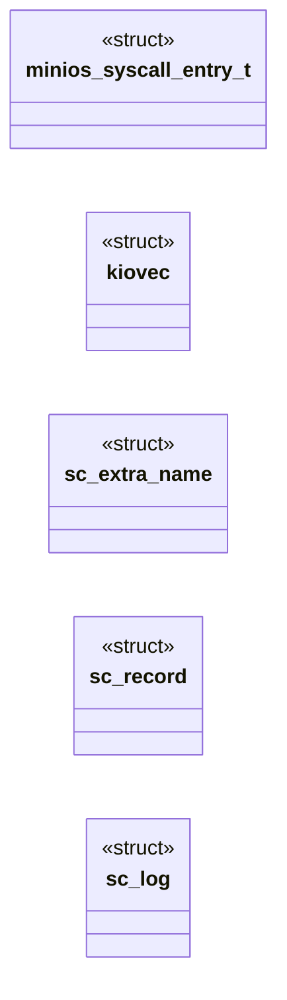
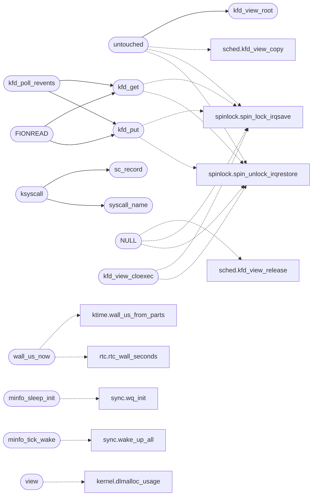

# `kernel/syscalls.c`

> Source: [kernel/syscalls.c:1](../../kernel/syscalls.c#L1) | language `c` | coverage 16.8% | [API index](../index.md)

syscalls.c - Linux x86-64 syscall dispatcher and SYS_SPAWN.

## Contents

- **Structs:** [`minios_syscall_entry_t`](#minios_syscall_entry_t), [`kiovec`](#kiovec), [`sc_extra_name`](#sc_extra_name), [`sc_record`](#sc_record), [`sc_log`](#sc_log)
- **Functions:** [`kfd_view_root`](#kfd_view_root), [`kfd_get`](#kfd_get), [`kfd_put`](#kfd_put), [`untouched`](#untouched), [`NULL`](#null), [`kfd_view_cloexec`](#kfd_view_cloexec), [`by`](#by), [`wall_us_now`](#wall_us_now), [`boot`](#boot), [`minfo_sleep_init`](#minfo_sleep_init), [`minfo_tick_wake`](#minfo_tick_wake), [`view`](#view), [`DOOM_FRAME`](#doom_frame), [`syscall_trace_enabled`](#syscall_trace_enabled), [`syscall_trace_set`](#syscall_trace_set), [`syscall_trace_verbose_enabled`](#syscall_trace_verbose_enabled), [`syscall_trace_verbose_set`](#syscall_trace_verbose_set), [`syscall_trace_shown`](#syscall_trace_shown), [`unchanged`](#unchanged), [`EAGAIN`](#eagain), [`EOF`](#eof), [`kfd_poll_revents`](#kfd_poll_revents), [`split`](#split), [`first`](#first), [`node`](#node), [`FIONREAD`](#fionread), [`clock`](#clock), [`clock_gettime`](#clock_gettime), [`long`](#long), [`syscall_name`](#syscall_name), [`sc_record_dump`](#sc_record_dump), [`ksyscall`](#ksyscall), [`user_range_ok`](#user_range_ok), [`Discipline`](#discipline), [`products`](#products), [`readlink`](#readlink), [`proc_spawn_elf`](#proc_spawn_elf)
- **Macros:** [`KFD_MAX`](#kfd_max), [`MINIOS_SYSCALL_BASE`](#minios_syscall_base), [`MINIOS_SYSCALL_COUNT`](#minios_syscall_count), [`SYSCALL_TRACE`](#syscall_trace), [`SYS_NOISY_TIME`](#sys_noisy_time), [`SYS_NOISY_KBD`](#sys_noisy_kbd), [`SYS_NOISY_MOUSE`](#sys_noisy_mouse), [`SYS_NOISY_GETC_RAW`](#sys_noisy_getc_raw), [`LINUX_O_RDONLY`](#linux_o_rdonly), [`LINUX_O_WRONLY`](#linux_o_wronly), [`LINUX_O_RDWR`](#linux_o_rdwr), [`LINUX_O_APPEND`](#linux_o_append), [`LINUX_O_NONBLOCK`](#linux_o_nonblock), [`LINUX_O_DIRECT`](#linux_o_direct), [`LINUX_O_CLOEXEC`](#linux_o_cloexec), [`LINUX_FD_CLOEXEC`](#linux_fd_cloexec), [`LINUX_F_DUPFD`](#linux_f_dupfd), [`LINUX_F_GETFD`](#linux_f_getfd), [`LINUX_F_SETFD`](#linux_f_setfd), [`LINUX_F_GETFL`](#linux_f_getfl), [`LINUX_F_SETFL`](#linux_f_setfl), [`LINUX_F_DUPFD_CLOEXEC`](#linux_f_dupfd_cloexec), [`LINUX_CLOSE_RANGE_UNSHARE`](#linux_close_range_unshare), [`LINUX_CLOSE_RANGE_CLOEXEC`](#linux_close_range_cloexec), [`LINUX_EFD_SEMAPHORE`](#linux_efd_semaphore), [`LINUX_EFD_NONBLOCK`](#linux_efd_nonblock), [`LINUX_EFD_CLOEXEC`](#linux_efd_cloexec), [`LINUX_EVENTFD_WORD`](#linux_eventfd_word), [`FD_STD_COUNT`](#fd_std_count), [`LINUX_MAP_SHARED`](#linux_map_shared), [`LINUX_MAP_PRIVATE`](#linux_map_private), [`LINUX_MAP_FIXED`](#linux_map_fixed), [`LINUX_MAP_ANONYMOUS`](#linux_map_anonymous), [`LINUX_MREMAP_MAYMOVE`](#linux_mremap_maymove), [`LINUX_MREMAP_FIXED`](#linux_mremap_fixed), [`LINUX_TCGETS`](#linux_tcgets), [`LINUX_TIOCGWINSZ`](#linux_tiocgwinsz), [`LINUX_FIONREAD`](#linux_fionread), [`LINUX_FIONBIO`](#linux_fionbio), [`LINUX_FIONCLEX`](#linux_fionclex), [`LINUX_FIOCLEX`](#linux_fioclex), [`LINUX_TCGETS2`](#linux_tcgets2), [`LINUX_ENOTTY`](#linux_enotty), [`LINUX_WINSIZE_LEN`](#linux_winsize_len), [`LINUX_TERMIOS_LEN`](#linux_termios_len), [`LINUX_TERMIOS2_LEN`](#linux_termios2_len), [`LINUX_IOCTL_INT`](#linux_ioctl_int), [`LINUX_RLIMIT_CPU`](#linux_rlimit_cpu), [`LINUX_RLIMIT_STACK`](#linux_rlimit_stack), [`LINUX_RLIMIT_NOFILE`](#linux_rlimit_nofile), [`LINUX_RLIMIT_AS`](#linux_rlimit_as), [`LINUX_RLIMIT_NLIMITS`](#linux_rlimit_nlimits), [`LINUX_RLIM_INFINITY`](#linux_rlim_infinity), [`LINUX_RLIMIT_PAIR`](#linux_rlimit_pair), [`LINUX_RLIMIT_TICKS_PER_S`](#linux_rlimit_ticks_per_s), [`LINUX_CPUMASK_BYTES`](#linux_cpumask_bytes), [`LINUX_CLOCK_REALTIME`](#linux_clock_realtime), [`LINUX_CLOCK_MONOTONIC`](#linux_clock_monotonic), [`LINUX_CLOCK_BOOTTIME`](#linux_clock_boottime), [`LINUX_TIMER_ABSTIME`](#linux_timer_abstime), [`LINUX_NS_PER_US`](#linux_ns_per_us), [`LINUX_US_PER_S`](#linux_us_per_s), [`LINUX_NS_PER_S`](#linux_ns_per_s), [`LINUX_SLEEP_MAX_S`](#linux_sleep_max_s), [`PROC_SELF_EXE`](#proc_self_exe), [`LINUX_SYSCALL_COUNT`](#linux_syscall_count), [`SC_EXTRA_COUNT`](#sc_extra_count), [`TRACE_HINT_NONE`](#trace_hint_none), [`TRACE_HINT_PATH`](#trace_hint_path), [`SC_RECORD_LEN`](#sc_record_len)
- **Variables:** [`gfx_zoom_2x`](#gfx_zoom_2x), [`gfx_win_title`](#gfx_win_title)

## Type Diagram



## Call Graph

Solid arrows stay in this module, dashed arrows leave it.



## Structs

<a id="minios_syscall_entry_t"></a>

### `minios_syscall_entry_t`

`struct` | [kernel/syscalls.c:237](../../kernel/syscalls.c#L237)

```c
typedef struct
```

---

<a id="kiovec"></a>

### `kiovec`

`struct` `const` | [kernel/syscalls.c:1097](../../kernel/syscalls.c#L1097)

```c
struct kiovec { const char *iov_base; unsigned long iov_len; };
```

---

<a id="sc_extra_name"></a>

### `sc_extra_name`

`struct` `const` | [kernel/syscalls.c:3030](../../kernel/syscalls.c#L3030)

```c
struct sc_extra_name { long n; const char *name; };
```

strace-style name resolver: Linux table first, then the MiniOS window, then the out-of-table Linux numbers the dispatcher answers (openat, newfstatat, clock_gettime, ...).

The tail is a data table, not a switch: a `case N:` ladder would trip tools/check_abi_numbers.py (its CASE_RE parses every `case N:` in this file as a dispatch site) and forces a comment per number to satisfy Rule C. Unknown numbers stay numeric so a new stub never prints a wrong name.

---

<a id="sc_record"></a>

### `sc_record`

`struct` | [kernel/syscalls.c:3106](../../kernel/syscalls.c#L3106)

```c
struct sc_record { long n, a1, a2, a3, ret; };
```

Syscall flight recorder: each process's last SC_RECORD_LEN syscalls (number, first three arguments, result), written on every call with no I/O so it never perturbs timing the way tracing does.

Per process, so a busy poll loop elsewhere cannot flush a dying worker's history; kept after exit until the slot is reused. The exception dump prints the * faulting process's log and `sclog <pid>` any process's. Heap-owned. define SC_RECORD_LEN 32

---

<a id="sc_log"></a>

### `sc_log`

`struct` | [kernel/syscalls.c:3107](../../kernel/syscalls.c#L3107)

```c
struct sc_log { unsigned long next; struct sc_record r[SC_RECORD_LEN]; };
```

---

## Functions

<a id="kfd_view_root"></a>

### `kfd_view_root`

`function` | [kernel/syscalls.c:70](../../kernel/syscalls.c#L70)

```c
kfd_view_t *kfd_view_root(void)
```

Docstring: Static root view (shell pid 0, pids without their own): entries are the historical shared table, never freed.

**Returns:** `kfd_view_t *`

*Called by:* [`untouched`](#untouched)

---

<a id="kfd_get"></a>

### `kfd_get`

`function` | [kernel/syscalls.c:89](../../kernel/syscalls.c#L89)

```c
KFILE *kfd_get(int fd)
```

**Parameters**

| Name | Type | Default | Description |
|---|---|---|---|
| `fd` | `int` |  |  |

**Returns:** `KFILE *`

*Calls:* [`spin_lock_irqsave`](headers.spinlock.h.md#spin_lock_irqsave), [`spin_unlock_irqrestore`](headers.spinlock.h.md#spin_unlock_irqrestore)

*Called by:* [`FIONREAD`](#fionread), [`kfd_poll_revents`](#kfd_poll_revents)

---

<a id="kfd_put"></a>

### `kfd_put`

`function` | [kernel/syscalls.c:102](../../kernel/syscalls.c#L102)

```c
void kfd_put(KFILE *f)
```

**Parameters**

| Name | Type | Default | Description |
|---|---|---|---|
| `f` | `KFILE *` |  |  |

*Calls:* [`spin_lock_irqsave`](headers.spinlock.h.md#spin_lock_irqsave), [`spin_unlock_irqrestore`](headers.spinlock.h.md#spin_unlock_irqrestore)

*Called by:* [`FIONREAD`](#fionread), [`kfd_poll_revents`](#kfd_poll_revents)

---

<a id="untouched"></a>

### `untouched`

`function` | [kernel/syscalls.c:138](../../kernel/syscalls.c#L138)

```c
* child untouched (caller refuses fail-closed). */ int kfd_view_copy(proc_t *child, proc_t *parent)
```

**Parameters**

| Name | Type | Default | Description |
|---|---|---|---|
| `closed` | `caller refuses fail-` |  |  |

**Returns:** `* child`

*Calls:* [`kfd_view_copy`](headers.sched.h.md#kfd_view_copy), [`spin_lock_irqsave`](headers.spinlock.h.md#spin_lock_irqsave), [`spin_unlock_irqrestore`](headers.spinlock.h.md#spin_unlock_irqrestore), [`kfd_view_root`](#kfd_view_root)

---

<a id="null"></a>

### `NULL`

`function` | [kernel/syscalls.c:165](../../kernel/syscalls.c#L165)

```c
* on NULL (already released or never owned). */ void kfd_view_release(proc_t *p)
```

**Parameters**

| Name | Type | Default | Description |
|---|---|---|---|
| `owned` | `already released or never` |  |  |

**Returns:** `* on`

*Calls:* [`kfd_view_release`](headers.sched.h.md#kfd_view_release), [`spin_lock_irqsave`](headers.spinlock.h.md#spin_lock_irqsave), [`spin_unlock_irqrestore`](headers.spinlock.h.md#spin_unlock_irqrestore)

---

<a id="kfd_view_cloexec"></a>

### `kfd_view_cloexec`

`function` | [kernel/syscalls.c:196](../../kernel/syscalls.c#L196)

```c
void kfd_view_cloexec(void)
```

Docstring: Close every CLOEXEC fd in the caller's own view (execve: the image is replaced, marked descriptors must not survive).

Runs on the live view entries with the same ref discipline as close.

*Calls:* [`spin_lock_irqsave`](headers.spinlock.h.md#spin_lock_irqsave), [`spin_unlock_irqrestore`](headers.spinlock.h.md#spin_unlock_irqrestore)

---

<a id="by"></a>

### `by`

`function` | [kernel/syscalls.c:224](../../kernel/syscalls.c#L224)

```c
* is indexed by (syscall_number - 200). New syscalls are added by: * 1. Adding a MINIOS_SYS_* constant to progs/minios_abi.h * 2. Implementing a static long sys_*(long a1, ..., long a6) function here
```

**Parameters**

| Name | Type | Default | Description |
|---|---|---|---|
| `syscall_number` |  |  |  |

**Returns:** `* is indexed`

---

<a id="wall_us_now"></a>

### `wall_us_now`

`function` | [kernel/syscalls.c:255](../../kernel/syscalls.c#L255)

```c
unsigned long wall_us_now(void)
```

wall_us_now: RTC-anchored wall clock in microseconds (Phase 0.2/0.3).

The RTC gives whole seconds; the fraction is the free-running ktime_us rebased at every RTC second edge, so successive reads order correctly across the edge. Shared by gettimeofday (96), clock_gettime (228) and the shell [`clock`](#clock) builtin: one source, never three disagreeing clocks. On RTC failure the base stays 0 and time reads as small uptime-like values; callers that need an epoch treat 0 as "no clock".

**Returns:** `unsigned long`

*Calls:* [`wall_us_from_parts`](headers.ktime.h.md#wall_us_from_parts), [`rtc_wall_seconds`](headers.rtc.h.md#rtc_wall_seconds)

---

<a id="boot"></a>

### `boot`

`function` | [kernel/syscalls.c:478](../../kernel/syscalls.c#L478)

```c
* boot (minfo_sleep_init from sched_init);
```

**Parameters**

| Name | Type | Default | Description |
|---|---|---|---|
| `sched_init` | `minfo_sleep_init from` |  |  |

**Returns:** `*`

---

<a id="minfo_sleep_init"></a>

### `minfo_sleep_init`

`function` | [kernel/syscalls.c:485](../../kernel/syscalls.c#L485)

```c
void minfo_sleep_init(int tick_ok)
```

MINFO sleep support (kernel/syscalls.c): timed park for ring-3 monitors. sched_init passes the tick-registration result; without a registered waker sel 6 fails closed instead of hanging.

**Parameters**

| Name | Type | Default | Description |
|---|---|---|---|
| `tick_ok` | `int` |  |  |

> **Inherited:** Documentation from [`minfo_sleep_init`](#minfo_sleep_init) (headers/kernel.h:116).

*Calls:* [`wq_init`](headers.sync.h.md#wq_init)

---

<a id="minfo_tick_wake"></a>

### `minfo_tick_wake`

`function` | [kernel/syscalls.c:490](../../kernel/syscalls.c#L490)

```c
void minfo_tick_wake(void *ctx)
```

**Parameters**

| Name | Type | Default | Description |
|---|---|---|---|
| `ctx` | `void *` |  |  |

*Calls:* [`wake_up_all`](headers.sync.h.md#wake_up_all)

---

<a id="view"></a>

### `view`

`function` | [kernel/syscalls.c:502](../../kernel/syscalls.c#L502)

```c
* view (same as the `clear` builtin). Anything else is -EINVAL. Each * out-word is range-checked...
```

**Parameters**

| Name | Type | Default | Description |
|---|---|---|---|
| `builtin` | `` same as the `clear` `` |  |  |

**Returns:** `*`

*Calls:* [`dlmalloc_usage`](headers.kernel.h.md#dlmalloc_usage), [`minifs_is_mounted`](headers.minifs.h.md#minifs_is_mounted), [`minifs_usage`](headers.minifs.h.md#minifs_usage), [`SANITIZE_RANGE`](headers.sanitize.h.md#sanitize_range), [`sleep_on`](headers.sync.h.md#sleep_on), [`term_clear`](headers.vga_fb.h.md#term_clear)

---

<a id="doom_frame"></a>

### `DOOM_FRAME`

`function` | [kernel/syscalls.c:828](../../kernel/syscalls.c#L828)

```c
* DOOM_FRAME (211) and NK_FRAME (220) stay as compat aliases. */ static long sys_minios_gfx_prese...
```

**Parameters**

| Name | Type | Default | Description |
|---|---|---|---|
| `211` |  |  |  |

**Returns:** `*`

*Calls:* [`SANITIZE_RANGE`](headers.sanitize.h.md#sanitize_range), [`vga_fb_blit_nk_rgb_window`](headers.vga_fb.h.md#vga_fb_blit_nk_rgb_window), [`vga_fb_blit_nk_window`](headers.vga_fb.h.md#vga_fb_blit_nk_window), [`vga_fb_gfx_origin`](headers.vga_fb.h.md#vga_fb_gfx_origin), [`vga_fb_blit_gfx_window`](kernel.vga_fb.c.md#vga_fb_blit_gfx_window)

---

<a id="syscall_trace_enabled"></a>

### `syscall_trace_enabled`

`function` | [kernel/syscalls.c:1109](../../kernel/syscalls.c#L1109)

```c
long syscall_trace_enabled(void)
```

**Returns:** `long`

---

<a id="syscall_trace_set"></a>

### `syscall_trace_set`

`function` | [kernel/syscalls.c:1110](../../kernel/syscalls.c#L1110)

```c
void syscall_trace_set(int on)
```

**Parameters**

| Name | Type | Default | Description |
|---|---|---|---|
| `on` | `int` |  |  |

---

<a id="syscall_trace_verbose_enabled"></a>

### `syscall_trace_verbose_enabled`

`function` | [kernel/syscalls.c:1111](../../kernel/syscalls.c#L1111)

```c
long syscall_trace_verbose_enabled(void)
```

**Returns:** `long`

---

<a id="syscall_trace_verbose_set"></a>

### `syscall_trace_verbose_set`

`function` | [kernel/syscalls.c:1112](../../kernel/syscalls.c#L1112)

```c
void syscall_trace_verbose_set(int on)
```

**Parameters**

| Name | Type | Default | Description |
|---|---|---|---|
| `on` | `int` |  |  |

---

<a id="syscall_trace_shown"></a>

### `syscall_trace_shown`

`function` | [kernel/syscalls.c:1113](../../kernel/syscalls.c#L1113)

```c
unsigned long syscall_trace_shown(void)
```

**Returns:** `unsigned long`

---

<a id="unchanged"></a>

### `unchanged`

`function` | [kernel/syscalls.c:1128](../../kernel/syscalls.c#L1128)

```c
* unchanged (same code, same order of checks). Numbers >= 200 that * overlap real Linux ABIs stay in the switch as documented * fall-throughs, as do out-of-range numbers (e.g. 334) and the * default E
```

**Parameters**

| Name | Type | Default | Description |
|---|---|---|---|
| `code` | `same` |  |  |
| `checks` | `same order of` |  |  |

**Returns:** `*`

---

<a id="eagain"></a>

### `EAGAIN`

`function` | [kernel/syscalls.c:1155](../../kernel/syscalls.c#L1155)

```c
* writer open is EAGAIN (-11, retry);
```

**Parameters**

| Name | Type | Default | Description |
|---|---|---|---|
| `-11` |  |  |  |

**Returns:** `* writer is`

---

<a id="eof"></a>

### `EOF`

`function` | [kernel/syscalls.c:1156](../../kernel/syscalls.c#L1156)

```c
* is EOF (0). */ KFILE *o = kfd_get(0);
```

========================================================================= Simple FILE interface (for libc compat) ========================================================================= Contract: KFILE wraps either a ramdisk file, a MiniFS file, or a VFS-backed file.

Exactly one of {rf, vfs, minifs_ino} is active per open file.

rf:          non-NULL when backed by ramdisk.  NULL otherwise.
  pos:         current file position.  Updated by read/write/seek.
  wbuf/wsize:  write buffer for created files.  Flushed on close.
               NULL when reading or when backed by MiniFS/VFS.
  mode:        0=read, 1=write (truncate), 2=append.
  is_console:  1 for stdin/stdout/stderr.  Routed to console I/O.
  minifs_ino:  >= 0 when backed by MiniFS.  -1 when ramdisk or VFS.
  minifs_size: cached file size for MiniFS files.
  vfs:         non-NULL when backed by VFS driver.  When non-NULL,
               dispatch goes through vfs->ops instead of ramdisk/MiniFS.

Invariants:
  1. kfopen returns a valid KFILE on success, NULL on failure.
  2. Every successful kfopen must be paired with exactly one kfclose.
  3. After kfclose, the KFILE is invalid and must not be reused.
  4. wbuf is allocated on write-mode open, freed on kfclose.
  5. For VFS-backed files, pos tracks the logical offset, not the
     driver's internal position (driver maintains its own state).
  6. ref counts table membership plus live users: kfopen sets 1,
     kfd_get adds one per snapshot, kfd_put drops one and frees
     through kfclose at zero. Direct kernel users (never in the
     table) keep the plain open/close pairing; only the syscall
     layer uses get/put, so a close racing a read can never free
     under it. The table itself mutates only under fd_lock.
=========================================================================

**Parameters**

| Name | Type | Default | Description |
|---|---|---|---|
| `0` |  |  |  |

**Returns:** `* is`

> **Inherited:** Documentation from [`EOF`](#eof) (headers/kernel.h:459).

---

<a id="kfd_poll_revents"></a>

### `kfd_poll_revents`

`function` | [kernel/syscalls.c:1545](../../kernel/syscalls.c#L1545)

```c
int kfd_poll_revents(int fd)
```

Docstring: poll(2) readiness of a non-socket descriptor (pipes, eventfds, files, console), masked by nothing: the caller keeps the requested bits plus POLLERR/POLLHUP/POLLNVAL.

POLLNVAL for a closed fd.

**Parameters**

| Name | Type | Default | Description |
|---|---|---|---|
| `fd` | `int` |  |  |

**Returns:** `int`

*Calls:* [`kfd_get`](#kfd_get), [`kfd_put`](#kfd_put)

---

<a id="split"></a>

### `split`

`function` | [kernel/syscalls.c:1932](../../kernel/syscalls.c#L1932)

```c
* hold a split (the mapping is restored untouched). */ static long sys_linux_munmap(long a1, long...
```

**Parameters**

| Name | Type | Default | Description |
|---|---|---|---|
| `untouched` | `the mapping is restored` |  |  |

**Returns:** `* hold a`

*Calls:* [`ALIGN_UP`](headers.kernel.h.md#align_up), [`mm_anon_release`](headers.kernel.h.md#mm_anon_release), [`mm_file_range_release`](headers.kernel.h.md#mm_file_range_release), [`spin_lock_irqsave`](headers.spinlock.h.md#spin_lock_irqsave), [`spin_unlock_irqrestore`](headers.spinlock.h.md#spin_unlock_irqrestore)

---

<a id="first"></a>

### `first`

`function` | [kernel/syscalls.c:2006](../../kernel/syscalls.c#L2006)

```c
* passes under mm_lock: validate every page first (present, user, * private), then apply, so a h...
```

**Parameters**

| Name | Type | Default | Description |
|---|---|---|---|
| `private` |  |  |  |

**Returns:** `* passes under mm_lock: validate every page`

---

<a id="node"></a>

### `node`

`function` | [kernel/syscalls.c:2128](../../kernel/syscalls.c#L2128)

```c
* mapping is one exact live VMA node (what mmap inserts);
```

**Parameters**

| Name | Type | Default | Description |
|---|---|---|---|
| `inserts` | `what mmap` |  |  |

**Returns:** `* mapping is one exact live VMA`

*Calls:* [`ALIGN_UP`](headers.kernel.h.md#align_up), [`mm_anon_release`](headers.kernel.h.md#mm_anon_release), [`mm_file_range_release`](headers.kernel.h.md#mm_file_range_release), [`SANITIZE_RANGE`](headers.sanitize.h.md#sanitize_range), [`spin_lock_irqsave`](headers.spinlock.h.md#spin_lock_irqsave), [`spin_unlock_irqrestore`](headers.spinlock.h.md#spin_unlock_irqrestore)

---

<a id="fionread"></a>

### `FIONREAD`

`function` | [kernel/syscalls.c:2439](../../kernel/syscalls.c#L2439)

```c
* descriptor answers FIONREAD (bytes readable now), FIONBIO (O_NONBLOCK), * FIOCLEX/FIONCLEX (FD...
```

**Parameters**

| Name | Type | Default | Description |
|---|---|---|---|
| `now` | `bytes readable` |  |  |

**Returns:** `* descriptor answers`

*Calls:* [`net_sys_ioctl`](headers.net.h.md#net_sys_ioctl), [`net_sys_is_socket`](headers.net.h.md#net_sys_is_socket), [`SANITIZE_RANGE`](headers.sanitize.h.md#sanitize_range), [`kfd_get`](#kfd_get), [`kfd_put`](#kfd_put)

---

<a id="clock"></a>

### `clock`

`function` | [kernel/syscalls.c:2665](../../kernel/syscalls.c#L2665)

```c
* clock (the monotonic TSC clock times it, as Linux does: glibc sends * every nanosleep here as a relative CLOCK_REALTIME sleep);
```

**Parameters**

| Name | Type | Default | Description |
|---|---|---|---|
| `it` | `the monotonic TSC clock times` |  |  |
| `sleep` | `as Linux does: glibc sends * every nanosleep here as a relative CLOCK_REALTIME` |  |  |

**Returns:** `*`

*Called by:* [`shell_exec_builtin`](kernel.shell.c.md#shell_exec_builtin)

---

<a id="clock_gettime"></a>

### `clock_gettime`

`function` | [kernel/syscalls.c:2669](../../kernel/syscalls.c#L2669)

```c
* clock_gettime(1) reads. */ static long sys_linux_clock_nanosleep(long a1, long a2, long a3, lon...
```

**Parameters**

| Name | Type | Default | Description |
|---|---|---|---|
| `1` |  |  |  |

**Returns:** `*`

*Calls:* [`SANITIZE_RANGE`](headers.sanitize.h.md#sanitize_range)

---

<a id="long"></a>

### `long`

`function` | [kernel/syscalls.c:2671](../../kernel/syscalls.c#L2671)

```c
unsigned long (*now)(void);
```

**Parameters**

| Name | Type | Default | Description |
|---|---|---|---|
| `now` |  |  |  |

**Returns:** `unsigned`

---

<a id="syscall_name"></a>

### `syscall_name`

`function` `const` | [kernel/syscalls.c:3045](../../kernel/syscalls.c#L3045)

```c
const char *syscall_name(long n)
```

define SC_EXTRA_COUNT (sizeof(sc_extra_names) / sizeof(sc_extra_names[0]))

**Parameters**

| Name | Type | Default | Description |
|---|---|---|---|
| `n` | `long` |  |  |

**Returns:** `char *`

*Called by:* [`ksyscall`](#ksyscall)

---

<a id="sc_record_dump"></a>

### `sc_record_dump`

`function` | [kernel/syscalls.c:3140](../../kernel/syscalls.c#L3140)

```c
void sc_record_dump(int pid)
```

Serial-only, safe from the exception path: pid's log, oldest first.

**Parameters**

| Name | Type | Default | Description |
|---|---|---|---|
| `pid` | `int` |  |  |

---

<a id="ksyscall"></a>

### `ksyscall`

`function` | [kernel/syscalls.c:3158](../../kernel/syscalls.c#L3158)

```c
long ksyscall(long n, long a1, long a2, long a3, long a4, long a5, long a6)
```

**Parameters**

| Name | Type | Default | Description |
|---|---|---|---|
| `n` | `long` |  |  |
| `a1` | `long` |  |  |
| `a2` | `long` |  |  |
| `a3` | `long` |  |  |
| `a4` | `long` |  |  |
| `a5` | `long` |  |  |
| `a6` | `long` |  |  |

**Returns:** `long`

*Calls:* [`sc_record`](#sc_record), [`syscall_name`](#syscall_name), [`d`](progs.doomgeneric.p_local.h.md#d)

---

<a id="user_range_ok"></a>

### `user_range_ok`

`function` | [kernel/syscalls.c:3197](../../kernel/syscalls.c#L3197)

```c
int user_range_ok(unsigned long p, unsigned long len)
```

========== User-pointer validation (kernel.c) ==========

**Parameters**

| Name | Type | Default | Description |
|---|---|---|---|
| `p` | `unsigned long` |  |  |
| `len` | `unsigned long` |  |  |

**Returns:** `int`

> **Inherited:** Documentation from [`user_range_ok`](#user_range_ok) (headers/kernel.h:692).

---

<a id="discipline"></a>

### `Discipline`

`function` | [kernel/syscalls.c:3210](../../kernel/syscalls.c#L3210)

```c
* * Discipline (audit 2026-09, kept as comment, not a deprecation: both * primitives are legitimate): user_range_ok is ONLY for exact-size * buffers (sizeof(int), 144-byte stat, fixed PCM length);
```

**Parameters**

| Name | Type | Default | Description |
|---|---|---|---|
| `audit` |  |  |  |
| `comment` | `kept as` |  |  |
| `legitimate` | `not a deprecation: both * primitives are` |  |  |

**Returns:** `user_range_ok is ONLY for exact-size * buffers (sizeof(int), 144-byte stat, fixed PCM length)`

---

<a id="products"></a>

### `products`

`function` | [kernel/syscalls.c:3214](../../kernel/syscalls.c#L3214)

```c
* products (writev cnt*sizeof, poll a2*8, spawn (argc+1)*sizeof) are * pre-bounded against (END-...
```

**Parameters**

| Name | Type | Default | Description |
|---|---|---|---|
| `sizeof` | `writev cnt*` |  |  |
| `a2` | `poll *8` |  |  |
| `sizeof` | `spawn (argc+1)*` |  |  |

**Returns:** `*`

*Calls:* [`user_str_ok`](headers.kernel.h.md#user_str_ok)

---

<a id="readlink"></a>

### `readlink`

`function` | [kernel/syscalls.c:3364](../../kernel/syscalls.c#L3364)

```c
* readlink (89). */ return readlink_path((const char *)a2, (char *)a3, a4);
```

**Parameters**

| Name | Type | Default | Description |
|---|---|---|---|
| `89` |  |  |  |

**Returns:** `*`

---

<a id="proc_spawn_elf"></a>

### `proc_spawn_elf`

`function` | [kernel/syscalls.c:3473](../../kernel/syscalls.c#L3473)

```c
* proc_spawn_elf (the same path mrun uses) and the caller blocks in * do_waitpid, so the parent address space is left intact. */ #include "spawn.h" static int k_syscall_spawn(const char *path, const c
```

**Parameters**

| Name | Type | Default | Description |
|---|---|---|---|
| `uses` | `the same path mrun` |  |  |

**Returns:** `*`

---

## Macros

<a id="kfd_max"></a>

### `KFD_MAX`

`macro` | [kernel/syscalls.c:51](../../kernel/syscalls.c#L51)

```c
#define KFD_MAX
```

---

<a id="minios_syscall_base"></a>

### `MINIOS_SYSCALL_BASE`

`macro` | [kernel/syscalls.c:242](../../kernel/syscalls.c#L242)

```c
#define MINIOS_SYSCALL_BASE
```

---

<a id="minios_syscall_count"></a>

### `MINIOS_SYSCALL_COUNT`

`macro` | [kernel/syscalls.c:243](../../kernel/syscalls.c#L243)

```c
#define MINIOS_SYSCALL_COUNT
```

---

<a id="syscall_trace"></a>

### `SYSCALL_TRACE`

`macro` | [kernel/syscalls.c:1099](../../kernel/syscalls.c#L1099)

```c
#define SYSCALL_TRACE
```

---

<a id="sys_noisy_time"></a>

### `SYS_NOISY_TIME`

`macro` | [kernel/syscalls.c:1119](../../kernel/syscalls.c#L1119)

```c
#define SYS_NOISY_TIME
```

Syscall numbers that are poll/clock reads: tracing them floods the console (SYS_TIME is called inside every pacing spin loop), which made `trace on` turn an interactive program into a 100 ms-per-syscall crawl.

Other syscalls are traced one-to-one so a short program's full dialogue stays visible.

---

<a id="sys_noisy_kbd"></a>

### `SYS_NOISY_KBD`

`macro` | [kernel/syscalls.c:1120](../../kernel/syscalls.c#L1120)

```c
#define SYS_NOISY_KBD
```

---

<a id="sys_noisy_mouse"></a>

### `SYS_NOISY_MOUSE`

`macro` | [kernel/syscalls.c:1121](../../kernel/syscalls.c#L1121)

```c
#define SYS_NOISY_MOUSE
```

---

<a id="sys_noisy_getc_raw"></a>

### `SYS_NOISY_GETC_RAW`

`macro` | [kernel/syscalls.c:1122](../../kernel/syscalls.c#L1122)

```c
#define SYS_NOISY_GETC_RAW
```

---

<a id="linux_o_rdonly"></a>

### `LINUX_O_RDONLY`

`macro` | [kernel/syscalls.c:1309](../../kernel/syscalls.c#L1309)

```c
#define LINUX_O_RDONLY
```

Linux descriptor-flag ABI values (docs/spec/smp-sched.md, Linux process, thread and descriptor ABI).

Named, never bare.

---

<a id="linux_o_wronly"></a>

### `LINUX_O_WRONLY`

`macro` | [kernel/syscalls.c:1310](../../kernel/syscalls.c#L1310)

```c
#define LINUX_O_WRONLY
```

---

<a id="linux_o_rdwr"></a>

### `LINUX_O_RDWR`

`macro` | [kernel/syscalls.c:1311](../../kernel/syscalls.c#L1311)

```c
#define LINUX_O_RDWR
```

---

<a id="linux_o_append"></a>

### `LINUX_O_APPEND`

`macro` | [kernel/syscalls.c:1312](../../kernel/syscalls.c#L1312)

```c
#define LINUX_O_APPEND
```

---

<a id="linux_o_nonblock"></a>

### `LINUX_O_NONBLOCK`

`macro` | [kernel/syscalls.c:1313](../../kernel/syscalls.c#L1313)

```c
#define LINUX_O_NONBLOCK
```

---

<a id="linux_o_direct"></a>

### `LINUX_O_DIRECT`

`macro` | [kernel/syscalls.c:1314](../../kernel/syscalls.c#L1314)

```c
#define LINUX_O_DIRECT
```

---

<a id="linux_o_cloexec"></a>

### `LINUX_O_CLOEXEC`

`macro` | [kernel/syscalls.c:1315](../../kernel/syscalls.c#L1315)

```c
#define LINUX_O_CLOEXEC
```

---

<a id="linux_fd_cloexec"></a>

### `LINUX_FD_CLOEXEC`

`macro` | [kernel/syscalls.c:1316](../../kernel/syscalls.c#L1316)

```c
#define LINUX_FD_CLOEXEC
```

---

<a id="linux_f_dupfd"></a>

### `LINUX_F_DUPFD`

`macro` | [kernel/syscalls.c:1317](../../kernel/syscalls.c#L1317)

```c
#define LINUX_F_DUPFD
```

---

<a id="linux_f_getfd"></a>

### `LINUX_F_GETFD`

`macro` | [kernel/syscalls.c:1318](../../kernel/syscalls.c#L1318)

```c
#define LINUX_F_GETFD
```

---

<a id="linux_f_setfd"></a>

### `LINUX_F_SETFD`

`macro` | [kernel/syscalls.c:1319](../../kernel/syscalls.c#L1319)

```c
#define LINUX_F_SETFD
```

---

<a id="linux_f_getfl"></a>

### `LINUX_F_GETFL`

`macro` | [kernel/syscalls.c:1320](../../kernel/syscalls.c#L1320)

```c
#define LINUX_F_GETFL
```

---

<a id="linux_f_setfl"></a>

### `LINUX_F_SETFL`

`macro` | [kernel/syscalls.c:1321](../../kernel/syscalls.c#L1321)

```c
#define LINUX_F_SETFL
```

---

<a id="linux_f_dupfd_cloexec"></a>

### `LINUX_F_DUPFD_CLOEXEC`

`macro` | [kernel/syscalls.c:1322](../../kernel/syscalls.c#L1322)

```c
#define LINUX_F_DUPFD_CLOEXEC
```

---

<a id="linux_close_range_unshare"></a>

### `LINUX_CLOSE_RANGE_UNSHARE`

`macro` | [kernel/syscalls.c:1323](../../kernel/syscalls.c#L1323)

```c
#define LINUX_CLOSE_RANGE_UNSHARE
```

---

<a id="linux_close_range_cloexec"></a>

### `LINUX_CLOSE_RANGE_CLOEXEC`

`macro` | [kernel/syscalls.c:1324](../../kernel/syscalls.c#L1324)

```c
#define LINUX_CLOSE_RANGE_CLOEXEC
```

---

<a id="linux_efd_semaphore"></a>

### `LINUX_EFD_SEMAPHORE`

`macro` | [kernel/syscalls.c:1325](../../kernel/syscalls.c#L1325)

```c
#define LINUX_EFD_SEMAPHORE
```

---

<a id="linux_efd_nonblock"></a>

### `LINUX_EFD_NONBLOCK`

`macro` | [kernel/syscalls.c:1326](../../kernel/syscalls.c#L1326)

```c
#define LINUX_EFD_NONBLOCK
```

---

<a id="linux_efd_cloexec"></a>

### `LINUX_EFD_CLOEXEC`

`macro` | [kernel/syscalls.c:1327](../../kernel/syscalls.c#L1327)

```c
#define LINUX_EFD_CLOEXEC
```

---

<a id="linux_eventfd_word"></a>

### `LINUX_EVENTFD_WORD`

`macro` | [kernel/syscalls.c:1328](../../kernel/syscalls.c#L1328)

```c
#define LINUX_EVENTFD_WORD
```

---

<a id="fd_std_count"></a>

### `FD_STD_COUNT`

`macro` | [kernel/syscalls.c:1329](../../kernel/syscalls.c#L1329)

```c
#define FD_STD_COUNT
```

*Calls:* [`spin_lock_irqsave`](headers.spinlock.h.md#spin_lock_irqsave), [`spin_unlock_irqrestore`](headers.spinlock.h.md#spin_unlock_irqrestore)

---

<a id="linux_map_shared"></a>

### `LINUX_MAP_SHARED`

`macro` | [kernel/syscalls.c:1771](../../kernel/syscalls.c#L1771)

```c
#define LINUX_MAP_SHARED
```

Linux mmap(9) flags.

Named, never bare. File-backed mappings are MAP_PRIVATE over a MiniFS file at a page-aligned offset; MAP_SHARED refuses until slice 3 proves writeback ordering, and ramdisk/pipe/console fds refuse (identity without sharing).

---

<a id="linux_map_private"></a>

### `LINUX_MAP_PRIVATE`

`macro` | [kernel/syscalls.c:1772](../../kernel/syscalls.c#L1772)

```c
#define LINUX_MAP_PRIVATE
```

---

<a id="linux_map_fixed"></a>

### `LINUX_MAP_FIXED`

`macro` | [kernel/syscalls.c:1773](../../kernel/syscalls.c#L1773)

```c
#define LINUX_MAP_FIXED
```

---

<a id="linux_map_anonymous"></a>

### `LINUX_MAP_ANONYMOUS`

`macro` | [kernel/syscalls.c:1774](../../kernel/syscalls.c#L1774)

```c
#define LINUX_MAP_ANONYMOUS
```

---

<a id="linux_mremap_maymove"></a>

### `LINUX_MREMAP_MAYMOVE`

`macro` | [kernel/syscalls.c:2082](../../kernel/syscalls.c#L2082)

```c
#define LINUX_MREMAP_MAYMOVE
```

Linux mremap(25) flags.

Named, never bare: FIXED needs MAYMOVE plus the 5th-arg target, anything outside the two is EINVAL.

---

<a id="linux_mremap_fixed"></a>

### `LINUX_MREMAP_FIXED`

`macro` | [kernel/syscalls.c:2083](../../kernel/syscalls.c#L2083)

```c
#define LINUX_MREMAP_FIXED
```

---

<a id="linux_tcgets"></a>

### `LINUX_TCGETS`

`macro` | [kernel/syscalls.c:2409](../../kernel/syscalls.c#L2409)

```c
#define LINUX_TCGETS
```

---

<a id="linux_tiocgwinsz"></a>

### `LINUX_TIOCGWINSZ`

`macro` | [kernel/syscalls.c:2410](../../kernel/syscalls.c#L2410)

```c
#define LINUX_TIOCGWINSZ
```

---

<a id="linux_fionread"></a>

### `LINUX_FIONREAD`

`macro` | [kernel/syscalls.c:2411](../../kernel/syscalls.c#L2411)

```c
#define LINUX_FIONREAD
```

---

<a id="linux_fionbio"></a>

### `LINUX_FIONBIO`

`macro` | [kernel/syscalls.c:2412](../../kernel/syscalls.c#L2412)

```c
#define LINUX_FIONBIO
```

---

<a id="linux_fionclex"></a>

### `LINUX_FIONCLEX`

`macro` | [kernel/syscalls.c:2413](../../kernel/syscalls.c#L2413)

```c
#define LINUX_FIONCLEX
```

---

<a id="linux_fioclex"></a>

### `LINUX_FIOCLEX`

`macro` | [kernel/syscalls.c:2414](../../kernel/syscalls.c#L2414)

```c
#define LINUX_FIOCLEX
```

---

<a id="linux_tcgets2"></a>

### `LINUX_TCGETS2`

`macro` | [kernel/syscalls.c:2415](../../kernel/syscalls.c#L2415)

```c
#define LINUX_TCGETS2
```

---

<a id="linux_enotty"></a>

### `LINUX_ENOTTY`

`macro` | [kernel/syscalls.c:2416](../../kernel/syscalls.c#L2416)

```c
#define LINUX_ENOTTY
```

---

<a id="linux_winsize_len"></a>

### `LINUX_WINSIZE_LEN`

`macro` | [kernel/syscalls.c:2417](../../kernel/syscalls.c#L2417)

```c
#define LINUX_WINSIZE_LEN
```

---

<a id="linux_termios_len"></a>

### `LINUX_TERMIOS_LEN`

`macro` | [kernel/syscalls.c:2418](../../kernel/syscalls.c#L2418)

```c
#define LINUX_TERMIOS_LEN
```

---

<a id="linux_termios2_len"></a>

### `LINUX_TERMIOS2_LEN`

`macro` | [kernel/syscalls.c:2419](../../kernel/syscalls.c#L2419)

```c
#define LINUX_TERMIOS2_LEN
```

---

<a id="linux_ioctl_int"></a>

### `LINUX_IOCTL_INT`

`macro` | [kernel/syscalls.c:2420](../../kernel/syscalls.c#L2420)

```c
#define LINUX_IOCTL_INT
```

---

<a id="linux_rlimit_cpu"></a>

### `LINUX_RLIMIT_CPU`

`macro` | [kernel/syscalls.c:2544](../../kernel/syscalls.c#L2544)

```c
#define LINUX_RLIMIT_CPU
```

---

<a id="linux_rlimit_stack"></a>

### `LINUX_RLIMIT_STACK`

`macro` | [kernel/syscalls.c:2545](../../kernel/syscalls.c#L2545)

```c
#define LINUX_RLIMIT_STACK
```

---

<a id="linux_rlimit_nofile"></a>

### `LINUX_RLIMIT_NOFILE`

`macro` | [kernel/syscalls.c:2546](../../kernel/syscalls.c#L2546)

```c
#define LINUX_RLIMIT_NOFILE
```

---

<a id="linux_rlimit_as"></a>

### `LINUX_RLIMIT_AS`

`macro` | [kernel/syscalls.c:2547](../../kernel/syscalls.c#L2547)

```c
#define LINUX_RLIMIT_AS
```

---

<a id="linux_rlimit_nlimits"></a>

### `LINUX_RLIMIT_NLIMITS`

`macro` | [kernel/syscalls.c:2548](../../kernel/syscalls.c#L2548)

```c
#define LINUX_RLIMIT_NLIMITS
```

---

<a id="linux_rlim_infinity"></a>

### `LINUX_RLIM_INFINITY`

`macro` | [kernel/syscalls.c:2549](../../kernel/syscalls.c#L2549)

```c
#define LINUX_RLIM_INFINITY
```

---

<a id="linux_rlimit_pair"></a>

### `LINUX_RLIMIT_PAIR`

`macro` | [kernel/syscalls.c:2550](../../kernel/syscalls.c#L2550)

```c
#define LINUX_RLIMIT_PAIR
```

---

<a id="linux_rlimit_ticks_per_s"></a>

### `LINUX_RLIMIT_TICKS_PER_S`

`macro` | [kernel/syscalls.c:2552](../../kernel/syscalls.c#L2552)

```c
#define LINUX_RLIMIT_TICKS_PER_S
```

RLIMIT_CPU is counted in scheduler ticks (the 100 Hz PIT).

---

<a id="linux_cpumask_bytes"></a>

### `LINUX_CPUMASK_BYTES`

`macro` | [kernel/syscalls.c:2553](../../kernel/syscalls.c#L2553)

```c
#define LINUX_CPUMASK_BYTES
```

---

<a id="linux_clock_realtime"></a>

### `LINUX_CLOCK_REALTIME`

`macro` | [kernel/syscalls.c:2618](../../kernel/syscalls.c#L2618)

```c
#define LINUX_CLOCK_REALTIME
```

---

<a id="linux_clock_monotonic"></a>

### `LINUX_CLOCK_MONOTONIC`

`macro` | [kernel/syscalls.c:2619](../../kernel/syscalls.c#L2619)

```c
#define LINUX_CLOCK_MONOTONIC
```

---

<a id="linux_clock_boottime"></a>

### `LINUX_CLOCK_BOOTTIME`

`macro` | [kernel/syscalls.c:2620](../../kernel/syscalls.c#L2620)

```c
#define LINUX_CLOCK_BOOTTIME
```

---

<a id="linux_timer_abstime"></a>

### `LINUX_TIMER_ABSTIME`

`macro` | [kernel/syscalls.c:2621](../../kernel/syscalls.c#L2621)

```c
#define LINUX_TIMER_ABSTIME
```

---

<a id="linux_ns_per_us"></a>

### `LINUX_NS_PER_US`

`macro` | [kernel/syscalls.c:2622](../../kernel/syscalls.c#L2622)

```c
#define LINUX_NS_PER_US
```

---

<a id="linux_us_per_s"></a>

### `LINUX_US_PER_S`

`macro` | [kernel/syscalls.c:2623](../../kernel/syscalls.c#L2623)

```c
#define LINUX_US_PER_S
```

---

<a id="linux_ns_per_s"></a>

### `LINUX_NS_PER_S`

`macro` | [kernel/syscalls.c:2624](../../kernel/syscalls.c#L2624)

```c
#define LINUX_NS_PER_S
```

---

<a id="linux_sleep_max_s"></a>

### `LINUX_SLEEP_MAX_S`

`macro` | [kernel/syscalls.c:2625](../../kernel/syscalls.c#L2625)

```c
#define LINUX_SLEEP_MAX_S
```

---

<a id="proc_self_exe"></a>

### `PROC_SELF_EXE`

`macro` | [kernel/syscalls.c:2783](../../kernel/syscalls.c#L2783)

```c
#define PROC_SELF_EXE
```

*Calls:* [`proc_sec_exe`](headers.proc_sec.h.md#proc_sec_exe), [`SANITIZE_RANGE`](headers.sanitize.h.md#sanitize_range), [`SANITIZE_STR`](headers.sanitize.h.md#sanitize_str)

---

<a id="linux_syscall_count"></a>

### `LINUX_SYSCALL_COUNT`

`macro` | [kernel/syscalls.c:2952](../../kernel/syscalls.c#L2952)

```c
#define LINUX_SYSCALL_COUNT
```

---

<a id="sc_extra_count"></a>

### `SC_EXTRA_COUNT`

`macro` | [kernel/syscalls.c:3044](../../kernel/syscalls.c#L3044)

```c
#define SC_EXTRA_COUNT
```

---

<a id="trace_hint_none"></a>

### `TRACE_HINT_NONE`

`macro` | [kernel/syscalls.c:3066](../../kernel/syscalls.c#L3066)

```c
#define TRACE_HINT_NONE
```

Verbose-tracer hint, split in two halves so a traced line never interleaves with the program's own output.

The snapshot runs BEFORE dispatch (the only moment user memory may be read: a path argument is copied, at most 48 bytes, only after user_str_ok, non-printables folded to '?', "<bad-ptr>" when it does not validate). The print runs AFTER dispatch returns, so `syscall write(...) "..." = N` lands as one atomic line after the program's bytes instead of wrapping them. Scalar hints (code=/addr=/len=/fd/pid=) need no snapshot and print post-hoc.

---

<a id="trace_hint_path"></a>

### `TRACE_HINT_PATH`

`macro` | [kernel/syscalls.c:3067](../../kernel/syscalls.c#L3067)

```c
#define TRACE_HINT_PATH
```

*Calls:* [`user_str_ok`](headers.kernel.h.md#user_str_ok)

---

<a id="sc_record_len"></a>

### `SC_RECORD_LEN`

`macro` | [kernel/syscalls.c:3105](../../kernel/syscalls.c#L3105)

```c
#define SC_RECORD_LEN
```

Syscall flight recorder: each process's last SC_RECORD_LEN syscalls (number, first three arguments, result), written on every call with no I/O so it never perturbs timing the way tracing does.

Per process, so a busy poll loop elsewhere cannot flush a dying worker's history; kept after exit until the slot is reused. The exception dump prints the faulting process's log and `sclog <pid>` any process's. Heap-owned.

---

## Variables

<a id="gfx_zoom_2x"></a>

### `gfx_zoom_2x`

`variable` `extern` | [kernel/syscalls.c:421](../../kernel/syscalls.c#L421)

```c
extern int gfx_zoom_2x;
```

---

<a id="gfx_win_title"></a>

### `gfx_win_title`

`variable` `const` `extern` | [kernel/syscalls.c:702](../../kernel/syscalls.c#L702)

```c
extern const char *gfx_win_title;
```

---
