# `kernel/syscalls_proc.c`

> Source: [kernel/syscalls_proc.c:1](../../kernel/syscalls_proc.c#L1) | language `c` | coverage 28.0% | [API index](../index.md)

syscalls_proc.c - Process-management syscall handlers.

## Contents

- **Functions:** [`state`](#state), [`sys_minios_clone`](#sys_minios_clone), [`sys_minios_thread_spawn`](#sys_minios_thread_spawn), [`sys_minios_seccomp`](#sys_minios_seccomp), [`sys_minios_nice`](#sys_minios_nice), [`sys_linux_yield`](#sys_linux_yield), [`sys_linux_getpid`](#sys_linux_getpid), [`sys_linux_clone`](#sys_linux_clone), [`sys_linux_fork`](#sys_linux_fork), [`sys_linux_vfork`](#sys_linux_vfork), [`sys_linux_execve`](#sys_linux_execve), [`sys_linux_exit`](#sys_linux_exit), [`kill`](#kill), [`groups`](#groups), [`sig`](#sig), [`sys_linux_kill`](#sys_linux_kill), [`sys_linux_gettid`](#sys_linux_gettid)
- **Macros:** [`LINUX_WNOHANG`](#linux_wnohang), [`LINUX_SIGKILL`](#linux_sigkill), [`LINUX_STATUS_SHIFT`](#linux_status_shift), [`LINUX_STATUS_CODE`](#linux_status_code), [`LINUX_ECHILD`](#linux_echild), [`LINUX_EINVAL`](#linux_einval), [`LINUX_ESRCH`](#linux_esrch)

## Call Graph

Solid arrows stay in this module, dashed arrows leave it.

```mermaid
flowchart LR
    n_kernel_syscalls_proc_c__sys_minios_clone(["sys_minios_clone"])
    n_headers_sched_h__do_clone["sched.do_clone"]
    n_kernel_syscalls_proc_c__sys_minios_thread_spawn(["sys_minios_thread_spawn"])
    n_headers_sched_h__do_thread_spawn["sched.do_thread_spawn"]
    n_kernel_syscalls_proc_c__sys_minios_seccomp(["sys_minios_seccomp"])
    n_headers_sched_h__SECCOMP_BIT["sched.SECCOMP_BIT"]
    n_headers_sched_h__seccomp_allow_one["sched.seccomp_allow_one"]
    n_headers_sched_h__seccomp_deny_one["sched.seccomp_deny_one"]
    n_kernel_syscalls_proc_c__sys_linux_yield(["sys_linux_yield"])
    n_headers_sched_h__yield["sched.yield"]
    n_kernel_syscalls_proc_c__sys_linux_getpid(["sys_linux_getpid"])
    n_headers_sched_h__proc_get["sched.proc_get"]
    n_kernel_syscalls_proc_c__sys_linux_clone(["sys_linux_clone"])
    n_headers_sched_h__do_linux_clone["sched.do_linux_clone"]
    n_kernel_syscalls_proc_c__sys_linux_fork(["sys_linux_fork"])
    n_headers_sched_h__do_fork["sched.do_fork"]
    n_kernel_syscalls_proc_c__sys_linux_execve(["sys_linux_execve"])
    n_headers_proc_sec_h__proc_sec_exe["proc_sec.proc_sec_exe"]
    n_headers_sanitize_h__SANITIZE_STR["sanitize.SANITIZE_STR"]
    n_headers_sched_h__do_execve["sched.do_execve"]
    n_kernel_syscalls_proc_c__sys_linux_exit(["sys_linux_exit"])
    n_headers_syscalls_proc_h__do_proc_exit["syscalls_proc.do_proc_exit"]
    n_kernel_syscalls_proc_c__groups(["groups"])
    n_headers_sched_h__do_waitpid_linux["sched.do_waitpid_linux"]
    n_headers_syscalls_proc_h__sys_linux_wait4["syscalls_proc.sys_linux_wait4"]
    n_kernel_syscalls_proc_c__sys_linux_kill(["sys_linux_kill"])
    n_headers_sched_h__do_kill_code["sched.do_kill_code"]
    n_headers_syscalls_proc_h__linux_signal_fatal["syscalls_proc.linux_signal_fatal"]
    n_kernel_syscalls_proc_c__sys_minios_clone -.-> n_headers_sched_h__do_clone
    n_kernel_syscalls_proc_c__sys_minios_thread_spawn -.-> n_headers_sched_h__do_thread_spawn
    n_kernel_syscalls_proc_c__sys_minios_seccomp -.-> n_headers_sched_h__SECCOMP_BIT
    n_kernel_syscalls_proc_c__sys_minios_seccomp -.-> n_headers_sched_h__seccomp_allow_one
    n_kernel_syscalls_proc_c__sys_minios_seccomp -.-> n_headers_sched_h__seccomp_deny_one
    n_kernel_syscalls_proc_c__sys_linux_yield -.-> n_headers_sched_h__yield
    n_kernel_syscalls_proc_c__sys_linux_getpid -.-> n_headers_sched_h__proc_get
    n_kernel_syscalls_proc_c__sys_linux_clone -.-> n_headers_sched_h__do_linux_clone
    n_kernel_syscalls_proc_c__sys_linux_fork -.-> n_headers_sched_h__do_fork
    n_kernel_syscalls_proc_c__sys_linux_execve -.-> n_headers_proc_sec_h__proc_sec_exe
    n_kernel_syscalls_proc_c__sys_linux_execve -.-> n_headers_sanitize_h__SANITIZE_STR
    n_kernel_syscalls_proc_c__sys_linux_execve -.-> n_headers_sched_h__do_execve
    n_kernel_syscalls_proc_c__sys_linux_exit -.-> n_headers_syscalls_proc_h__do_proc_exit
    n_kernel_syscalls_proc_c__groups -.-> n_headers_sched_h__do_waitpid_linux
    n_kernel_syscalls_proc_c__groups -.-> n_headers_syscalls_proc_h__sys_linux_wait4
    n_kernel_syscalls_proc_c__sys_linux_kill -.-> n_headers_sched_h__do_kill_code
    n_kernel_syscalls_proc_c__sys_linux_kill -.-> n_headers_sched_h__proc_get
    n_kernel_syscalls_proc_c__sys_linux_kill -.-> n_headers_syscalls_proc_h__linux_signal_fatal
```



## Functions

<a id="state"></a>

### `state`

`function` | [kernel/syscalls_proc.c:5](../../kernel/syscalls_proc.c#L5)

```c
* touches only scheduler state (current_pid, procs[], do_* / * seccomp_* / yield) plus the kernel-wide user_range_ok validator, so * this TU includes only kernel.h and sched.h. The dispatch tables in
```

**Parameters**

| Name | Type | Default | Description |
|---|---|---|---|
| `procs` |  |  |  |
| `yield` | `do_* / * seccomp_* /` |  |  |

**Returns:** `* touches only scheduler`

---

<a id="sys_minios_clone"></a>

### `sys_minios_clone`

`function` | [kernel/syscalls_proc.c:18](../../kernel/syscalls_proc.c#L18)

```c
long sys_minios_clone(long flags, long newsp, long a3, long a4, long a5, long a6)
```

**Parameters**

| Name | Type | Default | Description |
|---|---|---|---|
| `flags` | `long` |  |  |
| `newsp` | `long` |  |  |
| `a3` | `long` |  |  |
| `a4` | `long` |  |  |
| `a5` | `long` |  |  |
| `a6` | `long` |  |  |

**Returns:** `long`

*Calls:* [`do_clone`](headers.sched.h.md#do_clone)

---

<a id="sys_minios_thread_spawn"></a>

### `sys_minios_thread_spawn`

`function` | [kernel/syscalls_proc.c:24](../../kernel/syscalls_proc.c#L24)

```c
long sys_minios_thread_spawn(long a1, long a2, long a3, long a4, long a5, long a6)
```

**Parameters**

| Name | Type | Default | Description |
|---|---|---|---|
| `a1` | `long` |  |  |
| `a2` | `long` |  |  |
| `a3` | `long` |  |  |
| `a4` | `long` |  |  |
| `a5` | `long` |  |  |
| `a6` | `long` |  |  |

**Returns:** `long`

*Calls:* [`do_thread_spawn`](headers.sched.h.md#do_thread_spawn)

---

<a id="sys_minios_seccomp"></a>

### `sys_minios_seccomp`

`function` | [kernel/syscalls_proc.c:37](../../kernel/syscalls_proc.c#L37)

```c
long sys_minios_seccomp(long a1, long a2, long a3, long a4, long a5, long a6)
```

Seccomp-basic (238): a1 = op (1 deny-one, 2 allow-one, 3 deny-all), a2 = syscall number (ops 1-2).

Applies to current_pid only; the 200..231 window is filterable, Linux numbers never are.

**Parameters**

| Name | Type | Default | Description |
|---|---|---|---|
| `a1` | `long` |  |  |
| `a2` | `long` |  |  |
| `a3` | `long` |  |  |
| `a4` | `long` |  |  |
| `a5` | `long` |  |  |
| `a6` | `long` |  |  |

**Returns:** `long`

*Calls:* [`SECCOMP_BIT`](headers.sched.h.md#seccomp_bit), [`seccomp_allow_one`](headers.sched.h.md#seccomp_allow_one), [`seccomp_deny_one`](headers.sched.h.md#seccomp_deny_one)

---

<a id="sys_minios_nice"></a>

### `sys_minios_nice`

`function` | [kernel/syscalls_proc.c:53](../../kernel/syscalls_proc.c#L53)

```c
long sys_minios_nice(long a1, long a2, long a3, long a4, long a5, long a6)
```

Nice (239): a1 = new nice when a2 != 0, else query.

Clamped NICE_MIN..NICE_MAX.

**Parameters**

| Name | Type | Default | Description |
|---|---|---|---|
| `a1` | `long` |  |  |
| `a2` | `long` |  |  |
| `a3` | `long` |  |  |
| `a4` | `long` |  |  |
| `a5` | `long` |  |  |
| `a6` | `long` |  |  |

**Returns:** `long`

---

<a id="sys_linux_yield"></a>

### `sys_linux_yield`

`function` | [kernel/syscalls_proc.c:66](../../kernel/syscalls_proc.c#L66)

```c
long sys_linux_yield(long a1, long a2, long a3, long a4, long a5, long a6)
```

**Parameters**

| Name | Type | Default | Description |
|---|---|---|---|
| `a1` | `long` |  |  |
| `a2` | `long` |  |  |
| `a3` | `long` |  |  |
| `a4` | `long` |  |  |
| `a5` | `long` |  |  |
| `a6` | `long` |  |  |

**Returns:** `long`

*Calls:* [`yield`](headers.sched.h.md#yield)

---

<a id="sys_linux_getpid"></a>

### `sys_linux_getpid`

`function` | [kernel/syscalls_proc.c:75](../../kernel/syscalls_proc.c#L75)

```c
long sys_linux_getpid(long a1, long a2, long a3, long a4, long a5, long a6)
```

getpid answers the thread group: a CLONE_THREAD member reports its leader, a process its own pid.

The pid-0 exec frame (a foreground `run`) and threads it created keep answering 1, the value programs saw before there were real pids.

**Parameters**

| Name | Type | Default | Description |
|---|---|---|---|
| `a1` | `long` |  |  |
| `a2` | `long` |  |  |
| `a3` | `long` |  |  |
| `a4` | `long` |  |  |
| `a5` | `long` |  |  |
| `a6` | `long` |  |  |

**Returns:** `long`

*Calls:* [`proc_get`](headers.sched.h.md#proc_get)

---

<a id="sys_linux_clone"></a>

### `sys_linux_clone`

`function` | [kernel/syscalls_proc.c:83](../../kernel/syscalls_proc.c#L83)

```c
long sys_linux_clone(long a1, long a2, long a3, long a4, long a5, long a6)
```

Linux clone(2): (flags, newsp, parent_tid, child_tid, tls).

**Parameters**

| Name | Type | Default | Description |
|---|---|---|---|
| `a1` | `long` |  |  |
| `a2` | `long` |  |  |
| `a3` | `long` |  |  |
| `a4` | `long` |  |  |
| `a5` | `long` |  |  |
| `a6` | `long` |  |  |

**Returns:** `long`

*Calls:* [`do_linux_clone`](headers.sched.h.md#do_linux_clone)

---

<a id="sys_linux_fork"></a>

### `sys_linux_fork`

`function` | [kernel/syscalls_proc.c:89](../../kernel/syscalls_proc.c#L89)

```c
long sys_linux_fork(long a1, long a2, long a3, long a4, long a5, long a6)
```

**Parameters**

| Name | Type | Default | Description |
|---|---|---|---|
| `a1` | `long` |  |  |
| `a2` | `long` |  |  |
| `a3` | `long` |  |  |
| `a4` | `long` |  |  |
| `a5` | `long` |  |  |
| `a6` | `long` |  |  |

**Returns:** `long`

*Calls:* [`do_fork`](headers.sched.h.md#do_fork)

---

<a id="sys_linux_vfork"></a>

### `sys_linux_vfork`

`function` | [kernel/syscalls_proc.c:94](../../kernel/syscalls_proc.c#L94)

```c
long sys_linux_vfork(long a1, long a2, long a3, long a4, long a5, long a6)
```

**Parameters**

| Name | Type | Default | Description |
|---|---|---|---|
| `a1` | `long` |  |  |
| `a2` | `long` |  |  |
| `a3` | `long` |  |  |
| `a4` | `long` |  |  |
| `a5` | `long` |  |  |
| `a6` | `long` |  |  |

**Returns:** `long`

---

<a id="sys_linux_execve"></a>

### `sys_linux_execve`

`function` | [kernel/syscalls_proc.c:99](../../kernel/syscalls_proc.c#L99)

```c
long sys_linux_execve(long a1, long a2, long a3, long a4, long a5, long a6)
```

**Parameters**

| Name | Type | Default | Description |
|---|---|---|---|
| `a1` | `long` |  |  |
| `a2` | `long` |  |  |
| `a3` | `long` |  |  |
| `a4` | `long` |  |  |
| `a5` | `long` |  |  |
| `a6` | `long` |  |  |

**Returns:** `long`

*Calls:* [`proc_sec_exe`](headers.proc_sec.h.md#proc_sec_exe), [`SANITIZE_STR`](headers.sanitize.h.md#sanitize_str), [`do_execve`](headers.sched.h.md#do_execve)

---

<a id="sys_linux_exit"></a>

### `sys_linux_exit`

`function` | [kernel/syscalls_proc.c:184](../../kernel/syscalls_proc.c#L184)

```c
long sys_linux_exit(long a1, long a2, long a3, long a4, long a5, long a6)
```

**Parameters**

| Name | Type | Default | Description |
|---|---|---|---|
| `a1` | `long` |  |  |
| `a2` | `long` |  |  |
| `a3` | `long` |  |  |
| `a4` | `long` |  |  |
| `a5` | `long` |  |  |
| `a6` | `long` |  |  |

**Returns:** `long`

*Calls:* [`do_proc_exit`](headers.syscalls_proc.h.md#do_proc_exit)

---

<a id="kill"></a>

### `kill`

`function` | [kernel/syscalls_proc.c:192](../../kernel/syscalls_proc.c#L192)

```c
* historic kill (SIGKILL), -N is signal N (a seccomp kill is -SIGSYS). */ #define LINUX_WNOHANG ...
```

**Returns:** `* historic`

*Called by:* [`process`](progs.src.lxabi.c.md#process)

---

<a id="groups"></a>

### `groups`

`function` | [kernel/syscalls_proc.c:213](../../kernel/syscalls_proc.c#L213)

```c
* groups (pid 0 and < -1) are not modelled and wait for any child. */ long sys_linux_wait4(long a...
```

**Parameters**

| Name | Type | Default | Description |
|---|---|---|---|
| `and` | `pid 0 < -1` |  |  |

**Returns:** `*`

*Calls:* [`do_waitpid_linux`](headers.sched.h.md#do_waitpid_linux), [`sys_linux_wait4`](headers.syscalls_proc.h.md#sys_linux_wait4)

---

<a id="sig"></a>

### `sig`

`function` | [kernel/syscalls_proc.c:245](../../kernel/syscalls_proc.c#L245)

```c
* the target as killed by sig (wait4 reports WTERMSIG);
```

**Parameters**

| Name | Type | Default | Description |
|---|---|---|---|
| `WTERMSIG` | `wait4 reports` |  |  |

**Returns:** `* the target as killed by`

---

<a id="sys_linux_kill"></a>

### `sys_linux_kill`

`function` | [kernel/syscalls_proc.c:248](../../kernel/syscalls_proc.c#L248)

```c
long sys_linux_kill(long a1, long a2, long a3, long a4, long a5, long a6)
```

kill(pid, sig): sig 0 only probes that pid exists; a fatal signal ends the target as killed by sig (wait4 reports WTERMSIG); any other signal is delivered to its default action, ignore.

Process groups (pid <= 0) are not modelled.

**Parameters**

| Name | Type | Default | Description |
|---|---|---|---|
| `a1` | `long` |  |  |
| `a2` | `long` |  |  |
| `a3` | `long` |  |  |
| `a4` | `long` |  |  |
| `a5` | `long` |  |  |
| `a6` | `long` |  |  |

**Returns:** `long`

*Calls:* [`do_kill_code`](headers.sched.h.md#do_kill_code), [`proc_get`](headers.sched.h.md#proc_get), [`linux_signal_fatal`](headers.syscalls_proc.h.md#linux_signal_fatal)

---

<a id="sys_linux_gettid"></a>

### `sys_linux_gettid`

`function` | [kernel/syscalls_proc.c:259](../../kernel/syscalls_proc.c#L259)

```c
long sys_linux_gettid(long a1, long a2, long a3, long a4, long a5, long a6)
```

**Parameters**

| Name | Type | Default | Description |
|---|---|---|---|
| `a1` | `long` |  |  |
| `a2` | `long` |  |  |
| `a3` | `long` |  |  |
| `a4` | `long` |  |  |
| `a5` | `long` |  |  |
| `a6` | `long` |  |  |

**Returns:** `long`

---

## Macros

<a id="linux_wnohang"></a>

### `LINUX_WNOHANG`

`macro` | [kernel/syscalls_proc.c:193](../../kernel/syscalls_proc.c#L193)

```c
#define LINUX_WNOHANG
```

Linux wait status words (docs/spec/smp-sched.md): a normal exit carries its code in bits 8..15, a death by signal the signal number in bits 0..6.

MiniOS records a signal death as a negative exit code: -1 is the historic kill (SIGKILL), -N is signal N (a seccomp kill is -SIGSYS).

---

<a id="linux_sigkill"></a>

### `LINUX_SIGKILL`

`macro` | [kernel/syscalls_proc.c:194](../../kernel/syscalls_proc.c#L194)

```c
#define LINUX_SIGKILL
```

---

<a id="linux_status_shift"></a>

### `LINUX_STATUS_SHIFT`

`macro` | [kernel/syscalls_proc.c:195](../../kernel/syscalls_proc.c#L195)

```c
#define LINUX_STATUS_SHIFT
```

---

<a id="linux_status_code"></a>

### `LINUX_STATUS_CODE`

`macro` | [kernel/syscalls_proc.c:196](../../kernel/syscalls_proc.c#L196)

```c
#define LINUX_STATUS_CODE
```

---

<a id="linux_echild"></a>

### `LINUX_ECHILD`

`macro` | [kernel/syscalls_proc.c:197](../../kernel/syscalls_proc.c#L197)

```c
#define LINUX_ECHILD
```

---

<a id="linux_einval"></a>

### `LINUX_EINVAL`

`macro` | [kernel/syscalls_proc.c:198](../../kernel/syscalls_proc.c#L198)

```c
#define LINUX_EINVAL
```

---

<a id="linux_esrch"></a>

### `LINUX_ESRCH`

`macro` | [kernel/syscalls_proc.c:199](../../kernel/syscalls_proc.c#L199)

```c
#define LINUX_ESRCH
```

---
