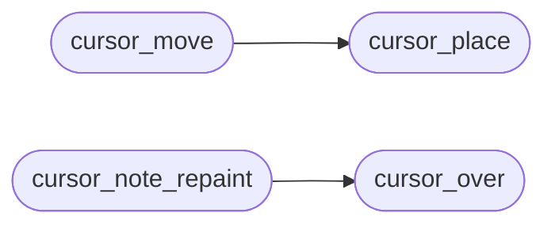

# `kernel/vga_cursor.c`

> Source: [kernel/vga_cursor.c:1](../../kernel/vga_cursor.c#L1) | language `c` | coverage 88.9% | [API index](../index.md)

Docstring: Hardware pointer sprite layer (kernel/vga_cursor.c).

## Contents

- **Functions:** [`cursor_over`](#cursor_over), [`cursor_place`](#cursor_place), [`cursor_move`](#cursor_move), [`cursor_erase`](#cursor_erase), [`cursor_invalidate`](#cursor_invalidate), [`cursor_note_repaint`](#cursor_note_repaint)
- **Macros:** [`CURSOR_TIP_X`](#cursor_tip_x), [`CURSOR_TIP_Y`](#cursor_tip_y)

## Call Graph

Solid arrows stay in this module, dashed arrows leave it.



## Functions

<a id="cursor_over"></a>

### `cursor_over`

`function` | [kernel/vga_cursor.c:96](../../kernel/vga_cursor.c#L96)

```c
int cursor_over(int x0, int y0, int w, int h)
```

Docstring: True when the cursor sprite overlaps the given screen rectangle.

Used to decide whether a partial repaint overwrote the cursor, in which case its saved background must be refreshed; otherwise the cursor keeps its saved background and moves without leaving a trail. The sprite is CURSOR_W x CURSOR_H with its top-left corner at (mx, my).

**Parameters**

| Name | Type | Default | Description |
|---|---|---|---|
| `x0` | `int` |  |  |
| `y0` | `int` |  |  |
| `w` | `int` |  |  |
| `h` | `int` |  |  |

**Returns:** `int`

*Called by:* [`cursor_note_repaint`](#cursor_note_repaint)

---

<a id="cursor_place"></a>

### `cursor_place`

`function` | [kernel/vga_cursor.c:106](../../kernel/vga_cursor.c#L106)

```c
void cursor_place(int mx, int my)
```

Docstring: Paint the pointer at mx/my unconditionally: save the background, draw the sprite, record the position.

**Parameters**

| Name | Type | Default | Description |
|---|---|---|---|
| `mx` | `int` |  |  |
| `my` | `int` |  |  |

*Called by:* [`cursor_move`](#cursor_move)

---

<a id="cursor_move"></a>

### `cursor_move`

`function` | [kernel/vga_cursor.c:116](../../kernel/vga_cursor.c#L116)

```c
void cursor_move(int mx, int my)
```

Docstring: Desktop-tick pointer update: repaint only when the position moved since the last paint, otherwise keep the saved background.

**Parameters**

| Name | Type | Default | Description |
|---|---|---|---|
| `mx` | `int` |  |  |
| `my` | `int` |  |  |

*Calls:* [`cursor_place`](#cursor_place)

---

<a id="cursor_erase"></a>

### `cursor_erase`

`function` | [kernel/vga_cursor.c:133](../../kernel/vga_cursor.c#L133)

```c
void cursor_erase(void)
```

Docstring: Restore the saved background when the pointer is up, then mark it hidden.

A repaint that covered the sprite calls cursor_invalidate instead: the background is gone, nothing to restore.

---

<a id="cursor_invalidate"></a>

### `cursor_invalidate`

`function` | [kernel/vga_cursor.c:141](../../kernel/vga_cursor.c#L141)

```c
void cursor_invalidate(void)
```

Docstring: Mark the pointer hidden without touching the framebuffer.

Used after any repaint that may have covered the sprite.

---

<a id="cursor_note_repaint"></a>

### `cursor_note_repaint`

`function` | [kernel/vga_cursor.c:147](../../kernel/vga_cursor.c#L147)

```c
void cursor_note_repaint(int x0, int y0, int w, int h)
```

Docstring: Invalidate the pointer when it overlaps a repainted screen rectangle, so the next move re-saves a fresh background.

**Parameters**

| Name | Type | Default | Description |
|---|---|---|---|
| `x0` | `int` |  |  |
| `y0` | `int` |  |  |
| `w` | `int` |  |  |
| `h` | `int` |  |  |

*Calls:* [`cursor_over`](#cursor_over)

---

## Macros

<a id="cursor_tip_x"></a>

### `CURSOR_TIP_X`

`macro` | [kernel/vga_cursor.c:28](../../kernel/vga_cursor.c#L28)

```c
#define CURSOR_TIP_X
```

The arrow's visual point is its top-left pixel: the sprite is drawn with its top-left corner at (mx, my), so click hit-tests use (mx, my) directly and a click lands where the user aims the arrow tip.

---

<a id="cursor_tip_y"></a>

### `CURSOR_TIP_Y`

`macro` | [kernel/vga_cursor.c:29](../../kernel/vga_cursor.c#L29)

```c
#define CURSOR_TIP_Y
```

---
