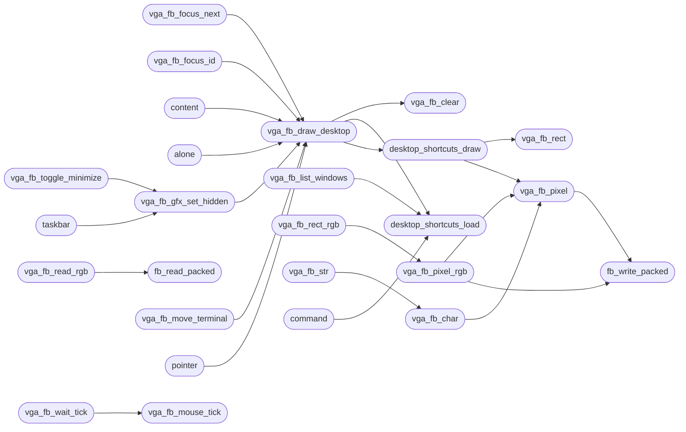

# `kernel/vga_fb.c`

> Source: [kernel/vga_fb.c:1](../../kernel/vga_fb.c#L1) | language `c` | coverage 51.8% | [API index](../index.md)

## Contents

- **Structs:** [`termwin_t`](#termwin_t)
- **Functions:** [`vga_fb_boot_config`](#vga_fb_boot_config), [`fb_bytes_per_pixel`](#fb_bytes_per_pixel), [`compositions`](#compositions), [`vga_fb_term_ring_init`](#vga_fb_term_ring_init), [`vga_fb_term_feed`](#vga_fb_term_feed), [`first`](#first), [`flag`](#flag), [`letterbox`](#letterbox), [`vga_fb_set_gfx_program`](#vga_fb_set_gfx_program), [`vga_fb_set_gfx_mode`](#vga_fb_set_gfx_mode), [`vga_fb_gfx_origin`](#vga_fb_gfx_origin), [`coordinates`](#coordinates), [`vga_fb_gfx_map_mouse`](#vga_fb_gfx_map_mouse), [`vga_fb_focus_event`](#vga_fb_focus_event), [`vga_fb_focus_report`](#vga_fb_focus_report), [`vga_fb_focus_get`](#vga_fb_focus_get), [`vga_fb_nterms_get`](#vga_fb_nterms_get), [`vga_fb_focus_next`](#vga_fb_focus_next), [`app`](#app), [`vga_fb_focus_id`](#vga_fb_focus_id), [`content`](#content), [`vga_fb_layout_set`](#vga_fb_layout_set), [`vga_fb_layout_cycle`](#vga_fb_layout_cycle), [`vga_fb_layout_get`](#vga_fb_layout_get), [`vga_fb_layout_name`](#vga_fb_layout_name), [`alone`](#alone), [`vga_fb_list_windows`](#vga_fb_list_windows), [`vga_fb_act_empty`](#vga_fb_act_empty), [`vga_fb_note_prompt`](#vga_fb_note_prompt), [`vga_fb_clear_prompt`](#vga_fb_clear_prompt), [`vga_fb_prompted`](#vga_fb_prompted), [`vga_fb_prompt_live`](#vga_fb_prompt_live), [`vga_fb_park_line`](#vga_fb_park_line), [`vga_fb_unpark_line`](#vga_fb_unpark_line), [`vga_fb_set_gfx_palette`](#vga_fb_set_gfx_palette), [`fb_write_packed`](#fb_write_packed), [`fb_read_packed`](#fb_read_packed), [`vga_fb_read_rgb`](#vga_fb_read_rgb), [`fb_write_row_packed`](#fb_write_row_packed), [`fb_read_row_packed`](#fb_read_row_packed), [`vga_fb_pixel`](#vga_fb_pixel), [`vga_fb_clear`](#vga_fb_clear), [`vga_fb_rect`](#vga_fb_rect), [`vga_fb_pixel_rgb`](#vga_fb_pixel_rgb), [`vga_fb_rect_rgb`](#vga_fb_rect_rgb), [`vga_fb_char`](#vga_fb_char), [`vga_fb_str`](#vga_fb_str), [`wm_close_pending`](#wm_close_pending), [`wm_clear_close`](#wm_clear_close), [`wm_gfx_mode_active`](#wm_gfx_mode_active), [`vga_fb_ps2_owner`](#vga_fb_ps2_owner), [`taskbar`](#taskbar), [`directly`](#directly), [`vga_fb_blit_gfx_window`](#vga_fb_blit_gfx_window), [`vga_fb_blit_nk_window`](#vga_fb_blit_nk_window), [`vga_fb_blit_nk_rgb_window`](#vga_fb_blit_nk_rgb_window), [`title`](#title), [`vga_fb_theme_name`](#vga_fb_theme_name), [`buffer`](#buffer), [`line`](#line), [`escapes`](#escapes), [`vga_fb_puts_term`](#vga_fb_puts_term), [`vga_fb_text_cursor`](#vga_fb_text_cursor), [`vga_fb_hide_text_cursor`](#vga_fb_hide_text_cursor), [`vga_fb_draw_desktop`](#vga_fb_draw_desktop), [`from`](#from), [`vga_fb_gfx_set_hidden`](#vga_fb_gfx_set_hidden), [`vga_fb_gfx_view_name`](#vga_fb_gfx_view_name), [`vga_fb_toggle_fullscreen`](#vga_fb_toggle_fullscreen), [`vga_fb_toggle_minimize`](#vga_fb_toggle_minimize), [`vga_fb_is_minimized`](#vga_fb_is_minimized), [`vga_fb_is_fullscreen`](#vga_fb_is_fullscreen), [`vga_fb_close_active`](#vga_fb_close_active), [`vga_fb_move_terminal`](#vga_fb_move_terminal), [`vga_fb_snap_window`](#vga_fb_snap_window), [`vga_fb_resize`](#vga_fb_resize), [`vga_fb_reset_default`](#vga_fb_reset_default), [`desktop_shortcuts_load`](#desktop_shortcuts_load), [`dock_bounce_counts`](#dock_bounce_counts), [`dock_click_count`](#dock_click_count), [`dock_pending_active`](#dock_pending_active), [`desktop_shortcuts_draw`](#desktop_shortcuts_draw), [`command`](#command), [`desktop_shortcuts_hit_test`](#desktop_shortcuts_hit_test), [`pointer`](#pointer), [`vga_fb_wait_tick`](#vga_fb_wait_tick), [`vga_fb_mouse_tick`](#vga_fb_mouse_tick), [`path`](#path), [`state`](#state), [`vga_fb_mouse_init`](#vga_fb_mouse_init), [`vga_fb_history_page`](#vga_fb_history_page), [`vga_fb_init`](#vga_fb_init)
- **Macros:** [`FBT`](#fbt), [`LG_LINE`](#lg_line), [`GFX_SRC_IDX`](#gfx_src_idx), [`GFX_SRC_RGB`](#gfx_src_rgb), [`GFX_KEEP_BYTES`](#gfx_keep_bytes), [`GFX_CURSOR_IDLE_TICKS`](#gfx_cursor_idle_ticks), [`GFX_CURSOR_FOLLOW_TICKS`](#gfx_cursor_follow_ticks), [`GFX_PROG_LEN`](#gfx_prog_len), [`WIN_DEF_COLS`](#win_def_cols), [`WIN_DEF_ROWS`](#win_def_rows), [`WIN_DEF_X`](#win_def_x), [`WIN_DEF_Y`](#win_def_y), [`WM_MAX_TERMS`](#wm_max_terms), [`WM_ELINE_SZ`](#wm_eline_sz), [`FB_OFFSET`](#fb_offset), [`TB_GFX_TITLE_MAX`](#tb_gfx_title_max)

## Call Graph

Solid arrows stay in this module, dashed arrows leave it.



## Structs

<a id="termwin_t"></a>

### `termwin_t`

`struct` | [kernel/vga_fb.c:978](../../kernel/vga_fb.c#L978)

```c
typedef struct
```

---

## Functions

<a id="vga_fb_boot_config"></a>

### `vga_fb_boot_config`

`function` | [kernel/vga_fb.c:90](../../kernel/vga_fb.c#L90)

```c
void vga_fb_boot_config(void)
```

---

<a id="fb_bytes_per_pixel"></a>

### `fb_bytes_per_pixel`

`function` | [kernel/vga_fb.c:117](../../kernel/vga_fb.c#L117)

```c
int fb_bytes_per_pixel(void)
```

Bytes per framebuffer pixel derived from fb_bpp (1 for 8-bit, 3 for 24, 4 for 32).

**Returns:** `int`

> **Inherited:** Documentation from [`fb_bytes_per_pixel`](#fb_bytes_per_pixel) (headers/vga_fb.h:30).

---

<a id="compositions"></a>

### `compositions`

`function` | [kernel/vga_fb.c:133](../../kernel/vga_fb.c#L133)

```c
* compositions (an ISR tick composing inside a syscall composition) draw * into the same shadow and leave the present to the outermost owner. * The shadow is allocated once on first use and never free
```

**Parameters**

| Name | Type | Default | Description |
|---|---|---|---|
| `composition` | `an ISR tick composing inside a syscall` |  |  |

**Returns:** `*`

---

<a id="vga_fb_term_ring_init"></a>

### `vga_fb_term_ring_init`

`function` | [kernel/vga_fb.c:349](../../kernel/vga_fb.c#L349)

```c
void vga_fb_term_ring_init(void)
```

Docstring: Create the terminal history ring.

Called once the heap is up, before the boot banner is printed, so the text-mode console has somewhere to put the boot log.

---

<a id="vga_fb_term_feed"></a>

### `vga_fb_term_feed`

`function` | [kernel/vga_fb.c:357](../../kernel/vga_fb.c#L357)

```c
void vga_fb_term_feed(const char *line, int len)
```

Docstring: Feed one completed console line into the terminal history.

The text-mode console (the boot log, before the desktop comes up) has no other history, and the desktop terminal owns the ring afterwards, so the ring is the one place both halves land.

**Parameters**

| Name | Type | Default | Description |
|---|---|---|---|
| `line` | `char *` |  |  |
| `len` | `int` |  |  |

---

<a id="first"></a>

### `first`

`function` | [kernel/vga_fb.c:456](../../kernel/vga_fb.c#L456)

```c
* screen ever showing it whole first (the old flash-then-melt). */ static unsigned int *fx_start_...
```

**Parameters**

| Name | Type | Default | Description |
|---|---|---|---|
| `melt` | `the old flash-then-` |  |  |

**Returns:** `* screen ever showing it whole`

*Calls:* [`cursor_erase`](headers.kernel.vga_cursor.h.md#cursor_erase), [`vga_fx_enabled`](headers.vga_fb.h.md#vga_fx_enabled), [`vga_fx_snap_rect`](headers.vga_fb.h.md#vga_fx_snap_rect)

---

<a id="flag"></a>

### `flag`

`function` | [kernel/vga_fb.c:533](../../kernel/vga_fb.c#L533)

```c
* is the minimized flag (the program keeps running, nothing composites);
```

**Parameters**

| Name | Type | Default | Description |
|---|---|---|---|
| `running` | `the program keeps` |  |  |
| `composites` | `nothing` |  |  |

**Returns:** `* is the minimized`

---

<a id="letterbox"></a>

### `letterbox`

`function` | [kernel/vga_fb.c:537](../../kernel/vga_fb.c#L537)

```c
* present to repaint chrome plus letterbox (after a desktop redraw or a * view change);
```

**Parameters**

| Name | Type | Default | Description |
|---|---|---|---|
| `change` | `after a desktop redraw or a * view` |  |  |

**Returns:** `* present to repaint chrome plus`

---

<a id="vga_fb_set_gfx_program"></a>

### `vga_fb_set_gfx_program`

`function` | [kernel/vga_fb.c:613](../../kernel/vga_fb.c#L613)

```c
void vga_fb_set_gfx_program(const char *name)
```

**Parameters**

| Name | Type | Default | Description |
|---|---|---|---|
| `name` | `char *` |  |  |

---

<a id="vga_fb_set_gfx_mode"></a>

### `vga_fb_set_gfx_mode`

`function` | [kernel/vga_fb.c:675](../../kernel/vga_fb.c#L675)

```c
void vga_fb_set_gfx_mode(int on)
```

Graphics-mode pointer.

SYS_VGA_MODE toggles vga_fb_set_gfx_mode; while a ring-3 graphics program owns the display the kernel idle loop (and with it vga_fb_mouse_tick) never runs, so the frame-composite functions restore the previous frame's pointer before the blit and redraw it after, keeping the desktop pointer visible over the whole display without leaving trails.

**Parameters**

| Name | Type | Default | Description |
|---|---|---|---|
| `on` | `int` |  |  |

> **Inherited:** Documentation from [`vga_fb_set_gfx_mode`](#vga_fb_set_gfx_mode) (headers/vga_fb.h:291).

*Calls:* [`cursor_erase`](headers.kernel.vga_cursor.h.md#cursor_erase), [`cursor_invalidate`](headers.kernel.vga_cursor.h.md#cursor_invalidate)

---

<a id="vga_fb_gfx_origin"></a>

### `vga_fb_gfx_origin`

`function` | [kernel/vga_fb.c:768](../../kernel/vga_fb.c#L768)

```c
void vga_fb_gfx_origin(int *x, int *y)
```

Docstring: Content origin of the graphics window (the point an app subtracts from SYS_MOUSE coordinates), for the present syscalls.

**Parameters**

| Name | Type | Default | Description |
|---|---|---|---|
| `x` | `int *` |  |  |
| `y` | `int *` |  |  |

---

<a id="coordinates"></a>

### `coordinates`

`function` | [kernel/vga_fb.c:782](../../kernel/vga_fb.c#L782)

```c
* windows keep the exact historical coordinates (including outside the * window);
```

**Parameters**

| Name | Type | Default | Description |
|---|---|---|---|
| `window` | `including outside the *` |  |  |

**Returns:** `* windows keep the exact historical`

---

<a id="vga_fb_gfx_map_mouse"></a>

### `vga_fb_gfx_map_mouse`

`function` | [kernel/vga_fb.c:785](../../kernel/vga_fb.c#L785)

```c
void vga_fb_gfx_map_mouse(int *x, int *y)
```

Docstring: Map a desktop pointer into the graphics app's back-buffer space when its view is scaled.

A 1:1 view is left untouched so native windows keep the exact historical coordinates (including outside the window); a scaled view maps through the inverse transform so the app's `mouse - origin` lands on the pixel under the arrow.

**Parameters**

| Name | Type | Default | Description |
|---|---|---|---|
| `x` | `int *` |  |  |
| `y` | `int *` |  |  |

*Calls:* [`wm_gfxview_map_point`](headers.wm_gfxview.h.md#wm_gfxview_map_point)

---

<a id="vga_fb_focus_event"></a>

### `vga_fb_focus_event`

`function` `const` | [kernel/vga_fb.c:1020](../../kernel/vga_fb.c#L1020)

```c
const wm_notify_event_t *vga_fb_focus_event(void)
```

Docstring: Last focus event for serial-observable state.

**Returns:** `wm_notify_event_t *`

*Calls:* [`wm_notify_last`](headers.wm_notify.h.md#wm_notify_last)

---

<a id="vga_fb_focus_report"></a>

### `vga_fb_focus_report`

`function` | [kernel/vga_fb.c:1026](../../kernel/vga_fb.c#L1026)

```c
void vga_fb_focus_report(int before, int source)
```

Docstring: Record a programmatic focus move from another unit.

**Parameters**

| Name | Type | Default | Description |
|---|---|---|---|
| `before` | `int` |  |  |
| `source` | `int` |  |  |

---

<a id="vga_fb_focus_get"></a>

### `vga_fb_focus_get`

`function` | [kernel/vga_fb.c:1137](../../kernel/vga_fb.c#L1137)

```c
int vga_fb_focus_get(void)
```

**Returns:** `int`

---

<a id="vga_fb_nterms_get"></a>

### `vga_fb_nterms_get`

`function` | [kernel/vga_fb.c:1138](../../kernel/vga_fb.c#L1138)

```c
int vga_fb_nterms_get(void)
```

**Returns:** `int`

---

<a id="vga_fb_focus_next"></a>

### `vga_fb_focus_next`

`function` | [kernel/vga_fb.c:1154](../../kernel/vga_fb.c#L1154)

```c
void vga_fb_focus_next(void)
```

Docstring: Cycle focus across terminals plus graphics when active.

*Calls:* [`kbd_raw_flush`](headers.drivers.kbd.h.md#kbd_raw_flush), [`wm_focus_next`](headers.wm_focus.h.md#wm_focus_next), [`wm_focus_selectable`](headers.wm_focus.h.md#wm_focus_selectable), [`vga_fb_draw_desktop`](#vga_fb_draw_desktop)

---

<a id="app"></a>

### `app`

`function` | [kernel/vga_fb.c:1195](../../kernel/vga_fb.c#L1195)

```c
* a gfx child spawned from another gfx app (file -> vedit) keeps the * terminal focused, so its keys and wheel keep landing on the shell * while the app looks hung. The enable arm mirrors the focus-gf
```

**Parameters**

| Name | Type | Default | Description |
|---|---|---|---|
| `vedit` | `file ->` |  |  |

**Returns:** `* a gfx child spawned from another gfx`

*Calls:* [`kbd_raw_flush`](headers.drivers.kbd.h.md#kbd_raw_flush)

---

<a id="vga_fb_focus_id"></a>

### `vga_fb_focus_id`

`function` | [kernel/vga_fb.c:1219](../../kernel/vga_fb.c#L1219)

```c
int vga_fb_focus_id(int id)
```

Docstring: Focus window id directly, fail closed on invalid id.

**Parameters**

| Name | Type | Default | Description |
|---|---|---|---|
| `id` | `int` |  |  |

**Returns:** `int`

*Calls:* [`kbd_raw_flush`](headers.drivers.kbd.h.md#kbd_raw_flush), [`wm_focus_set`](headers.wm_focus.h.md#wm_focus_set), [`vga_fb_draw_desktop`](#vga_fb_draw_desktop)

---

<a id="content"></a>

### `content`

`function` | [kernel/vga_fb.c:1269](../../kernel/vga_fb.c#L1269)

```c
* windows would share content (same prompt/output on both) and a park * would alias src == dst. ...
```

**Parameters**

| Name | Type | Default | Description |
|---|---|---|---|
| `both` | `same prompt/output on` |  |  |

**Returns:** `* windows would share`

*Calls:* [`vga_fb_term_split`](headers.vga_fb.h.md#vga_fb_term_split), [`vga_fb_tile_all`](headers.vga_fb.h.md#vga_fb_tile_all), [`vga_fb_draw_desktop`](#vga_fb_draw_desktop)

---

<a id="vga_fb_layout_set"></a>

### `vga_fb_layout_set`

`function` | [kernel/vga_fb.c:1354](../../kernel/vga_fb.c#L1354)

```c
int vga_fb_layout_set(int mode)
```

Docstring: Set active layout mode, fail closed on bad mode.

**Parameters**

| Name | Type | Default | Description |
|---|---|---|---|
| `mode` | `int` |  |  |

**Returns:** `int`

*Calls:* [`wm_layout_mode_valid`](headers.wm_layout.h.md#wm_layout_mode_valid)

---

<a id="vga_fb_layout_cycle"></a>

### `vga_fb_layout_cycle`

`function` | [kernel/vga_fb.c:1365](../../kernel/vga_fb.c#L1365)

```c
void vga_fb_layout_cycle(void)
```

Docstring: Cycle layout mode tile bsp cascade fibonacci.

*Calls:* [`vga_fb_tile_all`](headers.vga_fb.h.md#vga_fb_tile_all)

---

<a id="vga_fb_layout_get"></a>

### `vga_fb_layout_get`

`function` | [kernel/vga_fb.c:1381](../../kernel/vga_fb.c#L1381)

```c
int vga_fb_layout_get(void)
```

Docstring: Active layout mode id.

**Returns:** `int`

---

<a id="vga_fb_layout_name"></a>

### `vga_fb_layout_name`

`function` `const` | [kernel/vga_fb.c:1387](../../kernel/vga_fb.c#L1387)

```c
const char *vga_fb_layout_name(void)
```

Docstring: Active layout mode name, never null.

**Returns:** `char *`

*Calls:* [`wm_layout_mode_name`](headers.wm_layout.h.md#wm_layout_mode_name)

---

<a id="alone"></a>

### `alone`

`function` | [kernel/vga_fb.c:1399](../../kernel/vga_fb.c#L1399)

```c
* window alone (an unfocused graphics window minimizes to the taskbar, * exactly like the hidden terminals). The graphics move glides. */ void vga_fb_tile_all(void)
```

**Parameters**

| Name | Type | Default | Description |
|---|---|---|---|
| `taskbar` | `an unfocused graphics window minimizes to the` |  |  |
| `terminals` | `* exactly like the hidden` |  |  |

**Returns:** `* window`

*Calls:* [`vga_fb_tile_all`](headers.vga_fb.h.md#vga_fb_tile_all), [`wm_layout_compute`](headers.wm_layout.h.md#wm_layout_compute), [`wm_layout_same`](headers.wm_layout.h.md#wm_layout_same), [`vga_fb_draw_desktop`](#vga_fb_draw_desktop)

---

<a id="vga_fb_list_windows"></a>

### `vga_fb_list_windows`

`function` | [kernel/vga_fb.c:1526](../../kernel/vga_fb.c#L1526)

```c
void vga_fb_list_windows(void)
```

*Calls:* [`wm_gfxview_mode_name`](headers.wm_gfxview.h.md#wm_gfxview_mode_name), [`desktop_shortcuts_load`](#desktop_shortcuts_load)

---

<a id="vga_fb_act_empty"></a>

### `vga_fb_act_empty`

`function` | [kernel/vga_fb.c:1584](../../kernel/vga_fb.c#L1584)

```c
int vga_fb_act_empty(void)
```

1 when the focused window's active line is empty (fresh prompt spot).

**Returns:** `int`

---

<a id="vga_fb_note_prompt"></a>

### `vga_fb_note_prompt`

`function` | [kernel/vga_fb.c:1588](../../kernel/vga_fb.c#L1588)

```c
void vga_fb_note_prompt(void)
```

The shell loop calls note after printing a prompt (it is live in the focused window) and clear once the line is submitted for execution.

---

<a id="vga_fb_clear_prompt"></a>

### `vga_fb_clear_prompt`

`function` | [kernel/vga_fb.c:1593](../../kernel/vga_fb.c#L1593)

```c
void vga_fb_clear_prompt(void)
```

---

<a id="vga_fb_prompted"></a>

### `vga_fb_prompted`

`function` | [kernel/vga_fb.c:1598](../../kernel/vga_fb.c#L1598)

```c
int vga_fb_prompted(void)
```

**Returns:** `int`

---

<a id="vga_fb_prompt_live"></a>

### `vga_fb_prompt_live`

`function` | [kernel/vga_fb.c:1607](../../kernel/vga_fb.c#L1607)

```c
int vga_fb_prompt_live(void)
```

1 when the active line is empty or holds exactly a fresh prompt, so printing another one would stack duplicate `miniOS> ` lines on every refocus.

Compares the whole line, not a prefix.

**Returns:** `int`

---

<a id="vga_fb_park_line"></a>

### `vga_fb_park_line`

`function` | [kernel/vga_fb.c:1614](../../kernel/vga_fb.c#L1614)

```c
void vga_fb_park_line(const char *b, int p)
```

Park the shell's half-typed line into the focused window slot.

**Parameters**

| Name | Type | Default | Description |
|---|---|---|---|
| `b` | `char *` |  |  |
| `p` | `int` |  |  |

---

<a id="vga_fb_unpark_line"></a>

### `vga_fb_unpark_line`

`function` | [kernel/vga_fb.c:1629](../../kernel/vga_fb.c#L1629)

```c
int vga_fb_unpark_line(char *b, int *p)
```

Restore the focused window's parked line.

Returns 1 when one existed.

**Parameters**

| Name | Type | Default | Description |
|---|---|---|---|
| `b` | `char *` |  |  |
| `p` | `int *` |  |  |

**Returns:** `int`

---

<a id="vga_fb_set_gfx_palette"></a>

### `vga_fb_set_gfx_palette`

`function` | [kernel/vga_fb.c:1750](../../kernel/vga_fb.c#L1750)

```c
void vga_fb_set_gfx_palette(const unsigned char *pal)
```

Store the graphics program's 768-byte palette (SYS_PALETTE).

In 8-bit mode it is also programmed into the DAC; in true color it is only kept so the DOOM/Nuklear blits can expand their indexed back-buffers to RGB.

**Parameters**

| Name | Type | Default | Description |
|---|---|---|---|
| `pal` | `unsigned char *` |  |  |

> **Inherited:** Documentation from [`vga_fb_set_gfx_palette`](#vga_fb_set_gfx_palette) (headers/vga_fb.h:38).

*Calls:* [`outb`](headers.kernel.h.md#outb)

---

<a id="fb_write_packed"></a>

### `fb_write_packed`

`function` | [kernel/vga_fb.c:1781](../../kernel/vga_fb.c#L1781)

```c
void fb_write_packed(int x, int y, unsigned long rgb)
```

**Parameters**

| Name | Type | Default | Description |
|---|---|---|---|
| `x` | `int` |  |  |
| `y` | `int` |  |  |
| `rgb` | `unsigned long` |  |  |

*Called by:* [`vga_fb_pixel`](#vga_fb_pixel), [`vga_fb_pixel_rgb`](#vga_fb_pixel_rgb)

---

<a id="fb_read_packed"></a>

### `fb_read_packed`

`function` | [kernel/vga_fb.c:1801](../../kernel/vga_fb.c#L1801)

```c
unsigned long fb_read_packed(int x, int y)
```

Packed-pixel primitives (0x00RRGGBB): the cursor layer draws through these so it never touches raw framebuffer memory itself.

**Parameters**

| Name | Type | Default | Description |
|---|---|---|---|
| `x` | `int` |  |  |
| `y` | `int` |  |  |

**Returns:** `unsigned long`

> **Inherited:** Documentation from [`fb_read_packed`](#fb_read_packed) (headers/vga_fb.h:200).

*Called by:* [`vga_fb_read_rgb`](#vga_fb_read_rgb)

---

<a id="vga_fb_read_rgb"></a>

### `vga_fb_read_rgb`

`function` | [kernel/vga_fb.c:1825](../../kernel/vga_fb.c#L1825)

```c
unsigned long vga_fb_read_rgb(int x, int y)
```

Read one desktop pixel as packed 0x00RRGGBB (palette-resolved in 8-bit mode, native in true color).

Backstop for `gfx pixel`/`gfx shot`, which must report colors instead of DAC indices once the DAC is gone.

**Parameters**

| Name | Type | Default | Description |
|---|---|---|---|
| `x` | `int` |  |  |
| `y` | `int` |  |  |

**Returns:** `unsigned long`

> **Inherited:** Documentation from [`vga_fb_read_rgb`](#vga_fb_read_rgb) (headers/vga_fb.h:34).

*Calls:* [`fb_read_packed`](#fb_read_packed)

---

<a id="fb_write_row_packed"></a>

### `fb_write_row_packed`

`function` | [kernel/vga_fb.c:1830](../../kernel/vga_fb.c#L1830)

```c
void fb_write_row_packed(int x, int y, const unsigned int *src, int n)
```

Docstring: Write n packed pixels (0x00RRGGBB, or raw indices in 8-bit mode) to row y from column x, clipped once.

The row fast path the melt and the snapshot restore use instead of one call per pixel.

**Parameters**

| Name | Type | Default | Description |
|---|---|---|---|
| `x` | `int` |  |  |
| `y` | `int` |  |  |
| `src` | `unsigned int *` |  |  |
| `n` | `int` |  |  |

---

<a id="fb_read_row_packed"></a>

### `fb_read_row_packed`

`function` | [kernel/vga_fb.c:1860](../../kernel/vga_fb.c#L1860)

```c
void fb_read_row_packed(int x, int y, unsigned int *dst, int n)
```

Docstring: Read n packed pixels of row y from column x into dst, clipped once; pixels outside the screen read as 0.

**Parameters**

| Name | Type | Default | Description |
|---|---|---|---|
| `x` | `int` |  |  |
| `y` | `int` |  |  |
| `dst` | `unsigned int *` |  |  |
| `n` | `int` |  |  |

---

<a id="vga_fb_pixel"></a>

### `vga_fb_pixel`

`function` | [kernel/vga_fb.c:1991](../../kernel/vga_fb.c#L1991)

```c
void vga_fb_pixel(int x, int y, uint8_t color)
```

---- Drawing primitives ----

**Parameters**

| Name | Type | Default | Description |
|---|---|---|---|
| `x` | `int` |  |  |
| `y` | `int` |  |  |
| `color` | `uint8_t` |  |  |

*Calls:* [`fb_write_packed`](#fb_write_packed)

*Called by:* [`desktop_shortcuts_draw`](#desktop_shortcuts_draw), [`vga_fb_char`](#vga_fb_char), [`vga_fb_pixel_rgb`](#vga_fb_pixel_rgb)

---

<a id="vga_fb_clear"></a>

### `vga_fb_clear`

`function` | [kernel/vga_fb.c:2001](../../kernel/vga_fb.c#L2001)

```c
void vga_fb_clear(void)
```

Docstring: Clear the render target to black in bulk.

*Called by:* [`vga_fb_draw_desktop`](#vga_fb_draw_desktop), [`vga_fb_init`](#vga_fb_init)

---

<a id="vga_fb_rect"></a>

### `vga_fb_rect`

`function` | [kernel/vga_fb.c:2011](../../kernel/vga_fb.c#L2011)

```c
void vga_fb_rect(int x, int y, int w, int h, uint8_t color)
```

Docstring: Solid rectangle: the color resolves once, every row is one clipped run fill instead of a per-pixel palette lookup and call.

**Parameters**

| Name | Type | Default | Description |
|---|---|---|---|
| `x` | `int` |  |  |
| `y` | `int` |  |  |
| `w` | `int` |  |  |
| `h` | `int` |  |  |
| `color` | `uint8_t` |  |  |

*Called by:* [`desktop_shortcuts_draw`](#desktop_shortcuts_draw)

---

<a id="vga_fb_pixel_rgb"></a>

### `vga_fb_pixel_rgb`

`function` | [kernel/vga_fb.c:2026](../../kernel/vga_fb.c#L2026)

```c
void vga_fb_pixel_rgb(int x, int y, uint8_t r, uint8_t g, uint8_t b)
```

Direct RGB pixel: full color depth in true-color modes, best-effort quantization in 8-bit mode.

This is the primitive future UI (gradients, hover glows, selection blends) builds on instead of the 15-entry UI palette. Packed order 0x00RRGGBB, same as fb_write_packed.

**Parameters**

| Name | Type | Default | Description |
|---|---|---|---|
| `x` | `int` |  |  |
| `y` | `int` |  |  |
| `r` | `uint8_t` |  |  |
| `g` | `uint8_t` |  |  |
| `b` | `uint8_t` |  |  |

*Calls:* [`fb_write_packed`](#fb_write_packed), [`vga_fb_pixel`](#vga_fb_pixel)

*Called by:* [`vga_fb_rect_rgb`](#vga_fb_rect_rgb)

---

<a id="vga_fb_rect_rgb"></a>

### `vga_fb_rect_rgb`

`function` | [kernel/vga_fb.c:2035](../../kernel/vga_fb.c#L2035)

```c
void vga_fb_rect_rgb(int x, int y, int w, int h, uint8_t r, uint8_t g, uint8_t b)
```

**Parameters**

| Name | Type | Default | Description |
|---|---|---|---|
| `x` | `int` |  |  |
| `y` | `int` |  |  |
| `w` | `int` |  |  |
| `h` | `int` |  |  |
| `r` | `uint8_t` |  |  |
| `g` | `uint8_t` |  |  |
| `b` | `uint8_t` |  |  |

*Calls:* [`vga_fb_pixel_rgb`](#vga_fb_pixel_rgb)

---

<a id="vga_fb_char"></a>

### `vga_fb_char`

`function` | [kernel/vga_fb.c:2042](../../kernel/vga_fb.c#L2042)

```c
void vga_fb_char(int col, int row, char c, uint8_t fg, uint8_t bg)
```

**Parameters**

| Name | Type | Default | Description |
|---|---|---|---|
| `col` | `int` |  |  |
| `row` | `int` |  |  |
| `c` | `char` |  |  |
| `fg` | `uint8_t` |  |  |
| `bg` | `uint8_t` |  |  |

*Calls:* [`vga_fb_pixel`](#vga_fb_pixel)

*Called by:* [`vga_fb_str`](#vga_fb_str)

---

<a id="vga_fb_str"></a>

### `vga_fb_str`

`function` | [kernel/vga_fb.c:2056](../../kernel/vga_fb.c#L2056)

```c
void vga_fb_str(int col, int row, const char *s, uint8_t fg, uint8_t bg)
```

**Parameters**

| Name | Type | Default | Description |
|---|---|---|---|
| `col` | `int` |  |  |
| `row` | `int` |  |  |
| `s` | `char *` |  |  |
| `fg` | `uint8_t` |  |  |
| `bg` | `uint8_t` |  |  |

*Calls:* [`vga_fb_char`](#vga_fb_char)

---

<a id="wm_close_pending"></a>

### `wm_close_pending`

`function` | [kernel/vga_fb.c:2134](../../kernel/vga_fb.c#L2134)

```c
int wm_close_pending(void)
```

Close request bridge: the syscall dispatcher polls this so a graphics program's next syscall exits it on the child's own stack.

**Returns:** `int`

---

<a id="wm_clear_close"></a>

### `wm_clear_close`

`function` | [kernel/vga_fb.c:2135](../../kernel/vga_fb.c#L2135)

```c
void wm_clear_close(void)
```

---

<a id="wm_gfx_mode_active"></a>

### `wm_gfx_mode_active`

`function` | [kernel/vga_fb.c:2136](../../kernel/vga_fb.c#L2136)

```c
int wm_gfx_mode_active(void)
```

**Returns:** `int`

---

<a id="vga_fb_ps2_owner"></a>

### `vga_fb_ps2_owner`

`function` | [kernel/vga_fb.c:2139](../../kernel/vga_fb.c#L2139)

```c
int vga_fb_ps2_owner(int pid)
```

Docstring: PS/2 owner check with pid range validation, focus routed.

**Parameters**

| Name | Type | Default | Description |
|---|---|---|---|
| `pid` | `int` |  |  |

**Returns:** `int`

---

<a id="taskbar"></a>

### `taskbar`

`function` | [kernel/vga_fb.c:2159](../../kernel/vga_fb.c#L2159)

```c
* minimize hides the app to the taskbar (it never closes it), maximize * toggles true fullscreen...
```

**Parameters**

| Name | Type | Default | Description |
|---|---|---|---|
| `it` | `it never closes` |  |  |

**Returns:** `* minimize hides the app to the`

*Calls:* [`vga_fb_gfx_set_fullscreen`](headers.vga_fb.h.md#vga_fb_gfx_set_fullscreen), [`vga_fb_gfx_set_hidden`](#vga_fb_gfx_set_hidden)

---

<a id="directly"></a>

### `directly`

`function` | [kernel/vga_fb.c:2207](../../kernel/vga_fb.c#L2207)

```c
* RGB sources pack directly (quantized to the wallpaper cube in 8-bit). */ static void gfx_scale_...
```

**Parameters**

| Name | Type | Default | Description |
|---|---|---|---|
| `bit` | `quantized to the wallpaper cube in 8-` |  |  |

**Returns:** `* RGB sources pack`

---

<a id="vga_fb_blit_gfx_window"></a>

### `vga_fb_blit_gfx_window`

`function` | [kernel/vga_fb.c:2438](../../kernel/vga_fb.c#L2438)

```c
void vga_fb_blit_gfx_window(void)
```

*Called by:* [`DOOM_FRAME`](kernel.syscalls.c.md#doom_frame)

---

<a id="vga_fb_blit_nk_window"></a>

### `vga_fb_blit_nk_window`

`function` | [kernel/vga_fb.c:2447](../../kernel/vga_fb.c#L2447)

```c
void vga_fb_blit_nk_window(void)
```

RGB companion buffer (3 bytes per pixel, R,G,B order, NK_W x NK_H).

Mapped by mm_setup_protections like the indexed buffers; presented with * GFX_PRESENT + MINIOS_GFX_BUF_NK_RGB through vga_fb_blit_nk_rgb_window. define NK_RGB_ADDR   MINIOS_NK_RGB_ADDR define NK_RGB_BYTES  MINIOS_NK_RGB_BYTES

> **Inherited:** Documentation from [`vga_fb_blit_nk_window`](#vga_fb_blit_nk_window) (headers/vga_fb.h:75).

---

<a id="vga_fb_blit_nk_rgb_window"></a>

### `vga_fb_blit_nk_rgb_window`

`function` | [kernel/vga_fb.c:2453](../../kernel/vga_fb.c#L2453)

```c
void vga_fb_blit_nk_rgb_window(void)
```

Composite the Nuklear RGB back-buffer (NK_RGB_ADDR, NK_W x NK_H x 3 bytes) through the same present path as the indexed buffers.

---

<a id="title"></a>

### `title`

`function` | [kernel/vga_fb.c:2569](../../kernel/vga_fb.c#L2569)

```c
* 8px row plus its title (bright when focused). The hint line * starts after it instead of underneath. */ const uint8_t *ipx = gfx_task_icon();
```

**Parameters**

| Name | Type | Default | Description |
|---|---|---|---|
| `focused` | `bright when` |  |  |

**Returns:** `* 8px row plus its`

---

<a id="vga_fb_theme_name"></a>

### `vga_fb_theme_name`

`function` | [kernel/vga_fb.c:2654](../../kernel/vga_fb.c#L2654)

```c
int vga_fb_theme_name(char *dst, int cap)
```

Docstring: Active Nuklear theme name for the taskbar widget.

Reads etc/themes/current (ramdisk); a missing file, a bad name or an
overlong read falls back to "dark", never a stale or partial name.

**Parameters**

| Name | Type | Default | Description |
|---|---|---|---|
| `dst` | `char *` |  |  |
| `cap` | `int` |  |  |

**Returns:** `int`

---

<a id="buffer"></a>

### `buffer`

`function` | [kernel/vga_fb.c:2870](../../kernel/vga_fb.c#L2870)

```c
* owns the buffer (indices reset, render reads an empty ring). */ void term_clear(void)
```

**Parameters**

| Name | Type | Default | Description |
|---|---|---|---|
| `reset` | `indices` |  |  |
| `ring` | `render reads an empty` |  |  |

**Returns:** `* owns the`

*Calls:* [`term_clear`](headers.vga_fb.h.md#term_clear)

*Called by:* [`SB16_STREAM_BUF`](headers.sb16.h.md#sb16_stream_buf)

---

<a id="line"></a>

### `line`

`function` | [kernel/vga_fb.c:2930](../../kernel/vga_fb.c#L2930)

```c
* display stale bytes left over from a longer previous line (e.g. the prompt * would show the tail of the previous command's last output line stuck after * it). */ void vga_fb_putc_term(char c)
```

**Parameters**

| Name | Type | Default | Description |
|---|---|---|---|
| `it` | `e.g. the prompt * would show the tail of the previous command's last output line stuck after *` |  |  |

**Returns:** `* display stale bytes left over from a longer previous`

*Calls:* [`vga_fb_putc_term`](headers.vga_fb.h.md#vga_fb_putc_term)

---

<a id="escapes"></a>

### `escapes`

`function` | [kernel/vga_fb.c:2939](../../kernel/vga_fb.c#L2939)

```c
* swallowing them here keeps the escapes (which the serial side needs) * from printing as li...
```

**Parameters**

| Name | Type | Default | Description |
|---|---|---|---|
| `needs` | `which the serial side` |  |  |

**Returns:** `* swallowing them here keeps the`

---

<a id="vga_fb_puts_term"></a>

### `vga_fb_puts_term`

`function` | [kernel/vga_fb.c:2996](../../kernel/vga_fb.c#L2996)

```c
void vga_fb_puts_term(const char *s)
```

**Parameters**

| Name | Type | Default | Description |
|---|---|---|---|
| `s` | `char *` |  |  |

*Calls:* [`vga_fb_putc_term`](headers.vga_fb.h.md#vga_fb_putc_term)

---

<a id="vga_fb_text_cursor"></a>

### `vga_fb_text_cursor`

`function` | [kernel/vga_fb.c:3002](../../kernel/vga_fb.c#L3002)

```c
void vga_fb_text_cursor(int col)
```

Show the text cursor at character column `col` of the active line, or hide it with a negative column.

The cursor is a block rendered by render_row.

**Parameters**

| Name | Type | Default | Description |
|---|---|---|---|
| `col` | `int` |  |  |

---

<a id="vga_fb_hide_text_cursor"></a>

### `vga_fb_hide_text_cursor`

`function` | [kernel/vga_fb.c:3010](../../kernel/vga_fb.c#L3010)

```c
void vga_fb_hide_text_cursor(void)
```

Hide the text cursor (used when a live edit starts or the window redraws).

---

<a id="vga_fb_draw_desktop"></a>

### `vga_fb_draw_desktop`

`function` | [kernel/vga_fb.c:3034](../../kernel/vga_fb.c#L3034)

```c
void vga_fb_draw_desktop(void)
```

Docstring: Repaint the desktop through the shared render plan.

The whole frame composes off-screen (see the render-target section) and is presented once, pointer included, so a redraw never flashes a cleared or half-painted screen. A pending graphics-close melt keeps the closing rect showing the old pixels in the presented frame and then melts the fresh desktop over it on the visible framebuffer.

*Calls:* [`cursor_erase`](headers.kernel.vga_cursor.h.md#cursor_erase), [`cursor_invalidate`](headers.kernel.vga_cursor.h.md#cursor_invalidate), [`vga_fx_enabled`](headers.vga_fb.h.md#vga_fx_enabled), [`vga_fx_free`](headers.vga_fb.h.md#vga_fx_free), [`vga_fx_melt_rect`](headers.vga_fb.h.md#vga_fx_melt_rect), [`vga_fx_restore_rect`](headers.vga_fb.h.md#vga_fx_restore_rect), [`vga_fx_snap_rect`](headers.vga_fb.h.md#vga_fx_snap_rect), [`wm_build_render_plan`](headers.wm_render.h.md#wm_build_render_plan), [`desktop_shortcuts_draw`](#desktop_shortcuts_draw), [`desktop_shortcuts_load`](#desktop_shortcuts_load), [`vga_fb_clear`](#vga_fb_clear)

*Called by:* [`alone`](#alone), [`content`](#content), [`pointer`](#pointer), [`vga_fb_focus_id`](#vga_fb_focus_id), [`vga_fb_focus_next`](#vga_fb_focus_next), [`vga_fb_gfx_set_hidden`](#vga_fb_gfx_set_hidden), [`vga_fb_init`](#vga_fb_init), [`vga_fb_move_terminal`](#vga_fb_move_terminal)

---

<a id="from"></a>

### `from`

`function` | [kernel/vga_fb.c:3246](../../kernel/vga_fb.c#L3246)

```c
* leaving returns to the view it came from (floating or tiled). Returns * 0 on success, -1 witho...
```

**Parameters**

| Name | Type | Default | Description |
|---|---|---|---|
| `tiled` | `floating or` |  |  |

**Returns:** `* leaving returns to the view it came`

*Calls:* [`vga_fb_gfx_set_fullscreen`](headers.vga_fb.h.md#vga_fb_gfx_set_fullscreen)

---

<a id="vga_fb_gfx_set_hidden"></a>

### `vga_fb_gfx_set_hidden`

`function` | [kernel/vga_fb.c:3280](../../kernel/vga_fb.c#L3280)

```c
int vga_fb_gfx_set_hidden(int hide)
```

Docstring: Minimize (hide) or restore the graphics window.

The app keeps running; a hidden window paints nothing, drops the keyboard to the terminal and glides into its taskbar button; a restore glides back out and takes the keyboard. Returns 0, or -1 without a program.

**Parameters**

| Name | Type | Default | Description |
|---|---|---|---|
| `hide` | `int` |  |  |

**Returns:** `int`

*Calls:* [`vga_fb_draw_desktop`](#vga_fb_draw_desktop)

*Called by:* [`taskbar`](#taskbar), [`vga_fb_toggle_minimize`](#vga_fb_toggle_minimize)

---

<a id="vga_fb_gfx_view_name"></a>

### `vga_fb_gfx_view_name`

`function` `const` | [kernel/vga_fb.c:3308](../../kernel/vga_fb.c#L3308)

```c
const char *vga_fb_gfx_view_name(void)
```

Docstring: Graphics view state for `wm state`/`wm list`.

**Returns:** `char *`

*Calls:* [`wm_gfxview_mode_name`](headers.wm_gfxview.h.md#wm_gfxview_mode_name)

---

<a id="vga_fb_toggle_fullscreen"></a>

### `vga_fb_toggle_fullscreen`

`function` | [kernel/vga_fb.c:3332](../../kernel/vga_fb.c#L3332)

```c
void vga_fb_toggle_fullscreen(void)
```

Docstring: Toggle fullscreen on the focused window: the graphics window scales to the whole display, a terminal fills the grid.

*Calls:* [`vga_fb_gfx_set_fullscreen`](headers.vga_fb.h.md#vga_fb_gfx_set_fullscreen)

---

<a id="vga_fb_toggle_minimize"></a>

### `vga_fb_toggle_minimize`

`function` | [kernel/vga_fb.c:3353](../../kernel/vga_fb.c#L3353)

```c
void vga_fb_toggle_minimize(void)
```

Docstring: Minimize/restore the focused window (graphics or terminal).

*Calls:* [`vga_fb_gfx_set_hidden`](#vga_fb_gfx_set_hidden)

---

<a id="vga_fb_is_minimized"></a>

### `vga_fb_is_minimized`

`function` | [kernel/vga_fb.c:3361](../../kernel/vga_fb.c#L3361)

```c
int vga_fb_is_minimized(void)
```

**Returns:** `int`

---

<a id="vga_fb_is_fullscreen"></a>

### `vga_fb_is_fullscreen`

`function` | [kernel/vga_fb.c:3362](../../kernel/vga_fb.c#L3362)

```c
int vga_fb_is_fullscreen(void)
```

**Returns:** `int`

---

<a id="vga_fb_close_active"></a>

### `vga_fb_close_active`

`function` | [kernel/vga_fb.c:3416](../../kernel/vga_fb.c#L3416)

```c
int vga_fb_close_active(void)
```

Close the focused window.

For the graphics window (focused) this arms the close request that the syscall dispatcher honours on the child's next syscall; for a terminal it restores the default position (the shell cannot be closed). Returns 1 when a close was armed, 0 otherwise.

**Returns:** `int`

---

<a id="vga_fb_move_terminal"></a>

### `vga_fb_move_terminal`

`function` | [kernel/vga_fb.c:3430](../../kernel/vga_fb.c#L3430)

```c
void vga_fb_move_terminal(int dx, int dy)
```

**Parameters**

| Name | Type | Default | Description |
|---|---|---|---|
| `dx` | `int` |  |  |
| `dy` | `int` |  |  |

*Calls:* [`vga_fb_draw_desktop`](#vga_fb_draw_desktop)

---

<a id="vga_fb_snap_window"></a>

### `vga_fb_snap_window`

`function` | [kernel/vga_fb.c:3490](../../kernel/vga_fb.c#L3490)

```c
void vga_fb_snap_window(int zone)
```

**Parameters**

| Name | Type | Default | Description |
|---|---|---|---|
| `zone` | `int` |  |  |

---

<a id="vga_fb_resize"></a>

### `vga_fb_resize`

`function` | [kernel/vga_fb.c:3518](../../kernel/vga_fb.c#L3518)

```c
void vga_fb_resize(int dcols, int drows)
```

**Parameters**

| Name | Type | Default | Description |
|---|---|---|---|
| `dcols` | `int` |  |  |
| `drows` | `int` |  |  |

---

<a id="vga_fb_reset_default"></a>

### `vga_fb_reset_default`

`function` | [kernel/vga_fb.c:3538](../../kernel/vga_fb.c#L3538)

```c
void vga_fb_reset_default(void)
```

Docstring: Restore defaults on the focused window plus graphics offset.

---

<a id="desktop_shortcuts_load"></a>

### `desktop_shortcuts_load`

`function` | [kernel/vga_fb.c:3825](../../kernel/vga_fb.c#L3825)

```c
void desktop_shortcuts_load(void)
```

Load shortcuts from etc/shortcuts, decode icons, compute layout.

Called once from vga_fb_draw_desktop on first draw.

> **Inherited:** Documentation from [`desktop_shortcuts_load`](#desktop_shortcuts_load) (headers/desktop_shortcuts.h:82).

*Called by:* [`command`](#command), [`vga_fb_draw_desktop`](#vga_fb_draw_desktop), [`vga_fb_list_windows`](#vga_fb_list_windows)

---

<a id="dock_bounce_counts"></a>

### `dock_bounce_counts`

`function` | [kernel/vga_fb.c:3933](../../kernel/vga_fb.c#L3933)

```c
void dock_bounce_counts(unsigned long *kicks, unsigned long *paints)
```

Dock click bounce (Mac style): arm count and strip repaints while live, for the serial-observable proof (`wm state` reports both).

**Parameters**

| Name | Type | Default | Description |
|---|---|---|---|
| `kicks` | `unsigned long *` |  |  |
| `paints` | `unsigned long *` |  |  |

> **Inherited:** Documentation from [`dock_bounce_counts`](#dock_bounce_counts) (headers/vga_fb.h:264).

---

<a id="dock_click_count"></a>

### `dock_click_count`

`function` | [kernel/vga_fb.c:3943](../../kernel/vga_fb.c#L3943)

```c
void dock_click_count(unsigned long *edges)
```

**Parameters**

| Name | Type | Default | Description |
|---|---|---|---|
| `edges` | `unsigned long *` |  |  |

---

<a id="dock_pending_active"></a>

### `dock_pending_active`

`function` | [kernel/vga_fb.c:4007](../../kernel/vga_fb.c#L4007)

```c
int dock_pending_active(void)
```

**Returns:** `int`

---

<a id="desktop_shortcuts_draw"></a>

### `desktop_shortcuts_draw`

`function` | [kernel/vga_fb.c:4051](../../kernel/vga_fb.c#L4051)

```c
void desktop_shortcuts_draw(void)
```

Draw all shortcut icons and labels onto the framebuffer.

> **Inherited:** Documentation from [`desktop_shortcuts_draw`](#desktop_shortcuts_draw) (headers/desktop_shortcuts.h:85).

*Calls:* [`vga_fb_pixel`](#vga_fb_pixel), [`vga_fb_rect`](#vga_fb_rect)

*Called by:* [`vga_fb_draw_desktop`](#vga_fb_draw_desktop)

---

<a id="command"></a>

### `command`

`function` | [kernel/vga_fb.c:4140](../../kernel/vga_fb.c#L4140)

```c
* its launch command (config-driven, covers apps that never set a window * title);
```

**Parameters**

| Name | Type | Default | Description |
|---|---|---|---|
| `driven` | `config-` |  |  |
| `title` | `covers apps that never set a window *` |  |  |

**Returns:** `* its launch`

*Calls:* [`desktop_shortcuts_load`](#desktop_shortcuts_load)

---

<a id="desktop_shortcuts_hit_test"></a>

### `desktop_shortcuts_hit_test`

`function` `const` | [kernel/vga_fb.c:4166](../../kernel/vga_fb.c#L4166)

```c
const char *desktop_shortcuts_hit_test(int mx, int my)
```

Handle a left-click at (mx, my).

Returns the command string if the click hit an icon, or NULL otherwise.

**Parameters**

| Name | Type | Default | Description |
|---|---|---|---|
| `mx` | `int` |  |  |
| `my` | `int` |  |  |

**Returns:** `char *`

> **Inherited:** Documentation from [`desktop_shortcuts_hit_test`](#desktop_shortcuts_hit_test) (headers/desktop_shortcuts.h:89).

*Called by:* [`vga_fb_mouse_tick`](#vga_fb_mouse_tick)

---

<a id="pointer"></a>

### `pointer`

`function` | [kernel/vga_fb.c:4227](../../kernel/vga_fb.c#L4227)

```c
* tiled window floats it at native size under the pointer (the grab point * keeps its relative position along the title);
```

**Parameters**

| Name | Type | Default | Description |
|---|---|---|---|
| `title` | `the grab point * keeps its relative position along the` |  |  |

**Returns:** `* tiled window floats it at size under the`

*Calls:* [`wm_hit_title_bar`](headers.wm_geom.h.md#wm_hit_title_bar), [`vga_fb_draw_desktop`](#vga_fb_draw_desktop)

---

<a id="vga_fb_wait_tick"></a>

### `vga_fb_wait_tick`

`function` | [kernel/vga_fb.c:4334](../../kernel/vga_fb.c#L4334)

```c
void vga_fb_wait_tick(void)
```

Docstring: Drive the desktop from a kernel wait loop.

While the shell waits for a foreground process nothing else runs vga_fb_mouse_tick: the timer ISR drives it only for the pid-0 exec frame (user_program_active) and the shell's input loop is not running, so the pointer, taskbar and window controls froze for the whole run. The loop calls this between yields; it ticks at the ISR's cadence and stands down whenever the ISR owns the desktop, so the two never run the tick concurrently.

*Calls:* [`vga_fb_mouse_tick`](#vga_fb_mouse_tick)

---

<a id="vga_fb_mouse_tick"></a>

### `vga_fb_mouse_tick`

`function` | [kernel/vga_fb.c:4343](../../kernel/vga_fb.c#L4343)

```c
void vga_fb_mouse_tick(void)
```

Docstring: Per-tick mouse dispatch over unified geometry and events.

*Calls:* [`desktop_launch`](headers.kernel.h.md#desktop_launch), [`cursor_invalidate`](headers.kernel.vga_cursor.h.md#cursor_invalidate), [`cursor_move`](headers.kernel.vga_cursor.h.md#cursor_move), [`spin_restore_irq`](headers.spinlock.h.md#spin_restore_irq), [`spin_save_irq`](headers.spinlock.h.md#spin_save_irq), [`wm_is_click_edge`](headers.wm_events.h.md#wm_is_click_edge), [`wm_clamp_point`](headers.wm_geom.h.md#wm_clamp_point), [`desktop_shortcuts_hit_test`](#desktop_shortcuts_hit_test)

*Called by:* [`vga_fb_wait_tick`](#vga_fb_wait_tick)

---

<a id="path"></a>

### `path`

`function` | [kernel/vga_fb.c:4354](../../kernel/vga_fb.c#L4354)

```c
* present path (blit_gfx_buf) is the sole cursor painter. The tick * used to share the sprite state with it and raced every present * (~60fps vs 25Hz): stale restores painted trails and flicker, worst
```

**Returns:** `* present`

---

<a id="state"></a>

### `state`

`function` | [kernel/vga_fb.c:4467](../../kernel/vga_fb.c#L4467)

```c
* ignores the button state (the arming press is consumed) and settles * once on expiry, so t...
```

**Parameters**

| Name | Type | Default | Description |
|---|---|---|---|
| `consumed` | `the arming press is` |  |  |

**Returns:** `* ignores the button`

*Calls:* [`desktop_launch`](headers.kernel.h.md#desktop_launch), [`spin_restore_irq`](headers.spinlock.h.md#spin_restore_irq), [`spin_save_irq`](headers.spinlock.h.md#spin_save_irq)

---

<a id="vga_fb_mouse_init"></a>

### `vga_fb_mouse_init`

`function` | [kernel/vga_fb.c:4545](../../kernel/vga_fb.c#L4545)

```c
void vga_fb_mouse_init(void)
```

*Calls:* [`cursor_invalidate`](headers.kernel.vga_cursor.h.md#cursor_invalidate)

*Called by:* [`vga_fb_init`](#vga_fb_init)

---

<a id="vga_fb_history_page"></a>

### `vga_fb_history_page`

`function` | [kernel/vga_fb.c:4599](../../kernel/vga_fb.c#L4599)

```c
void vga_fb_history_page(int dir)
```

Docstring: Page the terminal history by one screen (dir -1 up, +1 down).

The framebuffer terminal keeps its own logical ring, so the page keys move that viewport; the legacy VGA scrollback ring only serves the text-mode console, where the framebuffer terminal does not exist.

**Parameters**

| Name | Type | Default | Description |
|---|---|---|---|
| `dir` | `int` |  |  |

---

<a id="vga_fb_init"></a>

### `vga_fb_init`

`function` | [kernel/vga_fb.c:4611](../../kernel/vga_fb.c#L4611)

```c
void vga_fb_init(void)
```

---- Public API ----

> **Inherited:** Documentation from [`vga_fb_init`](#vga_fb_init) (headers/vga_fb.h:177).

*Calls:* [`cursor_invalidate`](headers.kernel.vga_cursor.h.md#cursor_invalidate), [`vga_fx_enabled`](headers.vga_fb.h.md#vga_fx_enabled), [`vga_fx_free`](headers.vga_fb.h.md#vga_fx_free), [`vga_fx_melt_from_black`](headers.vga_fb.h.md#vga_fx_melt_from_black), [`vga_fx_snap_rect`](headers.vga_fb.h.md#vga_fx_snap_rect), [`vga_fb_clear`](#vga_fb_clear), [`vga_fb_draw_desktop`](#vga_fb_draw_desktop), [`vga_fb_mouse_init`](#vga_fb_mouse_init)

---

## Macros

<a id="fbt"></a>

### `FBT`

`macro` | [kernel/vga_fb.c:145](../../kernel/vga_fb.c#L145)

```c
#define FBT
```

---

<a id="lg_line"></a>

### `LG_LINE`

`macro` | [kernel/vga_fb.c:296](../../kernel/vga_fb.c#L296)

```c
#define LG_LINE(a)
```

---

<a id="gfx_src_idx"></a>

### `GFX_SRC_IDX`

`macro` | [kernel/vga_fb.c:524](../../kernel/vga_fb.c#L524)

```c
#define GFX_SRC_IDX
```

Persistent graphics layer: a private copy of the last presented SOURCE frame (the back-buffer bytes, before scaling), not of the screen pixels.

A desktop redraw (Alt+Tab, tile, drag, taskbar tick) wipes the whole framebuffer, which used to bury any program that only composites on input — vedit/Nuklear sit blocked in read with no next frame coming, so the window vanished until the next keypress. draw_desktop re-composes this copy on top after the terminals, at the CURRENT view: because the copy is the unscaled source, the same frame re-renders correctly when the window is re-tiled, maximized or animated between two rects, which a screen-pixel copy could never do. One fixed buffer sized for the largest source (the RGB Nuklear buffer), allocated once on the first present and never freed: no alloc/free race between the syscall present path and the ISR-driven desktop tick, and no UAF. The copy is taken right after the present reads the back-buffer, so a program rendering its next frame can never tear what the desktop re-shows. Validity resets on mode-on so a new program never flashes the previous one.

---

<a id="gfx_src_rgb"></a>

### `GFX_SRC_RGB`

`macro` | [kernel/vga_fb.c:525](../../kernel/vga_fb.c#L525)

```c
#define GFX_SRC_RGB
```

---

<a id="gfx_keep_bytes"></a>

### `GFX_KEEP_BYTES`

`macro` | [kernel/vga_fb.c:526](../../kernel/vga_fb.c#L526)

```c
#define GFX_KEEP_BYTES
```

---

<a id="gfx_cursor_idle_ticks"></a>

### `GFX_CURSOR_IDLE_TICKS`

`macro` | [kernel/vga_fb.c:552](../../kernel/vga_fb.c#L552)

```c
#define GFX_CURSOR_IDLE_TICKS
```

Docstring: Hide the pointer over a fullscreen app after this many idle timer ticks (100 Hz), so a game plays without a stray arrow.

---

<a id="gfx_cursor_follow_ticks"></a>

### `GFX_CURSOR_FOLLOW_TICKS`

`macro` | [kernel/vga_fb.c:558](../../kernel/vga_fb.c#L558)

```c
#define GFX_CURSOR_FOLLOW_TICKS
```

Docstring: Timer ticks (100 Hz) without a present after which the desktop tick moves the pointer itself in graphics mode.

An app that presents only on damage (the FreeDom browser idles on a static page) would otherwise freeze the arrow wherever its last frame left it.

---

<a id="gfx_prog_len"></a>

### `GFX_PROG_LEN`

`macro` | [kernel/vga_fb.c:610](../../kernel/vga_fb.c#L610)

```c
#define GFX_PROG_LEN
```

Compositor identity for the taskbar button: basename of the program that composited last.

The shell records its fg launch name; the syscall layer attributes every background frame to procs[current_pid].name, so the button always shows whoever is actually on screen (last frame wins, same as the pixels). Matched against the shortcut COMMANDS from etc/shortcuts — never against a hardcoded app list. Cleared with the graphics mode.

---

<a id="win_def_cols"></a>

### `WIN_DEF_COLS`

`macro` | [kernel/vga_fb.c:936](../../kernel/vga_fb.c#L936)

```c
#define WIN_DEF_COLS
```

Default non-fullscreen terminal window geometry.

The shell runs in a movable window: a title bar on top, a scrollbar on its right edge and text below. The defaults are clamped to the framebuffer so the window always fits (a small screen degrades to a near-fullscreen window).

---

<a id="win_def_rows"></a>

### `WIN_DEF_ROWS`

`macro` | [kernel/vga_fb.c:937](../../kernel/vga_fb.c#L937)

```c
#define WIN_DEF_ROWS
```

---

<a id="win_def_x"></a>

### `WIN_DEF_X`

`macro` | [kernel/vga_fb.c:938](../../kernel/vga_fb.c#L938)

```c
#define WIN_DEF_X
```

---

<a id="win_def_y"></a>

### `WIN_DEF_Y`

`macro` | [kernel/vga_fb.c:939](../../kernel/vga_fb.c#L939)

```c
#define WIN_DEF_Y
```

---

<a id="wm_max_terms"></a>

### `WM_MAX_TERMS`

`macro` | [kernel/vga_fb.c:967](../../kernel/vga_fb.c#L967)

```c
#define WM_MAX_TERMS
```

---- Multi-window manager (Alt-Tab focus + Super-Tab tiling) ----

Up to WM_MAX_TERMS terminal windows share one shell engine: the globals
above always mirror the FOCUSED window, so every terminal function below
keeps working untouched. tw_park/tw_unpark copy the whole window state
(geometry + logical ring + active line + cursor) between the globals and
the per-window slot. The second window's ring lives on the kernel heap
(64 KB: a static would blow the USER_LOAD_BASE .bss budget); window 0
keeps the historical static ring. Focus ids: 0/1 = terminals,
WM_FOCUS_GFX = a composited graphics window. The shell parks its input
line per window through shell_focus_park/restore (kernel.h), so each
terminal keeps its own half-typed command across Alt-Tab. History and
cwd stay shared; running a program blocks both windows (one exec
engine), documented in CLAUDE.md. While split, window 0 also snapshots
to the heap: its slot borrows the static ring, which IS the live one,
so sharing it would merge both windows' content and alias park's copy.
Close drops the snapshot and re-homes window 0 on the static ring.

---

<a id="wm_eline_sz"></a>

### `WM_ELINE_SZ`

`macro` | [kernel/vga_fb.c:968](../../kernel/vga_fb.c#L968)

```c
#define WM_ELINE_SZ
```

---

<a id="fb_offset"></a>

### `FB_OFFSET`

`macro` | [kernel/vga_fb.c:1687](../../kernel/vga_fb.c#L1687)

```c
#define FB_OFFSET(x,y)
```

---

<a id="tb_gfx_title_max"></a>

### `TB_GFX_TITLE_MAX`

`macro` | [kernel/vga_fb.c:2517](../../kernel/vga_fb.c#L2517)

```c
#define TB_GFX_TITLE_MAX
```

Title chars shown on the running-app taskbar button (icon + text must stay small: the taskbar is a single 8px row).

---
