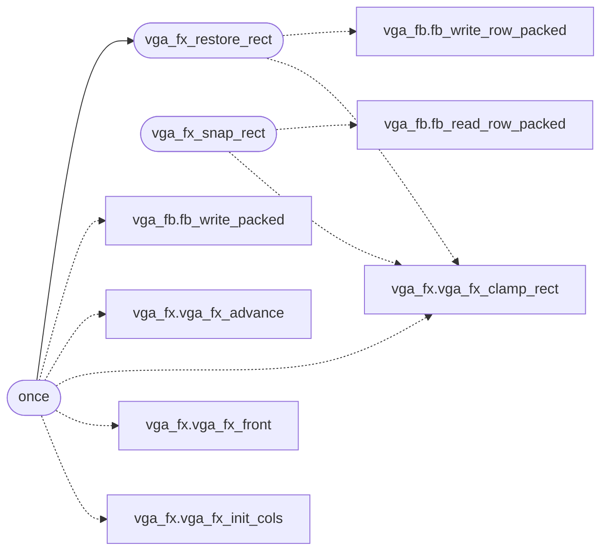

# `kernel/vga_fx.c`

> Source: [kernel/vga_fx.c:1](../../kernel/vga_fx.c#L1) | language `c` | coverage 33.3% | [API index](../index.md)

DOOM-melt desktop effects (see headers/vga_fx.h for the contract).

## Contents

- **Functions:** [`vga_fx_set_enabled`](#vga_fx_set_enabled), [`vga_fx_enabled`](#vga_fx_enabled), [`vga_fx_snap_rect`](#vga_fx_snap_rect), [`vga_fx_restore_rect`](#vga_fx_restore_rect), [`vga_fx_free`](#vga_fx_free), [`once`](#once), [`vga_fx_melt_rect`](#vga_fx_melt_rect), [`vga_fx_melt_from_black`](#vga_fx_melt_from_black)

## Call Graph

Solid arrows stay in this module, dashed arrows leave it.



## Functions

<a id="vga_fx_set_enabled"></a>

### `vga_fx_set_enabled`

`function` | [kernel/vga_fx.c:22](../../kernel/vga_fx.c#L22)

```c
void vga_fx_set_enabled(int on)
```

**Parameters**

| Name | Type | Default | Description |
|---|---|---|---|
| `on` | `int` |  |  |

---

<a id="vga_fx_enabled"></a>

### `vga_fx_enabled`

`function` | [kernel/vga_fx.c:27](../../kernel/vga_fx.c#L27)

```c
int vga_fx_enabled(void)
```

**Returns:** `int`

---

<a id="vga_fx_snap_rect"></a>

### `vga_fx_snap_rect`

`function` | [kernel/vga_fx.c:41](../../kernel/vga_fx.c#L41)

```c
unsigned int *vga_fx_snap_rect(int x, int y, int w, int h)
```

**Parameters**

| Name | Type | Default | Description |
|---|---|---|---|
| `x` | `int` |  |  |
| `y` | `int` |  |  |
| `w` | `int` |  |  |
| `h` | `int` |  |  |

**Returns:** `unsigned int *`

*Calls:* [`fb_read_row_packed`](headers.vga_fb.h.md#fb_read_row_packed), [`vga_fx_clamp_rect`](headers.vga_fx.h.md#vga_fx_clamp_rect)

---

<a id="vga_fx_restore_rect"></a>

### `vga_fx_restore_rect`

`function` | [kernel/vga_fx.c:63](../../kernel/vga_fx.c#L63)

```c
void vga_fx_restore_rect(int x, int y, int w, int h, const unsigned int *buf)
```

**Parameters**

| Name | Type | Default | Description |
|---|---|---|---|
| `x` | `int` |  |  |
| `y` | `int` |  |  |
| `w` | `int` |  |  |
| `h` | `int` |  |  |
| `buf` | `unsigned int *` |  |  |

*Calls:* [`fb_write_row_packed`](headers.vga_fb.h.md#fb_write_row_packed), [`vga_fx_clamp_rect`](headers.vga_fx.h.md#vga_fx_clamp_rect)

*Called by:* [`once`](#once)

---

<a id="vga_fx_free"></a>

### `vga_fx_free`

`function` | [kernel/vga_fx.c:77](../../kernel/vga_fx.c#L77)

```c
void vga_fx_free(unsigned int *buf)
```

**Parameters**

| Name | Type | Default | Description |
|---|---|---|---|
| `buf` | `unsigned int *` |  |  |

---

<a id="once"></a>

### `once`

`function` | [kernel/vga_fx.c:90](../../kernel/vga_fx.c#L90)

```c
* once (prev[] tracks the revealed frontier per column), then the final * restore guarantees the...
```

**Parameters**

| Name | Type | Default | Description |
|---|---|---|---|
| `column` | `prev[] tracks the revealed frontier per` |  |  |

**Returns:** `*`

*Calls:* [`fb_write_packed`](headers.vga_fb.h.md#fb_write_packed), [`vga_fx_advance`](headers.vga_fx.h.md#vga_fx_advance), [`vga_fx_clamp_rect`](headers.vga_fx.h.md#vga_fx_clamp_rect), [`vga_fx_front`](headers.vga_fx.h.md#vga_fx_front), [`vga_fx_init_cols`](headers.vga_fx.h.md#vga_fx_init_cols), [`vga_fx_restore_rect`](#vga_fx_restore_rect)

---

<a id="vga_fx_melt_rect"></a>

### `vga_fx_melt_rect`

`function` | [kernel/vga_fx.c:150](../../kernel/vga_fx.c#L150)

```c
void vga_fx_melt_rect(int x, int y, int w, int h, const unsigned int *oldb, const unsigned int *newb)
```

Drive one old->new melt.

The framebuffer must show the old rect on entry and shows the new rect on return.

**Parameters**

| Name | Type | Default | Description |
|---|---|---|---|
| `x` | `int` |  |  |
| `y` | `int` |  |  |
| `w` | `int` |  |  |
| `h` | `int` |  |  |
| `oldb` | `unsigned int *` |  |  |
| `newb` | `unsigned int *` |  |  |

---

<a id="vga_fx_melt_from_black"></a>

### `vga_fx_melt_from_black`

`function` | [kernel/vga_fx.c:159](../../kernel/vga_fx.c#L159)

```c
void vga_fx_melt_from_black(int x, int y, int w, int h, const unsigned int *newb)
```

Boot melt: the framebuffer is already cleared to black on entry, so no old snapshot is needed; the new frame scrolls down over black.

**Parameters**

| Name | Type | Default | Description |
|---|---|---|---|
| `x` | `int` |  |  |
| `y` | `int` |  |  |
| `w` | `int` |  |  |
| `h` | `int` |  |  |
| `newb` | `unsigned int *` |  |  |

---
