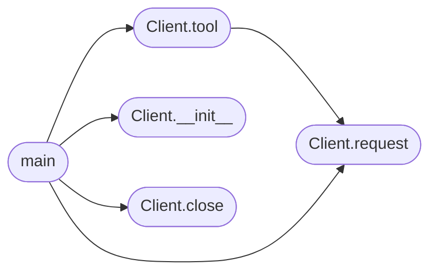

# `mcp.mcp_dbg_driver`

> Source: [mcp/mcp_dbg_driver.py:1](../../mcp/mcp_dbg_driver.py#L1) | language `py` | coverage 14.3% | [API index](../index.md)

Debug driver: boot MiniOS through the MCP bridge and run freedom.

## Contents

- **Classes:** [`Client`](#client)
- **Functions:** [`main`](#main)
- **Constants:** [`HERE`](#here), [`TMO`](#tmo)

## Call Graph

Solid arrows stay in this module, dashed arrows leave it.



## Classes

<a id="client"></a>

### `Client`

`class` | [mcp/mcp_dbg_driver.py:15](../../mcp/mcp_dbg_driver.py#L15)

```python
class Client
```

**Members**

| Member | Kind | Summary |
|---|---|---|
| [`__init__`](#client-__init__) | constructor |  |
| [`request`](#client-request) | method |  |
| [`tool`](#client-tool) | method |  |
| [`close`](#client-close) | method |  |

<a id="client-__init__"></a>

#### `Client.__init__`

`constructor` | [mcp/mcp_dbg_driver.py:16](../../mcp/mcp_dbg_driver.py#L16)

```python
def __init__(self)
```

*Called by:* [`main`](#main)

<a id="client-request"></a>

#### `Client.request`

`method` | [mcp/mcp_dbg_driver.py:28](../../mcp/mcp_dbg_driver.py#L28)

```python
def request(self, method, params=None)
```

**Parameters**

| Name | Type | Default | Description |
|---|---|---|---|
| `method` |  |  |  |
| `params` |  | `None` |  |

**Raises**

- `TimeoutError`: (raised in the body, not documented)

*Called by:* [`Client.tool`](#client-tool), [`main`](#main), [`Client.tool`](mcp.mcp_dogfood.py.md#client-tool), [`main`](mcp.mcp_dogfood.py.md#main), [`Client.tool`](tools.minios_cli.py.md#client-tool)

<a id="client-tool"></a>

#### `Client.tool`

`method` | [mcp/mcp_dbg_driver.py:46](../../mcp/mcp_dbg_driver.py#L46)

```python
def tool(self, name, params=None)
```

**Parameters**

| Name | Type | Default | Description |
|---|---|---|---|
| `name` |  |  |  |
| `params` |  | `None` |  |

**Raises**

- `AssertionError`: (raised in the body, not documented)

*Calls:* [`Client.request`](#client-request)

*Called by:* [`main`](#main), [`main`](mcp.mcp_dogfood.py.md#main), [`main`](tools.minios_cli.py.md#main)

<a id="client-close"></a>

#### `Client.close`

`method` | [mcp/mcp_dbg_driver.py:54](../../mcp/mcp_dbg_driver.py#L54)

```python
def close(self)
```

*Called by:* [`main`](#main), [`main`](mcp.mcp_dogfood.py.md#main), [`main`](tools.minios_cli.py.md#main)

---

## Functions

<a id="main"></a>

### `main`

`function` | [mcp/mcp_dbg_driver.py:64](../../mcp/mcp_dbg_driver.py#L64)

```python
def main()
```

*Calls:* [`Client.__init__`](#client-__init__), [`Client.close`](#client-close), [`Client.request`](#client-request), [`Client.tool`](#client-tool)

---

## Constants

<a id="here"></a>

### `HERE`

`constant` | [mcp/mcp_dbg_driver.py:11](../../mcp/mcp_dbg_driver.py#L11)

```python
HERE = os.path.dirname(os.path.abspath(__file__))
```

---

<a id="tmo"></a>

### `TMO`

`constant` | [mcp/mcp_dbg_driver.py:12](../../mcp/mcp_dbg_driver.py#L12)

```python
TMO = 120.0
```

---
