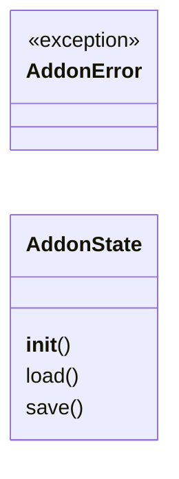
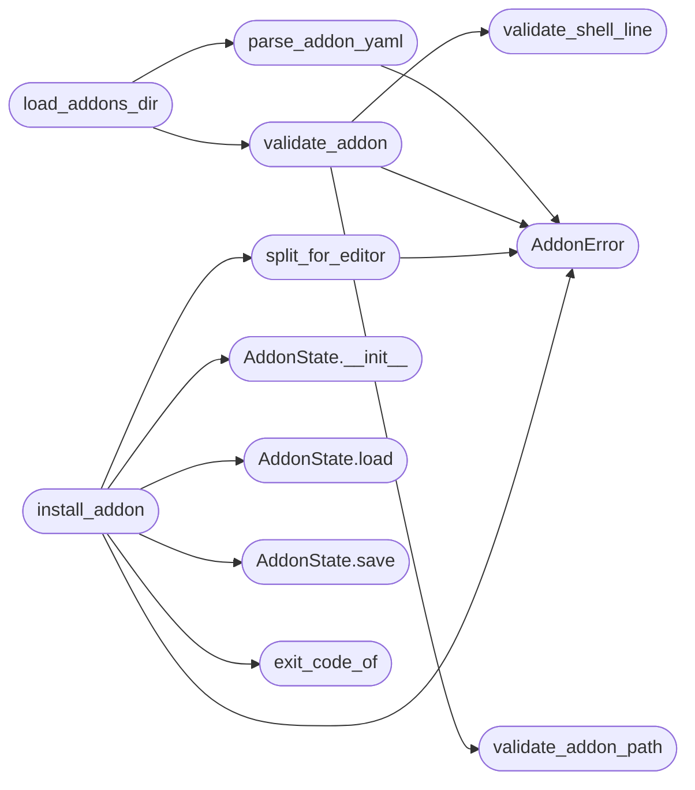

# `mcp.minios_addons`

> Source: [mcp/minios_addons.py:1](../../mcp/minios_addons.py#L1) | language `py` | coverage 71.4% | [API index](../index.md)

MiniOS addon marketplace (lazyaddons-style).

Addons are YAML files that say where a program's source lives on GitHub and
how it is built. Two flavors share one dialect:

- kind [`guest`](progs.src.scfuzz.c.md#guest) (default): built *inside* the OS. This module parses that
  YAML with a strict stdlib-only subset parser (no PyYAML) and installs
  the addon into a running MiniOS session: clone the repo, upload each
  source through the editor in bounded chunks, reassemble with [`cat`](mcp.minios_mcp.py.md#miniossession-cat),
  build and verify inside the OS.
- kind `host`: built on the host with the ordinary gcc toolchain and
  packed into the image by `make` (every sibling checkout and every
  vendored tree). `minios_install` refuses these with a diagnostic that
  names the make target instead of half-installing them.
- kind `reference`: source-only reference checkouts (never vendored,
  never linked, never built). Same refusal as `host`.

The host shell is never invoked; the only commands run are the addon's own
build/verify lines, driven line by line through the MiniOS shell.

## Contents

- **Classes:** [`AddonState`](#addonstate)
- **Exceptions:** [`AddonError`](#addonerror)
- **Functions:** [`parse_addon_yaml`](#parse_addon_yaml), [`validate_addon`](#validate_addon), [`validate_addon_path`](#validate_addon_path), [`validate_shell_line`](#validate_shell_line), [`load_addons_dir`](#load_addons_dir), [`split_for_editor`](#split_for_editor), [`exit_code_of`](#exit_code_of), [`install_addon`](#install_addon)
- **Constants:** [`ADDON_MAX_NAME`](#addon_max_name), [`ADDON_MAX_DESC`](#addon_max_desc), [`ADDON_MAX_ITEMS`](#addon_max_items), [`ADDON_LINE_MAX`](#addon_line_max), [`ADDON_PATH_CHARS`](#addon_path_chars), [`ADDON_KEYS`](#addon_keys), [`ADDON_INSTALL_KEYS`](#addon_install_keys), [`ADDON_KINDS`](#addon_kinds), [`ADDON_META_MAX`](#addon_meta_max), [`ADDON_REGISTRY_PATH`](#addon_registry_path), [`ADDON_TMO_CLONE_S`](#addon_tmo_clone_s), [`ADDON_TMO_SHELL_MS`](#addon_tmo_shell_ms), [`ADDON_CHUNK_LINES`](#addon_chunk_lines), [`ADDON_CHUNK_LINE_MAX`](#addon_chunk_line_max)

## Type Diagram



## Call Graph

Solid arrows stay in this module, dashed arrows leave it.



## Classes

<a id="addonstate"></a>

### `AddonState`

`class` | [mcp/minios_addons.py:377](../../mcp/minios_addons.py#L377)

```python
class AddonState
```

Host-side record of installed addons (system temp dir).

**Members**

| Member | Kind | Summary |
|---|---|---|
| [`__init__`](#addonstate-__init__) | constructor |  |
| [`load`](#addonstate-load) | method |  |
| [`save`](#addonstate-save) | method |  |

<a id="addonstate-__init__"></a>

#### `AddonState.__init__`

`constructor` | [mcp/minios_addons.py:380](../../mcp/minios_addons.py#L380)

```python
def __init__(self, path)
```

**Parameters**

| Name | Type | Default | Description |
|---|---|---|---|
| `path` |  |  |  |

*Called by:* [`install_addon`](#install_addon)

<a id="addonstate-load"></a>

#### `AddonState.load`

`method` | [mcp/minios_addons.py:383](../../mcp/minios_addons.py#L383)

```python
def load(self)
```

*Called by:* [`load_exec_elf`](kernel.loader.c.md#load_exec_elf), [`install_addon`](#install_addon)

<a id="addonstate-save"></a>

#### `AddonState.save`

`method` | [mcp/minios_addons.py:393](../../mcp/minios_addons.py#L393)

```python
def save(self, addons)
```

**Parameters**

| Name | Type | Default | Description |
|---|---|---|---|
| `addons` |  |  |  |

*Called by:* [`install_addon`](#install_addon)

---

## Exceptions

<a id="addonerror"></a>

### `AddonError`

`exception` | [mcp/minios_addons.py:56](../../mcp/minios_addons.py#L56)

```python
class AddonError(Exception)
```

Bases: `Exception`

Expected marketplace failure, reported to the client as isError.

---

## Functions

<a id="parse_addon_yaml"></a>

### `parse_addon_yaml`

`function` | [mcp/minios_addons.py:73](../../mcp/minios_addons.py#L73)

```python
def parse_addon_yaml(text)
```

Parse the strict YAML subset.

Returns the addon dict.

Grammar: flat `key: value` lines; `install:` opens an indented block
with `repo_url:`, an optional `kind:` ([`guest`](progs.src.scfuzz.c.md#guest) default, `host`,
`reference`), optional `dir_var:`/`ref:`/`artifact:` metadata, a
`files:` list of `- src:`/`dst:` pairs, and `build:` / `host_build:` /
`verify:` lists of `- ...` command lines (`verify` items may carry a
nested `exit_code:`). Everything else is a parse error with its line
number.

**Parameters**

| Name | Type | Default | Description |
|---|---|---|---|
| `text` |  |  |  |

*Calls:* [`AddonError`](#addonerror)

*Called by:* [`load_addons_dir`](#load_addons_dir)

---

<a id="validate_addon"></a>

### `validate_addon`

`function` | [mcp/minios_addons.py:205](../../mcp/minios_addons.py#L205)

```python
def validate_addon(addon, source)
```

Check bounds and character sets.

Raises AddonError.

**Parameters**

| Name | Type | Default | Description |
|---|---|---|---|
| `addon` |  |  |  |
| `source` |  |  |  |

**Raises**

- [`AddonError`](#addonerror): (raised in the body, not documented)

*Calls:* [`AddonError`](#addonerror), [`validate_addon_path`](#validate_addon_path), [`validate_shell_line`](#validate_shell_line)

*Called by:* [`load_addons_dir`](#load_addons_dir)

---

<a id="validate_addon_path"></a>

### `validate_addon_path`

`function` | [mcp/minios_addons.py:295](../../mcp/minios_addons.py#L295)

```python
def validate_addon_path(path)
```

dst paths live on the ramdisk: relative, no '..', bounded charset.

**Parameters**

| Name | Type | Default | Description |
|---|---|---|---|
| `path` |  |  |  |

*Called by:* [`validate_addon`](#validate_addon)

---

<a id="validate_shell_line"></a>

### `validate_shell_line`

`function` | [mcp/minios_addons.py:309](../../mcp/minios_addons.py#L309)

```python
def validate_shell_line(line)
```

Build/verify lines are single printable-ASCII shell commands.

**Parameters**

| Name | Type | Default | Description |
|---|---|---|---|
| `line` |  |  |  |

*Called by:* [`validate_addon`](#validate_addon)

---

<a id="load_addons_dir"></a>

### `load_addons_dir`

`function` | [mcp/minios_addons.py:323](../../mcp/minios_addons.py#L323)

```python
def load_addons_dir(addons_dir)
```

Load every addon yaml; each entry is a dict or an error string.

**Parameters**

| Name | Type | Default | Description |
|---|---|---|---|
| `addons_dir` |  |  |  |

*Calls:* [`parse_addon_yaml`](#parse_addon_yaml), [`validate_addon`](#validate_addon)

---

<a id="split_for_editor"></a>

### `split_for_editor`

`function` | [mcp/minios_addons.py:347](../../mcp/minios_addons.py#L347)

```python
def split_for_editor(text)
```

Split a source into editor-sized chunks.

Raises AddonError.

**Parameters**

| Name | Type | Default | Description |
|---|---|---|---|
| `text` |  |  |  |

**Raises**

- [`AddonError`](#addonerror): (raised in the body, not documented)

*Calls:* [`AddonError`](#addonerror)

*Called by:* [`install_addon`](#install_addon)

---

<a id="exit_code_of"></a>

### `exit_code_of`

`function` | [mcp/minios_addons.py:372](../../mcp/minios_addons.py#L372)

```python
def exit_code_of(text)
```

**Parameters**

| Name | Type | Default | Description |
|---|---|---|---|
| `text` |  |  |  |

*Called by:* [`install_addon`](#install_addon)

---

<a id="install_addon"></a>

### `install_addon`

`function` | [mcp/minios_addons.py:401](../../mcp/minios_addons.py#L401)

```python
def install_addon(session, addon, cfg)
```

Install one validated addon into the booted MiniOS session.

Failure at any step raises AddonError; upload parts are removed and
nothing is recorded, so a half-installed package is never reported.

**Parameters**

| Name | Type | Default | Description |
|---|---|---|---|
| `session` |  |  |  |
| `addon` |  |  |  |
| `cfg` |  |  |  |

**Raises**

- [`AddonError`](#addonerror): (raised in the body, not documented)

*Calls:* [`AddonError`](#addonerror), [`AddonState.__init__`](#addonstate-__init__), [`AddonState.load`](#addonstate-load), [`AddonState.save`](#addonstate-save), [`exit_code_of`](#exit_code_of), [`split_for_editor`](#split_for_editor)

---

## Constants

<a id="addon_max_name"></a>

### `ADDON_MAX_NAME`

`constant` | [mcp/minios_addons.py:30](../../mcp/minios_addons.py#L30)

```python
ADDON_MAX_NAME = 32
```

---

<a id="addon_max_desc"></a>

### `ADDON_MAX_DESC`

`constant` | [mcp/minios_addons.py:31](../../mcp/minios_addons.py#L31)

```python
ADDON_MAX_DESC = 512
```

---

<a id="addon_max_items"></a>

### `ADDON_MAX_ITEMS`

`constant` | [mcp/minios_addons.py:32](../../mcp/minios_addons.py#L32)

```python
ADDON_MAX_ITEMS = 32
```

---

<a id="addon_line_max"></a>

### `ADDON_LINE_MAX`

`constant` | [mcp/minios_addons.py:33](../../mcp/minios_addons.py#L33)

```python
ADDON_LINE_MAX = 200
```

---

<a id="addon_path_chars"></a>

### `ADDON_PATH_CHARS`

`constant` | [mcp/minios_addons.py:35](../../mcp/minios_addons.py#L35)

```python
ADDON_PATH_CHARS = frozenset('ABCDEFGHIJKLMNOPQRSTUVWXYZabcdefghijklmnopqrstuvwxyz0123456789._/-')
```

---

<a id="addon_keys"></a>

### `ADDON_KEYS`

`constant` | [mcp/minios_addons.py:39](../../mcp/minios_addons.py#L39)

```python
ADDON_KEYS = frozenset(['name', 'description', 'author', 'version', 'install'])
```

---

<a id="addon_install_keys"></a>

### `ADDON_INSTALL_KEYS`

`constant` | [mcp/minios_addons.py:40](../../mcp/minios_addons.py#L40)

```python
ADDON_INSTALL_KEYS
```

---

<a id="addon_kinds"></a>

### `ADDON_KINDS`

`constant` | [mcp/minios_addons.py:44](../../mcp/minios_addons.py#L44)

```python
ADDON_KINDS = ('guest', 'host', 'reference')
```

---

<a id="addon_meta_max"></a>

### `ADDON_META_MAX`

`constant` | [mcp/minios_addons.py:45](../../mcp/minios_addons.py#L45)

```python
ADDON_META_MAX = 128
```

---

<a id="addon_registry_path"></a>

### `ADDON_REGISTRY_PATH`

`constant` | [mcp/minios_addons.py:47](../../mcp/minios_addons.py#L47)

```python
ADDON_REGISTRY_PATH = 'var/lib/addons.txt'
```

---

<a id="addon_tmo_clone_s"></a>

### `ADDON_TMO_CLONE_S`

`constant` | [mcp/minios_addons.py:49](../../mcp/minios_addons.py#L49)

```python
ADDON_TMO_CLONE_S = 120
```

---

<a id="addon_tmo_shell_ms"></a>

### `ADDON_TMO_SHELL_MS`

`constant` | [mcp/minios_addons.py:50](../../mcp/minios_addons.py#L50)

```python
ADDON_TMO_SHELL_MS = 60000
```

---

<a id="addon_chunk_lines"></a>

### `ADDON_CHUNK_LINES`

`constant` | [mcp/minios_addons.py:52](../../mcp/minios_addons.py#L52)

```python
ADDON_CHUNK_LINES = 511
```

---

<a id="addon_chunk_line_max"></a>

### `ADDON_CHUNK_LINE_MAX`

`constant` | [mcp/minios_addons.py:53](../../mcp/minios_addons.py#L53)

```python
ADDON_CHUNK_LINE_MAX = 127
```

---
