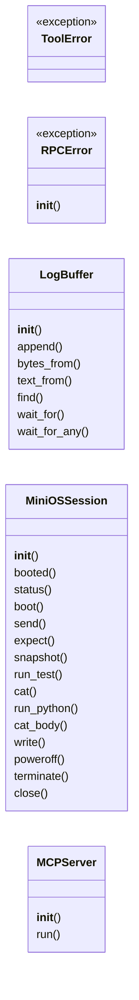
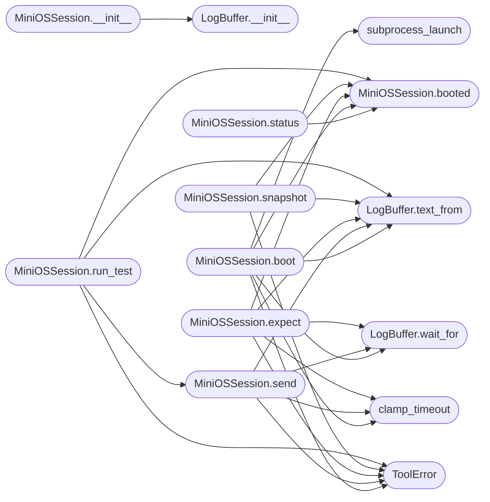

# `mcp.minios_mcp`

> Source: [mcp/minios_mcp.py:1](../../mcp/minios_mcp.py#L1) | language `py` | coverage 40.5% | [API index](../index.md)

MiniOS MCP bridge.

Exposes a running MiniOS instance as tools over the MCP stdio protocol.
The server boots os.img in QEMU, owns a pty-backed serial console, and
lets a client write, compile, link and run software inside the OS.

Python 3 standard library only. One QEMU child per server, terminated on
every exit path. The host shell is never invoked.

## Contents

- **Classes:** [`LogBuffer`](#logbuffer), [`MiniOSSession`](#miniossession), [`MCPServer`](#mcpserver)
- **Exceptions:** [`ToolError`](#toolerror), [`RPCError`](#rpcerror)
- **Functions:** [`env_config`](#env_config), [`clamp_timeout`](#clamp_timeout), [`validate_path`](#validate_path), [`validate_content`](#validate_content), [`subprocess_launch`](#subprocess_launch), [`main`](#main)
- **Constants:** [`CFG_SERVER_NAME`](#cfg_server_name), [`CFG_SERVER_VERSION`](#cfg_server_version), [`CFG_PROTOCOL_VERSION`](#cfg_protocol_version), [`CFG_PROMPT_SHELL`](#cfg_prompt_shell), [`CFG_PROMPT_EDITOR`](#cfg_prompt_editor), [`CFG_PROMPT_EDITOR_FORMS`](#cfg_prompt_editor_forms), [`CFG_MARK_POWEROFF`](#cfg_mark_poweroff), [`CFG_MARK_BOOT`](#cfg_mark_boot), [`CFG_EDITOR_APPEND`](#cfg_editor_append), [`CFG_EDITOR_SAVE`](#cfg_editor_save), [`CFG_EDIT_LINE_MAX`](#cfg_edit_line_max), [`CFG_EDIT_MAX_LINES`](#cfg_edit_max_lines), [`CFG_PATH_CHARS`](#cfg_path_chars), [`CFG_PATH_MAX`](#cfg_path_max), [`CFG_MEM`](#cfg_mem), [`CFG_LOG_CAP`](#cfg_log_cap), [`CFG_SNAP_MAX`](#cfg_snap_max), [`CFG_TMO_BOOT_MS`](#cfg_tmo_boot_ms), [`CFG_TMO_PROMPT_MS`](#cfg_tmo_prompt_ms), [`CFG_TMO_EXPECT_MS`](#cfg_tmo_expect_ms), [`CFG_TMO_POWEROFF_MS`](#cfg_tmo_poweroff_ms), [`CFG_TMO_MIN`](#cfg_tmo_min), [`CFG_TMO_MAX`](#cfg_tmo_max), [`CFG_READ_CHUNK`](#cfg_read_chunk), [`CFG_KILL_GRACE_S`](#cfg_kill_grace_s), [`CFG_JSONRPC_PARSE_ERROR`](#cfg_jsonrpc_parse_error), [`CFG_JSONRPC_INVALID_REQUEST`](#cfg_jsonrpc_invalid_request), [`CFG_JSONRPC_METHOD_NOT_FOUND`](#cfg_jsonrpc_method_not_found), [`CFG_JSONRPC_INVALID_PARAMS`](#cfg_jsonrpc_invalid_params), [`CFG_JSONRPC_INTERNAL_ERROR`](#cfg_jsonrpc_internal_error), [`TOOLS`](#tools)

## Type Diagram



## Call Graph

Solid arrows stay in this module, dashed arrows leave it.



## Classes

<a id="logbuffer"></a>

### `LogBuffer`

`class` | [mcp/minios_mcp.py:146](../../mcp/minios_mcp.py#L146)

```python
class LogBuffer
```

Bounded console log with absolute byte positions and waits.

**Members**

| Member | Kind | Summary |
|---|---|---|
| [`__init__`](#logbuffer-__init__) | constructor |  |
| [`append`](#logbuffer-append) | method |  |
| [`bytes_from`](#logbuffer-bytes_from) | method |  |
| [`text_from`](#logbuffer-text_from) | method |  |
| [`find`](#logbuffer-find) | method |  |
| [`wait_for`](#logbuffer-wait_for) | method | Block until marker appears at or after start; return position. |
| [`wait_for_any`](#logbuffer-wait_for_any) | method | Block until any of markers appears at or after start; return the earliest position found, or -1 when the timeout expires first. |

<a id="logbuffer-__init__"></a>

#### `LogBuffer.__init__`

`constructor` | [mcp/minios_mcp.py:149](../../mcp/minios_mcp.py#L149)

```python
def __init__(self, cap)
```

**Parameters**

| Name | Type | Default | Description |
|---|---|---|---|
| `cap` |  |  |  |

*Called by:* [`MiniOSSession.__init__`](#miniossession-__init__)

<a id="logbuffer-append"></a>

#### `LogBuffer.append`

`method` | [mcp/minios_mcp.py:155](../../mcp/minios_mcp.py#L155)

```python
def append(self, data)
```

**Parameters**

| Name | Type | Default | Description |
|---|---|---|---|
| `data` |  |  |  |

<a id="logbuffer-bytes_from"></a>

#### `LogBuffer.bytes_from`

`method` | [mcp/minios_mcp.py:163](../../mcp/minios_mcp.py#L163)

```python
def bytes_from(self, pos)
```

**Parameters**

| Name | Type | Default | Description |
|---|---|---|---|
| `pos` |  |  |  |

*Calls:* [`bytes`](headers.sched.h.md#bytes)

<a id="logbuffer-text_from"></a>

#### `LogBuffer.text_from`

`method` | [mcp/minios_mcp.py:168](../../mcp/minios_mcp.py#L168)

```python
def text_from(self, pos, end=None)
```

**Parameters**

| Name | Type | Default | Description |
|---|---|---|---|
| `pos` |  |  |  |
| `end` |  | `None` |  |

*Called by:* [`MiniOSSession.boot`](#miniossession-boot), [`MiniOSSession.expect`](#miniossession-expect), [`MiniOSSession.poweroff`](#miniossession-poweroff), [`MiniOSSession.run_test`](#miniossession-run_test), [`MiniOSSession.send`](#miniossession-send), [`MiniOSSession.snapshot`](#miniossession-snapshot), [`MiniOSSession.write`](#miniossession-write)

<a id="logbuffer-find"></a>

#### `LogBuffer.find`

`method` | [mcp/minios_mcp.py:175](../../mcp/minios_mcp.py#L175)

```python
def find(self, marker, start)
```

**Parameters**

| Name | Type | Default | Description |
|---|---|---|---|
| `marker` |  |  |  |
| `start` |  |  |  |

<a id="logbuffer-wait_for"></a>

#### `LogBuffer.wait_for`

`method` | [mcp/minios_mcp.py:179](../../mcp/minios_mcp.py#L179)

```python
def wait_for(self, marker, start, timeout_ms)
```

Block until marker appears at or after start; return position.

**Parameters**

| Name | Type | Default | Description |
|---|---|---|---|
| `marker` |  |  |  |
| `start` |  |  |  |
| `timeout_ms` |  |  |  |

*Called by:* [`MiniOSSession.boot`](#miniossession-boot), [`MiniOSSession.expect`](#miniossession-expect), [`MiniOSSession.poweroff`](#miniossession-poweroff), [`MiniOSSession.send`](#miniossession-send), [`MiniOSSession.write`](#miniossession-write)

<a id="logbuffer-wait_for_any"></a>

#### `LogBuffer.wait_for_any`

`method` | [mcp/minios_mcp.py:192](../../mcp/minios_mcp.py#L192)

```python
def wait_for_any(self, markers, start, timeout_ms)
```

Block until any of markers appears at or after start; return the earliest position found, or -1 when the timeout expires first.

**Parameters**

| Name | Type | Default | Description |
|---|---|---|---|
| `markers` |  |  |  |
| `start` |  |  |  |
| `timeout_ms` |  |  |  |

*Called by:* [`MiniOSSession.write`](#miniossession-write)

---

<a id="miniossession"></a>

### `MiniOSSession`

`class` | [mcp/minios_mcp.py:216](../../mcp/minios_mcp.py#L216)

```python
class MiniOSSession
```

One QEMU child, one pty, one console log, one consume cursor.

**Members**

| Member | Kind | Summary |
|---|---|---|
| [`__init__`](#miniossession-__init__) | constructor |  |
| [`booted`](#miniossession-booted) | method |  |
| [`status`](#miniossession-status) | method |  |
| [`boot`](#miniossession-boot) | method |  |
| [`send`](#miniossession-send) | method |  |
| [`expect`](#miniossession-expect) | method |  |
| [`snapshot`](#miniossession-snapshot) | method |  |
| [`run_test`](#miniossession-run_test) | method | Run a generic scenario: send a list of shell commands, then assert that each expected marker appears (and each refuted marker does not) in the output those... |
| [`cat`](#miniossession-cat) | method |  |
| [`run_python`](#miniossession-run_python) | method | Run a MicroPython script (or `-c` code) inside MiniOS and return its output, including the `exit code: N` line. |
| [`cat_body`](#miniossession-cat_body) | method | Read a ramdisk file and return exactly its bytes. |
| [`write`](#miniossession-write) | method |  |
| [`poweroff`](#miniossession-poweroff) | method |  |
| [`terminate`](#miniossession-terminate) | method |  |
| [`close`](#miniossession-close) | method |  |

<a id="miniossession-__init__"></a>

#### `MiniOSSession.__init__`

`constructor` | [mcp/minios_mcp.py:219](../../mcp/minios_mcp.py#L219)

```python
def __init__(self, cfg)
```

**Parameters**

| Name | Type | Default | Description |
|---|---|---|---|
| `cfg` |  |  |  |

*Calls:* [`LogBuffer.__init__`](#logbuffer-__init__)

*Called by:* [`MCPServer.__init__`](#mcpserver-__init__)

<a id="miniossession-booted"></a>

#### `MiniOSSession.booted`

`method` | [mcp/minios_mcp.py:230](../../mcp/minios_mcp.py#L230)

```python
def booted(self)
```

*Called by:* [`MiniOSSession.boot`](#miniossession-boot), [`MiniOSSession.expect`](#miniossession-expect), [`MiniOSSession.poweroff`](#miniossession-poweroff), [`MiniOSSession.run_test`](#miniossession-run_test), [`MiniOSSession.snapshot`](#miniossession-snapshot), [`MiniOSSession.status`](#miniossession-status), [`MiniOSSession.write`](#miniossession-write)

<a id="miniossession-status"></a>

#### `MiniOSSession.status`

`method` | [mcp/minios_mcp.py:233](../../mcp/minios_mcp.py#L233)

```python
def status(self)
```

*Calls:* [`MiniOSSession.booted`](#miniossession-booted)

<a id="miniossession-boot"></a>

#### `MiniOSSession.boot`

`method` | [mcp/minios_mcp.py:284](../../mcp/minios_mcp.py#L284)

```python
def boot(self, timeout_ms)
```

**Parameters**

| Name | Type | Default | Description |
|---|---|---|---|
| `timeout_ms` |  |  |  |

**Raises**

- [`ToolError`](#toolerror): (raised in the body, not documented)

*Calls:* [`LogBuffer.text_from`](#logbuffer-text_from), [`LogBuffer.wait_for`](#logbuffer-wait_for), [`MiniOSSession.booted`](#miniossession-booted), [`ToolError`](#toolerror), [`clamp_timeout`](#clamp_timeout), [`subprocess_launch`](#subprocess_launch)

<a id="miniossession-send"></a>

#### `MiniOSSession.send`

`method` | [mcp/minios_mcp.py:356](../../mcp/minios_mcp.py#L356)

```python
def send(self, line, timeout_ms)
```

**Parameters**

| Name | Type | Default | Description |
|---|---|---|---|
| `line` |  |  |  |
| `timeout_ms` |  |  |  |

**Raises**

- [`ToolError`](#toolerror): (raised in the body, not documented)

*Calls:* [`LogBuffer.text_from`](#logbuffer-text_from), [`LogBuffer.wait_for`](#logbuffer-wait_for), [`ToolError`](#toolerror), [`clamp_timeout`](#clamp_timeout)

*Called by:* [`MiniOSSession.cat`](#miniossession-cat), [`MiniOSSession.cat_body`](#miniossession-cat_body), [`MiniOSSession.run_python`](#miniossession-run_python), [`MiniOSSession.run_test`](#miniossession-run_test)

<a id="miniossession-expect"></a>

#### `MiniOSSession.expect`

`method` | [mcp/minios_mcp.py:367](../../mcp/minios_mcp.py#L367)

```python
def expect(self, marker, timeout_ms)
```

**Parameters**

| Name | Type | Default | Description |
|---|---|---|---|
| `marker` |  |  |  |
| `timeout_ms` |  |  |  |

**Raises**

- [`ToolError`](#toolerror): (raised in the body, not documented)

*Calls:* [`LogBuffer.text_from`](#logbuffer-text_from), [`LogBuffer.wait_for`](#logbuffer-wait_for), [`MiniOSSession.booted`](#miniossession-booted), [`ToolError`](#toolerror), [`clamp_timeout`](#clamp_timeout)

<a id="miniossession-snapshot"></a>

#### `MiniOSSession.snapshot`

`method` | [mcp/minios_mcp.py:381](../../mcp/minios_mcp.py#L381)

```python
def snapshot(self, max_bytes)
```

**Parameters**

| Name | Type | Default | Description |
|---|---|---|---|
| `max_bytes` |  |  |  |

**Raises**

- [`ToolError`](#toolerror): (raised in the body, not documented)

*Calls:* [`LogBuffer.text_from`](#logbuffer-text_from), [`MiniOSSession.booted`](#miniossession-booted), [`ToolError`](#toolerror)

<a id="miniossession-run_test"></a>

#### `MiniOSSession.run_test`

`method` | [mcp/minios_mcp.py:391](../../mcp/minios_mcp.py#L391)

```python
def run_test(self, commands, expect, refute, timeout_ms)
```

Run a generic scenario: send a list of shell commands, then assert that each expected marker appears (and each refuted marker does not) in the output those commands produced.

Returns a verdict plus the captured transcript. This is the reusable harness behind every in-OS feature test, so a session never has to hand-roll a QEMU boot and marker-assertion script.

**Parameters**

| Name | Type | Default | Description |
|---|---|---|---|
| `commands` |  |  |  |
| `expect` |  |  |  |
| `refute` |  |  |  |
| `timeout_ms` |  |  |  |

**Raises**

- [`ToolError`](#toolerror): (raised in the body, not documented)

*Calls:* [`LogBuffer.text_from`](#logbuffer-text_from), [`MiniOSSession.booted`](#miniossession-booted), [`MiniOSSession.send`](#miniossession-send), [`ToolError`](#toolerror), [`clamp_timeout`](#clamp_timeout)

<a id="miniossession-cat"></a>

#### `MiniOSSession.cat`

`method` | [mcp/minios_mcp.py:447](../../mcp/minios_mcp.py#L447)

```python
def cat(self, path)
```

**Parameters**

| Name | Type | Default | Description |
|---|---|---|---|
| `path` |  |  |  |

**Raises**

- [`ToolError`](#toolerror): (raised in the body, not documented)

*Calls:* [`MiniOSSession.send`](#miniossession-send), [`ToolError`](#toolerror), [`validate_path`](#validate_path)

<a id="miniossession-run_python"></a>

#### `MiniOSSession.run_python`

`method` | [mcp/minios_mcp.py:453](../../mcp/minios_mcp.py#L453)

```python
def run_python(self, script, args=None, timeout_ms=None)
```

Run a MicroPython script (or `-c` code) inside MiniOS and return its output, including the `exit code: N` line.

MicroPython now runs reliably thanks to the kernel fix that zeroes the initial registers at the ELF entry (rdx is rtld_fini for glibc's _start).

**Parameters**

| Name | Type | Default | Description |
|---|---|---|---|
| `script` |  |  |  |
| `args` |  | `None` |  |
| `timeout_ms` |  | `None` |  |

*Calls:* [`MiniOSSession.send`](#miniossession-send)

<a id="miniossession-cat_body"></a>

#### `MiniOSSession.cat_body`

`method` | [mcp/minios_mcp.py:464](../../mcp/minios_mcp.py#L464)

```python
def cat_body(self, path, missing_ok=False)
```

Read a ramdisk file and return exactly its bytes.

The serial console frames lines with carriage returns (CRLF, and a
CR before each new line while the terminal redraws); the kernel cat
appends one newline after the content. Content written through this
bridge is printable ASCII only, so every CR is framing: they are all
dropped first, then the echoed command line, the prompt and that
single trailing newline are stripped.

**Parameters**

| Name | Type | Default | Description |
|---|---|---|---|
| `path` |  |  |  |
| `missing_ok` |  | `False` |  |

**Raises**

- [`ToolError`](#toolerror): (raised in the body, not documented)

*Calls:* [`MiniOSSession.send`](#miniossession-send), [`ToolError`](#toolerror), [`validate_path`](#validate_path)

<a id="miniossession-write"></a>

#### `MiniOSSession.write`

`method` | [mcp/minios_mcp.py:500](../../mcp/minios_mcp.py#L500)

```python
def write(self, path, content)
```

**Parameters**

| Name | Type | Default | Description |
|---|---|---|---|
| `path` |  |  |  |
| `content` |  |  |  |

**Raises**

- [`ToolError`](#toolerror): (raised in the body, not documented)

*Calls:* [`LogBuffer.text_from`](#logbuffer-text_from), [`LogBuffer.wait_for`](#logbuffer-wait_for), [`LogBuffer.wait_for_any`](#logbuffer-wait_for_any), [`MiniOSSession.booted`](#miniossession-booted), [`ToolError`](#toolerror), [`clamp_timeout`](#clamp_timeout), [`validate_content`](#validate_content), [`validate_path`](#validate_path)

<a id="miniossession-poweroff"></a>

#### `MiniOSSession.poweroff`

`method` | [mcp/minios_mcp.py:537](../../mcp/minios_mcp.py#L537)

```python
def poweroff(self, timeout_ms)
```

**Parameters**

| Name | Type | Default | Description |
|---|---|---|---|
| `timeout_ms` |  |  |  |

**Raises**

- [`ToolError`](#toolerror): (raised in the body, not documented)

*Calls:* [`LogBuffer.text_from`](#logbuffer-text_from), [`LogBuffer.wait_for`](#logbuffer-wait_for), [`MiniOSSession.booted`](#miniossession-booted), [`MiniOSSession.terminate`](#miniossession-terminate), [`ToolError`](#toolerror), [`clamp_timeout`](#clamp_timeout)

<a id="miniossession-terminate"></a>

#### `MiniOSSession.terminate`

`method` | [mcp/minios_mcp.py:557](../../mcp/minios_mcp.py#L557)

```python
def terminate(self)
```

*Called by:* [`MiniOSSession.close`](#miniossession-close), [`MiniOSSession.poweroff`](#miniossession-poweroff)

<a id="miniossession-close"></a>

#### `MiniOSSession.close`

`method` | [mcp/minios_mcp.py:576](../../mcp/minios_mcp.py#L576)

```python
def close(self)
```

*Calls:* [`MiniOSSession.terminate`](#miniossession-terminate)

---

<a id="mcpserver"></a>

### `MCPServer`

`class` | [mcp/minios_mcp.py:731](../../mcp/minios_mcp.py#L731)

```python
class MCPServer
```

JSON-RPC dispatch loop over stdio.

**Members**

| Member | Kind | Summary |
|---|---|---|
| [`__init__`](#mcpserver-__init__) | constructor |  |
| [`run`](#mcpserver-run) | method |  |

<a id="mcpserver-__init__"></a>

#### `MCPServer.__init__`

`constructor` | [mcp/minios_mcp.py:734](../../mcp/minios_mcp.py#L734)

```python
def __init__(self, cfg)
```

**Parameters**

| Name | Type | Default | Description |
|---|---|---|---|
| `cfg` |  |  |  |

*Calls:* [`MiniOSSession.__init__`](#miniossession-__init__)

*Called by:* [`main`](#main)

<a id="mcpserver-run"></a>

#### `MCPServer.run`

`method` | [mcp/minios_mcp.py:738](../../mcp/minios_mcp.py#L738)

```python
def run(self)
```

*Called by:* [`main`](#main)

---

## Exceptions

<a id="toolerror"></a>

### `ToolError`

`exception` | [mcp/minios_mcp.py:131](../../mcp/minios_mcp.py#L131)

```python
class ToolError(Exception)
```

Bases: `Exception`

Expected tool failure, reported to the client as isError.

---

<a id="rpcerror"></a>

### `RPCError`

`exception` | [mcp/minios_mcp.py:137](../../mcp/minios_mcp.py#L137)

```python
class RPCError(Exception)
```

Bases: `Exception`

JSON-RPC level failure carrying a standard error code.

**Members**

| Member | Kind | Summary |
|---|---|---|
| [`__init__`](#rpcerror-__init__) | constructor |  |

<a id="rpcerror-__init__"></a>

#### `RPCError.__init__`

`constructor` | [mcp/minios_mcp.py:140](../../mcp/minios_mcp.py#L140)

```python
def __init__(self, code, message)
```

**Parameters**

| Name | Type | Default | Description |
|---|---|---|---|
| `code` |  |  |  |
| `message` |  |  |  |

---

## Functions

<a id="env_config"></a>

### `env_config`

`function` | [mcp/minios_mcp.py:71](../../mcp/minios_mcp.py#L71)

```python
def env_config()
```

Resolve the configuration: defaults overridden by the environment.

*Called by:* [`main`](#main)

---

<a id="clamp_timeout"></a>

### `clamp_timeout`

`function` | [mcp/minios_mcp.py:89](../../mcp/minios_mcp.py#L89)

```python
def clamp_timeout(ms)
```

Clamp a requested wait to the bounded timeout range.

**Parameters**

| Name | Type | Default | Description |
|---|---|---|---|
| `ms` |  |  |  |

*Called by:* [`MiniOSSession.boot`](#miniossession-boot), [`MiniOSSession.expect`](#miniossession-expect), [`MiniOSSession.poweroff`](#miniossession-poweroff), [`MiniOSSession.run_test`](#miniossession-run_test), [`MiniOSSession.send`](#miniossession-send), [`MiniOSSession.write`](#miniossession-write)

---

<a id="validate_path"></a>

### `validate_path`

`function` | [mcp/minios_mcp.py:102](../../mcp/minios_mcp.py#L102)

```python
def validate_path(name)
```

Reject file names the ramdisk or the shell would mishandle.

**Parameters**

| Name | Type | Default | Description |
|---|---|---|---|
| `name` |  |  |  |

*Called by:* [`MiniOSSession.cat`](#miniossession-cat), [`MiniOSSession.cat_body`](#miniossession-cat_body), [`MiniOSSession.write`](#miniossession-write)

---

<a id="validate_content"></a>

### `validate_content`

`function` | [mcp/minios_mcp.py:118](../../mcp/minios_mcp.py#L118)

```python
def validate_content(text)
```

Reject lines the kernel readline cannot carry (printable ASCII).

**Parameters**

| Name | Type | Default | Description |
|---|---|---|---|
| `text` |  |  |  |

*Called by:* [`MiniOSSession.write`](#miniossession-write)

---

<a id="subprocess_launch"></a>

### `subprocess_launch`

`function` | [mcp/minios_mcp.py:580](../../mcp/minios_mcp.py#L580)

```python
def subprocess_launch(cfg, slave_fd)
```

**Parameters**

| Name | Type | Default | Description |
|---|---|---|---|
| `cfg` |  |  |  |
| `slave_fd` |  |  |  |

*Called by:* [`MiniOSSession.boot`](#miniossession-boot)

---

<a id="main"></a>

### `main`

`function` | [mcp/minios_mcp.py:888](../../mcp/minios_mcp.py#L888)

```python
def main()
```

*Calls:* [`MCPServer.__init__`](#mcpserver-__init__), [`MCPServer.run`](#mcpserver-run), [`env_config`](#env_config)

---

## Constants

<a id="cfg_server_name"></a>

### `CFG_SERVER_NAME`

`constant` | [mcp/minios_mcp.py:24](../../mcp/minios_mcp.py#L24)

```python
CFG_SERVER_NAME = 'minios-mcp'
```

---

<a id="cfg_server_version"></a>

### `CFG_SERVER_VERSION`

`constant` | [mcp/minios_mcp.py:25](../../mcp/minios_mcp.py#L25)

```python
CFG_SERVER_VERSION = '1.0.0'
```

---

<a id="cfg_protocol_version"></a>

### `CFG_PROTOCOL_VERSION`

`constant` | [mcp/minios_mcp.py:26](../../mcp/minios_mcp.py#L26)

```python
CFG_PROTOCOL_VERSION = '2024-11-05'
```

---

<a id="cfg_prompt_shell"></a>

### `CFG_PROMPT_SHELL`

`constant` | [mcp/minios_mcp.py:28](../../mcp/minios_mcp.py#L28)

```python
CFG_PROMPT_SHELL = 'miniOS> '
```

---

<a id="cfg_prompt_editor"></a>

### `CFG_PROMPT_EDITOR`

`constant` | [mcp/minios_mcp.py:29](../../mcp/minios_mcp.py#L29)

```python
CFG_PROMPT_EDITOR = 'edit> '
```

---

<a id="cfg_prompt_editor_forms"></a>

### `CFG_PROMPT_EDITOR_FORMS`

`constant` | [mcp/minios_mcp.py:32](../../mcp/minios_mcp.py#L32)

```python
CFG_PROMPT_EDITOR_FORMS = ('edit> ', 'edit *> ', 'edit !> ', 'edit * !> ')
```

---

<a id="cfg_mark_poweroff"></a>

### `CFG_MARK_POWEROFF`

`constant` | [mcp/minios_mcp.py:33](../../mcp/minios_mcp.py#L33)

```python
CFG_MARK_POWEROFF = 'powering off'
```

---

<a id="cfg_mark_boot"></a>

### `CFG_MARK_BOOT`

`constant` | [mcp/minios_mcp.py:34](../../mcp/minios_mcp.py#L34)

```python
CFG_MARK_BOOT = 'MiniOS Kernel'
```

---

<a id="cfg_editor_append"></a>

### `CFG_EDITOR_APPEND`

`constant` | [mcp/minios_mcp.py:36](../../mcp/minios_mcp.py#L36)

```python
CFG_EDITOR_APPEND = 'a'
```

---

<a id="cfg_editor_save"></a>

### `CFG_EDITOR_SAVE`

`constant` | [mcp/minios_mcp.py:37](../../mcp/minios_mcp.py#L37)

```python
CFG_EDITOR_SAVE = 'x'
```

---

<a id="cfg_edit_line_max"></a>

### `CFG_EDIT_LINE_MAX`

`constant` | [mcp/minios_mcp.py:39](../../mcp/minios_mcp.py#L39)

```python
CFG_EDIT_LINE_MAX = 128
```

---

<a id="cfg_edit_max_lines"></a>

### `CFG_EDIT_MAX_LINES`

`constant` | [mcp/minios_mcp.py:40](../../mcp/minios_mcp.py#L40)

```python
CFG_EDIT_MAX_LINES = 512
```

---

<a id="cfg_path_chars"></a>

### `CFG_PATH_CHARS`

`constant` | [mcp/minios_mcp.py:42](../../mcp/minios_mcp.py#L42)

```python
CFG_PATH_CHARS = frozenset('ABCDEFGHIJKLMNOPQRSTUVWXYZabcdefghijklmnopqrstuvwxyz0123456789._/-')
```

---

<a id="cfg_path_max"></a>

### `CFG_PATH_MAX`

`constant` | [mcp/minios_mcp.py:43](../../mcp/minios_mcp.py#L43)

```python
CFG_PATH_MAX = 32
```

---

<a id="cfg_mem"></a>

### `CFG_MEM`

`constant` | [mcp/minios_mcp.py:45](../../mcp/minios_mcp.py#L45)

```python
CFG_MEM = '1G'
```

---

<a id="cfg_log_cap"></a>

### `CFG_LOG_CAP`

`constant` | [mcp/minios_mcp.py:46](../../mcp/minios_mcp.py#L46)

```python
CFG_LOG_CAP = 1048576
```

---

<a id="cfg_snap_max"></a>

### `CFG_SNAP_MAX`

`constant` | [mcp/minios_mcp.py:47](../../mcp/minios_mcp.py#L47)

```python
CFG_SNAP_MAX = 16384
```

---

<a id="cfg_tmo_boot_ms"></a>

### `CFG_TMO_BOOT_MS`

`constant` | [mcp/minios_mcp.py:49](../../mcp/minios_mcp.py#L49)

```python
CFG_TMO_BOOT_MS = 60000
```

---

<a id="cfg_tmo_prompt_ms"></a>

### `CFG_TMO_PROMPT_MS`

`constant` | [mcp/minios_mcp.py:50](../../mcp/minios_mcp.py#L50)

```python
CFG_TMO_PROMPT_MS = 30000
```

---

<a id="cfg_tmo_expect_ms"></a>

### `CFG_TMO_EXPECT_MS`

`constant` | [mcp/minios_mcp.py:51](../../mcp/minios_mcp.py#L51)

```python
CFG_TMO_EXPECT_MS = 30000
```

---

<a id="cfg_tmo_poweroff_ms"></a>

### `CFG_TMO_POWEROFF_MS`

`constant` | [mcp/minios_mcp.py:52](../../mcp/minios_mcp.py#L52)

```python
CFG_TMO_POWEROFF_MS = 30000
```

---

<a id="cfg_tmo_min"></a>

### `CFG_TMO_MIN`

`constant` | [mcp/minios_mcp.py:53](../../mcp/minios_mcp.py#L53)

```python
CFG_TMO_MIN = 500
```

---

<a id="cfg_tmo_max"></a>

### `CFG_TMO_MAX`

`constant` | [mcp/minios_mcp.py:54](../../mcp/minios_mcp.py#L54)

```python
CFG_TMO_MAX = 600000
```

---

<a id="cfg_read_chunk"></a>

### `CFG_READ_CHUNK`

`constant` | [mcp/minios_mcp.py:56](../../mcp/minios_mcp.py#L56)

```python
CFG_READ_CHUNK = 4096
```

---

<a id="cfg_kill_grace_s"></a>

### `CFG_KILL_GRACE_S`

`constant` | [mcp/minios_mcp.py:57](../../mcp/minios_mcp.py#L57)

```python
CFG_KILL_GRACE_S = 2.0
```

---

<a id="cfg_jsonrpc_parse_error"></a>

### `CFG_JSONRPC_PARSE_ERROR`

`constant` | [mcp/minios_mcp.py:59](../../mcp/minios_mcp.py#L59)

```python
CFG_JSONRPC_PARSE_ERROR = -32700
```

---

<a id="cfg_jsonrpc_invalid_request"></a>

### `CFG_JSONRPC_INVALID_REQUEST`

`constant` | [mcp/minios_mcp.py:60](../../mcp/minios_mcp.py#L60)

```python
CFG_JSONRPC_INVALID_REQUEST = -32600
```

---

<a id="cfg_jsonrpc_method_not_found"></a>

### `CFG_JSONRPC_METHOD_NOT_FOUND`

`constant` | [mcp/minios_mcp.py:61](../../mcp/minios_mcp.py#L61)

```python
CFG_JSONRPC_METHOD_NOT_FOUND = -32601
```

---

<a id="cfg_jsonrpc_invalid_params"></a>

### `CFG_JSONRPC_INVALID_PARAMS`

`constant` | [mcp/minios_mcp.py:62](../../mcp/minios_mcp.py#L62)

```python
CFG_JSONRPC_INVALID_PARAMS = -32602
```

---

<a id="cfg_jsonrpc_internal_error"></a>

### `CFG_JSONRPC_INTERNAL_ERROR`

`constant` | [mcp/minios_mcp.py:63](../../mcp/minios_mcp.py#L63)

```python
CFG_JSONRPC_INTERNAL_ERROR = -32603
```

---

<a id="tools"></a>

### `TOOLS`

`constant` | [mcp/minios_mcp.py:606](../../mcp/minios_mcp.py#L606)

```python
TOOLS
```

---
