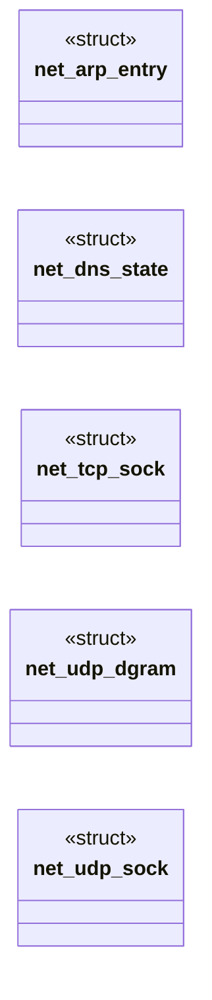
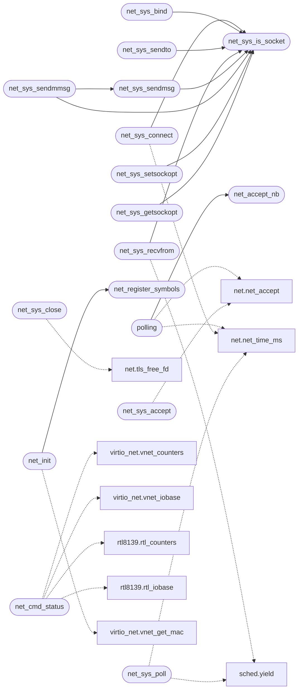

# `net/net.c`

> Source: [net/net.c:1](../../net/net.c#L1) | language `c` | coverage 14.4% | [API index](../index.md)

MiniOS network stack: virtio-net preferred, rtl8139 fallback, under

## Contents

- **Structs:** [`net_arp_entry`](#net_arp_entry), [`net_dns_state`](#net_dns_state), [`net_tcp_sock`](#net_tcp_sock), [`net_udp_dgram`](#net_udp_dgram), [`net_udp_sock`](#net_udp_sock)
- **Functions:** [`net_udp_send`](#net_udp_send), [`net_rx_handle_frame`](#net_rx_handle_frame), [`net_open`](#net_open), [`net_connect`](#net_connect), [`net_send`](#net_send), [`net_recv`](#net_recv), [`net_recv_timeout`](#net_recv_timeout), [`net_close`](#net_close), [`net_listen`](#net_listen), [`net_accept_nb`](#net_accept_nb), [`polling`](#polling), [`net_sock_state`](#net_sock_state), [`net_sys_is_socket`](#net_sys_is_socket), [`net_sys_socket`](#net_sys_socket), [`net_sys_connect`](#net_sys_connect), [`net_sys_bind`](#net_sys_bind), [`net_sys_listen`](#net_sys_listen), [`net_sys_accept`](#net_sys_accept), [`net_sys_sendto`](#net_sys_sendto), [`net_sys_recvfrom`](#net_sys_recvfrom), [`net_sys_sendmsg`](#net_sys_sendmsg), [`net_sys_sendmmsg`](#net_sys_sendmmsg), [`net_sys_shutdown`](#net_sys_shutdown), [`net_sys_close`](#net_sys_close), [`net_sys_setsockopt`](#net_sys_setsockopt), [`net_sys_getsockopt`](#net_sys_getsockopt), [`net_sys_getsockname`](#net_sys_getsockname), [`net_sys_getpeername`](#net_sys_getpeername), [`net_sys_fcntl`](#net_sys_fcntl), [`net_sys_ioctl`](#net_sys_ioctl), [`net_sys_poll`](#net_sys_poll), [`net_sys_dns`](#net_sys_dns), [`net_cmd_status`](#net_cmd_status), [`net_get_addrs`](#net_get_addrs), [`net_cmd_ping`](#net_cmd_ping), [`net_cmd_dns`](#net_cmd_dns), [`net_register_symbols`](#net_register_symbols), [`net_init`](#net_init)
- **Macros:** [`NET_TCP_CLOSED`](#net_tcp_closed), [`NET_TCP_SYN_SENT`](#net_tcp_syn_sent), [`NET_TCP_ESTABLISHED`](#net_tcp_established), [`NET_TCP_FIN_SENT`](#net_tcp_fin_sent), [`NET_TCP_DEAD`](#net_tcp_dead), [`NET_TCP_LISTEN`](#net_tcp_listen), [`NET_TCP_SYN_RCVD`](#net_tcp_syn_rcvd), [`LNX_AF_INET`](#lnx_af_inet), [`LNX_SOCK_STREAM`](#lnx_sock_stream), [`LNX_SOCK_DGRAM`](#lnx_sock_dgram), [`LNX_SOCK_TYPE_MASK`](#lnx_sock_type_mask), [`LNX_SOCK_NONBLOCK`](#lnx_sock_nonblock), [`LNX_SOCK_CLOEXEC`](#lnx_sock_cloexec), [`LNX_IPPROTO_TCP`](#lnx_ipproto_tcp), [`LNX_IPPROTO_UDP`](#lnx_ipproto_udp), [`LNX_MSG_PEEK`](#lnx_msg_peek), [`LNX_MSG_DONTWAIT`](#lnx_msg_dontwait), [`LNX_MSG_NOSIGNAL`](#lnx_msg_nosignal), [`LNX_SOL_SOCKET`](#lnx_sol_socket), [`LNX_SO_REUSEADDR`](#lnx_so_reuseaddr), [`LNX_SO_TYPE`](#lnx_so_type), [`LNX_SO_ERROR`](#lnx_so_error), [`LNX_SO_SNDBUF`](#lnx_so_sndbuf), [`LNX_SO_RCVBUF`](#lnx_so_rcvbuf), [`LNX_SO_KEEPALIVE`](#lnx_so_keepalive), [`LNX_SO_LINGER`](#lnx_so_linger), [`LNX_SO_RCVTIMEO`](#lnx_so_rcvtimeo), [`LNX_SO_SNDTIMEO`](#lnx_so_sndtimeo), [`LNX_IPPROTO_IP`](#lnx_ipproto_ip), [`LNX_IP_TOS`](#lnx_ip_tos), [`LNX_IP_TTL`](#lnx_ip_ttl), [`LNX_IP_MTU_DISCOVER`](#lnx_ip_mtu_discover), [`LNX_IP_RECVERR`](#lnx_ip_recverr), [`NET_IP_DEFAULT_TTL`](#net_ip_default_ttl), [`LNX_TCP_NODELAY`](#lnx_tcp_nodelay), [`LNX_TCP_KEEPIDLE`](#lnx_tcp_keepidle), [`LNX_TCP_KEEPINTVL`](#lnx_tcp_keepintvl), [`LNX_TCP_KEEPCNT`](#lnx_tcp_keepcnt), [`LNX_O_RDWR`](#lnx_o_rdwr), [`LNX_O_NONBLOCK`](#lnx_o_nonblock), [`LNX_FD_CLOEXEC`](#lnx_fd_cloexec), [`LNX_F_GETFD`](#lnx_f_getfd), [`LNX_F_SETFD`](#lnx_f_setfd), [`LNX_F_GETFL`](#lnx_f_getfl), [`LNX_F_SETFL`](#lnx_f_setfl), [`LNX_POLLIN`](#lnx_pollin), [`LNX_POLLOUT`](#lnx_pollout), [`LNX_POLLERR`](#lnx_pollerr), [`LNX_POLLHUP`](#lnx_pollhup), [`LNX_POLLNVAL`](#lnx_pollnval), [`LNX_EBADF`](#lnx_ebadf), [`LNX_EAGAIN`](#lnx_eagain), [`LNX_EFAULT`](#lnx_efault), [`LNX_EINVAL`](#lnx_einval), [`LNX_EPIPE`](#lnx_epipe), [`LNX_EDESTADDRREQ`](#lnx_edestaddrreq), [`LNX_EMSGSIZE`](#lnx_emsgsize), [`LNX_ENOPROTOOPT`](#lnx_enoprotoopt), [`LNX_EPROTONOSUPPORT`](#lnx_eprotonosupport), [`LNX_EOPNOTSUPP`](#lnx_eopnotsupp), [`LNX_EAFNOSUPPORT`](#lnx_eafnosupport), [`LNX_EISCONN`](#lnx_eisconn), [`LNX_ENOTCONN`](#lnx_enotconn), [`LNX_ETIMEDOUT`](#lnx_etimedout), [`LNX_ECONNREFUSED`](#lnx_econnrefused), [`LNX_EALREADY`](#lnx_ealready), [`LNX_EINPROGRESS`](#lnx_einprogress), [`NET_SEND_FLAGS_OK`](#net_send_flags_ok), [`NET_RECV_FLAGS_OK`](#net_recv_flags_ok), [`LNX_FIONREAD`](#lnx_fionread), [`LNX_FIONBIO`](#lnx_fionbio), [`LNX_FIONCLEX`](#lnx_fionclex), [`LNX_FIOCLEX`](#lnx_fioclex), [`LNX_ENOTTY`](#lnx_enotty)

## Type Diagram



## Call Graph

Solid arrows stay in this module, dashed arrows leave it.



## Structs

<a id="net_arp_entry"></a>

### `net_arp_entry`

`struct` | [net/net.c:95](../../net/net.c#L95)

```c
struct net_arp_entry
```

---

<a id="net_dns_state"></a>

### `net_dns_state`

`struct` | [net/net.c:221](../../net/net.c#L221)

```c
struct net_dns_state
```

---

<a id="net_tcp_sock"></a>

### `net_tcp_sock`

`struct` | [net/net.c:408](../../net/net.c#L408)

```c
struct net_tcp_sock
```

---

<a id="net_udp_dgram"></a>

### `net_udp_dgram`

`struct` | [net/net.c:437](../../net/net.c#L437)

```c
struct net_udp_dgram
```

One received datagram.

---

<a id="net_udp_sock"></a>

### `net_udp_sock`

`struct` | [net/net.c:445](../../net/net.c#L445)

```c
struct net_udp_sock
```

Datagram socket: a bounded ring of received datagrams.

---

## Functions

<a id="net_udp_send"></a>

### `net_udp_send`

`function` | [net/net.c:329](../../net/net.c#L329)

```c
net_udp_send((const unsigned char[])
```

**Parameters**

| Name | Type | Default | Description |
|---|---|---|---|
| `char` | `(const unsigned [])` |  |  |

---

<a id="net_rx_handle_frame"></a>

### `net_rx_handle_frame`

`function` | [net/net.c:822](../../net/net.c#L822)

```c
void net_rx_handle_frame(const unsigned char *frame, unsigned len)
```

Demux entry point the rtl8139 driver (rtl8139.c) calls for every frame drained from the RX ring; lives in net.c.

**Parameters**

| Name | Type | Default | Description |
|---|---|---|---|
| `frame` | `unsigned char *` |  |  |
| `len` | `unsigned` |  |  |

> **Inherited:** Documentation from [`net_rx_handle_frame`](#net_rx_handle_frame) (headers/net.h:159).

---

<a id="net_open"></a>

### `net_open`

`function` | [net/net.c:886](../../net/net.c#L886)

```c
int net_open(void)
```

Libc-style API for ET_REL programs

**Returns:** `int`

> **Inherited:** Documentation from [`net_open`](#net_open) (headers/net.h:119).

---

<a id="net_connect"></a>

### `net_connect`

`function` | [net/net.c:892](../../net/net.c#L892)

```c
int net_connect(const char *host, unsigned short port)
```

**Parameters**

| Name | Type | Default | Description |
|---|---|---|---|
| `host` | `char *` |  |  |
| `port` | `unsigned short` |  |  |

**Returns:** `int`

---

<a id="net_send"></a>

### `net_send`

`function` | [net/net.c:901](../../net/net.c#L901)

```c
int net_send(int fd, const char *buf, int len)
```

**Parameters**

| Name | Type | Default | Description |
|---|---|---|---|
| `fd` | `int` |  |  |
| `buf` | `char *` |  |  |
| `len` | `int` |  |  |

**Returns:** `int`

---

<a id="net_recv"></a>

### `net_recv`

`function` | [net/net.c:906](../../net/net.c#L906)

```c
int net_recv(int fd, char *buf, int len)
```

**Parameters**

| Name | Type | Default | Description |
|---|---|---|---|
| `fd` | `int` |  |  |
| `buf` | `char *` |  |  |
| `len` | `int` |  |  |

**Returns:** `int`

---

<a id="net_recv_timeout"></a>

### `net_recv_timeout`

`function` | [net/net.c:911](../../net/net.c#L911)

```c
int net_recv_timeout(int fd, char *buf, int len, unsigned long timeout_ms)
```

Blocking receive with a deadline: like net_recv, but -1 on timeout.

**Parameters**

| Name | Type | Default | Description |
|---|---|---|---|
| `fd` | `int` |  |  |
| `buf` | `char *` |  |  |
| `len` | `int` |  |  |
| `timeout_ms` | `unsigned long` |  |  |

**Returns:** `int`

> **Inherited:** Documentation from [`net_recv_timeout`](#net_recv_timeout) (headers/net.h:124).

---

<a id="net_close"></a>

### `net_close`

`function` | [net/net.c:916](../../net/net.c#L916)

```c
void net_close(int fd)
```

**Parameters**

| Name | Type | Default | Description |
|---|---|---|---|
| `fd` | `int` |  |  |

---

<a id="net_listen"></a>

### `net_listen`

`function` | [net/net.c:927](../../net/net.c#L927)

```c
int net_listen(unsigned short port)
```

Docstring: Allocate a socket bound to a local port and listening.

Returns the socket index, or -1 when the table is full.

**Parameters**

| Name | Type | Default | Description |
|---|---|---|---|
| `port` | `unsigned short` |  |  |

**Returns:** `int`

---

<a id="net_accept_nb"></a>

### `net_accept_nb`

`function` | [net/net.c:942](../../net/net.c#L942)

```c
int net_accept_nb(int fd)
```

Docstring: Take a pending child off a LISTEN socket without waiting.

Returns the child index, or -1 when no handshake has completed yet. The child is ESTABLISHED and owned by the caller.

**Parameters**

| Name | Type | Default | Description |
|---|---|---|---|
| `fd` | `int` |  |  |

**Returns:** `int`

*Called by:* [`polling`](#polling)

---

<a id="polling"></a>

### `polling`

`function` | [net/net.c:959](../../net/net.c#L959)

```c
* without polling (the peer's ACK arrives through the driver poll). */ int net_accept(int fd, uns...
```

**Parameters**

| Name | Type | Default | Description |
|---|---|---|---|
| `poll` | `the peer's ACK arrives through the driver` |  |  |

**Returns:** `* without`

*Calls:* [`net_accept`](headers.net.h.md#net_accept), [`net_time_ms`](headers.net.h.md#net_time_ms), [`net_accept_nb`](#net_accept_nb)

---

<a id="net_sock_state"></a>

### `net_sock_state`

`function` | [net/net.c:976](../../net/net.c#L976)

```c
int net_sock_state(int fd)
```

Docstring: Socket state for diagnostics (the `net` builtin and the httpd selftest). -1 on a wild fd.

**Parameters**

| Name | Type | Default | Description |
|---|---|---|---|
| `fd` | `int` |  |  |

**Returns:** `int`

---

<a id="net_sys_is_socket"></a>

### `net_sys_is_socket`

`function` | [net/net.c:1102](../../net/net.c#L1102)

```c
int net_sys_is_socket(long fd)
```

Linux socket ABI entry points (kernel/syscalls.c routes to them).

**Parameters**

| Name | Type | Default | Description |
|---|---|---|---|
| `fd` | `long` |  |  |

**Returns:** `int`

> **Inherited:** Documentation from [`net_sys_is_socket`](#net_sys_is_socket) (headers/net.h:101).

*Called by:* [`net_sys_bind`](#net_sys_bind), [`net_sys_connect`](#net_sys_connect), [`net_sys_getsockopt`](#net_sys_getsockopt), [`net_sys_recvfrom`](#net_sys_recvfrom), [`net_sys_sendmmsg`](#net_sys_sendmmsg), [`net_sys_sendmsg`](#net_sys_sendmsg), [`net_sys_sendto`](#net_sys_sendto), [`net_sys_setsockopt`](#net_sys_setsockopt)

---

<a id="net_sys_socket"></a>

### `net_sys_socket`

`function` | [net/net.c:1222](../../net/net.c#L1222)

```c
long net_sys_socket(long a1, long a2, long a3)
```

Linux syscall ABI (sockaddr_in layout matches Linux)

**Parameters**

| Name | Type | Default | Description |
|---|---|---|---|
| `a1` | `long` |  |  |
| `a2` | `long` |  |  |
| `a3` | `long` |  |  |

**Returns:** `long`

> **Inherited:** Documentation from [`net_sys_socket`](#net_sys_socket) (headers/net.h:142).

---

<a id="net_sys_connect"></a>

### `net_sys_connect`

`function` | [net/net.c:1249](../../net/net.c#L1249)

```c
long net_sys_connect(long fd, long sockaddr, long addrlen)
```

**Parameters**

| Name | Type | Default | Description |
|---|---|---|---|
| `fd` | `long` |  |  |
| `sockaddr` | `long` |  |  |
| `addrlen` | `long` |  |  |

**Returns:** `long`

*Calls:* [`net_time_ms`](headers.net.h.md#net_time_ms), [`net_sys_is_socket`](#net_sys_is_socket)

---

<a id="net_sys_bind"></a>

### `net_sys_bind`

`function` | [net/net.c:1296](../../net/net.c#L1296)

```c
long net_sys_bind(long fd, long sockaddr, long addrlen)
```

**Parameters**

| Name | Type | Default | Description |
|---|---|---|---|
| `fd` | `long` |  |  |
| `sockaddr` | `long` |  |  |
| `addrlen` | `long` |  |  |

**Returns:** `long`

*Calls:* [`net_sys_is_socket`](#net_sys_is_socket)

---

<a id="net_sys_listen"></a>

### `net_sys_listen`

`function` | [net/net.c:1318](../../net/net.c#L1318)

```c
long net_sys_listen(long fd, long backlog)
```

**Parameters**

| Name | Type | Default | Description |
|---|---|---|---|
| `fd` | `long` |  |  |
| `backlog` | `long` |  |  |

**Returns:** `long`

---

<a id="net_sys_accept"></a>

### `net_sys_accept`

`function` | [net/net.c:1329](../../net/net.c#L1329)

```c
long net_sys_accept(long fd, long sockaddr, long addrlen)
```

**Parameters**

| Name | Type | Default | Description |
|---|---|---|---|
| `fd` | `long` |  |  |
| `sockaddr` | `long` |  |  |
| `addrlen` | `long` |  |  |

**Returns:** `long`

*Calls:* [`net_accept`](headers.net.h.md#net_accept)

---

<a id="net_sys_sendto"></a>

### `net_sys_sendto`

`function` | [net/net.c:1375](../../net/net.c#L1375)

```c
long net_sys_sendto(long fd, long buf, long len, long flags, long to, long tolen)
```

**Parameters**

| Name | Type | Default | Description |
|---|---|---|---|
| `fd` | `long` |  |  |
| `buf` | `long` |  |  |
| `len` | `long` |  |  |
| `flags` | `long` |  |  |
| `to` | `long` |  |  |
| `tolen` | `long` |  |  |

**Returns:** `long`

*Calls:* [`net_sys_is_socket`](#net_sys_is_socket)

---

<a id="net_sys_recvfrom"></a>

### `net_sys_recvfrom`

`function` | [net/net.c:1390](../../net/net.c#L1390)

```c
long net_sys_recvfrom(long fd, long buf, long len, long flags, long from, long fromlen)
```

**Parameters**

| Name | Type | Default | Description |
|---|---|---|---|
| `fd` | `long` |  |  |
| `buf` | `long` |  |  |
| `len` | `long` |  |  |
| `flags` | `long` |  |  |
| `from` | `long` |  |  |
| `fromlen` | `long` |  |  |

**Returns:** `long`

*Calls:* [`yield`](headers.sched.h.md#yield), [`net_sys_is_socket`](#net_sys_is_socket)

---

<a id="net_sys_sendmsg"></a>

### `net_sys_sendmsg`

`function` | [net/net.c:1470](../../net/net.c#L1470)

```c
long net_sys_sendmsg(long fd, long msg, long flags)
```

**Parameters**

| Name | Type | Default | Description |
|---|---|---|---|
| `fd` | `long` |  |  |
| `msg` | `long` |  |  |
| `flags` | `long` |  |  |

**Returns:** `long`

*Calls:* [`net_sys_is_socket`](#net_sys_is_socket)

*Called by:* [`net_sys_sendmmsg`](#net_sys_sendmmsg)

---

<a id="net_sys_sendmmsg"></a>

### `net_sys_sendmmsg`

`function` | [net/net.c:1498](../../net/net.c#L1498)

```c
long net_sys_sendmmsg(long fd, long vec, long vlen, long flags)
```

sendmmsg (307): glibc's resolver sends its A and AAAA queries together and treats ENOSYS as a failed lookup.

Returns the messages sent, storing each one's byte count in msg_len; an error on the first is returned.

**Parameters**

| Name | Type | Default | Description |
|---|---|---|---|
| `fd` | `long` |  |  |
| `vec` | `long` |  |  |
| `vlen` | `long` |  |  |
| `flags` | `long` |  |  |

**Returns:** `long`

*Calls:* [`net_sys_is_socket`](#net_sys_is_socket), [`net_sys_sendmsg`](#net_sys_sendmsg)

---

<a id="net_sys_shutdown"></a>

### `net_sys_shutdown`

`function` | [net/net.c:1514](../../net/net.c#L1514)

```c
long net_sys_shutdown(long fd, long how)
```

**Parameters**

| Name | Type | Default | Description |
|---|---|---|---|
| `fd` | `long` |  |  |
| `how` | `long` |  |  |

**Returns:** `long`

---

<a id="net_sys_close"></a>

### `net_sys_close`

`function` | [net/net.c:1523](../../net/net.c#L1523)

```c
long net_sys_close(long fd)
```

**Parameters**

| Name | Type | Default | Description |
|---|---|---|---|
| `fd` | `long` |  |  |

**Returns:** `long`

*Calls:* [`tls_free_fd`](headers.net.h.md#tls_free_fd)

---

<a id="net_sys_setsockopt"></a>

### `net_sys_setsockopt`

`function` | [net/net.c:1534](../../net/net.c#L1534)

```c
long net_sys_setsockopt(long fd, long level, long name, long val, long len)
```

**Parameters**

| Name | Type | Default | Description |
|---|---|---|---|
| `fd` | `long` |  |  |
| `level` | `long` |  |  |
| `name` | `long` |  |  |
| `val` | `long` |  |  |
| `len` | `long` |  |  |

**Returns:** `long`

*Calls:* [`net_sys_is_socket`](#net_sys_is_socket)

---

<a id="net_sys_getsockopt"></a>

### `net_sys_getsockopt`

`function` | [net/net.c:1569](../../net/net.c#L1569)

```c
long net_sys_getsockopt(long fd, long level, long name, long val, long lenp)
```

**Parameters**

| Name | Type | Default | Description |
|---|---|---|---|
| `fd` | `long` |  |  |
| `level` | `long` |  |  |
| `name` | `long` |  |  |
| `val` | `long` |  |  |
| `lenp` | `long` |  |  |

**Returns:** `long`

*Calls:* [`net_sys_is_socket`](#net_sys_is_socket)

---

<a id="net_sys_getsockname"></a>

### `net_sys_getsockname`

`function` | [net/net.c:1616](../../net/net.c#L1616)

```c
long net_sys_getsockname(long fd, long addr, long lenp)
```

**Parameters**

| Name | Type | Default | Description |
|---|---|---|---|
| `fd` | `long` |  |  |
| `addr` | `long` |  |  |
| `lenp` | `long` |  |  |

**Returns:** `long`

---

<a id="net_sys_getpeername"></a>

### `net_sys_getpeername`

`function` | [net/net.c:1625](../../net/net.c#L1625)

```c
long net_sys_getpeername(long fd, long addr, long lenp)
```

**Parameters**

| Name | Type | Default | Description |
|---|---|---|---|
| `fd` | `long` |  |  |
| `addr` | `long` |  |  |
| `lenp` | `long` |  |  |

**Returns:** `long`

---

<a id="net_sys_fcntl"></a>

### `net_sys_fcntl`

`function` | [net/net.c:1643](../../net/net.c#L1643)

```c
long net_sys_fcntl(long fd, long cmd, long arg)
```

fcntl on a socket: O_NONBLOCK through F_GETFL/F_SETFL, FD_CLOEXEC recorded through F_GETFD/F_SETFD (sockets live in one table shared by fork, so execve keeps them; docs/spec/network.md).

**Parameters**

| Name | Type | Default | Description |
|---|---|---|---|
| `fd` | `long` |  |  |
| `cmd` | `long` |  |  |
| `arg` | `long` |  |  |

**Returns:** `long`

---

<a id="net_sys_ioctl"></a>

### `net_sys_ioctl`

`function` | [net/net.c:1674](../../net/net.c#L1674)

```c
long net_sys_ioctl(long fd, long req, long arg)
```

ioctl on a socket: FIONREAD answers the bytes a read would return now (a stream's buffered bytes, the size of a datagram socket's next datagram), FIONBIO sets O_NONBLOCK from the int at arg, FIOCLEX and FIONCLEX record FD_CLOEXEC; terminal and every other request is ENOTTY, as Linux answers it for a socket. arg is validated by the caller.

**Parameters**

| Name | Type | Default | Description |
|---|---|---|---|
| `fd` | `long` |  |  |
| `req` | `long` |  |  |
| `arg` | `long` |  |  |

**Returns:** `long`

---

<a id="net_sys_poll"></a>

### `net_sys_poll`

`function` | [net/net.c:1727](../../net/net.c#L1727)

```c
long net_sys_poll(long fds, long nfds, long timeout_ms)
```

**Parameters**

| Name | Type | Default | Description |
|---|---|---|---|
| `fds` | `long` |  |  |
| `nfds` | `long` |  |  |
| `timeout_ms` | `long` |  |  |

**Returns:** `long`

*Calls:* [`net_time_ms`](headers.net.h.md#net_time_ms), [`yield`](headers.sched.h.md#yield)

---

<a id="net_sys_dns"></a>

### `net_sys_dns`

`function` | [net/net.c:1767](../../net/net.c#L1767)

```c
long net_sys_dns(long host)
```

MiniOS syscall 200: resolve a hostname, returned as a network-order 32-bit address (like inet_addr), or -1 on failure.

**Parameters**

| Name | Type | Default | Description |
|---|---|---|---|
| `host` | `long` |  |  |

**Returns:** `long`

---

<a id="net_cmd_status"></a>

### `net_cmd_status`

`function` | [net/net.c:1803](../../net/net.c#L1803)

```c
void net_cmd_status(void)
```

Shell commands

> **Inherited:** Documentation from [`net_cmd_status`](#net_cmd_status) (headers/net.h:113).

*Calls:* [`vnet_counters`](headers.drivers.virtio_net.h.md#vnet_counters), [`vnet_iobase`](headers.drivers.virtio_net.h.md#vnet_iobase), [`rtl_counters`](headers.net.rtl8139.h.md#rtl_counters), [`rtl_iobase`](headers.net.rtl8139.h.md#rtl_iobase)

---

<a id="net_get_addrs"></a>

### `net_get_addrs`

`function` | [net/net.c:1825](../../net/net.c#L1825)

```c
void net_get_addrs(unsigned char mac_out[NET_ETH_ALEN], unsigned char ip_out[4])
```

Docstring: Copy the station MAC and IP out for status screens.

**Parameters**

| Name | Type | Default | Description |
|---|---|---|---|
| `NET_ETH_ALEN` | `unsigned char mac_out[ ]` |  |  |
| `ip_out` | `unsigned char [4]` |  |  |

---

<a id="net_cmd_ping"></a>

### `net_cmd_ping`

`function` | [net/net.c:1831](../../net/net.c#L1831)

```c
void net_cmd_ping(const char *ip_text)
```

**Parameters**

| Name | Type | Default | Description |
|---|---|---|---|
| `ip_text` | `char *` |  |  |

---

<a id="net_cmd_dns"></a>

### `net_cmd_dns`

`function` | [net/net.c:1842](../../net/net.c#L1842)

```c
void net_cmd_dns(const char *host)
```

**Parameters**

| Name | Type | Default | Description |
|---|---|---|---|
| `host` | `char *` |  |  |

---

<a id="net_register_symbols"></a>

### `net_register_symbols`

`function` | [net/net.c:1855](../../net/net.c#L1855)

```c
void net_register_symbols(void)
```

*Called by:* [`net_init`](#net_init)

---

<a id="net_init"></a>

### `net_init`

`function` | [net/net.c:1863](../../net/net.c#L1863)

```c
void net_init(void)
```

*Calls:* [`vnet_get_mac`](headers.drivers.virtio_net.h.md#vnet_get_mac), [`vnet_init`](headers.drivers.virtio_net.h.md#vnet_init), [`rtl_get_mac`](headers.net.rtl8139.h.md#rtl_get_mac), [`rtl_init`](headers.net.rtl8139.h.md#rtl_init), [`net_register_symbols`](#net_register_symbols)

*Called by:* [`__attribute__`](kernel.c.md#__attribute__)

---

## Macros

<a id="net_tcp_closed"></a>

### `NET_TCP_CLOSED`

`macro` | [net/net.c:400](../../net/net.c#L400)

```c
#define NET_TCP_CLOSED
```

---

<a id="net_tcp_syn_sent"></a>

### `NET_TCP_SYN_SENT`

`macro` | [net/net.c:401](../../net/net.c#L401)

```c
#define NET_TCP_SYN_SENT
```

---

<a id="net_tcp_established"></a>

### `NET_TCP_ESTABLISHED`

`macro` | [net/net.c:402](../../net/net.c#L402)

```c
#define NET_TCP_ESTABLISHED
```

---

<a id="net_tcp_fin_sent"></a>

### `NET_TCP_FIN_SENT`

`macro` | [net/net.c:403](../../net/net.c#L403)

```c
#define NET_TCP_FIN_SENT
```

---

<a id="net_tcp_dead"></a>

### `NET_TCP_DEAD`

`macro` | [net/net.c:404](../../net/net.c#L404)

```c
#define NET_TCP_DEAD
```

---

<a id="net_tcp_listen"></a>

### `NET_TCP_LISTEN`

`macro` | [net/net.c:405](../../net/net.c#L405)

```c
#define NET_TCP_LISTEN
```

---

<a id="net_tcp_syn_rcvd"></a>

### `NET_TCP_SYN_RCVD`

`macro` | [net/net.c:406](../../net/net.c#L406)

```c
#define NET_TCP_SYN_RCVD
```

---

<a id="lnx_af_inet"></a>

### `LNX_AF_INET`

`macro` | [net/net.c:1028](../../net/net.c#L1028)

```c
#define LNX_AF_INET
```

---

<a id="lnx_sock_stream"></a>

### `LNX_SOCK_STREAM`

`macro` | [net/net.c:1029](../../net/net.c#L1029)

```c
#define LNX_SOCK_STREAM
```

---

<a id="lnx_sock_dgram"></a>

### `LNX_SOCK_DGRAM`

`macro` | [net/net.c:1030](../../net/net.c#L1030)

```c
#define LNX_SOCK_DGRAM
```

---

<a id="lnx_sock_type_mask"></a>

### `LNX_SOCK_TYPE_MASK`

`macro` | [net/net.c:1031](../../net/net.c#L1031)

```c
#define LNX_SOCK_TYPE_MASK
```

---

<a id="lnx_sock_nonblock"></a>

### `LNX_SOCK_NONBLOCK`

`macro` | [net/net.c:1032](../../net/net.c#L1032)

```c
#define LNX_SOCK_NONBLOCK
```

---

<a id="lnx_sock_cloexec"></a>

### `LNX_SOCK_CLOEXEC`

`macro` | [net/net.c:1033](../../net/net.c#L1033)

```c
#define LNX_SOCK_CLOEXEC
```

---

<a id="lnx_ipproto_tcp"></a>

### `LNX_IPPROTO_TCP`

`macro` | [net/net.c:1034](../../net/net.c#L1034)

```c
#define LNX_IPPROTO_TCP
```

---

<a id="lnx_ipproto_udp"></a>

### `LNX_IPPROTO_UDP`

`macro` | [net/net.c:1035](../../net/net.c#L1035)

```c
#define LNX_IPPROTO_UDP
```

---

<a id="lnx_msg_peek"></a>

### `LNX_MSG_PEEK`

`macro` | [net/net.c:1036](../../net/net.c#L1036)

```c
#define LNX_MSG_PEEK
```

---

<a id="lnx_msg_dontwait"></a>

### `LNX_MSG_DONTWAIT`

`macro` | [net/net.c:1037](../../net/net.c#L1037)

```c
#define LNX_MSG_DONTWAIT
```

---

<a id="lnx_msg_nosignal"></a>

### `LNX_MSG_NOSIGNAL`

`macro` | [net/net.c:1038](../../net/net.c#L1038)

```c
#define LNX_MSG_NOSIGNAL
```

---

<a id="lnx_sol_socket"></a>

### `LNX_SOL_SOCKET`

`macro` | [net/net.c:1039](../../net/net.c#L1039)

```c
#define LNX_SOL_SOCKET
```

---

<a id="lnx_so_reuseaddr"></a>

### `LNX_SO_REUSEADDR`

`macro` | [net/net.c:1040](../../net/net.c#L1040)

```c
#define LNX_SO_REUSEADDR
```

---

<a id="lnx_so_type"></a>

### `LNX_SO_TYPE`

`macro` | [net/net.c:1041](../../net/net.c#L1041)

```c
#define LNX_SO_TYPE
```

---

<a id="lnx_so_error"></a>

### `LNX_SO_ERROR`

`macro` | [net/net.c:1042](../../net/net.c#L1042)

```c
#define LNX_SO_ERROR
```

---

<a id="lnx_so_sndbuf"></a>

### `LNX_SO_SNDBUF`

`macro` | [net/net.c:1043](../../net/net.c#L1043)

```c
#define LNX_SO_SNDBUF
```

---

<a id="lnx_so_rcvbuf"></a>

### `LNX_SO_RCVBUF`

`macro` | [net/net.c:1044](../../net/net.c#L1044)

```c
#define LNX_SO_RCVBUF
```

---

<a id="lnx_so_keepalive"></a>

### `LNX_SO_KEEPALIVE`

`macro` | [net/net.c:1045](../../net/net.c#L1045)

```c
#define LNX_SO_KEEPALIVE
```

---

<a id="lnx_so_linger"></a>

### `LNX_SO_LINGER`

`macro` | [net/net.c:1046](../../net/net.c#L1046)

```c
#define LNX_SO_LINGER
```

---

<a id="lnx_so_rcvtimeo"></a>

### `LNX_SO_RCVTIMEO`

`macro` | [net/net.c:1047](../../net/net.c#L1047)

```c
#define LNX_SO_RCVTIMEO
```

---

<a id="lnx_so_sndtimeo"></a>

### `LNX_SO_SNDTIMEO`

`macro` | [net/net.c:1048](../../net/net.c#L1048)

```c
#define LNX_SO_SNDTIMEO
```

---

<a id="lnx_ipproto_ip"></a>

### `LNX_IPPROTO_IP`

`macro` | [net/net.c:1049](../../net/net.c#L1049)

```c
#define LNX_IPPROTO_IP
```

---

<a id="lnx_ip_tos"></a>

### `LNX_IP_TOS`

`macro` | [net/net.c:1050](../../net/net.c#L1050)

```c
#define LNX_IP_TOS
```

---

<a id="lnx_ip_ttl"></a>

### `LNX_IP_TTL`

`macro` | [net/net.c:1051](../../net/net.c#L1051)

```c
#define LNX_IP_TTL
```

---

<a id="lnx_ip_mtu_discover"></a>

### `LNX_IP_MTU_DISCOVER`

`macro` | [net/net.c:1052](../../net/net.c#L1052)

```c
#define LNX_IP_MTU_DISCOVER
```

---

<a id="lnx_ip_recverr"></a>

### `LNX_IP_RECVERR`

`macro` | [net/net.c:1053](../../net/net.c#L1053)

```c
#define LNX_IP_RECVERR
```

---

<a id="net_ip_default_ttl"></a>

### `NET_IP_DEFAULT_TTL`

`macro` | [net/net.c:1054](../../net/net.c#L1054)

```c
#define NET_IP_DEFAULT_TTL
```

---

<a id="lnx_tcp_nodelay"></a>

### `LNX_TCP_NODELAY`

`macro` | [net/net.c:1055](../../net/net.c#L1055)

```c
#define LNX_TCP_NODELAY
```

---

<a id="lnx_tcp_keepidle"></a>

### `LNX_TCP_KEEPIDLE`

`macro` | [net/net.c:1056](../../net/net.c#L1056)

```c
#define LNX_TCP_KEEPIDLE
```

---

<a id="lnx_tcp_keepintvl"></a>

### `LNX_TCP_KEEPINTVL`

`macro` | [net/net.c:1057](../../net/net.c#L1057)

```c
#define LNX_TCP_KEEPINTVL
```

---

<a id="lnx_tcp_keepcnt"></a>

### `LNX_TCP_KEEPCNT`

`macro` | [net/net.c:1058](../../net/net.c#L1058)

```c
#define LNX_TCP_KEEPCNT
```

---

<a id="lnx_o_rdwr"></a>

### `LNX_O_RDWR`

`macro` | [net/net.c:1059](../../net/net.c#L1059)

```c
#define LNX_O_RDWR
```

---

<a id="lnx_o_nonblock"></a>

### `LNX_O_NONBLOCK`

`macro` | [net/net.c:1060](../../net/net.c#L1060)

```c
#define LNX_O_NONBLOCK
```

---

<a id="lnx_fd_cloexec"></a>

### `LNX_FD_CLOEXEC`

`macro` | [net/net.c:1061](../../net/net.c#L1061)

```c
#define LNX_FD_CLOEXEC
```

---

<a id="lnx_f_getfd"></a>

### `LNX_F_GETFD`

`macro` | [net/net.c:1062](../../net/net.c#L1062)

```c
#define LNX_F_GETFD
```

---

<a id="lnx_f_setfd"></a>

### `LNX_F_SETFD`

`macro` | [net/net.c:1063](../../net/net.c#L1063)

```c
#define LNX_F_SETFD
```

---

<a id="lnx_f_getfl"></a>

### `LNX_F_GETFL`

`macro` | [net/net.c:1064](../../net/net.c#L1064)

```c
#define LNX_F_GETFL
```

---

<a id="lnx_f_setfl"></a>

### `LNX_F_SETFL`

`macro` | [net/net.c:1065](../../net/net.c#L1065)

```c
#define LNX_F_SETFL
```

---

<a id="lnx_pollin"></a>

### `LNX_POLLIN`

`macro` | [net/net.c:1066](../../net/net.c#L1066)

```c
#define LNX_POLLIN
```

---

<a id="lnx_pollout"></a>

### `LNX_POLLOUT`

`macro` | [net/net.c:1067](../../net/net.c#L1067)

```c
#define LNX_POLLOUT
```

---

<a id="lnx_pollerr"></a>

### `LNX_POLLERR`

`macro` | [net/net.c:1068](../../net/net.c#L1068)

```c
#define LNX_POLLERR
```

---

<a id="lnx_pollhup"></a>

### `LNX_POLLHUP`

`macro` | [net/net.c:1069](../../net/net.c#L1069)

```c
#define LNX_POLLHUP
```

---

<a id="lnx_pollnval"></a>

### `LNX_POLLNVAL`

`macro` | [net/net.c:1070](../../net/net.c#L1070)

```c
#define LNX_POLLNVAL
```

---

<a id="lnx_ebadf"></a>

### `LNX_EBADF`

`macro` | [net/net.c:1071](../../net/net.c#L1071)

```c
#define LNX_EBADF
```

---

<a id="lnx_eagain"></a>

### `LNX_EAGAIN`

`macro` | [net/net.c:1072](../../net/net.c#L1072)

```c
#define LNX_EAGAIN
```

---

<a id="lnx_efault"></a>

### `LNX_EFAULT`

`macro` | [net/net.c:1073](../../net/net.c#L1073)

```c
#define LNX_EFAULT
```

---

<a id="lnx_einval"></a>

### `LNX_EINVAL`

`macro` | [net/net.c:1074](../../net/net.c#L1074)

```c
#define LNX_EINVAL
```

---

<a id="lnx_epipe"></a>

### `LNX_EPIPE`

`macro` | [net/net.c:1075](../../net/net.c#L1075)

```c
#define LNX_EPIPE
```

---

<a id="lnx_edestaddrreq"></a>

### `LNX_EDESTADDRREQ`

`macro` | [net/net.c:1076](../../net/net.c#L1076)

```c
#define LNX_EDESTADDRREQ
```

---

<a id="lnx_emsgsize"></a>

### `LNX_EMSGSIZE`

`macro` | [net/net.c:1077](../../net/net.c#L1077)

```c
#define LNX_EMSGSIZE
```

---

<a id="lnx_enoprotoopt"></a>

### `LNX_ENOPROTOOPT`

`macro` | [net/net.c:1078](../../net/net.c#L1078)

```c
#define LNX_ENOPROTOOPT
```

---

<a id="lnx_eprotonosupport"></a>

### `LNX_EPROTONOSUPPORT`

`macro` | [net/net.c:1079](../../net/net.c#L1079)

```c
#define LNX_EPROTONOSUPPORT
```

---

<a id="lnx_eopnotsupp"></a>

### `LNX_EOPNOTSUPP`

`macro` | [net/net.c:1080](../../net/net.c#L1080)

```c
#define LNX_EOPNOTSUPP
```

---

<a id="lnx_eafnosupport"></a>

### `LNX_EAFNOSUPPORT`

`macro` | [net/net.c:1081](../../net/net.c#L1081)

```c
#define LNX_EAFNOSUPPORT
```

---

<a id="lnx_eisconn"></a>

### `LNX_EISCONN`

`macro` | [net/net.c:1082](../../net/net.c#L1082)

```c
#define LNX_EISCONN
```

---

<a id="lnx_enotconn"></a>

### `LNX_ENOTCONN`

`macro` | [net/net.c:1083](../../net/net.c#L1083)

```c
#define LNX_ENOTCONN
```

---

<a id="lnx_etimedout"></a>

### `LNX_ETIMEDOUT`

`macro` | [net/net.c:1084](../../net/net.c#L1084)

```c
#define LNX_ETIMEDOUT
```

---

<a id="lnx_econnrefused"></a>

### `LNX_ECONNREFUSED`

`macro` | [net/net.c:1085](../../net/net.c#L1085)

```c
#define LNX_ECONNREFUSED
```

---

<a id="lnx_ealready"></a>

### `LNX_EALREADY`

`macro` | [net/net.c:1086](../../net/net.c#L1086)

```c
#define LNX_EALREADY
```

---

<a id="lnx_einprogress"></a>

### `LNX_EINPROGRESS`

`macro` | [net/net.c:1087](../../net/net.c#L1087)

```c
#define LNX_EINPROGRESS
```

---

<a id="net_send_flags_ok"></a>

### `NET_SEND_FLAGS_OK`

`macro` | [net/net.c:1088](../../net/net.c#L1088)

```c
#define NET_SEND_FLAGS_OK
```

---

<a id="net_recv_flags_ok"></a>

### `NET_RECV_FLAGS_OK`

`macro` | [net/net.c:1089](../../net/net.c#L1089)

```c
#define NET_RECV_FLAGS_OK
```

---

<a id="lnx_fionread"></a>

### `LNX_FIONREAD`

`macro` | [net/net.c:1663](../../net/net.c#L1663)

```c
#define LNX_FIONREAD
```

---

<a id="lnx_fionbio"></a>

### `LNX_FIONBIO`

`macro` | [net/net.c:1664](../../net/net.c#L1664)

```c
#define LNX_FIONBIO
```

---

<a id="lnx_fionclex"></a>

### `LNX_FIONCLEX`

`macro` | [net/net.c:1665](../../net/net.c#L1665)

```c
#define LNX_FIONCLEX
```

---

<a id="lnx_fioclex"></a>

### `LNX_FIOCLEX`

`macro` | [net/net.c:1666](../../net/net.c#L1666)

```c
#define LNX_FIOCLEX
```

---

<a id="lnx_enotty"></a>

### `LNX_ENOTTY`

`macro` | [net/net.c:1667](../../net/net.c#L1667)

```c
#define LNX_ENOTTY
```

---
