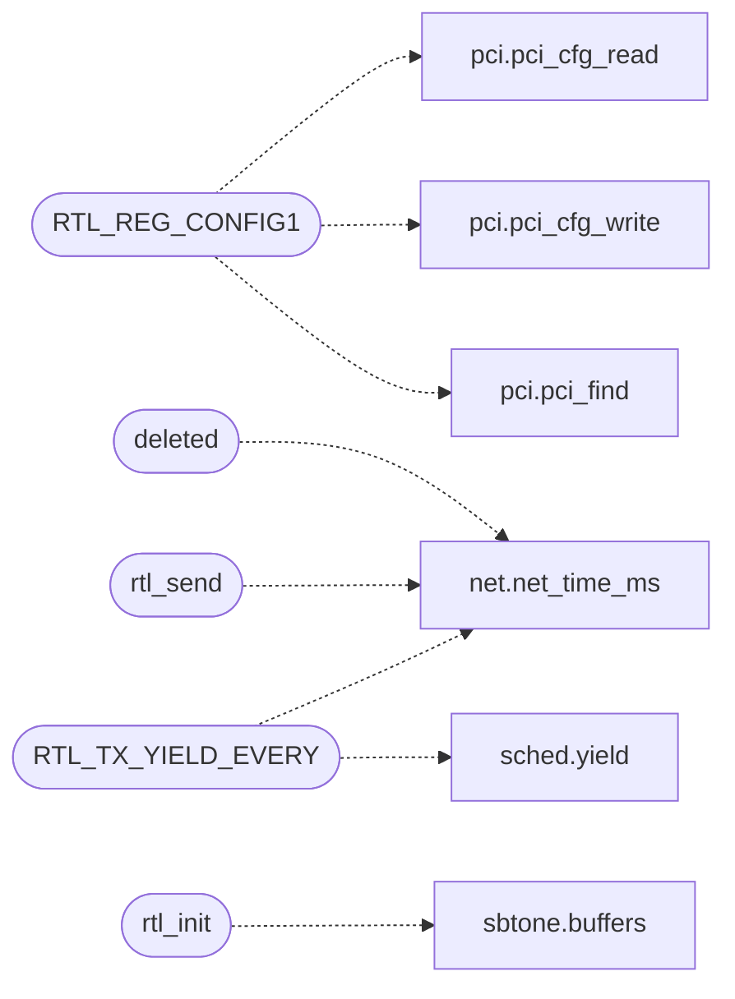

# `net/rtl8139.c`

> Source: [net/rtl8139.c:1](../../net/rtl8139.c#L1) | language `c` | coverage 42.1% | [API index](../index.md)

## Contents

- **Functions:** [`deleted`](#deleted), [`rtl_present`](#rtl_present), [`rtl_init`](#rtl_init), [`rtl_send`](#rtl_send), [`rtl_get_mac`](#rtl_get_mac), [`rtl_iobase`](#rtl_iobase), [`rtl_counters`](#rtl_counters), [`rtl_poll`](#rtl_poll)
- **Macros:** [`RTL_REG_CR`](#rtl_reg_cr), [`RTL_REG_TSD0`](#rtl_reg_tsd0), [`RTL_REG_TSAD0`](#rtl_reg_tsad0), [`RTL_REG_RBSTART`](#rtl_reg_rbstart), [`RTL_REG_CAPR`](#rtl_reg_capr), [`RTL_REG_CBR`](#rtl_reg_cbr), [`RTL_REG_9346CR`](#rtl_reg_9346cr), [`RTL_REG_CONFIG1`](#rtl_reg_config1), [`RTL_MIN_FRAME`](#rtl_min_frame), [`RTL_TX_YIELD_EVERY`](#rtl_tx_yield_every)

## Call Graph

Solid arrows stay in this module, dashed arrows leave it.



## Functions

<a id="deleted"></a>

### `deleted`

`function` | [net/rtl8139.c:79](../../net/rtl8139.c#L79)

```c
* been deleted (a second base/per-ms pair beside ktime's is a second * clock, and drivers must never calibrate). */ unsigned long net_time_ms(void)
```

**Parameters**

| Name | Type | Default | Description |
|---|---|---|---|
| `calibrate` | `a second base/per-ms pair beside ktime's is a second * clock, and drivers must never` |  |  |

**Returns:** `* been`

*Calls:* [`net_time_ms`](headers.net.h.md#net_time_ms)

---

<a id="rtl_present"></a>

### `rtl_present`

`function` | [net/rtl8139.c:107](../../net/rtl8139.c#L107)

```c
int rtl_present(void)
```

Nonzero when the rtl8139 was found and initialized.

**Returns:** `int`

> **Inherited:** Documentation from [`rtl_present`](#rtl_present) (headers/net/rtl8139.h:18).

---

<a id="rtl_init"></a>

### `rtl_init`

`function` | [net/rtl8139.c:120](../../net/rtl8139.c#L120)

```c
void rtl_init(void)
```

Calibrate the clock, probe the NIC and set up the TX/RX rings.

> **Inherited:** Documentation from [`rtl_init`](#rtl_init) (headers/net/rtl8139.h:21).

*Calls:* [`buffers`](progs.src.sbtone.c.md#buffers)

---

<a id="rtl_send"></a>

### `rtl_send`

`function` | [net/rtl8139.c:177](../../net/rtl8139.c#L177)

```c
int rtl_send(const unsigned char *frame, unsigned len)
```

Transmit one raw Ethernet frame.

Returns 1 on success, 0 on failure (no device, frame too large for a slot, or a TX deadline expiry).

**Parameters**

| Name | Type | Default | Description |
|---|---|---|---|
| `frame` | `unsigned char *` |  |  |
| `len` | `unsigned` |  |  |

**Returns:** `int`

> **Inherited:** Documentation from [`rtl_send`](#rtl_send) (headers/net/rtl8139.h:25).

*Calls:* [`net_time_ms`](headers.net.h.md#net_time_ms)

---

<a id="rtl_get_mac"></a>

### `rtl_get_mac`

`function` | [net/rtl8139.c:205](../../net/rtl8139.c#L205)

```c
void rtl_get_mac(unsigned char out[NET_ETH_ALEN])
```

Copy the NIC MAC into out (NET_ETH_ALEN bytes).

**Parameters**

| Name | Type | Default | Description |
|---|---|---|---|
| `NET_ETH_ALEN` | `unsigned char out[ ]` |  |  |

> **Inherited:** Documentation from [`rtl_get_mac`](#rtl_get_mac) (headers/net/rtl8139.h:32).

---

<a id="rtl_iobase"></a>

### `rtl_iobase`

`function` | [net/rtl8139.c:210](../../net/rtl8139.c#L210)

```c
unsigned short rtl_iobase(void)
```

The NIC I/O base, or 0 when the device is absent.

**Returns:** `unsigned short`

> **Inherited:** Documentation from [`rtl_iobase`](#rtl_iobase) (headers/net/rtl8139.h:35).

---

<a id="rtl_counters"></a>

### `rtl_counters`

`function` | [net/rtl8139.c:214](../../net/rtl8139.c#L214)

```c
void rtl_counters(unsigned int *tx_frames, unsigned int *rx_frames)
```

Frame-level TX/RX counters (bytes are protocol counters in net.c).

**Parameters**

| Name | Type | Default | Description |
|---|---|---|---|
| `tx_frames` | `unsigned int *` |  |  |
| `rx_frames` | `unsigned int *` |  |  |

> **Inherited:** Documentation from [`rtl_counters`](#rtl_counters) (headers/net/rtl8139.h:38).

---

<a id="rtl_poll"></a>

### `rtl_poll`

`function` | [net/rtl8139.c:238](../../net/rtl8139.c#L238)

```c
void rtl_poll(void)
```

---

## Macros

<a id="rtl_reg_cr"></a>

### `RTL_REG_CR`

`macro` | [net/rtl8139.c:46](../../net/rtl8139.c#L46)

```c
#define RTL_REG_CR
```

---

<a id="rtl_reg_tsd0"></a>

### `RTL_REG_TSD0`

`macro` | [net/rtl8139.c:47](../../net/rtl8139.c#L47)

```c
#define RTL_REG_TSD0
```

---

<a id="rtl_reg_tsad0"></a>

### `RTL_REG_TSAD0`

`macro` | [net/rtl8139.c:48](../../net/rtl8139.c#L48)

```c
#define RTL_REG_TSAD0
```

---

<a id="rtl_reg_rbstart"></a>

### `RTL_REG_RBSTART`

`macro` | [net/rtl8139.c:49](../../net/rtl8139.c#L49)

```c
#define RTL_REG_RBSTART
```

---

<a id="rtl_reg_capr"></a>

### `RTL_REG_CAPR`

`macro` | [net/rtl8139.c:50](../../net/rtl8139.c#L50)

```c
#define RTL_REG_CAPR
```

---

<a id="rtl_reg_cbr"></a>

### `RTL_REG_CBR`

`macro` | [net/rtl8139.c:51](../../net/rtl8139.c#L51)

```c
#define RTL_REG_CBR
```

---

<a id="rtl_reg_9346cr"></a>

### `RTL_REG_9346CR`

`macro` | [net/rtl8139.c:52](../../net/rtl8139.c#L52)

```c
#define RTL_REG_9346CR
```

---

<a id="rtl_reg_config1"></a>

### `RTL_REG_CONFIG1`

`macro` | [net/rtl8139.c:53](../../net/rtl8139.c#L53)

```c
#define RTL_REG_CONFIG1
```

*Calls:* [`pci_cfg_read`](headers.drivers.pci.h.md#pci_cfg_read), [`pci_cfg_write`](headers.drivers.pci.h.md#pci_cfg_write), [`pci_find`](headers.drivers.pci.h.md#pci_find)

---

<a id="rtl_min_frame"></a>

### `RTL_MIN_FRAME`

`macro` | [net/rtl8139.c:99](../../net/rtl8139.c#L99)

```c
#define RTL_MIN_FRAME
```

Ethernet minimum frame without FCS: shorter frames are zero padded.

---

<a id="rtl_tx_yield_every"></a>

### `RTL_TX_YIELD_EVERY`

`macro` | [net/rtl8139.c:166](../../net/rtl8139.c#L166)

```c
#define RTL_TX_YIELD_EVERY
```

Cooperative TX wait: the NIC owns no interrupt line in this build, so completion is polled, but a congested descriptor must not spin the CPU away from every other thread.

The wait yields every RTL_TX_YIELD_EVERY spins and stays deadline-bounded (fail closed with 0 past the deadline, exactly like the old busy-wait).

*Calls:* [`net_time_ms`](headers.net.h.md#net_time_ms), [`yield`](headers.sched.h.md#yield)

---
