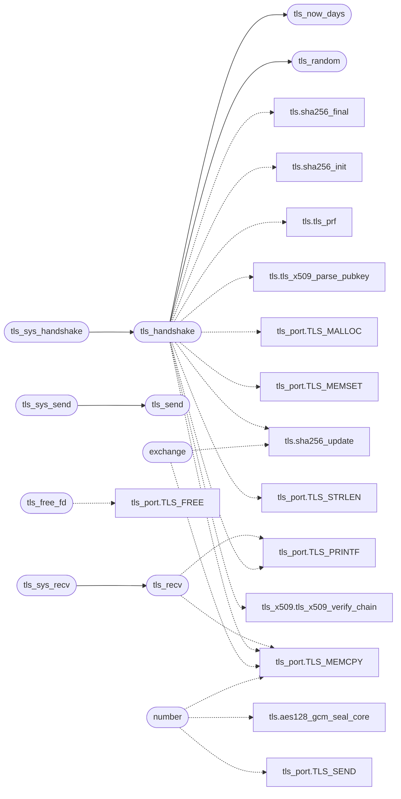

# `net/tls.c`

> Source: [net/tls.c:1](../../net/tls.c#L1) | language `c` | coverage 50.0% | [API index](../index.md)

tls.c - TLS 1.2 client sessions for MiniOS.

## Contents

- **Functions:** [`tls_free_fd`](#tls_free_fd), [`number`](#number), [`exchange`](#exchange), [`tls_handshake`](#tls_handshake), [`tls_send`](#tls_send), [`tls_recv`](#tls_recv), [`tls_sys_handshake`](#tls_sys_handshake), [`tls_sys_send`](#tls_sys_send), [`tls_sys_recv`](#tls_sys_recv), [`tls_random`](#tls_random), [`tls_now_days`](#tls_now_days)

## Call Graph

Solid arrows stay in this module, dashed arrows leave it.



## Functions

<a id="tls_free_fd"></a>

### `tls_free_fd`

`function` | [net/tls.c:40](../../net/tls.c#L40)

```c
void tls_free_fd(int fd)
```

TLS sessions attached to socket fds (tls.c); net_sys_close frees them.

With MINIOS_NO_TLS the engine is unlinked and tls.h carries the inline * no-op; this declaration would collide with it, so it is omitted. ifndef MINIOS_NO_TLS

**Parameters**

| Name | Type | Default | Description |
|---|---|---|---|
| `fd` | `int` |  |  |

> **Inherited:** Documentation from [`tls_free_fd`](#tls_free_fd) (headers/net.h:170).

*Calls:* [`TLS_FREE`](headers.tls_port.h.md#tls_free)

---

<a id="number"></a>

### `number`

`function` | [net/tls.c:64](../../net/tls.c#L64)

```c
* The nonce_explicit is the sequence number (RFC 5288 allows it and * OpenSSL uses it);
```

**Parameters**

| Name | Type | Default | Description |
|---|---|---|---|
| `it` | `RFC 5288 allows it and * OpenSSL uses` |  |  |

**Returns:** `* The nonce_explicit is the sequence`

*Calls:* [`aes128_gcm_seal_core`](headers.tls.h.md#aes128_gcm_seal_core), [`TLS_MEMCPY`](headers.tls_port.h.md#tls_memcpy), [`TLS_SEND`](headers.tls_port.h.md#tls_send)

---

<a id="exchange"></a>

### `exchange`

`function` | [net/tls.c:173](../../net/tls.c#L173)

```c
* key exchange (ClientHello, ClientKeyExchange) go out in plaintext * records, as TLS 1.2 requir...
```

**Returns:** `* key`

*Calls:* [`sha256_update`](headers.tls.h.md#sha256_update), [`TLS_MEMCPY`](headers.tls_port.h.md#tls_memcpy)

---

<a id="tls_handshake"></a>

### `tls_handshake`

`function` | [net/tls.c:466](../../net/tls.c#L466)

```c
int tls_handshake(int fd, const char *host)
```

Blocking TLS 1.2 handshake over an open TCP socket (net fd index). host is the SNI + certificate hostname.

Returns 0 on success, -1 with a diagnostic on the console. The session lives on the kernel heap.

**Parameters**

| Name | Type | Default | Description |
|---|---|---|---|
| `fd` | `int` |  |  |
| `host` | `char *` |  |  |

**Returns:** `int`

> **Inherited:** Documentation from [`tls_handshake`](#tls_handshake) (headers/tls.h:277).

*Calls:* [`sha256_final`](headers.tls.h.md#sha256_final), [`sha256_init`](headers.tls.h.md#sha256_init), [`sha256_update`](headers.tls.h.md#sha256_update), [`tls_prf`](headers.tls.h.md#tls_prf), [`tls_x509_parse_pubkey`](headers.tls.h.md#tls_x509_parse_pubkey), [`TLS_MALLOC`](headers.tls_port.h.md#tls_malloc), [`TLS_MEMCPY`](headers.tls_port.h.md#tls_memcpy), [`TLS_MEMSET`](headers.tls_port.h.md#tls_memset), [`TLS_PRINTF`](headers.tls_port.h.md#tls_printf), [`TLS_STRLEN`](headers.tls_port.h.md#tls_strlen), [`tls_now_days`](#tls_now_days), [`tls_random`](#tls_random) and 1 more

*Called by:* [`tls_sys_handshake`](#tls_sys_handshake)

---

<a id="tls_send"></a>

### `tls_send`

`function` | [net/tls.c:687](../../net/tls.c#L687)

```c
int tls_send(int fd, const char *buf, int len)
```

Send len plaintext bytes as one TLS record.

All-or-error.

**Parameters**

| Name | Type | Default | Description |
|---|---|---|---|
| `fd` | `int` |  |  |
| `buf` | `char *` |  |  |
| `len` | `int` |  |  |

**Returns:** `int`

> **Inherited:** Documentation from [`tls_send`](#tls_send) (headers/tls.h:280).

*Called by:* [`tls_sys_send`](#tls_sys_send)

---

<a id="tls_recv"></a>

### `tls_recv`

`function` | [net/tls.c:696](../../net/tls.c#L696)

```c
int tls_recv(int fd, char *buf, int len)
```

Receive decrypted application bytes.

0 = clean EOF (close_notify or FIN at a record boundary); -1 = protocol error / truncation (diagnostic).

**Parameters**

| Name | Type | Default | Description |
|---|---|---|---|
| `fd` | `int` |  |  |
| `buf` | `char *` |  |  |
| `len` | `int` |  |  |

**Returns:** `int`

> **Inherited:** Documentation from [`tls_recv`](#tls_recv) (headers/tls.h:284).

*Calls:* [`TLS_MEMCPY`](headers.tls_port.h.md#tls_memcpy), [`TLS_PRINTF`](headers.tls_port.h.md#tls_printf)

*Called by:* [`tls_sys_recv`](#tls_sys_recv)

---

<a id="tls_sys_handshake"></a>

### `tls_sys_handshake`

`function` | [net/tls.c:772](../../net/tls.c#L772)

```c
long tls_sys_handshake(long fd, long host)
```

if !defined(TLS_TEST) && !defined(TLS_RING3)

**Parameters**

| Name | Type | Default | Description |
|---|---|---|---|
| `fd` | `long` |  |  |
| `host` | `long` |  |  |

**Returns:** `long`

*Calls:* [`tls_handshake`](#tls_handshake)

---

<a id="tls_sys_send"></a>

### `tls_sys_send`

`function` | [net/tls.c:777](../../net/tls.c#L777)

```c
long tls_sys_send(long fd, long buf, long len)
```

**Parameters**

| Name | Type | Default | Description |
|---|---|---|---|
| `fd` | `long` |  |  |
| `buf` | `long` |  |  |
| `len` | `long` |  |  |

**Returns:** `long`

*Calls:* [`tls_send`](#tls_send)

---

<a id="tls_sys_recv"></a>

### `tls_sys_recv`

`function` | [net/tls.c:782](../../net/tls.c#L782)

```c
long tls_sys_recv(long fd, long buf, long len)
```

**Parameters**

| Name | Type | Default | Description |
|---|---|---|---|
| `fd` | `long` |  |  |
| `buf` | `long` |  |  |
| `len` | `long` |  |  |

**Returns:** `long`

*Calls:* [`tls_recv`](#tls_recv)

---

<a id="tls_random"></a>

### `tls_random`

`function` | [net/tls.c:795](../../net/tls.c#L795)

```c
void tls_random(unsigned char *out, unsigned len)
```

**Parameters**

| Name | Type | Default | Description |
|---|---|---|---|
| `out` | `unsigned char *` |  |  |
| `len` | `unsigned` |  |  |

*Calls:* [`net_time_ms`](headers.net.h.md#net_time_ms)

*Called by:* [`tls_handshake`](#tls_handshake)

---

<a id="tls_now_days"></a>

### `tls_now_days`

`function` | [net/tls.c:826](../../net/tls.c#L826)

```c
long tls_now_days(void)
```

**Returns:** `long`

*Called by:* [`tls_handshake`](#tls_handshake)

---
