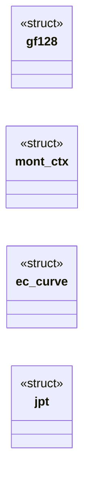
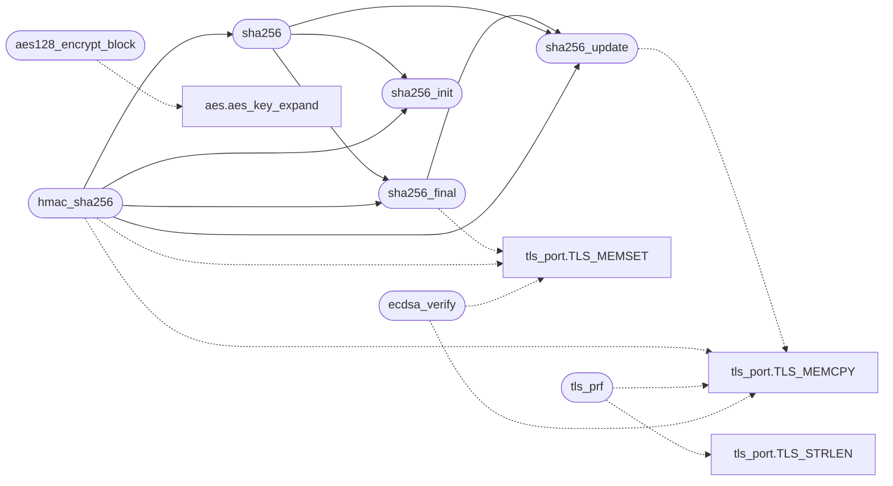

# `net/tls_crypto.c`

> Source: [net/tls_crypto.c:1](../../net/tls_crypto.c#L1) | language `c` | coverage 42.9% | [API index](../index.md)

tls_crypto.c - the crypto behind the kernel TLS 1.2 client.

## Contents

- **Structs:** [`gf128`](#gf128), [`mont_ctx`](#mont_ctx), [`ec_curve`](#ec_curve), [`jpt`](#jpt)
- **Functions:** [`sha256_init`](#sha256_init), [`sha256_update`](#sha256_update), [`sha256_final`](#sha256_final), [`sha256`](#sha256), [`hmac_sha256`](#hmac_sha256), [`tls_prf`](#tls_prf), [`aes128_encrypt_block`](#aes128_encrypt_block), [`word`](#word), [`aes128_gcm_seal`](#aes128_gcm_seal), [`aes128_gcm_open`](#aes128_gcm_open), [`aes128_gcm_seal_core`](#aes128_gcm_seal_core), [`aes128_gcm_open_core`](#aes128_gcm_open_core), [`p256_scalar_mult`](#p256_scalar_mult), [`p384_scalar_mult`](#p384_scalar_mult), [`p256_ecdh`](#p256_ecdh), [`ecdsa_verify`](#ecdsa_verify), [`rsa_pkcs1_verify_sha256`](#rsa_pkcs1_verify_sha256), [`rsa_pkcs1_verify_sha384`](#rsa_pkcs1_verify_sha384), [`sha384`](#sha384), [`p256_point_valid`](#p256_point_valid), [`p256_pub`](#p256_pub), [`p256_scalar_valid`](#p256_scalar_valid)
- **Macros:** [`TLS_BN_WORDS`](#tls_bn_words)

## Type Diagram



## Call Graph

Solid arrows stay in this module, dashed arrows leave it.



## Structs

<a id="gf128"></a>

### `gf128`

`struct` | [net/tls_crypto.c:316](../../net/tls_crypto.c#L316)

```c
typedef struct
```

---

<a id="mont_ctx"></a>

### `mont_ctx`

`struct` | [net/tls_crypto.c:655](../../net/tls_crypto.c#L655)

```c
struct mont_ctx
```

---

<a id="ec_curve"></a>

### `ec_curve`

`struct` | [net/tls_crypto.c:838](../../net/tls_crypto.c#L838)

```c
struct ec_curve
```

---

<a id="jpt"></a>

### `jpt`

`struct` | [net/tls_crypto.c:859](../../net/tls_crypto.c#L859)

```c
struct jpt
```

Jacobian point: three coordinates in Montgomery domain, nw words each.

The point at infinity has Z = 0.

---

## Functions

<a id="sha256_init"></a>

### `sha256_init`

`function` | [net/tls_crypto.c:37](../../net/tls_crypto.c#L37)

```c
void sha256_init(struct sha256_ctx *c)
```

**Parameters**

| Name | Type | Default | Description |
|---|---|---|---|
| `c` | `struct sha256_ctx *` |  |  |

*Called by:* [`hmac_sha256`](#hmac_sha256), [`sha256`](#sha256)

---

<a id="sha256_update"></a>

### `sha256_update`

`function` | [net/tls_crypto.c:80](../../net/tls_crypto.c#L80)

```c
void sha256_update(struct sha256_ctx *c, const unsigned char *data, unsigned len)
```

**Parameters**

| Name | Type | Default | Description |
|---|---|---|---|
| `c` | `struct sha256_ctx *` |  |  |
| `data` | `unsigned char *` |  |  |
| `len` | `unsigned` |  |  |

*Calls:* [`TLS_MEMCPY`](headers.tls_port.h.md#tls_memcpy)

*Called by:* [`hmac_sha256`](#hmac_sha256), [`sha256`](#sha256), [`sha256_final`](#sha256_final)

---

<a id="sha256_final"></a>

### `sha256_final`

`function` | [net/tls_crypto.c:105](../../net/tls_crypto.c#L105)

```c
void sha256_final(struct sha256_ctx *c, unsigned char out[32])
```

**Parameters**

| Name | Type | Default | Description |
|---|---|---|---|
| `c` | `struct sha256_ctx *` |  |  |
| `out` | `unsigned char [32]` |  |  |

*Calls:* [`TLS_MEMSET`](headers.tls_port.h.md#tls_memset), [`sha256_update`](#sha256_update)

*Called by:* [`hmac_sha256`](#hmac_sha256), [`sha256`](#sha256)

---

<a id="sha256"></a>

### `sha256`

`function` | [net/tls_crypto.c:126](../../net/tls_crypto.c#L126)

```c
void sha256(const unsigned char *data, unsigned len, unsigned char out[32])
```

**Parameters**

| Name | Type | Default | Description |
|---|---|---|---|
| `data` | `unsigned char *` |  |  |
| `len` | `unsigned` |  |  |
| `out` | `unsigned char [32]` |  |  |

*Calls:* [`sha256_final`](#sha256_final), [`sha256_init`](#sha256_init), [`sha256_update`](#sha256_update)

*Called by:* [`hmac_sha256`](#hmac_sha256)

---

<a id="hmac_sha256"></a>

### `hmac_sha256`

`function` | [net/tls_crypto.c:135](../../net/tls_crypto.c#L135)

```c
void hmac_sha256(const unsigned char *key, unsigned klen, const unsigned char *data, unsigned dlen, unsigned char out[32])
```

**Parameters**

| Name | Type | Default | Description |
|---|---|---|---|
| `key` | `unsigned char *` |  |  |
| `klen` | `unsigned` |  |  |
| `data` | `unsigned char *` |  |  |
| `dlen` | `unsigned` |  |  |
| `out` | `unsigned char [32]` |  |  |

*Calls:* [`TLS_MEMCPY`](headers.tls_port.h.md#tls_memcpy), [`TLS_MEMSET`](headers.tls_port.h.md#tls_memset), [`sha256`](#sha256), [`sha256_final`](#sha256_final), [`sha256_init`](#sha256_init), [`sha256_update`](#sha256_update)

---

<a id="tls_prf"></a>

### `tls_prf`

`function` | [net/tls_crypto.c:188](../../net/tls_crypto.c#L188)

```c
void tls_prf(const unsigned char *secret, unsigned secret_len, const char *label, const unsigned char *seed, unsigned seed_len, unsigned char *out, unsigned out_len)
```

TLS 1.2 PRF with SHA-256

**Parameters**

| Name | Type | Default | Description |
|---|---|---|---|
| `secret` | `unsigned char *` |  |  |
| `secret_len` | `unsigned` |  |  |
| `label` | `char *` |  |  |
| `seed` | `unsigned char *` |  |  |
| `seed_len` | `unsigned` |  |  |
| `out` | `unsigned char *` |  |  |
| `out_len` | `unsigned` |  |  |

> **Inherited:** Documentation from [`tls_prf`](#tls_prf) (headers/tls.h:179).

*Calls:* [`TLS_MEMCPY`](headers.tls_port.h.md#tls_memcpy), [`TLS_STRLEN`](headers.tls_port.h.md#tls_strlen)

---

<a id="aes128_encrypt_block"></a>

### `aes128_encrypt_block`

`function` | [net/tls_crypto.c:263](../../net/tls_crypto.c#L263)

```c
void aes128_encrypt_block(const unsigned char key[16], const unsigned char in[16], unsigned char out[16])
```

AES-128 block cipher (key expansion internal; T-table implementation)

**Parameters**

| Name | Type | Default | Description |
|---|---|---|---|
| `key` | `unsigned char [16]` |  |  |
| `in` | `unsigned char [16]` |  |  |
| `out` | `unsigned char [16]` |  |  |

> **Inherited:** Documentation from [`aes128_encrypt_block`](#aes128_encrypt_block) (headers/tls.h:184).

*Calls:* [`aes_key_expand`](progs.asm.aes.s.md#aes_key_expand)

---

<a id="word"></a>

### `word`

`function` | [net/tls_crypto.c:326](../../net/tls_crypto.c#L326)

```c
* of the low word (hi holds bits 64..127, lo bits 0..63). Masked in, * so the shift never branches on key bits. */ r.hi = (v.hi >> 1) ^ (0xE100000000000000ULL & mask);
```

**Parameters**

| Name | Type | Default | Description |
|---|---|---|---|
| `bits` | `hi holds 64..127` |  |  |
| `bits` | `lo 0..63` |  |  |

**Returns:** `* of the low`

---

<a id="aes128_gcm_seal"></a>

### `aes128_gcm_seal`

`function` | [net/tls_crypto.c:475](../../net/tls_crypto.c#L475)

```c
int aes128_gcm_seal(const unsigned char key[16], const unsigned char salt[4], unsigned long long seq, const unsigned char *aad, unsigned aad_len, const unsigned char *pt, unsigned pt_len, unsigned char *ct, unsigned char tag[16])
```

GCM.

Each call seals one record: tag = 16 bytes appended to ct. Returns 0 on success, -1 on overflow (len > TLS_REC_MAX).

**Parameters**

| Name | Type | Default | Description |
|---|---|---|---|
| `key` | `unsigned char [16]` |  |  |
| `salt` | `unsigned char [4]` |  |  |
| `seq` | `unsigned long long` |  |  |
| `aad` | `unsigned char *` |  |  |
| `aad_len` | `unsigned` |  |  |
| `pt` | `unsigned char *` |  |  |
| `pt_len` | `unsigned` |  |  |
| `ct` | `unsigned char *` |  |  |
| `tag` | `unsigned char [16]` |  |  |

**Returns:** `int`

> **Inherited:** Documentation from [`aes128_gcm_seal`](#aes128_gcm_seal) (headers/tls.h:189).

---

<a id="aes128_gcm_open"></a>

### `aes128_gcm_open`

`function` | [net/tls_crypto.c:487](../../net/tls_crypto.c#L487)

```c
int aes128_gcm_open(const unsigned char key[16], const unsigned char salt[4], unsigned long long seq, const unsigned char *aad, unsigned aad_len, const unsigned char *ct, unsigned ct_len, const unsigned char tag[16], unsigned char *pt)
```

Returns 0 when the tag verifies, -1 otherwise (constant-time compare).

**Parameters**

| Name | Type | Default | Description |
|---|---|---|---|
| `key` | `unsigned char [16]` |  |  |
| `salt` | `unsigned char [4]` |  |  |
| `seq` | `unsigned long long` |  |  |
| `aad` | `unsigned char *` |  |  |
| `aad_len` | `unsigned` |  |  |
| `ct` | `unsigned char *` |  |  |
| `ct_len` | `unsigned` |  |  |
| `tag` | `unsigned char [16]` |  |  |
| `pt` | `unsigned char *` |  |  |

**Returns:** `int`

> **Inherited:** Documentation from [`aes128_gcm_open`](#aes128_gcm_open) (headers/tls.h:197).

---

<a id="aes128_gcm_seal_core"></a>

### `aes128_gcm_seal_core`

`function` | [net/tls_crypto.c:505](../../net/tls_crypto.c#L505)

```c
int aes128_gcm_seal_core(const unsigned char key[16], const unsigned char nonce[12], const unsigned char *aad, unsigned aad_len, const unsigned char *pt, unsigned pt_len, unsigned char *ct, unsigned char tag[16])
```

Core GCM with an arbitrary 12-byte nonce (the TLS API above is the 4-byte salt + 8-byte sequence special case).

Used by the host tests against the NIST vectors.

**Parameters**

| Name | Type | Default | Description |
|---|---|---|---|
| `key` | `unsigned char [16]` |  |  |
| `nonce` | `unsigned char [12]` |  |  |
| `aad` | `unsigned char *` |  |  |
| `aad_len` | `unsigned` |  |  |
| `pt` | `unsigned char *` |  |  |
| `pt_len` | `unsigned` |  |  |
| `ct` | `unsigned char *` |  |  |
| `tag` | `unsigned char [16]` |  |  |

**Returns:** `int`

> **Inherited:** Documentation from [`aes128_gcm_seal_core`](#aes128_gcm_seal_core) (headers/tls.h:208).

---

<a id="aes128_gcm_open_core"></a>

### `aes128_gcm_open_core`

`function` | [net/tls_crypto.c:516](../../net/tls_crypto.c#L516)

```c
int aes128_gcm_open_core(const unsigned char key[16], const unsigned char nonce[12], const unsigned char *aad, unsigned aad_len, const unsigned char *ct, unsigned ct_len, const unsigned char tag[16], unsigned char *pt)
```

**Parameters**

| Name | Type | Default | Description |
|---|---|---|---|
| `key` | `unsigned char [16]` |  |  |
| `nonce` | `unsigned char [12]` |  |  |
| `aad` | `unsigned char *` |  |  |
| `aad_len` | `unsigned` |  |  |
| `ct` | `unsigned char *` |  |  |
| `ct_len` | `unsigned` |  |  |
| `tag` | `unsigned char [16]` |  |  |
| `pt` | `unsigned char *` |  |  |

**Returns:** `int`

---

<a id="p256_scalar_mult"></a>

### `p256_scalar_mult`

`function` | [net/tls_crypto.c:1088](../../net/tls_crypto.c#L1088)

```c
int p256_scalar_mult(const unsigned char scalar[32], const unsigned char qx[32], const unsigned char qy[32], unsigned char rx[32], unsigned char ry[32])
```

secp256r1 / secp384r1: shared Jacobian point arithmetic over NIST primes. curve: 0 = P-256, 1 = P-384.

**Parameters**

| Name | Type | Default | Description |
|---|---|---|---|
| `scalar` | `unsigned char [32]` |  |  |
| `qx` | `unsigned char [32]` |  |  |
| `qy` | `unsigned char [32]` |  |  |
| `rx` | `unsigned char [32]` |  |  |
| `ry` | `unsigned char [32]` |  |  |

**Returns:** `int`

> **Inherited:** Documentation from [`p256_scalar_mult`](#p256_scalar_mult) (headers/tls.h:222).

---

<a id="p384_scalar_mult"></a>

### `p384_scalar_mult`

`function` | [net/tls_crypto.c:1101](../../net/tls_crypto.c#L1101)

```c
int p384_scalar_mult(const unsigned char scalar[48], const unsigned char qx[48], const unsigned char qy[48], unsigned char rx[48], unsigned char ry[48])
```

**Parameters**

| Name | Type | Default | Description |
|---|---|---|---|
| `scalar` | `unsigned char [48]` |  |  |
| `qx` | `unsigned char [48]` |  |  |
| `qy` | `unsigned char [48]` |  |  |
| `rx` | `unsigned char [48]` |  |  |
| `ry` | `unsigned char [48]` |  |  |

**Returns:** `int`

---

<a id="p256_ecdh"></a>

### `p256_ecdh`

`function` | [net/tls_crypto.c:1114](../../net/tls_crypto.c#L1114)

```c
int p256_ecdh(const unsigned char priv[32], const unsigned char peer_x[32], const unsigned char peer_y[32], unsigned char z[32])
```

ECDH shared secret: Z = priv * peer_pub (P-256).

Returns 0 on success, -1 when the peer point is not on the curve (fail closed).

**Parameters**

| Name | Type | Default | Description |
|---|---|---|---|
| `priv` | `unsigned char [32]` |  |  |
| `peer_x` | `unsigned char [32]` |  |  |
| `peer_y` | `unsigned char [32]` |  |  |
| `z` | `unsigned char [32]` |  |  |

**Returns:** `int`

> **Inherited:** Documentation from [`p256_ecdh`](#p256_ecdh) (headers/tls.h:231).

---

<a id="ecdsa_verify"></a>

### `ecdsa_verify`

`function` | [net/tls_crypto.c:1163](../../net/tls_crypto.c#L1163)

```c
int ecdsa_verify(int curve, const unsigned char pub_x[], const unsigned char pub_y[], const unsigned char digest[], unsigned digest_len, const unsigned char sig[], unsigned sig_len)
```

ECDSA verify over a SHA-256 or SHA-384 digest. curve: 0 = P-256, 1 = P-384.

Returns 0 when the signature verifies.

**Parameters**

| Name | Type | Default | Description |
|---|---|---|---|
| `curve` | `int` |  |  |
| `pub_x` | `unsigned char []` |  |  |
| `pub_y` | `unsigned char []` |  |  |
| `digest` | `unsigned char []` |  |  |
| `digest_len` | `unsigned` |  |  |
| `sig` | `unsigned char []` |  |  |
| `sig_len` | `unsigned` |  |  |

**Returns:** `int`

> **Inherited:** Documentation from [`ecdsa_verify`](#ecdsa_verify) (headers/tls.h:243).

*Calls:* [`TLS_MEMCPY`](headers.tls_port.h.md#tls_memcpy), [`TLS_MEMSET`](headers.tls_port.h.md#tls_memset)

---

<a id="rsa_pkcs1_verify_sha256"></a>

### `rsa_pkcs1_verify_sha256`

`function` | [net/tls_crypto.c:1326](../../net/tls_crypto.c#L1326)

```c
int rsa_pkcs1_verify_sha256(const unsigned char *n, unsigned n_len, const unsigned char *e, unsigned e_len, const unsigned char digest[32], const unsigned char *sig, unsigned sig_len)
```

RSA PKCS#1 v1.5 signature verify with SHA-256. modulus up to 4096 bits. digest is the SHA-256 of the signed data.

Returns 0 on success.

**Parameters**

| Name | Type | Default | Description |
|---|---|---|---|
| `n` | `unsigned char *` |  |  |
| `n_len` | `unsigned` |  |  |
| `e` | `unsigned char *` |  |  |
| `e_len` | `unsigned` |  |  |
| `digest` | `unsigned char [32]` |  |  |
| `sig` | `unsigned char *` |  |  |
| `sig_len` | `unsigned` |  |  |

**Returns:** `int`

> **Inherited:** Documentation from [`rsa_pkcs1_verify_sha256`](#rsa_pkcs1_verify_sha256) (headers/tls.h:249).

---

<a id="rsa_pkcs1_verify_sha384"></a>

### `rsa_pkcs1_verify_sha384`

`function` | [net/tls_crypto.c:1340](../../net/tls_crypto.c#L1340)

```c
int rsa_pkcs1_verify_sha384(const unsigned char *n, unsigned n_len, const unsigned char *e, unsigned e_len, const unsigned char digest[48], const unsigned char *sig, unsigned sig_len)
```

**Parameters**

| Name | Type | Default | Description |
|---|---|---|---|
| `n` | `unsigned char *` |  |  |
| `n_len` | `unsigned` |  |  |
| `e` | `unsigned char *` |  |  |
| `e_len` | `unsigned` |  |  |
| `digest` | `unsigned char [48]` |  |  |
| `sig` | `unsigned char *` |  |  |
| `sig_len` | `unsigned` |  |  |

**Returns:** `int`

---

<a id="sha384"></a>

### `sha384`

`function` | [net/tls_crypto.c:1506](../../net/tls_crypto.c#L1506)

```c
void sha384(const unsigned char *data, unsigned len, unsigned char out[48])
```

**Parameters**

| Name | Type | Default | Description |
|---|---|---|---|
| `data` | `unsigned char *` |  |  |
| `len` | `unsigned` |  |  |
| `out` | `unsigned char [48]` |  |  |

---

<a id="p256_point_valid"></a>

### `p256_point_valid`

`function` | [net/tls_crypto.c:1512](../../net/tls_crypto.c#L1512)

```c
int p256_point_valid(const unsigned char x[32], const unsigned char y[32])
```

P-256 point validation and helpers for the handshake

**Parameters**

| Name | Type | Default | Description |
|---|---|---|---|
| `x` | `unsigned char [32]` |  |  |
| `y` | `unsigned char [32]` |  |  |

**Returns:** `int`

> **Inherited:** Documentation from [`p256_point_valid`](#p256_point_valid) (headers/tls.h:236).

---

<a id="p256_pub"></a>

### `p256_pub`

`function` | [net/tls_crypto.c:1520](../../net/tls_crypto.c#L1520)

```c
int p256_pub(const unsigned char priv[32], unsigned char x[32], unsigned char y[32])
```

**Parameters**

| Name | Type | Default | Description |
|---|---|---|---|
| `priv` | `unsigned char [32]` |  |  |
| `x` | `unsigned char [32]` |  |  |
| `y` | `unsigned char [32]` |  |  |

**Returns:** `int`

---

<a id="p256_scalar_valid"></a>

### `p256_scalar_valid`

`function` | [net/tls_crypto.c:1539](../../net/tls_crypto.c#L1539)

```c
int p256_scalar_valid(const unsigned char scalar[32])
```

**Parameters**

| Name | Type | Default | Description |
|---|---|---|---|
| `scalar` | `unsigned char [32]` |  |  |

**Returns:** `int`

---

## Macros

<a id="tls_bn_words"></a>

### `TLS_BN_WORDS`

`macro` | [net/tls_crypto.c:535](../../net/tls_crypto.c#L535)

```c
#define TLS_BN_WORDS
```

---
