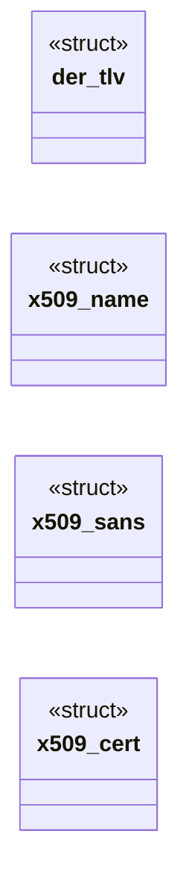
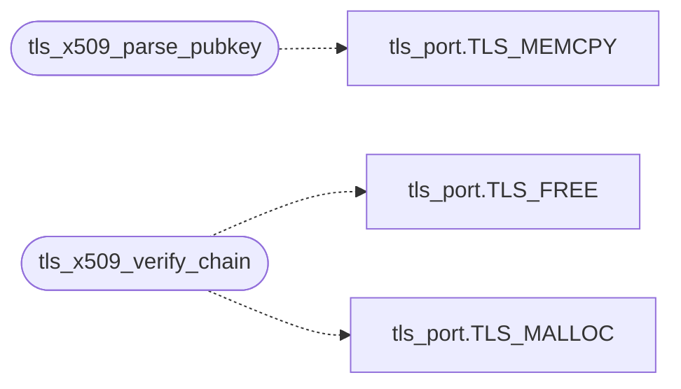

# `net/tls_x509.c`

> Source: [net/tls_x509.c:1](../../net/tls_x509.c#L1) | language `c` | coverage 37.5% | [API index](../index.md)

tls_x509.c - minimal X.509 DER parsing and chain verification.

## Contents

- **Structs:** [`der_tlv`](#der_tlv), [`x509_name`](#x509_name), [`x509_sans`](#x509_sans), [`x509_cert`](#x509_cert)
- **Functions:** [`tls_x509_parse_pubkey`](#tls_x509_parse_pubkey), [`tls_x509_verify_chain`](#tls_x509_verify_chain)
- **Macros:** [`TLS_SAN_MAX`](#tls_san_max)

## Type Diagram



## Call Graph

Solid arrows stay in this module, dashed arrows leave it.



## Structs

<a id="der_tlv"></a>

### `der_tlv`

`struct` | [net/tls_x509.c:43](../../net/tls_x509.c#L43)

```c
struct der_tlv
```

---

<a id="x509_name"></a>

### `x509_name`

`struct` | [net/tls_x509.c:129](../../net/tls_x509.c#L129)

```c
struct x509_name
```

---

<a id="x509_sans"></a>

### `x509_sans`

`struct` | [net/tls_x509.c:172](../../net/tls_x509.c#L172)

```c
struct x509_sans
```

---

<a id="x509_cert"></a>

### `x509_cert`

`struct` | [net/tls_x509.c:265](../../net/tls_x509.c#L265)

```c
struct x509_cert
```

---

## Functions

<a id="tls_x509_parse_pubkey"></a>

### `tls_x509_parse_pubkey`

`function` | [net/tls_x509.c:452](../../net/tls_x509.c#L452)

```c
int tls_x509_parse_pubkey(const unsigned char *der, unsigned len, struct tls_pubkey *pk)
```

Parse one DER certificate into a public key.

Returns 0 on success.

**Parameters**

| Name | Type | Default | Description |
|---|---|---|---|
| `der` | `unsigned char *` |  |  |
| `len` | `unsigned` |  |  |
| `pk` | `struct tls_pubkey *` |  |  |

**Returns:** `int`

> **Inherited:** Documentation from [`tls_x509_parse_pubkey`](#tls_x509_parse_pubkey) (headers/tls.h:261).

*Calls:* [`TLS_MEMCPY`](headers.tls_port.h.md#tls_memcpy)

---

<a id="tls_x509_verify_chain"></a>

### `tls_x509_verify_chain`

`function` | [net/tls_x509.c:521](../../net/tls_x509.c#L521)

```c
int tls_x509_verify_chain(const unsigned char *chain, unsigned chain_len, unsigned cert_lens[], int n_certs, const char *host, long now_days)
```

**Parameters**

| Name | Type | Default | Description |
|---|---|---|---|
| `chain` | `unsigned char *` |  |  |
| `chain_len` | `unsigned` |  |  |
| `cert_lens` | `unsigned []` |  |  |
| `n_certs` | `int` |  |  |
| `host` | `char *` |  |  |
| `now_days` | `long` |  |  |

**Returns:** `int`

*Calls:* [`TLS_FREE`](headers.tls_port.h.md#tls_free), [`TLS_MALLOC`](headers.tls_port.h.md#tls_malloc)

*Called by:* [`tls_handshake`](net.tls.c.md#tls_handshake)

---

## Macros

<a id="tls_san_max"></a>

### `TLS_SAN_MAX`

`macro` | [net/tls_x509.c:170](../../net/tls_x509.c#L170)

```c
#define TLS_SAN_MAX
```

SAN dNSName walk.

Callback-less: fill the first TLS_SAN_MAX names. Bounded, but generous: real-world leaves carry dozens of dNSName entries (Wikipedia's leaf lists 38), and dropping the matching entry off the tail would fail closed for no security gain.

---
