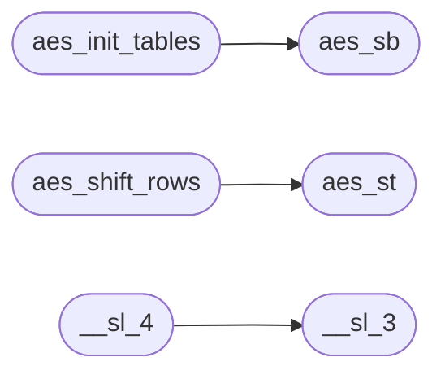

# `progs/asm/aes.s`

> Source: [progs/asm/aes.s:1](../../progs/asm/aes.s#L1) | language `s` | coverage 0.0% | [API index](../index.md)

## Contents

- **Functions:** [`aes_rk`](#aes_rk), [`aes_sb`](#aes_sb), [`aes_rc`](#aes_rc), [`aes_st`](#aes_st), [`aes_iv`](#aes_iv), [`aes_read_all`](#aes_read_all), [`aes_write_all`](#aes_write_all), [`aes_has`](#aes_has), [`hex_val`](#hex_val), [`aes_parse_hex`](#aes_parse_hex), [`aes_gf_mul`](#aes_gf_mul), [`aes_xtime`](#aes_xtime), [`aes_rotl8`](#aes_rotl8), [`aes_init_tables`](#aes_init_tables), [`aes_key_expand`](#aes_key_expand), [`aes_add_round_key`](#aes_add_round_key), [`aes_sub_bytes`](#aes_sub_bytes), [`aes_shift_rows`](#aes_shift_rows), [`aes_mix_columns`](#aes_mix_columns), [`aes_cipher`](#aes_cipher), [`aes_iv_increment`](#aes_iv_increment), [`aes_ctr_crypt`](#aes_ctr_crypt), [`aes_hdr_put`](#aes_hdr_put), [`aes_hdr_get`](#aes_hdr_get), [`aes_tool_name`](#aes_tool_name), [`aes_run`](#aes_run), [`__sl_3`](#__sl_3), [`__sl_4`](#__sl_4), [`main`](#main), [`_start`](#_start)

## Call Graph

Solid arrows stay in this module, dashed arrows leave it.



## Functions

<a id="aes_rk"></a>

### `aes_rk`

`function` | [progs/asm/aes.s:3](../../progs/asm/aes.s#L3)

```asm
aes_rk:
```

---

<a id="aes_sb"></a>

### `aes_sb`

`function` | [progs/asm/aes.s:7](../../progs/asm/aes.s#L7)

```asm
aes_sb:
```

*Called by:* [`aes_init_tables`](#aes_init_tables)

---

<a id="aes_rc"></a>

### `aes_rc`

`function` | [progs/asm/aes.s:11](../../progs/asm/aes.s#L11)

```asm
aes_rc:
```

---

<a id="aes_st"></a>

### `aes_st`

`function` | [progs/asm/aes.s:15](../../progs/asm/aes.s#L15)

```asm
aes_st:
```

*Called by:* [`aes_shift_rows`](#aes_shift_rows)

---

<a id="aes_iv"></a>

### `aes_iv`

`function` | [progs/asm/aes.s:19](../../progs/asm/aes.s#L19)

```asm
aes_iv:
```

---

<a id="aes_read_all"></a>

### `aes_read_all`

`function` | [progs/asm/aes.s:23](../../progs/asm/aes.s#L23)

```asm
aes_read_all:
```

---

<a id="aes_write_all"></a>

### `aes_write_all`

`function` | [progs/asm/aes.s:238](../../progs/asm/aes.s#L238)

```asm
aes_write_all:
```

---

<a id="aes_has"></a>

### `aes_has`

`function` | [progs/asm/aes.s:345](../../progs/asm/aes.s#L345)

```asm
aes_has:
```

*Called by:* [`main`](progs.src.aes.c.md#main)

---

<a id="hex_val"></a>

### `hex_val`

`function` | [progs/asm/aes.s:498](../../progs/asm/aes.s#L498)

```asm
hex_val:
```

---

<a id="aes_parse_hex"></a>

### `aes_parse_hex`

`function` | [progs/asm/aes.s:620](../../progs/asm/aes.s#L620)

```asm
aes_parse_hex:
```

---

<a id="aes_gf_mul"></a>

### `aes_gf_mul`

`function` | [progs/asm/aes.s:783](../../progs/asm/aes.s#L783)

```asm
aes_gf_mul:
```

---

<a id="aes_xtime"></a>

### `aes_xtime`

`function` | [progs/asm/aes.s:884](../../progs/asm/aes.s#L884)

```asm
aes_xtime:
```

---

<a id="aes_rotl8"></a>

### `aes_rotl8`

`function` | [progs/asm/aes.s:933](../../progs/asm/aes.s#L933)

```asm
aes_rotl8:
```

---

<a id="aes_init_tables"></a>

### `aes_init_tables`

`function` | [progs/asm/aes.s:970](../../progs/asm/aes.s#L970)

```asm
aes_init_tables:
```

*Calls:* [`aes_sb`](#aes_sb)

---

<a id="aes_key_expand"></a>

### `aes_key_expand`

`function` | [progs/asm/aes.s:1197](../../progs/asm/aes.s#L1197)

```asm
aes_key_expand:
```

*Called by:* [`aes128_encrypt_block`](net.tls_crypto.c.md#aes128_encrypt_block)

---

<a id="aes_add_round_key"></a>

### `aes_add_round_key`

`function` | [progs/asm/aes.s:1646](../../progs/asm/aes.s#L1646)

```asm
aes_add_round_key:
```

---

<a id="aes_sub_bytes"></a>

### `aes_sub_bytes`

`function` | [progs/asm/aes.s:1721](../../progs/asm/aes.s#L1721)

```asm
aes_sub_bytes:
```

---

<a id="aes_shift_rows"></a>

### `aes_shift_rows`

`function` | [progs/asm/aes.s:1774](../../progs/asm/aes.s#L1774)

```asm
aes_shift_rows:
```

*Calls:* [`aes_st`](#aes_st)

---

<a id="aes_mix_columns"></a>

### `aes_mix_columns`

`function` | [progs/asm/aes.s:1993](../../progs/asm/aes.s#L1993)

```asm
aes_mix_columns:
```

---

<a id="aes_cipher"></a>

### `aes_cipher`

`function` | [progs/asm/aes.s:2466](../../progs/asm/aes.s#L2466)

```asm
aes_cipher:
```

---

<a id="aes_iv_increment"></a>

### `aes_iv_increment`

`function` | [progs/asm/aes.s:2565](../../progs/asm/aes.s#L2565)

```asm
aes_iv_increment:
```

---

<a id="aes_ctr_crypt"></a>

### `aes_ctr_crypt`

`function` | [progs/asm/aes.s:2648](../../progs/asm/aes.s#L2648)

```asm
aes_ctr_crypt:
```

---

<a id="aes_hdr_put"></a>

### `aes_hdr_put`

`function` | [progs/asm/aes.s:2791](../../progs/asm/aes.s#L2791)

```asm
aes_hdr_put:
```

---

<a id="aes_hdr_get"></a>

### `aes_hdr_get`

`function` | [progs/asm/aes.s:2906](../../progs/asm/aes.s#L2906)

```asm
aes_hdr_get:
```

---

<a id="aes_tool_name"></a>

### `aes_tool_name`

`function` | [progs/asm/aes.s:3059](../../progs/asm/aes.s#L3059)

```asm
aes_tool_name:
```

---

<a id="aes_run"></a>

### `aes_run`

`function` | [progs/asm/aes.s:3077](../../progs/asm/aes.s#L3077)

```asm
aes_run:
```

*Called by:* [`main`](progs.src.aes.c.md#main)

---

<a id="__sl_3"></a>

### `__sl_3`

`function` | [progs/asm/aes.s:3087](../../progs/asm/aes.s#L3087)

```asm
__sl_3:
```

*Called by:* [`__sl_4`](#__sl_4)

---

<a id="__sl_4"></a>

### `__sl_4`

`function` | [progs/asm/aes.s:3091](../../progs/asm/aes.s#L3091)

```asm
__sl_4:
```

*Calls:* [`__sl_3`](#__sl_3)

---

<a id="main"></a>

### `main`

`function` | [progs/asm/aes.s:3807](../../progs/asm/aes.s#L3807)

```asm
main:
```

---

<a id="_start"></a>

### `_start`

`function` | [progs/asm/aes.s:4113](../../progs/asm/aes.s#L4113)

```asm
_start:
```

---
